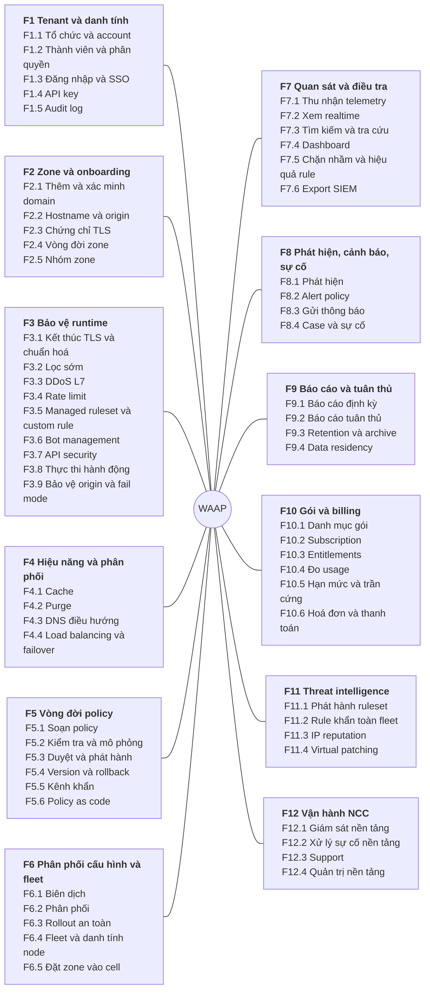
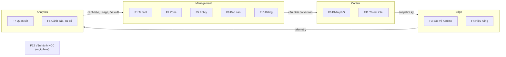

# 1.5 Bản đồ phân rã chức năng

> **Trạng thái: bản nháp chờ review (2026-11-06).** Đây là đầu vào cho [1.6 Requirements](06-requirements.md)
> và cho thiết kế dữ liệu ([5.6](../05-building-blocks/06-data-model.md), [5.8.14](../05-building-blocks/08-components/14-management-database.md)).
> Thiết kế database đã viết trước bản đồ này, nên phải được đối chiếu lại sau khi bản đồ và requirements chốt.

Bản đồ trả lời câu hỏi **hệ thống phải làm những việc gì**, chưa nói làm bằng thành phần nào. Nó phân rã
sản phẩm WAAP theo ba cấp:

| Cấp | Mã | Ý nghĩa | Ví dụ |
|---|---|---|---|
| 1 | `F1`…`F12` | Nhóm chức năng, ứng với một mảng nghiệp vụ | F5 Vòng đời policy |
| 2 | `F5.3` | Chức năng: một việc người dùng hoặc hệ thống nhận ra được | F5.3 Duyệt và phát hành |
| 3 | `F5.3.2` | Chức năng lá: đủ nhỏ để viết requirement và kiểm thử | F5.3.2 Duyệt 4-eyes |

Quy tắc:

- **Mỗi chức năng lá có đúng một plane chủ** (M = Management, C = Control, E = Edge, A = Analytics). Plane
  chủ là nơi giữ quyết định và dữ liệu gốc của chức năng; plane khác chỉ gọi tới hoặc nhận kết quả.
- **Mức** theo [1.2](00-index.md#12-tổng-quan-yêu-cầu): **MVP**, **MR** (Mở rộng), **NC** (Nâng cao).
- Cột **Dữ liệu** ghi đối tượng dữ liệu chính mà chức năng tạo ra hoặc sửa (ghi đậm) hay chỉ đọc. Đây là
  cầu nối sang thiết kế database: một đối tượng không có chức năng nào tạo ra là thừa, một chức năng ghi
  dữ liệu mà không có đối tượng tương ứng là thiếu.
- Persona dùng tên ở [1.4](00-index.md#14-các-bên-liên-quan).

## Tổng quan cấp 1 và cấp 2

Phân bố theo plane chủ:

Một nhóm cấp 1 có thể có lá ở plane khác plane chủ của nhóm. Ví dụ F8.4 Case thuộc Management dù phát
hiện ở Analytics, F10.4 Đo usage đếm ở Edge và gộp ở Analytics. Bảng dưới ghi plane cho từng lá.

## F1 Tenant và danh tính

Ai là khách, ai được làm gì. Persona chính: chủ tài khoản, quản trị bảo mật, DevOps.

| Mã | Chức năng lá | Plane | Mức | Dữ liệu |
|---|---|---|---|---|
| **F1.1** | **Tổ chức và account** | | | |
| F1.1.1 | Đăng ký org mới (self-service) hoặc NCC tạo org (Enterprise) | M | MVP | **Org**, **Account** |
| F1.1.2 | Tạo, đổi tên, đóng account trong org | M | MVP | **Account** |
| F1.1.3 | Chọn region dữ liệu cho account | M | NC | **Account**.region |
| F1.1.4 | Xoá org theo yêu cầu (sau thời hạn giữ dữ liệu) | M | MVP | **Org**, toàn bộ dữ liệu tenant |
| **F1.2** | **Thành viên và phân quyền** | | | |
| F1.2.1 | Mời thành viên qua email, chấp nhận lời mời | M | MVP | **Invitation**, **Member** |
| F1.2.2 | Gán vai trò có sẵn ở cấp org, account, nhóm zone hoặc zone | M | MVP | **RoleBinding** |
| F1.2.3 | Tạo vai trò tuỳ chỉnh từ tập quyền | M | MR | **Role** |
| F1.2.4 | Gỡ thành viên, thu hồi mọi phiên và key của họ | M | MVP | **Member**, Session, **ApiKey** |
| F1.2.5 | Đồng bộ user và nhóm từ IdP qua SCIM | M | MR | **Member**, **Group** |
| **F1.3** | **Đăng nhập và SSO** | | | |
| F1.3.1 | Đăng nhập email + mật khẩu, MFA (TOTP, WebAuthn) | M | MVP | User, **MfaFactor** |
| F1.3.2 | Cấu hình SSO SAML/OIDC theo domain email | M | MVP | **SsoConnection**, **SsoDomain** |
| F1.3.3 | Bắt buộc SSO, bắt buộc MFA theo org | M | MVP | **Org**.securitySettings |
| F1.3.4 | Quản lý phiên: xem, đăng xuất từ xa, hết hạn | M | MVP | Session |
| **F1.4** | **API key** | | | |
| F1.4.1 | Tạo API key có phạm vi (quyền, zone) và ngày hết hạn | M | MVP | **ApiKey** |
| F1.4.2 | Xoay, thu hồi API key; xem lần dùng cuối | M | MVP | **ApiKey**.lastUsedAt |
| F1.4.3 | Service account cho CI/CD, Terraform | M | MVP | **ServiceAccount** |
| **F1.5** | **Audit log** | | | |
| F1.5.1 | Ghi mọi thay đổi: ai, cái gì, trước/sau, lúc nào, từ IP nào, qua UI hay API | M | MVP | **AuditEntry** |
| F1.5.2 | Xem, lọc audit log theo người, đối tượng, thời gian | M | MVP | AuditEntry |
| F1.5.3 | Xuất audit log (CSV, JSON, đẩy sang SIEM) | M | MVP | AuditEntry |

## F2 Zone và onboarding

Đưa một site vào bảo vệ. Persona chính: DevOps, quản trị bảo mật.

| Mã | Chức năng lá | Plane | Mức | Dữ liệu |
|---|---|---|---|---|
| **F2.1** | **Thêm và xác minh domain** | | | |
| F2.1.1 | Thêm zone theo domain gốc; chặn domain đã thuộc tenant khác | M | MVP | **Zone**, **DomainClaim** (toàn cục) |
| F2.1.2 | Xác minh quyền sở hữu qua TXT hoặc CNAME, kiểm lại định kỳ | M | MVP | **DomainVerification** |
| F2.1.3 | Hướng dẫn trỏ DNS (CNAME hoặc đổi nameserver), kiểm trạng thái trỏ | M | MVP | **Zone**.dnsStatus |
| F2.1.4 | Quét bản ghi DNS hiện có khi chuyển nameserver | M | MR | **DnsRecord** |
| **F2.2** | **Hostname và origin** | | | |
| F2.2.1 | Thêm, xoá hostname trong zone; wildcard | M | MVP | **Hostname**, **HostnameClaim** (toàn cục) |
| F2.2.2 | Khai báo origin (IP, hostname, cổng, giao thức, SNI, header host) | M | MVP | **Origin** |
| F2.2.3 | Kiểm tra origin trước khi kích hoạt (kết nối, TLS, thời gian phản hồi) | M | MVP | **OriginCheck** |
| F2.2.4 | Cấu hình timeout, retry, keepalive tới origin | M | MVP | **Origin** |
| F2.2.5 | Chế độ đứng sau CDN của khách (tin IP và header client của CDN đó) | M | MVP | **ZoneSettings** |
| **F2.3** | **Chứng chỉ TLS** | | | |
| F2.3.1 | Cấp cert tự động (ACME) cho hostname đã xác minh | C | MVP | **CertRequest**, Cert (khoá ở secret store) |
| F2.3.2 | Gia hạn tự động, cảnh báo khi gia hạn lỗi | C | MVP | Cert |
| F2.3.3 | Khách tải cert riêng lên | M | MR | **CustomCert** (khoá ở secret store) |
| F2.3.4 | Cấu hình TLS: phiên bản tối thiểu, cipher, HSTS, chế độ TLS tới origin | M | MVP | **ZoneSettings** |
| F2.3.5 | Keyless (khoá ở hạ tầng khách) | E | NC | — |
| **F2.4** | **Vòng đời zone** | | | |
| F2.4.1 | Kích hoạt zone; mặc định bật managed ruleset log-only 7 ngày | M | MVP | **Zone**.status, **PolicyDraft** mặc định |
| F2.4.2 | Tạm dừng zone (chuyển tiếp không bảo vệ), mở lại | M | MVP | **Zone**.status |
| F2.4.3 | Gỡ zone, giải phóng domain và hostname | M | MVP | **Zone**, DomainClaim, HostnameClaim |
| F2.4.4 | Chuyển zone giữa các account cùng org | M | MR | **Zone**.accountId |
| **F2.5** | **Nhóm zone** | | | |
| F2.5.1 | Gắn tag, tạo nhóm zone để phân quyền và áp policy | M | MVP | **ZoneGroup**, **ZoneTag** |
| F2.5.2 | Thao tác hàng loạt trên nhóm zone (bật tính năng, đổi mặc định) | M | MR | **BulkOperation** |

## F3 Bảo vệ runtime

Chạy trên từng request ở edge. Không có UI riêng: cấu hình qua F5, kết quả xem qua F7.

| Mã | Chức năng lá | Plane | Mức | Dữ liệu |
|---|---|---|---|---|
| **F3.1** | **Kết thúc TLS và chuẩn hoá** | | | |
| F3.1.1 | Kết thúc TLS theo SNI, HTTP/1.1, HTTP/2, HTTP/3 | E | MVP | Cert (đọc) |
| F3.1.2 | Xác định zone và hostname của request | E | MVP | Routing index (đọc) |
| F3.1.3 | Gán request ID, chuẩn hoá URI, header, giới hạn kích thước | E | MVP | — |
| F3.1.4 | Nhận diện IP client thật khi đứng sau CDN của khách | E | MVP | ZoneSettings (đọc) |
| **F3.2** | **Lọc sớm** | | | |
| F3.2.1 | Access list IP, CIDR, quốc gia, ASN (allow, block, challenge) | E | MVP | AccessList (đọc) |
| F3.2.2 | Chặn theo IP reputation | E | MR | Reputation feed (đọc) |
| F3.2.3 | Chặn request sai giao thức rõ ràng | E | MVP | — |
| **F3.3** | **DDoS L7** | | | |
| F3.3.1 | Đo traffic theo zone và nguồn, phát hiện đột biến theo baseline | E | MVP | Bộ đếm (bộ nhớ) |
| F3.3.2 | Giảm thiểu tự động theo độ nhạy và hành động khách chọn | E | MVP | DdosSettings (đọc) |
| F3.3.3 | Under Attack mode: challenge mọi request chưa có clearance | E | MVP | ZoneSettings (đọc) |
| F3.3.4 | Chuyển zone bị flood lớn sang cell cách ly | C | MR | **ZonePlacement** |
| F3.3.5 | DDoS L3/L4 qua hạ tầng hoặc đối tác | E | MR | — |
| **F3.4** | **Rate limit** | | | |
| F3.4.1 | Rate limit theo IP, đường dẫn, phương thức, toàn fleet | E | MVP | RateLimitRule (đọc) |
| F3.4.2 | Rate limit theo header, cookie, consumer API, method gRPC | E | MR | RateLimitRule (đọc) |
| **F3.5** | **Managed ruleset và custom rule** | | | |
| F3.5.1 | Kiểm theo CRS và system ruleset, paranoia level, ngưỡng anomaly | E | MVP | RulesetRelease, ManagedRulesetConfig (đọc) |
| F3.5.2 | Kiểm body JSON, XML, multipart, form trong giới hạn kích thước của gói | E | MVP | Entitlements (đọc) |
| F3.5.3 | Đánh giá custom rule theo thứ tự ưu tiên | E | MVP | CustomRule (đọc) |
| F3.5.4 | Áp exception có phạm vi (rule, trường, đường dẫn) | E | MVP | Exception (đọc) |
| F3.5.5 | Kiểm WebSocket (bắt tay; frame ở mức NC), gRPC theo method | E | MR | — |
| **F3.6** | **Bot management** | | | |
| F3.6.1 | Chặn bot xấu rõ ràng, nhận diện bot đã xác minh | E | MVP | Verified bot list (đọc) |
| F3.6.2 | Tính điểm bot và áp policy theo đường dẫn | E | MR | BotPolicy (đọc) |
| F3.6.3 | Chống chiếm tài khoản (credential stuffing) | E | NC | — |
| **F3.7** | **API security** | | | |
| F3.7.1 | Kiểm request theo schema OpenAPI của endpoint | E | MR | ApiSchema (đọc) |
| F3.7.2 | Xác thực JWT (JWKS của khách), mTLS client | E | MR | ApiAuthConfig (đọc) |
| F3.7.3 | Ghi nhận endpoint để discovery | E | MR | Telemetry |
| F3.7.4 | Phát hiện BOLA, dữ liệu nhạy cảm trong response | E | NC | — |
| **F3.8** | **Thực thi hành động** | | | |
| F3.8.1 | Block, challenge (JS, tương tác), log, allow, skip | E | MVP | — |
| F3.8.2 | Trang chặn và trang challenge tuỳ biến theo zone | E | MR | **CustomPage** (đọc) |
| F3.8.3 | Phát security event cho mọi quyết định không phải allow | E | MVP | **SecurityEvent** |
| F3.8.4 | Thực thi trần cứng của gói (chuyển tiếp tối giản, hạ cấp) | E | MVP | Entitlements (đọc) |
| **F3.9** | **Bảo vệ origin và fail mode** | | | |
| F3.9.1 | Fail-open hoặc fail-closed khi tầng WAF không trả lời kịp | E | MVP | ZoneSettings (đọc) |
| F3.9.2 | Xác thực edge với origin (mTLS tới origin, header bí mật) | E | MVP | ZoneSettings (đọc) |
| F3.9.3 | Phục vụ bản cache cũ khi origin lỗi | E | MVP | Cache |

## F4 Hiệu năng và phân phối

| Mã | Chức năng lá | Plane | Mức | Dữ liệu |
|---|---|---|---|---|
| **F4.1** | **Cache** | | | |
| F4.1.1 | Cache theo Cache-Control, stale-if-error | E | MVP | Cache |
| F4.1.2 | Cache rule của khách: cache key, TTL, bỏ qua cache | M | MVP | **CacheRule** |
| F4.1.3 | Tiered cache, origin shield | E | MR | — |
| **F4.2** | **Purge** | | | |
| F4.2.1 | Purge toàn zone, theo URL, theo prefix | M | MVP | **PurgeRequest** |
| F4.2.2 | Purge theo tag | M | MR | **PurgeRequest** |
| **F4.3** | **DNS điều hướng** | | | |
| F4.3.1 | Trả IP PoP gần và khoẻ cho hostname của khách | E | MVP | PoP health (đọc) |
| F4.3.2 | DNS authoritative cho khách: bản ghi proxied, DNSSEC | M | MR | **DnsRecord** |
| **F4.4** | **Load balancing và failover** | | | |
| F4.4.1 | Nhóm origin, health check, chuyển origin khi lỗi | M | MR | **OriginPool**, **HealthCheck** |

## F5 Vòng đời policy

Mọi thay đổi ảnh hưởng tới traffic đi qua nhóm này. Persona chính: quản trị bảo mật, SOC analyst, DevOps.

| Mã | Chức năng lá | Plane | Mức | Dữ liệu |
|---|---|---|---|---|
| **F5.1** | **Soạn policy** | | | |
| F5.1.1 | Soạn custom rule bằng builder hoặc biểu thức text | M | MVP | **CustomRule** (trong **PolicyDraft**) |
| F5.1.2 | Cấu hình managed ruleset: profile, paranoia, ngưỡng, rule tắt | M | MVP | **ManagedRulesetConfig** |
| F5.1.3 | Soạn rate limit rule, access list | M | MVP | **RateLimitRule**, **AccessList** |
| F5.1.4 | Tạo exception có phạm vi, có hạn | M | MVP | **Exception** |
| F5.1.5 | Cấu hình DDoS L7, Under Attack mode, bot, API security của zone | M | MVP | **DdosSettings**, **BotPolicy**, **ApiSchema** |
| F5.1.6 | Bật log-only theo rule hoặc theo zone | M | MVP | thuộc tính của rule, **ZoneSettings** |
| F5.1.7 | Kế thừa policy org → nhóm zone → zone | M | MR | **PolicyTemplate**, **PolicyBinding** |
| F5.1.8 | Duyệt và xác nhận endpoint API từ discovery, tải OpenAPI | M | MR | **ApiEndpoint**, **ApiSchema** |
| **F5.2** | **Kiểm tra và mô phỏng** | | | |
| F5.2.1 | Kiểm cú pháp, kiểu, giới hạn gói ngay khi soạn | M | MVP | — |
| F5.2.2 | Biên dịch thử trước khi gửi duyệt (cùng checker với Control) | C | MVP | **CompileResult** |
| F5.2.3 | Mô phỏng trên traffic lịch sử, báo số request bị ảnh hưởng | A | MR | **ReplayJob**, **ReplayResult** |
| **F5.3** | **Duyệt và phát hành** | | | |
| F5.3.1 | Gửi change request kèm diff và kết quả kiểm tra | M | MVP | **ChangeRequest** |
| F5.3.2 | Duyệt 4-eyes (người duyệt khác người tạo), bật theo account | M | MR | **Approval** |
| F5.3.3 | Khung giờ được phép thay đổi | M | MR | **ChangeWindow** |
| F5.3.4 | Phát hành: tạo PolicyVersion bất biến, gửi sang Control | M | MVP | **PolicyVersion**, Outbox |
| F5.3.5 | Theo dõi trạng thái phát hành tới edge (đã biên dịch, % node đã áp) | C | MVP | **RolloutStatus** |
| **F5.4** | **Version và rollback** | | | |
| F5.4.1 | Xem lịch sử version của zone, ai duyệt, khi nào | M | MVP | PolicyVersion |
| F5.4.2 | So sánh hai version | M | MVP | PolicyVersion |
| F5.4.3 | Rollback một bấm về version bất kỳ còn giữ | M | MVP | **PolicyVersion** (version mới từ nội dung cũ) |
| **F5.5** | **Kênh khẩn** | | | |
| F5.5.1 | Bật Under Attack mode không cần duyệt | M | MVP | **ZoneSettings**, AuditEntry |
| F5.5.2 | Rule tạm có hạn từ case hoặc từ SOC, tự hết hạn | M | MVP | **TemporaryMitigation** |
| **F5.6** | **Policy as code** | | | |
| F5.6.1 | Toàn bộ F5.1–F5.4 qua public API | M | MVP | — |
| F5.6.2 | Terraform provider | M | MR | — |
| F5.6.3 | Đồng bộ từ Git (GitOps) | M | MR | **GitSource** |

## F6 Phân phối cấu hình và fleet

Không có persona khách; NOC/SRE xem và can thiệp.

| Mã | Chức năng lá | Plane | Mức | Dữ liệu |
|---|---|---|---|---|
| **F6.1** | **Biên dịch** | | | |
| F6.1.1 | Biên dịch PolicyVersion và cấu hình zone thành bundle của zone | C | MVP | **ZoneBundle** |
| F6.1.2 | Từ chối bundle vượt ngân sách (kích thước, độ phức tạp) | C | MVP | **CompileResult** |
| F6.1.3 | Ký bundle, dựng manifest | C | MVP | **Manifest** |
| **F6.2** | **Phân phối** | | | |
| F6.2.1 | Đẩy bundle tới PoP store, node nạp khi cần | C | MVP | PoP store |
| F6.2.2 | Đường nhanh cho lớp cấu hình khẩn (Under Attack, rule khẩn, purge) | C | MVP | — |
| F6.2.3 | Node mới hoặc nối lại tự đồng bộ tới manifest mới nhất | E | MVP | — |
| **F6.3** | **Rollout an toàn** | | | |
| F6.3.1 | Canary theo cell, gate theo chỉ số, tự rollback | C | MVP | **Rollout** |
| F6.3.2 | Rollout bản edge và ruleset theo wave | C | MVP | **Rollout** |
| **F6.4** | **Fleet và danh tính node** | | | |
| F6.4.1 | Đăng ký node, cấp cert node 24 giờ, gia hạn tự động | C | MVP | **Node**, **NodeCert** |
| F6.4.2 | Thu hồi node | C | MVP | **NodeDenyList** |
| F6.4.3 | Biết node nào chạy bản edge nào, manifest nào | C | MVP | **Node**.state |
| **F6.5** | **Đặt zone vào cell** | | | |
| F6.5.1 | Chọn pool cell theo gói, chuyển khi đổi gói | C | MVP | **ZonePlacement** |
| F6.5.2 | Cân bằng lại cell, cách ly zone ồn | C | MR | **ZonePlacement** |

## F7 Quan sát và điều tra

Persona chính: SOC analyst, quản trị bảo mật; support của NCC với quyền giới hạn.

| Mã | Chức năng lá | Plane | Mức | Dữ liệu |
|---|---|---|---|---|
| **F7.1** | **Thu nhận telemetry** | | | |
| F7.1.1 | Nhận security event đầy đủ, không mất | A | MVP | **SecurityEvent** |
| F7.1.2 | Nhận access log lấy mẫu theo gói | A | MVP | **AccessLog** |
| F7.1.3 | Nhận mẫu request cho replay (gói cao) | A | MR | **RequestSample** |
| F7.1.4 | Đối soát số bản ghi gửi và nhận | A | MVP | Bộ đếm đối soát |
| **F7.2** | **Xem realtime** | | | |
| F7.2.1 | Luồng security event trực tiếp theo zone | A | MVP | — (live tap) |
| F7.2.2 | Thông báo trong portal (cảnh báo, kết quả phát hành) | A | MVP | — |
| **F7.3** | **Tìm kiếm và tra cứu** | | | |
| F7.3.1 | Tra cứu theo request ID: rule nào, bước nào, version nào | A | MVP | SecurityEvent, AccessLog |
| F7.3.2 | Lọc, nhóm event theo trường, khoảng thời gian | A | MVP | SecurityEvent |
| F7.3.3 | Lưu truy vấn, chia sẻ trong account | M | MVP | **SavedSearch** |
| **F7.4** | **Dashboard** | | | |
| F7.4.1 | Dashboard traffic, bảo mật, cache, origin | A | MVP | Bảng tổng hợp |
| F7.4.2 | Hiệu quả rule: số khớp, hành động, theo thời gian | A | MVP | Bảng tổng hợp |
| F7.4.3 | Phân bố bot, endpoint API | A | MR | Bảng tổng hợp |
| **F7.5** | **Chặn nhầm và hiệu quả rule** | | | |
| F7.5.1 | Đánh dấu một event là chặn nhầm | M | MVP | **FalsePositiveLabel** |
| F7.5.2 | Tỉ lệ chặn nhầm theo rule | A | MVP | Bảng tổng hợp |
| F7.5.3 | Từ event đánh dấu, tạo nháp exception | M | MVP | **Exception** (nháp) |
| **F7.6** | **Export SIEM** | | | |
| F7.6.1 | Cấu hình đích export (Splunk, S3, HTTP, Kafka, syslog) | M | MVP | **ExportDestination** |
| F7.6.2 | Đẩy event liên tục, thử lại, báo đích lỗi | A | MVP | Trạng thái export |

## F8 Phát hiện, cảnh báo, sự cố

| Mã | Chức năng lá | Plane | Mức | Dữ liệu |
|---|---|---|---|---|
| **F8.1** | **Phát hiện** | | | |
| F8.1.1 | Đánh giá alert template (W, D, O, BOT, API) theo cửa sổ | A | MVP | **AlertState** |
| F8.1.2 | Phát hiện bất thường theo baseline | A | NC | Baseline |
| F8.1.3 | Đề xuất mở case và mitigation | A | MR | **CaseProposal** |
| **F8.2** | **Alert policy** | | | |
| F8.2.1 | Tạo alert policy: điều kiện, phạm vi zone, mức | M | MVP | **AlertPolicy** |
| F8.2.2 | Kênh thông báo: email, webhook, Slack, Teams, PagerDuty, SMS | M | MVP | **NotificationChannel** |
| F8.2.3 | Giờ im lặng, chu kỳ lặp, gộp cảnh báo | M | MVP | **AlertPolicy** |
| F8.2.4 | Gửi thử kênh | M | MVP | — |
| **F8.3** | **Gửi thông báo** | | | |
| F8.3.1 | Gửi theo kênh, thử lại, ghi kết quả | A | MVP | **NotificationDelivery** |
| **F8.4** | **Case và sự cố** | | | |
| F8.4.1 | Mở case tay hoặc từ đề xuất | M | MR | **Case** |
| F8.4.2 | Gắn event, truy vấn, mitigation vào case | M | MR | **CaseLink** |
| F8.4.3 | Workflow case: mở → tiếp nhận → giảm thiểu → đóng, người phụ trách, SLA | M | MR | **Case**.status |
| F8.4.4 | Đóng case kèm tóm tắt | M | MR | **Case** |

## F9 Báo cáo và tuân thủ

| Mã | Chức năng lá | Plane | Mức | Dữ liệu |
|---|---|---|---|---|
| **F9.1** | **Báo cáo định kỳ** | | | |
| F9.1.1 | Định nghĩa báo cáo, lịch gửi, người nhận | M | MR | **ReportDefinition** |
| F9.1.2 | Chạy báo cáo, xuất PDF/CSV | M | MR | **ReportRun** |
| **F9.2** | **Báo cáo tuân thủ** | | | |
| F9.2.1 | Báo cáo theo PCI DSS 6.4, SOC 2 (thay đổi, quyền, retention) | M | MR | ReportRun |
| F9.2.2 | Báo cáo SLA của NCC theo zone | A | MR | Bảng tổng hợp |
| **F9.3** | **Retention và archive** | | | |
| F9.3.1 | Giữ log theo thời hạn của gói, xoá khi hết hạn | A | MVP | SecurityEvent, AccessLog |
| F9.3.2 | Archive audit log, không xoá | M | MVP | AuditEntry archive |
| F9.3.3 | Xoá dữ liệu cá nhân theo yêu cầu | M | MVP | Member, User |
| **F9.4** | **Data residency** | | | |
| F9.4.1 | Log của account nằm trong region đã chọn | A | NC | — |
| F9.4.2 | Cấu hình của tenant Enterprise nằm trong region đã chọn | M | NC | Tenant placement |

## F10 Gói và billing

Persona chính: chủ tài khoản, bộ phận tài chính của khách; sales của NCC.

| Mã | Chức năng lá | Plane | Mức | Dữ liệu |
|---|---|---|---|---|
| **F10.1** | **Danh mục gói** | | | |
| F10.1.1 | NCC định nghĩa gói, giá, hạn mức, đơn giá vượt, có version | M | MVP | **Plan**, **PlanVersion**, **Price** |
| F10.1.2 | Gói riêng cho hợp đồng Enterprise | M | MVP | **Plan** (riêng tenant) |
| F10.1.3 | Add-on (zone phụ, tính năng lẻ) | M | MR | **AddOn** |
| **F10.2** | **Subscription** | | | |
| F10.2.1 | Dùng thử 14 ngày, giới hạn số lượt dùng thử mỗi khách | M | MVP | **Subscription**, **TrialClaim** (toàn cục) |
| F10.2.2 | Mua, nâng, hạ gói theo zone hoặc account | M | MVP | **Subscription** |
| F10.2.3 | Quá hạn thanh toán: chuyển tiếp tối giản 30 ngày rồi tạm dừng | M | MVP | **Subscription**.status |
| **F10.3** | **Entitlements** | | | |
| F10.3.1 | Tính entitlements của zone từ gói, add-on, hợp đồng | M | MVP | **Entitlements** |
| F10.3.2 | Phát entitlements mới khi đổi gói, có hiệu lực ≤ 5 phút | M | MVP | Outbox |
| F10.3.3 | Chặn tạo vượt giới hạn gói (số rule, số đích export, …) | M | MVP | Entitlements (đọc) |
| **F10.4** | **Đo usage** | | | |
| F10.4.1 | Đếm băng thông sạch, request theo zone tại edge | E | MVP | Bộ đếm |
| F10.4.2 | Gộp theo giờ, ngày, kỳ; đối soát với node | A | MVP | **UsageCounter** |
| F10.4.3 | Nhận usage vào Management để tính tiền | M | MVP | **UsageDaily** |
| **F10.5** | **Hạn mức và trần cứng** | | | |
| F10.5.1 | Cảnh báo 80% và 100% hạn mức | M | MVP | **QuotaNotice** |
| F10.5.2 | Gói có trần: phát lệnh áp trần khi vượt | M | MVP | **Entitlements**.capState |
| **F10.6** | **Hoá đơn và thanh toán** | | | |
| F10.6.1 | Lập hoá đơn cuối kỳ: phí nền, phí vượt, add-on, thuế | M | MVP | **Invoice**, **InvoiceLine** |
| F10.6.2 | Thanh toán qua cổng, lưu phương thức (token của cổng) | M | MVP | **PaymentMethod**, **Payment** |
| F10.6.3 | Xuất hoá đơn điện tử theo quy định | M | MVP | **Invoice** |
| F10.6.4 | Điều chỉnh, hoàn tiền, ghi có | M | MR | **CreditNote** |

## F11 Threat intelligence

Persona chính: threat research của NCC.

| Mã | Chức năng lá | Plane | Mức | Dữ liệu |
|---|---|---|---|---|
| F11.1.1 | Phát hành system ruleset và bản CRS có version | C | MVP | **RulesetRelease** |
| F11.1.2 | Rollout ruleset theo wave, log-only trước khi chặn | C | MVP | **Rollout** |
| F11.2.1 | Rule khẩn toàn fleet cho CVE mới, ≤ 15 s tới 100% node | C | MVP | **EmergencyRule** |
| F11.3.1 | Nhập và cập nhật feed IP reputation | C | MR | **ReputationFeed** |
| F11.4.1 | Virtual patching theo CVE: gợi ý rule cho zone có công nghệ bị ảnh hưởng | C | MR | **VirtualPatch** |
| F11.4.2 | Tín hiệu chéo tenant ẩn danh | A | NC | — |

## F12 Vận hành NCC

Persona chính: NOC/SRE, support, product. Chi tiết vận hành ở [8.12](../08-cross-cutting/12-platform-monitoring.md),
[8.13](../08-cross-cutting/13-operational-behaviors.md).

| Mã | Chức năng lá | Plane | Mức | Dữ liệu |
|---|---|---|---|---|
| F12.1.1 | Giám sát SLI, probe tổng hợp, lan truyền cấu hình | mọi plane | MVP | Metric |
| F12.1.2 | Giám sát dung lượng PoP, cell, chống noisy neighbor | C | MR | Metric |
| F12.2.1 | Rút PoP khỏi DNS, chuyển traffic | C | MVP | **PopState** |
| F12.2.2 | Đóng băng phát hành toàn fleet | C | MVP | **FleetFreeze** |
| F12.3.1 | Support tra request ID của khách không cần đọc toàn bộ tenant | A | MVP | **SupportAccessGrant** |
| F12.3.2 | Support truy cập tenant khi khách cho phép, có hạn, có audit | M | MVP | **SupportAccessGrant** |
| F12.4.1 | Quản trị org: xem, tạm khoá, mở khoá tenant vi phạm | M | MVP | **Org**.status |
| F12.4.2 | Quản lý danh mục gói, đối tác hạ tầng, PoP | M | MVP | Plan, **Partner**, **Pop** |

## Chức năng ngoài phạm vi

Không nằm trong bản đồ, nhắc lại để không bị thêm vào thiết kế dữ liệu: vulnerability scanning (DAST, sản
phẩm riêng nếu làm), edge compute, tối ưu ảnh, video, client-side protection. Xem [1.2](00-index.md#12-tổng-quan-yêu-cầu).

## Đối chiếu với thiết kế hiện có

| Phát hiện khi phân rã | Ảnh hưởng |
|---|---|
| Có đối tượng dữ liệu chưa có trong [5.8.12](../05-building-blocks/08-components/12-management.md): Invitation, MfaFactor, SsoDomain, ServiceAccount, DomainVerification, OriginCheck, ChangeWindow, TemporaryMitigation, PolicyTemplate/PolicyBinding, GitSource, QuotaNotice, PaymentMethod, Payment, CreditNote, AddOn, TrialClaim, SupportAccessGrant, Partner, Pop | Bổ sung vào module sau khi requirements chốt |
| F1.1.4, F9.3.3 (xoá org, xoá dữ liệu cá nhân) chưa có đường đi trong thiết kế database: audit không xoá nhưng có dữ liệu cá nhân | Câu hỏi mở OQ-6 ở [1.6](06-requirements.md#9-câu-hỏi-mở-cho-review) |
| F2.3, F6.4, F11 có dữ liệu gốc ở Control, không ở Management | Database của Control cần thiết kế riêng, không gộp vào 5.8.14 |
| F12 cần dữ liệu của NCC (Partner, Pop, gói) trong cùng database với tenant | Dùng `PLATFORM_TENANT_ID`, đã ghi ở 5.8.14 §2 |
