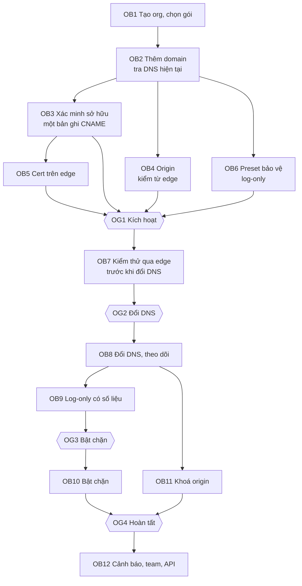

# 1.7.1 Onboarding một website

> **Trạng thái: bản nháp chờ review (2026-11-06).** Các thay đổi kéo theo đã được áp vào 1.5, 1.6, 5.5 và
> được liệt kê ở [§8](#8-thay-đổi-kéo-theo).

## 1. Mục tiêu và định nghĩa "xong"

Onboarding bắt đầu khi khách nhập domain và kết thúc khi website **được bảo vệ thật**. Website được bảo
vệ thật khi đủ cả năm điều kiện sau:

1. Traffic của mọi hostname được chọn đi qua edge (DNS đã trỏ, edge đã thấy request thật).
2. HTTPS hợp lệ trên edge, không có lúc nào người dùng gặp lỗi cert.
3. Managed ruleset và các rule của khách ở chế độ **chặn**, sau một giai đoạn log-only có số liệu.
4. Origin chỉ nhận traffic từ edge. Nếu origin vẫn mở ra Internet thì kẻ tấn công đi vòng qua WAF được.
5. Có người nhận cảnh báo.

Phần lớn sản phẩm WAAP dừng ở điều kiện 1 và gọi đó là "đã onboard". Sản phẩm này coi 3 và 4 là một
phần của onboarding, vì không có chúng thì khách trả tiền mà chưa được bảo vệ.

**Rủi ro lớn nhất của onboarding là làm sập website của khách**, không phải để lọt tấn công. Các rủi ro đó
là:

- Lỗi cert lúc đổi DNS.
- Origin từ chối IP của edge.
- Chặn nhầm ngay ngày đầu.
- Mất IP thật của client.
- Upload hoặc WebSocket bị cắt.

Thứ tự các bước dưới đây được sắp để loại từng rủi ro này **trước khi** traffic thật đi qua edge.

## 2. Tác nhân và biến thể theo phân khúc

| Tác nhân | Làm gì trong onboarding |
|---|---|
| Chủ tài khoản | Tạo org, chọn gói hoặc dùng thử, mời người |
| DevOps / người giữ DNS | Tạo bản ghi xác minh, đổi DNS, mở firewall origin cho edge, khoá origin |
| Quản trị bảo mật | Chọn preset, xem báo cáo log-only, quyết định bật chặn |
| Developer của ứng dụng | Kiểm thử trước khi đổi DNS, báo chỗ bị chặn nhầm |
| Sales, kỹ sư triển khai (NCC) | Dẫn onboarding cho Enterprise |

Một người có thể giữ nhiều vai trò; ở Free và Pro thường chỉ có một người làm tất cả.

| Phân khúc | Cách onboard | Khác biệt |
|---|---|---|
| Free, Pro | Tự phục vụ, wizard | Preset tự chọn theo phát hiện, ít câu hỏi; mục tiêu sẵn sàng đổi DNS trong 15 phút |
| Business | Tự phục vụ, có thể có hỗ trợ | Như trên, thêm nhập nhiều hostname, cert riêng, mời team, API/Terraform ngay từ đầu |
| Enterprise | Dự án có kỹ sư NCC đi kèm, 2–6 tuần | Kickoff và kiểm kê hostname, zone staging trước, khung giờ đổi DNS, cell riêng nếu có, thường có hợp đồng trước dùng thử |

## 3. Khách cần chuẩn bị gì

Portal hiện danh sách này trước bước đầu tiên. Danh sách cũng có trong email chào mừng, vì người tạo org
thường không phải người giữ DNS.

| # | Cần có | Vì sao | Nếu thiếu |
|---|---|---|---|
| CB1 | Quyền sửa DNS của domain (registrar hoặc nhà cung cấp DNS) | Xác minh sở hữu, uỷ quyền cert, đổi DNS | Dừng ở bước xác minh; gửi hướng dẫn cho người giữ DNS (OB3) |
| CB2 | Địa chỉ origin, cổng, giao thức của từng hostname | Edge phải biết gửi traffic về đâu | Hệ thống gợi ý từ DNS hiện tại (OB2) |
| CB3 | Quyền sửa firewall hoặc security group của origin | Mở cho dải IP của edge, sau đó khoá origin | Origin từ chối edge; website lỗi sau khi đổi DNS |
| CB4 | Bản ghi CAA của domain cho phép CA của NCC (nếu domain có CAA) | Không có thì CA từ chối cấp cert | Phát hiện ở OB2, chặn ở OB5 |
| CB5 | Danh sách tính năng đặc biệt của ứng dụng: upload lớn, WebSocket, gRPC, API cho mobile, webhook từ đối tác, IP allowlist ở origin | Đây là các chỗ dễ bị cắt hoặc chặn nhầm | Hỏi trong preset (OB6) và trong checklist kiểm thử (OB7) |
| CB6 | Ứng dụng đọc IP client từ header nào | Sau khi đi qua edge, IP nguồn ở origin là IP của edge | Log và rate limit ở origin sai; hướng dẫn ở OB4 |
| CB7 | Khả năng hạ TTL của bản ghi DNS sẽ đổi, ít nhất 24 giờ trước khi đổi | Đổi nhanh và quay lui nhanh | Quay lui chậm theo TTL cũ |

## 4. Các bước, thứ tự và cổng



Sau OB2 có ba nhánh chạy song song: xác minh và cert (OB3, OB5), origin (OB4), preset (OB6). Khách không
phải chờ một nhánh xong mới làm nhánh khác. Wizard vẫn hiện theo thứ tự trên, nhưng cho nhảy bước.

### Vì sao thứ tự này

| Phải xong trước | Rồi mới | Lý do |
|---|---|---|
| Xác minh sở hữu (OB3) | Cấp cert (OB5), kích hoạt (OG1) | Không cấp cert hay nhận traffic cho domain mà tenant chưa chứng minh sở hữu; chặn chiếm domain của người khác |
| Cert trên edge (OB5) | Đổi DNS (OG2) | Nếu đổi DNS khi chưa có cert, HTTPS lỗi cho mọi người dùng tới khi cert về. Vì vậy cert phải lấy được **trước** khi traffic tới, tức là không dùng HTTP-01 ở lần cấp đầu (xem OB3, OB5) |
| Kiểm origin từ edge (OB4) | Đổi DNS (OG2) | Origin thường có firewall; nếu chưa mở cho edge thì website sập ngay khi đổi |
| Kiểm thử qua edge (OB7) | Đổi DNS (OG2) | Phát hiện chỗ hỏng (upload, WebSocket, chuyển hướng, cookie domain) khi chưa ảnh hưởng người dùng thật |
| Đổi DNS, có traffic thật (OB8) | Bật chặn (OG3) | Không có traffic thật thì không biết rule nào chặn nhầm |
| Log-only đủ lâu (OB9) | Bật chặn (OG3) | Rủi ro R2 (chặn nhầm làm mất niềm tin) |
| Traffic đã đi hết qua edge (OB8) | Khoá origin (OB11) | Khoá sớm thì người dùng còn theo DNS cũ bị cắt |

Có hai thứ **không** chờ log-only. Thứ nhất là chống DDoS L7 và lọc sớm (access list, sai giao thức rõ
ràng): chúng chạy từ request đầu tiên, vì đó là lý do nhiều khách onboard ngay lúc đang bị tấn công. Thứ
hai là trường hợp khách đang bị tấn công: khách chọn "bật chặn ngay" ở OB6, có cảnh báo rõ về rủi ro chặn
nhầm, và bỏ qua OG3.

### Cổng

| Cổng | Điều kiện | Ai mở | Khi không đạt |
|---|---|---|---|
| **OG1 Kích hoạt** (cấu hình của zone được phát xuống edge) | Mọi hostname đã chọn đã xác minh sở hữu; mỗi hostname có cert `issued` (hoặc, với xác minh bằng TXT không uỷ quyền, khách đã tải cert lên hoặc xác nhận chấp nhận khoảng lỗi cert, [OQ-20](#9-câu-hỏi-mở)); mỗi hostname có origin; origin kiểm từ edge đạt, hoặc khách xác nhận bỏ qua; preset đã chọn | Tự động khi đủ điều kiện, hoặc khách bấm | Nút "Kích hoạt" tắt, ghi rõ điều kiện còn thiếu |
| **OG2 Đổi DNS** | Zone đã kích hoạt; khuyến nghị đã kiểm thử qua edge (OB7) và đã hạ TTL | Khách (đổi DNS ở bên ngoài) | Không chặn được, vì DNS là của khách; portal cảnh báo nếu đổi khi OG1 chưa đạt (zone nhận traffic nhưng trả trang "chưa sẵn sàng" thay vì lỗi TLS, xem OB8) |
| **OG3 Bật chặn** | Ít nhất 7 ngày log-only **và** ít nhất 10.000 request thật ([OQ-17](#9-câu-hỏi-mở)); khách đã xem báo cáo log-only | Khách, qua change request (duyệt 4-eyes nếu account bật) | Nhắc mỗi tuần; không tự bật ([OQ-4](../06-requirements.md#9-câu-hỏi-mở-cho-review)) |
| **OG4 Hoàn tất** | Đã bật chặn; origin đã khoá hoặc khách chủ động bỏ qua (ghi audit); có ít nhất một người nhận cảnh báo | Tự động | Zone vẫn chạy bình thường; trạng thái onboarding "chưa hoàn tất" hiện trên danh sách zone |

### Trạng thái

Có hai trục trạng thái độc lập, đừng gộp vào một workflow:

- **`Zone.status`** (5.8.12): `pending → verifying → active ↔ paused → removed`. Đây là vòng đời vận hành:
  zone có đang nhận và xử lý traffic không.
- **Tiến độ onboarding**: mỗi bước OB có trạng thái `todo / in_progress / done / skipped / failed`. Tiến
  độ được tính từ kết quả kiểm (`ZoneCheckResult`, `CertStatusChanged`, traffic thấy được) và hành động
  của khách. Nó không chặn thao tác nào ngoài các cổng.

`Zone.status = active` tương ứng cổng OG1, không phải "đã onboard xong". Một zone `active` có thể chưa
có traffic (chưa đổi DNS) hoặc vẫn đang log-only.

## 5. Chi tiết từng bước

### OB1 Tạo org, chọn gói

| | |
|---|---|
| Đầu vào | Email (đã xác minh), tên tổ chức; gói hoặc dùng thử |
| Xử lý | Tạo org, account mặc định, owner (F1.1.1); dùng thử 14 ngày nếu chưa dùng (BR-8, F10.2.1) |
| Kết quả | Org, Account, Member, Subscription |
| Lỗi thường gặp | Đã dùng thử ở org khác, cùng domain email hoặc thẻ → mua gói hoặc liên hệ sales |
| Plane, dữ liệu | PM1, PM5; Org, Account, Subscription, TrialClaim |

### OB2 Thêm domain, tra DNS hiện tại

| | |
|---|---|
| Đầu vào | Domain gốc (`example.com`), có thể là IDN (`tênmiền.vn`, lưu dạng punycode) |
| Xử lý | 1. Chuẩn hoá, kiểm cú pháp, kiểm domain có thuộc public suffix không (không nhận `com.vn` làm domain gốc). 2. Kiểm claim toàn cục (BR-1); nếu trống, giữ claim ở trạng thái **chờ xác minh**. 3. Control tra DNS hiện tại (F2.1.5): NS, A/AAAA/CNAME của apex và `www`, CAA, TTL. 4. Gợi ý hostname từ DNS và Certificate Transparency (F2.1.6, Mở rộng). 5. Nhận diện CDN hoặc WAF đang đứng trước domain (theo CNAME đích hoặc ASN của IP). 6. Khách chọn hostname cần bảo vệ và phương thức kết nối (§5, OB8). |
| Kết quả | Zone (`pending`), DomainClaim (chờ xác minh), danh sách Hostname đã chọn, DnsSnapshot |
| Lỗi thường gặp | Domain đã thuộc tenant khác → từ chối, không tiết lộ tenant giữ, chỉ đường tranh chấp ([OQ-2](../06-requirements.md#9-câu-hỏi-mở-cho-review)); domain không phân giải → cảnh báo, vẫn cho tiếp (site mới); CAA chặn CA của NCC → báo ngay, hướng dẫn thêm bản ghi CAA |
| Plane, dữ liệu | PM2 (zone, claim), PC6 (tra DNS) qua `ZoneCheckResult` (`dns_discovery`, `caa`) |

### OB3 Xác minh sở hữu

Đề xuất dùng **một bản ghi CNAME cho mỗi hostname**, làm hai việc một lúc:

```text
_acme-challenge.shop.example.com.  CNAME  shop-example-com.<zone_id>.acme.<ncc-domain>.
```

1. **Chứng minh sở hữu**: chỉ người sửa được DNS của domain mới tạo được bản ghi này. Đích chứa
   `zone_id`, nên nó gắn với đúng zone của đúng tenant.
2. **Uỷ quyền DNS-01 lâu dài**: CA tra `_acme-challenge` và đi theo CNAME sang DNS của NCC. Control đặt
   token ở đó và cấp, gia hạn cert **trước khi** traffic tới, không cần hỏi lại khách.

Bản ghi TXT xác minh riêng (cách 5.8.7 đang ghi) vẫn được hỗ trợ cho khách không muốn uỷ quyền. Khi đó cert
đầu phải đợi tới lúc đổi DNS, hoặc khách tải cert lên.

| | |
|---|---|
| Đầu vào | Bản ghi do khách tạo ở DNS của mình |
| Xử lý | Control kiểm từ ≥ 3 resolver ở các mạng khác nhau (chống cache, chống DNS nội bộ của khách). Tần suất kiểm: mỗi phút trong giờ đầu, mỗi 10 phút trong 24 giờ, mỗi giờ tới ngày 14; khách bấm "Kiểm tra lại" bất kỳ lúc nào. Đạt khi đa số resolver thấy đúng đích. |
| Kết quả | DomainVerification `verified`; claim chuyển sang `verified`; Control bắt đầu xin cert |
| Lỗi thường gặp | Khách dán sai (thừa domain gốc ở cuối do giao diện DNS tự thêm, sai dấu chấm cuối) → thông báo nêu đúng giá trị thấy được và giá trị cần có; DNS chưa lan truyền → hiện thời gian kiểm kế tiếp; ở 14 ngày vẫn chưa xác minh → huỷ claim, giải phóng domain (BR-22) |
| Người giữ DNS không phải người đang onboard | Nút "Gửi hướng dẫn": email cho người giữ DNS chứa đúng bản ghi cần tạo, không cần đăng nhập |
| Plane, dữ liệu | PC6 kiểm, gửi `ZoneCheckResult` (`ownership`) về PM2; DomainVerification |

### OB4 Origin

| | |
|---|---|
| Đầu vào | Mỗi hostname: địa chỉ origin (gợi ý từ DnsSnapshot), cổng, giao thức, SNI, Host header |
| Xử lý | Control yêu cầu edge ở ≥ 2 PoP thử kết nối (`OriginProbe`): TCP, TLS (cert của origin có hợp lệ và khớp hostname không), một request `GET /` với Host thật, thời gian theo chặng. Đề xuất chế độ TLS tới origin: `strict` nếu cert của origin hợp lệ, nếu không thì `full` kèm cảnh báo. Hiện dải IP của edge để khách mở firewall. Hướng dẫn ứng dụng đọc IP client từ header của edge (CB6). |
| Kết quả | Origin, OriginCheck theo PoP |
| Lỗi thường gặp | Timeout từ edge nhưng truy cập trực tiếp được → gần như chắc firewall chưa mở cho edge, hiện đúng thông điệp đó; origin trả 301 sang hostname khác → cảnh báo vòng chuyển hướng; cert của origin tự ký → `full` thay vì `strict`; origin là IP nội bộ (RFC 1918) → từ chối, ngoài phạm vi (không có tunnel ở MVP) |
| Plane, dữ liệu | PM2 (khai báo), PC6 điều phối, PE3 thực hiện (`OriginProbe`); `ZoneCheckResult` (`origin`) |

### OB5 Cert trên edge

| | |
|---|---|
| Đầu vào | Hostname đã xác minh |
| Xử lý | Kiểm CAA; xin cert qua DNS-01 (uỷ quyền ở OB3), dự phòng CA thứ hai; một cert cho mỗi hostname hoặc cert chung cho apex và `www` ([OQ-18](#9-câu-hỏi-mở)). Business trở lên có thể tải cert riêng thay thế. |
| Kết quả | Cert `issued`, có trong bundle của zone (tham chiếu cert đã mã hoá) |
| Lỗi thường gặp | CAA chặn; CA giới hạn tần suất; khách xoá bản ghi `_acme-challenge` sau khi xác minh (gia hạn sẽ hỏng, cảnh báo trước hạn ≥ 14 ngày, FR-2-08) |
| Plane, dữ liệu | PC6; `CertStatusChanged` về PM2 |

### OB6 Preset bảo vệ ban đầu

| | |
|---|---|
| Đầu vào | Loại ứng dụng (gợi ý theo phát hiện ở OB2 và câu trả lời CB5): website thông thường, WordPress hoặc CMS phổ biến, cửa hàng trực tuyến, API JSON, SPA kèm API |
| Xử lý | Áp **preset** vào bản nháp policy: managed ruleset ở paranoia phù hợp, **log-only**; exception sẵn có của preset (ví dụ trang quản trị của CMS); DDoS L7 và lọc sớm **bật chặn**; giới hạn body theo gói; cache mặc định chỉ cho tài nguyên tĩnh; bot ở mức chặn bot xấu rõ ràng. Hỏi về upload lớn, WebSocket, gRPC, webhook của đối tác (thêm exception hoặc allowlist). Lựa chọn "đang bị tấn công, bật chặn ngay". |
| Kết quả | PolicyDraft từ preset, phát hành thành PolicyVersion đầu tiên khi qua OG1 |
| Lỗi thường gặp | Chọn sai loại ứng dụng → đổi preset được bất kỳ lúc nào trong giai đoạn log-only |
| Plane, dữ liệu | PM3; ZonePreset (danh mục của NCC), PolicyDraft, PolicyVersion |

### OB7 Kiểm thử qua edge trước khi đổi DNS

| | |
|---|---|
| Đầu vào | Zone đã kích hoạt (OG1) |
| Xử lý | Hai cách để gửi request thật qua edge mà chưa đổi DNS: (1) lệnh `curl --resolve` hoặc dòng `hosts` trỏ hostname thật về IP của edge, portal sinh sẵn; (2) hostname xem trước của NCC (`<zone>.preview.<ncc-domain>`), edge chuyển Host sang hostname thật khi gửi về origin ([OQ-19](#9-câu-hỏi-mở)). Portal hiện luồng event realtime của zone trong lúc kiểm thử. Checklist gợi ý: trang chủ, đăng nhập, upload, thanh toán, API, WebSocket. |
| Kết quả | Kết quả từng mục checklist (khách tự đánh dấu), event log-only đầu tiên |
| Lỗi thường gặp | Cookie gắn domain khác hoặc chuyển hướng tuyệt đối làm trang xem trước hỏng → hướng dẫn dùng cách (1); upload vượt giới hạn body của gói → hiện ngay giới hạn và cách nâng |
| Plane, dữ liệu | PE1 phục vụ, PA4 realtime, PM2 checklist; OnboardingProgress |

### OB8 Đổi DNS và theo dõi

Phương thức kết nối:

| Phương thức | Dùng khi | Khách làm | Mức |
|---|---|---|---|
| **CNAME** | Subdomain (`www`, `shop`, `api`) | `shop.example.com CNAME z<zone_id>.edge.<ncc>` | MVP |
| **Apex qua CNAME flattening / ALIAS** | Domain gốc, nhà cung cấp DNS của khách hỗ trợ ALIAS | Bản ghi ALIAS về hostname edge | MVP |
| **Apex qua A/AAAA tĩnh** | Domain gốc, DNS của khách không có ALIAS | Bản ghi A/AAAA về dải IP ổn định của NCC (mất điều hướng theo địa lý ở tầng DNS) | MVP ([OQ-16](#9-câu-hỏi-mở)) |
| **Đổi nameserver** | Khách chuyển hẳn DNS sang NCC | Đổi NS ở registrar | MR |
| **Đứng sau CDN của khách** | Khách giữ CDN hiện có | Đổi origin của CDN sang hostname edge; cấu hình IP tin cậy (F2.2.5) | MVP |

| | |
|---|---|
| Xử lý | Nhắc hạ TTL ≥ 24 giờ trước. Sau khi khách đổi: Control kiểm trạng thái trỏ từ nhiều resolver (F2.1.7, `dns_routing`); Management hỏi Query API xem edge đã thấy request thật của zone chưa (F2.7.2). Portal hiện "đã trỏ / chưa trỏ / trỏ một phần" theo từng hostname và lượng traffic qua edge. Kế hoạch quay lui hiện sẵn: bản ghi DNS cũ (lưu từ DnsSnapshot) và nút tạm dừng zone (chuyển tiếp không bảo vệ, FR-2-12). |
| Kết quả | Zone có traffic thật; mốc thời gian traffic đầu tiên |
| Lỗi thường gặp | Đổi DNS khi zone chưa kích hoạt → HTTP nhận trang "website đang được thiết lập", HTTPS vẫn lỗi cert vì edge chưa có cert cho hostname (đây là lý do OB5 phải xong trước OG2); portal cảnh báo khách ngay; khách đổi DNS nhưng quên mở firewall origin → 5xx với `status_source = origin_connect`, hiện ngay trên onboarding (8.14); IP client mất ở origin → nhắc lại CB6 |
| Plane, dữ liệu | PC6 (`dns_routing`), PA3 (traffic), PM2; OnboardingProgress |

### OB9 Giai đoạn log-only có số liệu

| | |
|---|---|
| Xử lý | Báo cáo hằng ngày, gửi email và hiện trên portal (F2.7.3): số request **sẽ bị chặn** theo rule, các rule nghi chặn nhầm (khớp nhiều trên người dùng đã đăng nhập, khớp đều đặn trên cùng một đường dẫn, từ IP có điểm bot thấp), đề xuất exception một bấm (F7.5.3). Mức sẵn sàng bật chặn: số ngày, số request, số rule còn nghi chặn nhầm chưa xử lý. |
| Kết quả | Exception, nhãn chặn nhầm (`FalsePositiveLabeled`), mức sẵn sàng |
| Plane, dữ liệu | PA3 tổng hợp, PM3, PM4 |

### OB10 Bật chặn

| | |
|---|---|
| Xử lý | Đề xuất bật chặn theo bậc: các nhóm rule có độ tin cậy cao trước (SQLi, RCE, scanner), nhóm dễ chặn nhầm sau. Mỗi bậc là một change request (F5.3.1), duyệt 4-eyes nếu account bật. Rollback một bấm (F5.4.3). |
| Kết quả | PolicyVersion ở chế độ chặn |
| Plane, dữ liệu | PM3 |

### OB11 Khoá origin

| | |
|---|---|
| Xử lý | Hướng dẫn ba cách, khách chọn một hoặc nhiều: (1) firewall origin chỉ nhận dải IP của edge (NCC công bố danh sách có version và báo trước khi đổi); (2) edge gửi header bí mật và origin kiểm (F3.9.2); (3) mTLS edge → origin (F3.9.2). Control kiểm origin còn lộ không (F2.2.6, `origin_exposure`): thử kết nối origin từ một điểm **không** thuộc edge; vẫn trả lời được nghĩa là chưa khoá. Nhắc rằng IP origin cũ có thể đã lộ qua lịch sử DNS, nên cân nhắc đổi IP origin. |
| Kết quả | ZoneCheckResult `origin_exposure`; cấu hình bí mật hoặc mTLS tới origin |
| Lỗi thường gặp | Khoá firewall khi một phần người dùng còn theo DNS cũ → chỉ gợi ý khoá khi traffic trực tiếp vào origin đã về gần 0 (khách tự xác nhận; hệ thống không thấy traffic đi thẳng vào origin) |
| Plane, dữ liệu | PM2, PC6 (`origin_exposure`) |

### OB12 Hoàn tất

| | |
|---|---|
| Xử lý | Bật alert policy mặc định (tấn công lớn, origin lỗi, cert sắp hết hạn) gửi cho owner; gợi ý mời team, tạo API key hoặc Terraform; nhắc onboard hostname còn lại |
| Kết quả | AlertPolicy mặc định, onboarding `complete` |
| Plane, dữ liệu | PM4, PM1 |

## 6. Trường hợp đặc biệt

| Trường hợp | Xử lý đề xuất |
|---|---|
| Khách onboard **trong lúc đang bị tấn công** | Đường tắt: OB2 → OB3 → OB5 → OG1 với preset "bị tấn công" (Under Attack mode, chặn ngay) → đổi DNS; bỏ OB7, OB9. Mục tiêu sẵn sàng ≤ 10 phút sau khi xác minh. Sau khi hết tấn công, quay lại log-only cho các rule chưa kiểm |
| Chuyển từ WAF hoặc CDN khác | Phát hiện ở OB2; nhắc rằng rule của nhà cung cấp cũ không tự chuyển sang; với zone đứng sau CDN của khách, chọn chế độ F2.2.5 |
| Domain đã ở tenant khác | Từ chối; quy trình tranh chấp do support xử lý bằng bản ghi xác minh mới ([OQ-2](../06-requirements.md#9-câu-hỏi-mở-cho-review)) |
| Nhiều hostname (hàng chục tới hàng nghìn) | Nhập hàng loạt qua CSV hoặc API (F2.2.7); bản ghi uỷ quyền wildcard `_acme-challenge` không có, nên mỗi hostname một bản ghi, hoặc dùng cert wildcard qua uỷ quyền ở cấp domain gốc |
| Wildcard `*.example.com` | Cần cert wildcard, chỉ cấp qua DNS-01, nên bắt buộc uỷ quyền ở OB3 |
| Domain đã có HSTS preload | Bắt buộc có cert trước khi đổi DNS (đã là quy tắc chung); cảnh báo không cho phép bỏ qua OB5 |
| Origin dùng client cert, IP allowlist cho đối tác | Đưa vào exception hoặc access list ở OB6; nhắc rằng IP đối tác giờ được thấy qua header |
| Ứng dụng nội bộ, origin không có IP công cộng | Ngoài phạm vi MVP (cần tunnel từ origin ra edge) |
| Zone staging trước zone thật (Enterprise) | Onboard staging như zone phụ (giá zone phụ), sao chép policy sang zone chính bằng template (F5.1.7) |
| Registrar `.vn` chậm cập nhật | Chỉ ảnh hưởng phương thức đổi nameserver; CNAME không phụ thuộc registrar |
| Khách bỏ dở | Nhắc ở ngày 1, 3, 7 theo bước đang dừng, gửi người phù hợp (người giữ DNS cho OB3, OB8); claim hết hạn ở ngày 14 |

## 7. Mục tiêu thời gian

| Chỉ số | Mục tiêu đề xuất | Đo từ |
|---|---|---|
| Thêm domain tới sẵn sàng đổi DNS (OG1), tự phục vụ | ≤ 15 phút p50, không tính thời gian khách sửa DNS và DNS lan truyền | Thời điểm OB2 đến OG1 |
| Phát hiện bản ghi xác minh | ≤ 2 phút sau khi resolver công cộng thấy bản ghi | `ZoneCheckResult` |
| Cấp cert sau xác minh | ≤ 5 phút p95 (phụ thuộc CA) | `CertStatusChanged` |
| Kích hoạt tới edge sẵn sàng phục vụ | ≤ 30 s (QS-4) | Trạng thái rollout |
| Onboard khi đang bị tấn công | ≤ 10 phút từ xác minh tới chặn được | |
| Tỉ lệ zone hoàn tất onboarding (OG4) trong 30 ngày | Theo dõi, chưa đặt mục tiêu | Chỉ số sản phẩm |

## 8. Thay đổi kéo theo

| Ở đâu | Thay đổi |
|---|---|
| [1.5](../05-functional-decomposition.md) | F2 bổ sung F2.1.5–F2.1.8, F2.2.6, F2.2.7, F2.3.6, nhóm mới F2.6 (cấu hình ban đầu và kiểm thử), F2.7 (chuyển traffic và hoàn tất). Các kiểm qua DNS và kiểm origin chuyển plane chủ từ M sang C: F2.1.2, F2.1.4, F2.2.3. Lý do: domain verifier của cert-service ([5.8.7](../../05-building-blocks/08-components/07-cert-ruleset-release.md)) đã làm việc này làm điều kiện xin cert, và origin phải được kiểm từ edge. PC6 đổi tên thành "Xác minh domain và cert". Thêm LK-27, LK-28 |
| [1.6](../06-requirements.md) | FR-2-17…FR-2-30; BR-22…BR-25; sửa FR-2-02 (kiểm từ nhiều resolver, hết hạn 14 ngày); DT-3 thêm DnsSnapshot, OnboardingProgress, ZonePreset; OQ-16…OQ-19 |
| [5.5](../../05-building-blocks/05-contracts.md) | Thêm `ZoneCheckResult` (LK-28), `OriginProbe` (LK-27) |
| [6.4](../../06-runtime/00-index.md#64-onboarding-một-zone) | Vẽ lại sequence theo các bước trên |

## 9. Câu hỏi mở

| ID | Câu hỏi | Đề xuất |
|---|---|---|
| OQ-16 | Apex không có ALIAS: có cấp dải IP tĩnh (A/AAAA) ngay từ MVP không, khi chưa có anycast? | Có, một dải nhỏ cố định ở mỗi region, chấp nhận mất điều hướng theo địa lý cho apex; khuyến nghị khách chuyển `example.com` → `www` |
| OQ-17 | Điều kiện tối thiểu để bật chặn (số ngày, số request) | 7 ngày và 10.000 request; zone ít traffic hơn thì hiện cảnh báo "chưa đủ số liệu" nhưng vẫn cho bật |
| OQ-18 | Cert theo từng hostname hay một cert gộp nhiều SAN cho cả zone? | Theo hostname (lỗi một hostname không kéo các hostname khác), riêng apex và `www` gộp một cert |
| OQ-19 | Có làm hostname xem trước (`*.preview.<ncc>`) ở MVP không? Nó mở thêm một đường vào origin cần bảo vệ | Không ở MVP, chỉ `curl --resolve` và `hosts`; xem lại khi có phản hồi của khách |
| OQ-20 | Bản ghi TXT (không uỷ quyền) có còn được hỗ trợ không, khi nó làm cert đầu phải chờ tới lúc đổi DNS? | Có, cho khách không chấp nhận uỷ quyền DNS, kèm cảnh báo rõ về khoảng lỗi cert hoặc yêu cầu tải cert lên |
