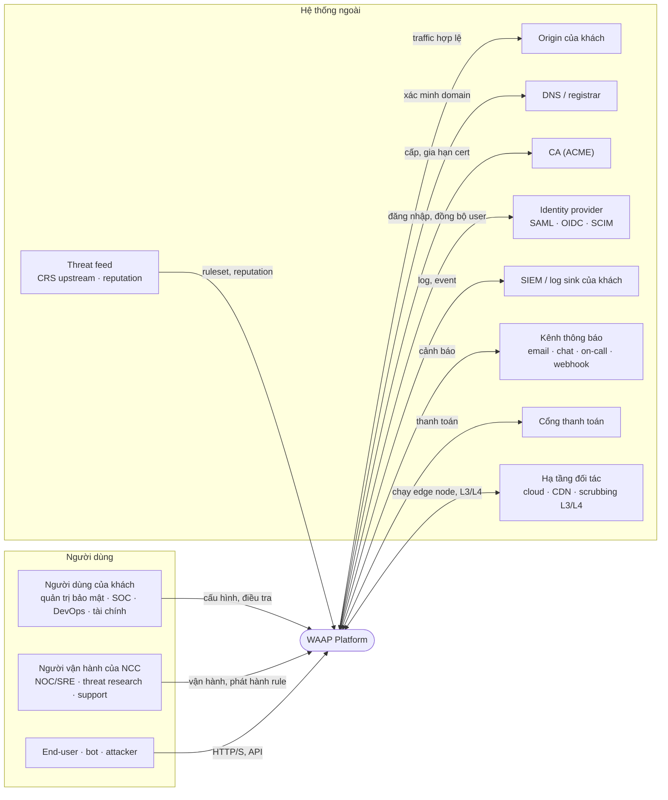

# 3. System Scope and Context

## 3.1 Bối cảnh nghiệp vụ (C4 System Context)

| Đối tác | Vào hệ thống | Ra khỏi hệ thống |
|---|---|---|
| Người dùng của khách | Zone, policy, exception, duyệt thay đổi, truy vấn log | Dashboard, kết quả tra cứu, báo cáo, cảnh báo |
| Người vận hành NCC | System ruleset, rule khẩn, lệnh rollout/rollback | Trạng thái fleet, độ phủ version, sức khoẻ node |
| End-user / bot / attacker | Request HTTP(S) và API | Response của origin, trang chặn có request ID, challenge |
| Origin của khách | Response | Request đã lọc, qua kết nối có xác thực |
| DNS | Bản ghi xác minh, trạng thái CNAME | Truy vấn kiểm tra |
| CA | Chứng chỉ | Yêu cầu cấp/gia hạn qua ACME |
| Identity provider | Danh tính, nhóm (SAML/OIDC), provisioning (SCIM) | Yêu cầu xác thực |
| SIEM của khách | | Security event, access log theo định dạng và đích khách chọn |
| Kênh thông báo | | Cảnh báo, thông báo thay đổi |
| Threat feed | Bản CRS mới, IP reputation | |
| Cổng thanh toán | Trạng thái thanh toán | Hoá đơn, yêu cầu thu |
| Hạ tầng đối tác | Năng lực chạy node, scrubbing L3/L4 | Edge artifact, yêu cầu định tuyến |

## 3.2 Bối cảnh kỹ thuật

| Kênh | Hướng | Đặc điểm cần có |
|---|---|---|
| Traffic khách vào edge | End-user → Edge | Trỏ qua CNAME hoặc anycast; TLS theo SNI; HTTP/1.1, HTTP/2, HTTP/3 |
| Edge → origin | Edge → Origin | TLS, khuyến nghị mTLS hoặc header bí mật; khách chặn mọi IP không phải edge |
| Portal và public API | Người dùng → Management | HTTPS, SSO, API key có phạm vi; cùng mô hình quyền cho UI và API |
| IaC | DevOps → Management | Provider Terraform và GitOps đi qua public API, không có đường riêng |
| ACME | Control ↔ CA | HTTP-01 / DNS-01 / TLS-ALPN-01 |
| Log export | Analytics → SIEM | Đẩy liên tục (HTTP, syslog, object storage); retry, theo dõi độ trễ theo đích |
| Thông báo | Analytics/Management → kênh | Email, chat, on-call, webhook có ký |
| Feed | Feed → Control | Kéo định kỳ, kiểm tra nguồn và chữ ký nếu có, luôn đi qua vòng đời phát hành |
