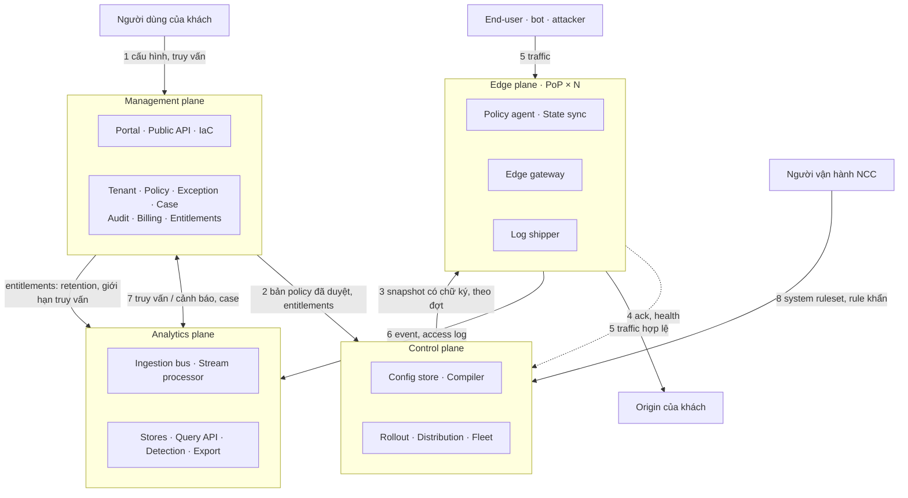

# 5. Building Block View

| File | Nội dung |
|---|---|
| [00-index.md](00-index.md) | Level 1: bốn plane và quan hệ giữa chúng (C4 Container) |
| [01-management-plane.md](01-management-plane.md) | Level 2: bounded context của Management |
| [02-control-plane.md](02-control-plane.md) | Level 2: từ bản đã duyệt tới snapshot trên node |
| [03-edge-plane.md](03-edge-plane.md) | Level 2: bên trong một edge node, pipeline request |
| [04-analytics-plane.md](04-analytics-plane.md) | Level 2: luồng log, store, truy vấn, phát hiện |
| [05-contracts.md](05-contracts.md) | Hợp đồng giữa các plane: thông điệp, đảm bảo giao nhận, version |
| [06-data-model.md](06-data-model.md) | Mô hình dữ liệu logic của Management và mô hình rule |

## Level 1: bốn plane

| Plane | Trách nhiệm | Không làm | Yêu cầu nổi bật |
|---|---|---|---|
| **Management** | Mọi thứ người dùng tạo ra và quản lý: tenant, zone, policy, exception, case, quyền, audit, gói cước | Không giữ log thô; không biết edge node nào tồn tại | Đúng nghiệp vụ, đầy đủ quyền và audit; 99.9% |
| **Control** | Biến bản policy đã duyệt thành snapshot chạy được, đưa an toàn tới từng node, biết node nào chạy gì | Không có UI cho khách; không xử lý traffic | Lan truyền nhanh, không bao giờ đẩy config hỏng ra toàn fleet |
| **Edge** | Xử lý từng request: TLS, kiểm tra, quyết định, proxy; phát log | Không gọi plane khác trên đường request; không hiểu khái niệm nghiệp vụ | Độ trễ thêm thấp, 99.99%, tự chạy khi mất kết nối |
| **Analytics** | Nhận, làm giàu, lưu, truy vấn log; phát hiện và cảnh báo; xuất sang SIEM | Không sửa policy trực tiếp (chỉ gợi ý qua Management) | Không mất log, độ trễ tra cứu thấp, chi phí theo gói |

Quy tắc ranh giới:

- **Edge không có mũi tên nào tới Management.** Edge biết ý định của người dùng chỉ qua Control,
  và mọi thứ người dùng thấy về traffic đi qua Analytics.
- **Không plane nào đọc database của plane khác.** Mọi trao đổi đi qua hợp đồng ở
  [05-contracts.md](05-contracts.md).
- **Analytics không ra lệnh cho edge.** Một phát hiện cần hành động trở thành đề xuất (hoặc hành
  động tự động đã được khách bật trước) đi qua Management, rồi vào vòng đời policy như mọi thay đổi khác.
