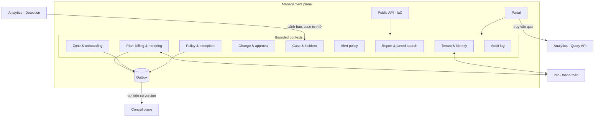

# 5.1 Management plane

Xây trên `metap` ([ADR-0009](../09-adr/0009-metap-for-management-plane-only.md)). Mỗi bounded
context là một nhóm entity, workflow và quyền. Thay đổi cần tới Control đi qua **outbox** trong
cùng transaction với lần ghi, nên không có thay đổi nào "lưu xong nhưng không bao giờ tới edge".

| Context | Giữ gì | Hành vi chính |
|---|---|---|
| **Tenant & identity** | Org, account, user, nhóm, vai trò, API key, cấu hình SSO/SCIM | Phân cấp org → account → zone; quyền RBAC/ABAC theo zone hoặc nhóm zone; API key có phạm vi và hạn |
| **Zone & onboarding** | Zone, hostname, origin, trạng thái xác minh, yêu cầu cert, chế độ fail-open/closed | Thêm domain, xác minh qua DNS, kiểm tra origin, yêu cầu cert; mặc định bật managed ruleset log-only 7 ngày |
| **Policy & exception** | Custom rule (text + AST), rate limit rule, access list, cấu hình managed ruleset (paranoia, ngưỡng anomaly, rule tắt), exception có phạm vi, cấu hình DDoS L7, Under Attack mode | Validate trên AST; mỗi lần lưu tạo bản nháp; bản đã duyệt là **PolicyVersion** bất biến |
| **Change & approval** | Change request, người duyệt, khung giờ thay đổi, kết quả mô phỏng đính kèm | Workflow duyệt 4-eyes (bật theo account); rule khẩn và Under Attack mode đi đường riêng không cần duyệt nhưng vẫn ghi audit |
| **Case & incident** | Case, liên kết tới event/truy vấn, người phụ trách, SLA, mitigation tạm có hạn | Case mở tay hoặc tự mở từ Detection; đóng kèm tóm tắt |
| **Alert policy** | Điều kiện, kênh, người nhận, chu kỳ lặp, giờ im lặng | Phát cấu hình sang Analytics; Analytics đánh giá và gửi |
| **Report & saved search** | Truy vấn đã lưu, định nghĩa báo cáo, lịch gửi | Thực thi qua Query API theo lịch |
| **Plan, billing & metering** | Gói, subscription, **entitlements**, số liệu sử dụng, hoá đơn | Đổi gói phát entitlements mới; nhận số đo sử dụng từ Analytics để tính tiền |
| **Audit log** | Ai đổi gì, lúc nào, từ đâu, qua UI hay API | Chỉ ghi thêm, không xoá, xuất được cho kiểm toán |

Management **không** giữ log thô. Nó chỉ giữ thứ người dùng tạo ra và đọc dữ liệu traffic qua
Query API của Analytics, nơi áp quyền theo tenant.
