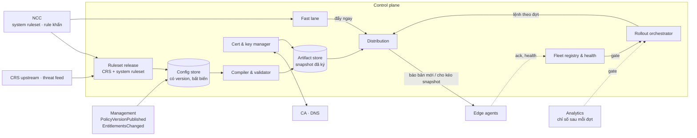

# 5.2 Control plane

Biến ý định thành config chạy được, và chịu trách nhiệm cho câu hỏi "node nào đang chạy version
nào". Không có UI cho khách; người vận hành NCC dùng console riêng.

| Thành phần | Trách nhiệm |
|---|---|
| **Config store** | Nguồn sự thật cho mọi config edge cần: PolicyVersion theo zone, entitlements, bản ruleset, cài đặt toàn cục. Mỗi bản bất biến, có ID và cha. |
| **Ruleset release** | Nhận CRS upstream và system ruleset của NCC, chạy bộ test regression (traffic mẫu tốt và xấu), gắn version, đưa vào config store. CRS mới không bao giờ tự động lên edge. |
| **Compiler & validator** | Dịch AST rule của khách và cấu hình ruleset thành dạng edge thực thi được; kiểm tra an toàn: kích thước, độ phức tạp regex, giới hạn theo entitlements, rule xung đột, schema version edge hỗ trợ. Snapshot không qua validator thì không có. |
| **Artifact store** | Giữ snapshot đã biên dịch và **ký**: một bundle cho mỗi zone, một bundle chung cho ruleset và cài đặt toàn cục. Giữ đủ lịch sử để rollback tức thì. |
| **Rollout orchestrator** | Đường thường: canary (một nhóm node, hoặc log-only) → một region → toàn fleet. Mỗi đợt có gate: tỉ lệ ack, lỗi nạp, độ trễ, chỉ số chặn/FP từ Analytics. Gate hỏng thì dừng và rollback về version trước. |
| **Fast lane** | Rule khẩn của NCC, bật/tắt Under Attack mode, rollback: bỏ qua các đợt, vẫn qua compiler, vẫn có version. Mục tiêu ≤ 5 s toàn fleet. |
| **Distribution** | Báo node có bản mới (push nhẹ), node tự kéo snapshot theo version (pull). Hỗ trợ delta nhưng luôn kéo được bản đầy đủ. |
| **Fleet registry & health** | Danh tính node, nơi chạy (PoP riêng / hạ tầng đối tác / on-prem của khách), region, phiên bản phần mềm, version snapshot đang chạy theo zone, nhịp heartbeat. Trả lời "bao nhiêu % fleet đang ở v42". |
| **Node identity service** | Cấp và gia hạn cert node 24 h sau khi kiểm registry, xử lý re-enroll của node offline, phát danh sách node bị chặn qua fast lane ([8.19](../08-cross-cutting/19-node-identity-and-mtls.md)) |
| **Cert & key manager** | Xác minh domain, ACME, gia hạn, nhận cert khách tải lên; giữ private key như bí mật cấp cao nhất; đưa vào snapshot dạng đã mã hoá cho node được phép. |

Snapshot là **bản đầy đủ, bất biến, có chữ ký** ([ADR-0002](../09-adr/0002-central-compile-signed-snapshots.md)).
Delta chỉ là tối ưu đường truyền: node mất kết nối lâu chỉ cần kéo lại bản đầy đủ, không có trạng
thái trung gian nào cần hoà giải.
