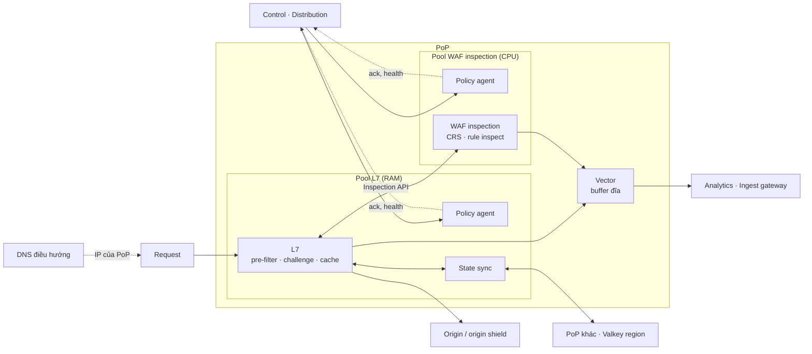

# 5.3 Edge plane

Nhiều PoP, nhiều region, chạy trên PoP riêng, hạ tầng đối tác hoặc trong hạ tầng của khách
([ADR-0005](../09-adr/0005-edge-on-own-and-existing-infra.md)). Mỗi PoP có **ba lớp** với tài nguyên
khác nhau ([ADR-0033](../09-adr/0033-two-tier-edge-proxy-and-waf.md)), cộng DNS điều hướng:

| Lớp | Làm gì | Tài nguyên chính | Chi tiết |
|---|---|---|---|
| L3/L4 | Hấp thụ flood mạng, anycast | Băng thông | Hạ tầng / đối tác; PoP riêng: XDP (Mở rộng) |
| **L7** | TLS, kết nối, pre-filter, challenge, rate limit, cache, proxy tới origin | **RAM, kết nối, băng thông** | [5.8.1](08-components/01-l7.md) |
| **WAF inspection** | CRS, custom rule cần body, API schema; trả verdict | **CPU** | [5.8.2](08-components/02-waf-inspection.md) |
| DNS điều hướng | Đưa người dùng tới PoP gần, khoẻ | Nhẹ | [5.8.3](08-components/03-dns-and-traffic-steering.md) |

## Bên trong một PoP

| Thành phần | Trách nhiệm | Khi mất kết nối |
|---|---|---|
| **Policy agent** (ở cả hai pool) | Kéo snapshot, kiểm chữ ký, nạp phần của tầng mình, swap nguyên khối, giữ last-good, báo ack | Chạy tiếp bản đang có |
| **L7** | Pipeline bước 2–11, 13–15 ([5.8.1](08-components/01-l7.md#thứ-tự-xử-lý)) | Không phụ thuộc mạng ngoài PoP |
| **WAF inspection** | Bước 12: schema body API, GraphQL, rồi managed ruleset, custom rule phần inspect | Không phụ thuộc mạng ngoài PoP |
| **State sync** | Counter rate limit và DDoS L7 ([ADR-0011](../09-adr/0011-approximate-fleet-rate-limiting.md)) | Rơi về đếm cục bộ |
| **Vector** | Gom event và access log của cả hai tầng, gửi ingest gateway | Buffer đĩa |

## Pipeline request

| # | Bước | Tầng | Ghi chú |
|---|---|---|---|
| 1 | L3/L4 mitigation | Hạ tầng | Volumetric |
| 2 | TLS | L7 | Cert theo SNI; ghi fingerprint JA4, HTTP/2 |
| 3 | Giới hạn giao thức, chuẩn hoá | L7 | Chặn request sai chuẩn, smuggling |
| 4 | Access list, reputation | L7 | Trust bỏ qua bot và challenge; skip bỏ qua đúng một chặng ([BR-28](../../requirements/02-requirements.md#4-quy-tắc-nghiệp-vụ)) |
| 5 | DDoS L7 | L7 | Không trust, skip nào bỏ qua được |
| 6 | Bot scoring | L7 | Chỉ tính điểm và lớp ([8.16](../08-cross-cutting/16-bot-management.md)) |
| 7 | Under Attack mode, challenge | L7 | Mọi challenge đều ở L7 ([ADR-0034](../09-adr/0034-pre-filter-and-rule-split-across-tiers.md)); bot đã xác minh bỏ qua theo cấu hình |
| 8 | API: endpoint, xác thực, consumer, schema rẻ | L7 | [8.17](../08-cross-cutting/17-api-security.md) |
| 9 | Rate limit theo rule | L7 | Khoá theo IP, header, cookie, API key, JWT claim |
| 10 | Policy bot, custom rule phần pre | L7 | Rule trước rule đầu tiên cần body |
| 11 | Inspect gate | L7 | Gọi hay không gọi WAF |
| 12 | Schema body, GraphQL, rồi managed ruleset, custom rule phần inspect | **WAF** | Chỉ request còn lại sau bước 4–11 |
| 13 | Quyết định | L7 | allow / log / challenge / block |
| 14 | Cache | L7 | Mặc định sau WAF; tài nguyên tĩnh có thể miễn WAF |
| 15 | Proxy tới origin | L7 | Qua origin shield ở Mở rộng |

Thứ tự là quy tắc nghiệp vụ [BR-32](../../requirements/02-requirements.md#4-quy-tắc-nghiệp-vụ); xung đột rule theo [BR-33](../../requirements/02-requirements.md#4-quy-tắc-nghiệp-vụ) ([5.8.1](08-components/01-l7.md#thứ-tự-xử-lý)).

Mỗi bước có ngân sách thời gian và hành vi khi lỗi theo zone (fail-open hoặc fail-closed); tầng WAF
không trả lời kịp cũng áp fail mode này.

## Cô lập tenant

- Ở L7: giới hạn kết nối, RAM cho body buffer, băng thông log theo tenant.
- Ở WAF: phần CPU theo gói (fair share), kích thước body được kiểm tra, độ phức tạp regex (chặn ở compiler).
- Tenant vượt giới hạn bị hạ cấp theo fail mode của chính nó, không làm chậm tenant khác.
