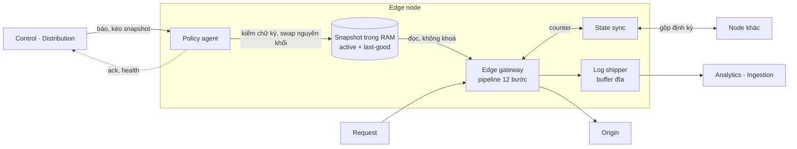

# 5.3 Edge plane

Nhiều node, nhiều region, chạy trên PoP riêng, hạ tầng đối tác hoặc trong hạ tầng của khách
([ADR-0005](../09-adr/0005-edge-on-own-and-existing-infra.md)). Mọi node chạy cùng một artifact.

## Bên trong một node

| Thành phần | Trách nhiệm | Khi mất kết nối |
|---|---|---|
| **Policy agent** | Kéo snapshot, kiểm chữ ký và schema version, nạp thử, swap nguyên khối; giữ bản last-good; báo ack theo version và health | Tiếp tục chạy bản đang có; không bao giờ xoá config vì mất kết nối |
| **Snapshot trong RAM** | Policy đã biên dịch theo zone, ruleset, cert theo SNI, khoá ký clearance token, entitlements áp ở edge (tỉ lệ lấy mẫu, giới hạn) | |
| **Edge gateway** | Xử lý request theo pipeline bên dưới | Không phụ thuộc mạng ngoài node |
| **State sync** | Counter rate limit và DDoS L7: đếm cục bộ, gộp định kỳ với node khác ([ADR-0011](../09-adr/0011-approximate-fleet-rate-limiting.md)) | Rơi về đếm cục bộ |
| **Log shipper** | Gom event và access log, che trường nhạy cảm, lấy mẫu theo entitlements, nén, gửi at-least-once | Ghi vào buffer đĩa; khi đầy thì bỏ access log trước, giữ security event |

## Pipeline request

Thứ tự là quyết định sản phẩm: nó quyết định allowlist có vượt được rate limit không, bot có bị
WAF chặn trước khi được chấm điểm không.

| # | Bước | Ghi chú |
|---|---|---|
| 1 | L3/L4 mitigation | Volumetric; thường là năng lực của hạ tầng nơi đặt node |
| 2 | TLS | Cert theo SNI, phiên bản và cipher theo cấu hình zone |
| 3 | Chuẩn hoá | Decode, gộp path, chống né (double encoding, unicode); giới hạn kích thước header/body |
| 4 | Access list | IP / CIDR / geo / ASN; `allow` bỏ qua các bước kiểm tra phía sau theo phạm vi cấu hình |
| 5 | Under Attack mode | Nếu bật: request không có clearance token hợp lệ nhận challenge ([ADR-0008](../09-adr/0008-under-attack-mode.md)) |
| 6 | Rate limit & DDoS L7 | Counter theo khoá (IP, API key, session, path); ngưỡng thích ứng theo baseline zone |
| 7 | Bot | Mở rộng: xác minh bot tốt, điểm hành vi, challenge |
| 8 | Managed ruleset | CRS + system ruleset trên engine SecLang, anomaly scoring, paranoia level, exclusion của khách ([ADR-0004](../09-adr/0004-managed-ruleset-crs-on-seclang.md)) |
| 9 | Custom rule | Biểu thức của khách theo priority, first match wins |
| 10 | API schema | Mở rộng: OpenAPI, JWT |
| 11 | Quyết định | allow / log / challenge / block; log-only hạ mọi hành động xuống log; trang chặn luôn in request ID |
| 12 | Cache / proxy | Tới origin qua kết nối có xác thực |

Mỗi bước có **ngân sách thời gian** và hành vi khi lỗi hoặc quá hạn theo zone: **fail-open**
(cho qua, ghi event) hoặc **fail-closed** (chặn). Mọi bước ra quyết định phát một security event;
bước 12 phát access log cho mọi request.

## Cô lập tenant tại node

Một node phục vụ nhiều tenant. Giới hạn theo tenant: thời gian CPU cho kiểm tra body, kích thước
body được kiểm tra, số rule, độ phức tạp regex (chặn ở compiler), băng thông log. Tenant vượt giới
hạn bị hạ cấp (ví dụ bỏ kiểm tra body sâu, theo fail mode của zone) chứ không làm chậm tenant khác.
