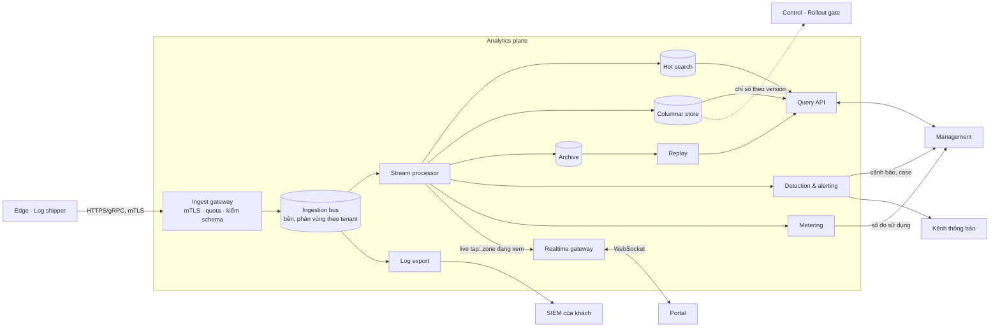

# 5.4 Analytics plane

Một luồng ghi, nhiều kiểu đọc ([ADR-0010](../09-adr/0010-analytics-one-write-path-many-stores.md)).
Đặt theo region dữ liệu để đáp ứng residency ([07](../07-deployment/00-index.md)).

| Thành phần | Trách nhiệm |
|---|---|
| **Ingest gateway** | Điểm vào duy nhất cho log từ edge: xác thực node bằng mTLS, kiểm schema version, giới hạn lưu lượng theo tenant và theo node, định tuyến vào topic Kafka. Kafka không bao giờ lộ ra mạng của edge, đối tác hay khách |
| **Ingestion bus** | Nhận từ log shipper, ack sau khi ghi bền, phân vùng theo tenant, giữ đủ lâu để các consumer chậm đuổi kịp |
| **Stream processor** | Làm giàu (geo, ASN, tên rule, tên zone), loại trùng theo request ID, gộp theo cửa sổ thời gian, áp retention theo entitlements khi ghi |
| **Hot search** | Từng request trong vài ngày gần nhất; tra theo request ID, IP, rule, path; phục vụ điều tra và xử lý chặn nhầm |
| **Columnar store** | Số liệu gộp theo phút/giờ/ngày; dashboard, báo cáo, tỉ lệ chặn và FP theo rule và theo policy version; luôn có **tổng traffic làm mẫu số** |
| **Archive** | Lưu dài hạn chi phí thấp theo gói và residency; nguồn cho replay và yêu cầu pháp lý |
| **Detection & alerting** | Ngưỡng (MVP) rồi baseline (Nâng cao); đánh giá alert policy do Management phát; gộp event thành case; gửi thông báo |
| **Log export** | Đọc thẳng từ bus, đẩy liên tục sang đích khách chọn; mỗi đích một hàng đợi riêng, đích chậm không ảnh hưởng đích khác |
| **Metering** | Đếm request, băng thông, dung lượng log theo tenant cho billing |
| **Query API** | Cửa duy nhất để đọc dữ liệu traffic: áp quyền theo tenant/zone, giới hạn khoảng thời gian và chi phí theo entitlements |
| **Realtime gateway** | Đẩy số liệu từng giây, security event mẫu, cảnh báo, tiến độ rollout tới hàng chục nghìn phiên portal qua WebSocket; chỉ gom cho zone đang có người xem ([5.8.13](08-components/13-realtime-gateway.md)) |
| **Replay** | Chạy một bản policy nháp trên traffic lịch sử (mẫu từ archive) để trả lời "áp rule này 7 ngày qua thì chặn gì" |

Hai điểm thiết kế:

- **Log export đọc từ bus, không từ store.** Khách cần log gần như ngay, và SIEM của khách chậm
  hay sập không được làm chậm dashboard của chính mình.
- **Mọi bản ghi mang policy version.** Nếu thiếu, gate canary và phân tích chặn nhầm không phân biệt
  được tác động của rule mới với rule cũ.
