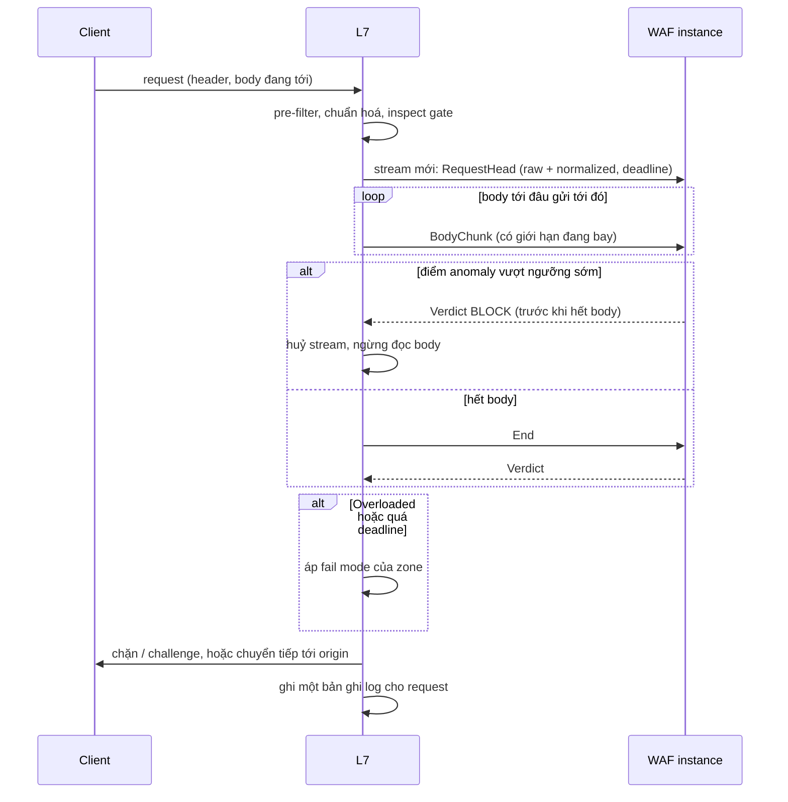

# 5.5 Hợp đồng giữa các plane

Mỗi hợp đồng có schema version. Bên nhận phải chấp nhận version hiện tại và version liền trước
(N-1), để mỗi plane deploy độc lập. Bên nhận gặp version mới hơn mức nó hiểu thì từ chối cả bản
và giữ trạng thái cũ, không đọc dở.

| Hợp đồng | Từ → Tới | Nội dung | Giao nhận |
|---|---|---|---|
| **PolicyVersionPublished** | Management → Control | zone ID, PolicyVersion ID và cha, AST của rule, cấu hình ruleset, exception, cài đặt zone, người duyệt, kênh (thường / khẩn) | Outbox → at-least-once; Control bỏ trùng theo version ID |
| **ZoneChanged** | Management → Control | hostname, origin, trạng thái, fail mode, yêu cầu cert | Như trên |
| **EntitlementsChanged** | Management → Control, Analytics | Giới hạn theo gói: tỉ lệ lấy mẫu log, retention tối đa, khoảng truy vấn, số rule, đích export, tính năng bật | Như trên; có hiệu lực không cần deploy |
| **Snapshot** | Control → Edge | Top manifest (digest của 4.096 bucket, ký) → bucket manifest (digest bundle của các zone trong bucket) → bundle zone, bundle chung, routing index delta ([ADR-0040](../09-adr/0040-config-distribution-at-scale.md)) | PoP store đồng bộ theo bucket; node kéo bundle zone từ PoP store khi cần, kiểm digest |
| **SnapshotAnnouncement** | Control → Edge | "top manifest version V", danh sách bucket đổi; cờ khẩn | Push nhẹ, mất cũng không sao vì agent tự kiểm định kỳ; node ACK theo V (tăng đơn điệu) |
| **NodeProfile** | Control → Edge | Cấu hình của node/PoP: cổng nghe, số worker, giới hạn RAM, kích thước cache đĩa, tham số HTTP toàn cục, kích thước pool WAF, địa chỉ relay | Bundle riêng có chữ ký; rollout như phần mềm; áp bằng hot restart (lớp C, [8.15](../08-cross-cutting/15-config-propagation-and-apply.md)) |
| **NodeStatus** | Edge → Control | Node ID, phần mềm, version đang chạy theo zone, lỗi nạp, chỉ số sức khoẻ | Heartbeat định kỳ + sự kiện khi đổi version |
| **Inspection API** | L7 → WAF inspection (trong PoP) | Header, body theo chunk, ngữ cảnh zone/tenant/request ID; trả verdict | gRPC stream đồng bộ, có deadline; xem mục bên dưới |
| **TelemetryRecord** | Edge → Analytics | Loại (security event / access log / mẫu request / usage counter), request ID, thời điểm, zone, tenant, policy version, bước pipeline, rule ID, hành động, `status_source`, `edge_error`, `bot.score/class/category/signals`, JA4 và fingerprint HTTP/2 (đã băm), `api.endpoint_id`, `api.consumer` (đã băm), mã vi phạm schema, trạng thái JWT, thời gian theo chặng ([8.14](../08-cross-cutting/14-latency-and-error-attribution.md)), trường request đã che | At-least-once; Analytics bỏ trùng theo request ID + loại |
| **UsageCounter** | Edge → Analytics (loại của TelemetryRecord) | Mỗi phút, mỗi zone có traffic trên node: request sạch, request bị chặn/challenge, byte ra client của traffic sạch, byte vào, đơn vị CPU WAF, byte trúng cache; `node_id`, số thứ tự | Không lấy mẫu; buffer riêng không bị bỏ khi đầy; bỏ trùng theo `(node, zone, phút)` ([ADR-0043](../09-adr/0043-usage-based-pricing-and-metering.md)) |
| **Query** | Management → Analytics | Truy vấn có cấu trúc (không phải ngôn ngữ truy vấn tự do của store), danh tính người gọi, phạm vi zone | Đồng bộ, có giới hạn chi phí |
| **AlertRaised / CaseProposed** | Analytics → Management | Điều kiện khớp, mẫu event, đề xuất mitigation | At-least-once, bỏ trùng theo khoá cảnh báo |
| **RolloutSignal** | Analytics → Control | Chỉ số theo zone/policy version trong cửa sổ canary | Định kỳ trong lúc rollout |
| **UsageReport** | Analytics → Management | Số đo sử dụng theo tenant và kỳ | Định kỳ, có thể chạy lại |

### Hợp đồng bổ sung (tạm, 2026-11-06)

> **Trạng thái: tạm, chờ phân tích nghiệp vụ.** Các hợp đồng dưới đây lấp các liên kết giữa plane mà
> [bản đồ phân rã chức năng](../../requirements/01-functional-decomposition.md#liên-kết-giữa-các-plane) tìm
> ra nhưng bảng trên chưa có. Tên và trường có thể đổi khi phân tích từng nghiệp vụ
> ([requirements §3](../../requirements/03-business-analysis/00-index.md)); quy tắc version N-1 ở đầu mục áp như mọi
> hợp đồng khác. Cột **LK** trỏ về liên kết trong bản đồ phân rã chức năng. Hai hợp đồng ghi **chờ onboarding** đến
> từ bản nháp onboarding chưa duyệt ([requirements §3.1](../../requirements/03-business-analysis/01-onboarding.md)).

| Hợp đồng | Từ → Tới | LK | Nội dung | Giao nhận |
|---|---|---|---|---|
| **PurgeRequested** | Management → Control | LK-3 | Purge ID, zone, loại (toàn zone / URL / prefix / tag), danh sách giá trị trong giới hạn gói, người yêu cầu | Outbox, lớp A fast lane ([8.15](../08-cross-cutting/15-config-propagation-and-apply.md)); là lệnh, không vào bundle; bỏ trùng theo purge ID; tiến độ trả qua `RolloutProgress` |
| **CompileResult** | Control → Management | LK-7 | PolicyVersion ID hoặc change request ID, kết quả (đạt / từ chối), lỗi theo rule (vị trí, mã, thông điệp), số đo ngân sách (kích thước, độ phức tạp), digest bundle | Outbox của Control, at-least-once; Management bỏ trùng theo version ID. Biên dịch thử khi soạn (LK-6) vẫn gọi đồng bộ |
| **RolloutProgress** | Control → Management, Analytics (realtime) | LK-7 | Version hoặc purge ID, giai đoạn (canary / wave n / toàn fleet), % node đã áp, số node lỗi, lý do dừng hoặc rollback | Khi đổi giai đoạn và tối đa mỗi 10 s khi đang chạy; mất không sao, Management đọc lại qua Control internal API |
| **CertStatusChanged** | Control → Management | LK-24 | Hostname, cert ID, trạng thái (`pending_validation`, `issued`, `renewing`, `failed`, `expired`), ngày hết hạn, CA, nguyên nhân lỗi (CAA, DNS-01, rate limit của CA) | Outbox; bỏ trùng theo (cert ID, trạng thái, thời điểm) |
| **ZoneCheckResult** (chờ onboarding) | Control → Management | LK-28 | Zone, hostname, loại kiểm (`ownership`, `dns_routing`, `origin`, `origin_exposure`, `caa`, `dns_discovery`), kết quả, chi tiết (bản ghi thấy được, resolver, mã lỗi, thời gian phản hồi), lần kiểm kế tiếp | Outbox; Management giữ kết quả mới nhất theo (zone, hostname, loại); kiểm theo yêu cầu thì trả cả qua Control internal API (sync) |
| **OriginProbe** (chờ onboarding) | Control ↔ Edge | LK-27 | Yêu cầu: zone, origin, cổng, giao thức, SNI, Host, đường dẫn; kết quả: kết nối, TLS (chuỗi, hostname khớp, hạn), mã HTTP, thời gian theo chặng, node và PoP đã thử | Đồng bộ qua kênh mTLS của edge agent, có deadline; Control chọn node ở ≥ 2 PoP |
| **PopState** | Control → Edge (DNS) | LK-13 | PoP ID, trạng thái (`active`, `draining`, `down`), trọng số, VIP theo cell | Nằm trong bundle chung; rút PoP đi kèm cờ khẩn. DNS dùng trạng thái cuối nếu không nhận |
| **PermissionsChanged** | Management → Analytics (realtime gateway) | LK-19 | Tenant, chủ thể (user / API key / service account), loại (đổi vai trò, khoá, gỡ, thu hồi key), thời điểm | Outbox; gateway đóng channel liên quan; bỏ trùng theo event ID |
| **AlertPolicyChanged** | Management → Analytics | LK-20 | Alert policy ID, version, template, điều kiện, phạm vi zone, tham chiếu kênh (không có secret), giờ im lặng, chu kỳ lặp; xoá là tombstone | Outbox; Analytics giữ version lớn nhất |
| **ExportDestinationChanged** | Management → Analytics | LK-20 | Đích ID, version, loại, endpoint, tham chiếu secret, bộ lọc, trạng thái bật/tắt; xoá là tombstone | Như trên |
| **FalsePositiveLabeled** | Management → Analytics | LK-20 | Request ID, zone, rule ID, policy version, nhãn (chặn nhầm / không phải), người gắn, lý do | Outbox; bỏ trùng theo (request ID, rule ID); nhãn sau thay nhãn trước |
| **ReplayRequested / ReplayCompleted** | Management → Analytics / Analytics → Management | LK-22 | Yêu cầu: job ID, zone, digest bundle nháp (Control biên dịch thử), khoảng thời gian, tỉ lệ mẫu. Kết quả: số request đổi hành động theo rule, mẫu request đã che, lỗi | Outbox hai chiều; job idempotent theo job ID; kết quả chi tiết giữ ở Analytics, Management nhận tóm tắt |
| **DataErasureRequested / DataErasureCompleted** | Management → Analytics, Control / Analytics, Control → Management | LK-23 | Yêu cầu: erasure ID, tenant, phạm vi (org / user / zone), định danh cần xoá hoặc ẩn danh, hạn hoàn tất. Kết quả: plane, số bản ghi xử lý, thời điểm | Outbox; mỗi plane trả `Completed` riêng; Management đóng yêu cầu khi đủ mọi plane |
| **IsolationRequested** | Analytics → Control | LK-25 | Zone, detector, chỉ số kích hoạt, mức đề xuất (cell cách ly / nhóm PoP riêng), thời hạn | RabbitMQ at-least-once; Control quyết theo chính sách, có thể từ chối; NOC thấy mọi yêu cầu |
| **ReputationBatch** | Analytics → Control | LK-26 | Version, loại (IP / ASN / fingerprint), danh sách điểm, khoảng thời gian tính, phương pháp | Theo lô: file trên object storage + thông báo; Control đưa qua pipeline phát hành (đánh giá, log-only) như ruleset ([5.8.7](08-components/07-cert-ruleset-release.md)) |

## Snapshot gồm gì

Ở quy mô 1 triệu zone ([7.5](../07-deployment/05-capacity-and-sharding.md)), snapshot không phải một
gói chứa mọi zone mà là một cây theo digest:

```text
top manifest (version V, ký Ed25519, ≈ 128 KB)
  ├── digest bundle chung, digest routing index
  └── digest của 4.096 bucket manifest
        bucket manifest (≈ 250 zone mỗi bucket)
          └── zone_id → digest bundle L7, digest bundle WAF, cell_id
routing index: (hostname, cổng) → zone_id, cell_id, cert_ref, digest   (mọi node, ≈ 200 MB)
```

Mỗi bundle có nội dung như dưới; node chỉ nạp bundle của zone đang có traffic ([ADR-0040](../09-adr/0040-config-distribution-at-scale.md)).


```text
bundle chung (version M)
  ├── ruleset releases: CRS vX, system ruleset vY
  ├── cài đặt toàn cục, danh sách chặn khẩn của NCC
  ├── khoá HMAC cấp và kiểm clearance token (hiện tại + trước đó)
  ├── dữ liệu bot: danh sách bot đã xác minh, reputation fingerprint/ASN/IP, mô hình bot (8.16)
  └── lớp rule khẩn
bundle zone (version N, tham chiếu bundle chung ≥ M)
  ├── phần L7
  │     ├── hostname, origin, TLS (tham chiếu cert đã mã hoá), fail mode
  │     ├── access list, rate limit, DDoS L7, Under Attack mode
  │     ├── custom rule phần pre (IR), inspect gate (miễn WAF cho tài nguyên tĩnh)
  │     ├── cache rule, cấu hình purge
  │     ├── policy bot theo nhóm path, danh sách bot của khách
  │     ├── API: route table, kiểm tham số/header, cấu hình JWT + JWKS, CA client mTLS, nguồn danh tính consumer (8.17)
  │     └── entitlements áp ở L7: tỉ lệ lấy mẫu, giới hạn body buffer, kết nối
  └── phần WAF
        ├── cấu hình managed ruleset: paranoia, ngưỡng anomaly, rule tắt, exclusion
        ├── custom rule phần inspect
        ├── validator body JSON theo endpoint, giới hạn GraphQL
        └── entitlements áp ở WAF: phần CPU, kích thước body kiểm tra
```

Disabled rule bị loại khi biên dịch chứ không mang theo cờ: edge không bao giờ giữ một rule mà nó
phải nhớ là không áp.

Policy agent ở tầng L7 chỉ nạp phần L7 (và bundle chung), ở tầng WAF chỉ nạp phần WAF; cùng một
manifest nên hai tầng chạy cùng version policy, trừ khoảng lệch ngắn lúc swap: Inspect request mang
`policy_version_id` của L7, WAF giữ version hiện tại và version trước để trả lời đúng version
([8.15 §6](../08-cross-cutting/15-config-propagation-and-apply.md#6-hai-tầng-swap-lệch-nhau)). Bundle chung
có thêm **lớp rule khẩn** nhỏ, tách khỏi ruleset release để fast lane không phải build lại CRS.

## Inspection API (L7 → WAF)

> **Trạng thái: bản nháp, chưa chốt, đang mở để nghiên cứu.** Hợp đồng giữa hai tầng
> ([ADR-0031](../09-adr/0031-edge-l7-and-waf-engine-options.md) §5, phương án I1), độc lập với nền L7 được
> chọn. Phần dưới gồm khung message hiện có, các điểm còn mở (IA1–IA13) kèm hướng đề xuất và việc cần nghiên cứu,
> rồi bản proto nháp gom các hướng đề xuất. Không điểm nào dưới đây là quyết định; mọi con số phải được
> đo trong spike của ADR-0031 trước khi chốt.

### Khung hiện có

```protobuf
service Inspection {
  rpc Inspect(stream InspectRequest) returns (stream InspectResponse);
}
message InspectRequest {
  oneof m {
    RequestHead head  = 1;  // zone_id, tenant_id, request_id, policy_version_id, method, uri,
                            // header, client_ip, geo, asn, bot (score, class), api (endpoint_id,
                            // consumer), deadline_us
    bytes       chunk = 2;  // body, theo thứ tự, tổng tối đa theo entitlements
    End         end   = 3;  // body_truncated
  }
}
message InspectResponse {
  oneof m {
    Verdict    verdict    = 1;  // có thể gửi trước khi nhận hết body
    Overloaded overloaded = 2;  // admission control từ chối, L7 áp fail mode
    Error      error      = 3;
  }
}
message Verdict {
  Action action = 1;            // ALLOW, LOG, CHALLENGE, BLOCK
  repeated string rule_ids = 2;
  uint32 anomaly_score = 3;
  repeated MatchedField matched = 4;  // tên trường + đoạn giá trị đã che
  uint32 engine_time_us = 5;
}
```

| Quy tắc | Giá trị hiện ghi |
|---|---|
| Deadline | L7 đặt theo ngân sách của zone (mặc định 1,5 ms); quá hạn → fail mode |
| Verdict sớm | WAF trả ngay khi điểm anomaly vượt ngưỡng; L7 ngừng gửi body |
| Tương thích | N/N-1 như mọi hợp đồng; WAF nhận `ext_proc`/SPOE qua adapter nếu L7 là Envoy/HAProxy |
| Bảo mật | Unix socket khi chung host, mTLS khi khác node ([8.19](../08-cross-cutting/19-node-identity-and-mtls.md)) |

### Các điểm còn mở

| # | Câu hỏi | Hướng đề xuất (chưa chốt) | Phương án khác | Cần nghiên cứu, đo |
|---|---|---|---|---|
| IA1 | **Mô hình stream**: mỗi request một stream, hay một stream dài ghép nhiều request | Mỗi request một HTTP/2 stream trên pool kết nối dài L7 → WAF; huỷ request = huỷ stream | Stream dài ghép request theo `request_id` (ít overhead mở stream, nhưng head-of-line và huỷ phức tạp); unary RPC cho request không body | Overhead mở stream gRPC ở 50k–100k request/s mỗi node L7; độ trễ p99 hai mô hình; hành vi khi một request body lớn chiếm kết nối |
| IA2 | **Ai chuẩn hoá request** (decode URL, path `..`, header trùng, cookie, charset, giải nén body) | L7 chuẩn hoá một lần theo quy tắc cố định, gửi **cả bản gốc lẫn bản đã chuẩn hoá**; WAF không tự giải mã thêm ngoài transformation của SecLang | WAF tự chuẩn hoá từ bản gốc (giống ModSecurity truyền thống); L7 chỉ chuyển nguyên văn | Danh sách khác biệt giữa cách L7, engine WAF và các origin phổ biến (NGINX, Apache, Node, Java) hiểu cùng một request; bộ test evasion (path, encoding, header trùng, HTTP/2 → HTTP/1 downgrade); xung đột với transformation của CRS |
| IA3 | **Version policy lệch** giữa L7 và WAF | WAF giữ version hiện tại và liền trước; không có version được yêu cầu thì kiểm bằng version mới nhất và gắn cờ `version_mismatch` | Từ chối (`Error`) để L7 áp fail mode; hoặc L7 chỉ gửi khi WAF báo đã có version | Tần suất lệch thật trong lúc rollout; ảnh hưởng tới replay và thống kê theo version |
| IA4 | **Chọn instance WAF** | Hash theo profile CRS (giữ instance engine nóng) kết hợp cân bằng theo tải, chuyển instance kế tiếp trên ring khi quá tải | Least-request thuần; hash theo zone | Tỉ lệ trúng instance đã nạp profile; độ lệch tải khi một profile rất nóng; chi phí dựng instance khi trượt |
| IA5 | **Retry** | Thử lại một lần, sang instance khác, chỉ khi `Error` và còn ngân sách thời gian; `Overloaded` không thử lại | Không bao giờ thử lại; hoặc hedged request (gửi song song sau p95) | Tỉ lệ `Error` thật; ảnh hưởng của retry tới tải lúc quá tải; chi phí body phải gửi lại (L7 phải giữ body tới khi có verdict) |
| IA6 | **Backpressure và giới hạn khi gửi body** | Giới hạn kích thước chunk (ví dụ 16 KB), số chunk đang bay, số request đồng thời mỗi kết nối; client gửi body chậm quá ngưỡng thì áp `body_overflow` | Đệm toàn bộ body ở L7 rồi gửi một lần (đơn giản, tốn RAM L7, mất verdict sớm) | RAM L7 và WAF ở body 1 MB × số request đồng thời; độ trễ đuôi khi upload chậm; tương tác với flow control của HTTP/2 |
| IA7 | **Nghĩa của action** và ai thực thi | L7 luôn thực thi; verdict mang `status`, `block_page_id`, `challenge_type`, header thêm vào request gửi origin (ví dụ điểm WAF) | WAF trả cả response chặn đầy đủ | Danh sách hành động thật cần cho custom rule phần inspect và CRS; trang chặn theo zone |
| IA8 | **Ai ghi log** | Chỉ L7 ghi một bản ghi mỗi request; verdict mang đủ rule, điểm, trường khớp, thời gian để L7 ghép | WAF ghi security event riêng rồi Analytics ghép theo `request_id` | Kích thước verdict khi khớp nhiều rule; mất bản ghi khi L7 chết sau khi nhận verdict |
| IA9 | **Bắt tay khi mở kết nối** | RPC `Hello`: version schema, kích thước body tối đa, decoder có sẵn, profile đang nạp | Đọc capability từ snapshot (không cần RPC) | Có cần thông tin động (profile đang nạp) hay chỉ tĩnh |
| IA10 | **Mức tin dữ liệu từ L7** | WAF tin toàn bộ head (IP client, bot, API) vì L7 đã được xác thực bằng mTLS với vai trò `l7` | WAF kiểm lại một phần (ví dụ IP client với PROXY protocol) | Mô hình đe doạ khi một node L7 bị chiếm; có cần ký head không |
| IA11 | **Kiểm response** (Nâng cao) | Để sẵn pha `ResponseHead` / chunk response trong schema, chưa dùng ở MVP | Kênh riêng cho response | Nhu cầu thật (dữ liệu nhạy cảm, [8.17](../08-cross-cutting/17-api-security.md)); chi phí độ trễ khi phải đệm response |
| IA13 | **Transport của callout**: gRPC, HTTP thường, hay giao thức nhị phân tự viết | gRPC (HTTP/2 + protobuf): có sẵn ghép kênh, flow control theo stream, huỷ, deadline, schema N/N-1, mTLS, sinh code Go/Rust/C++; tiền lệ Envoy `ext_proc` | HTTP/1.1 hoặc HTTP/2 thường, ngữ cảnh trong header (kiểu `ext_authz` HTTP, `auth_request`; không schema, HTTP/1.1 không ghép kênh); giao thức nhị phân trên Unix socket cho PoP nhỏ chạy L7 và WAF chung host (bỏ HTTP/2 và TLS, có thể zero-copy hoặc shared memory; kiểu HAProxy SPOE). UDP bị loại: body lớn hơn MTU, không thứ tự, không flow control | Chi phí mỗi lần gọi (µs) và CPU của cả ba ở 50.000–100.000 request/s mỗi node L7, body 0 / 4 KB / 64 KB; chi phí copy body vào protobuf; độ phức tạp tự viết framing, huỷ, flow control cho phương án nhị phân |
| IA12 | **WebSocket, gRPC của khách** | Chỉ request bắt tay đi qua Inspection API; frame (Nâng cao) cần message riêng | | Theo [5.8.2 Phạm vi giao thức](08-components/02-waf-inspection.md#phạm-vi-giao-thức) |

### Proto nháp gom các hướng đề xuất

Chỉ để thảo luận và dùng làm điểm xuất phát cho spike; tên và trường sẽ đổi.

```protobuf
service Inspection {
  rpc Hello(HelloRequest) returns (HelloResponse);                    // IA9
  rpc Inspect(stream InspectRequest) returns (stream InspectResponse); // IA1: một stream mỗi request
}
message InspectRequest {
  oneof m {
    RequestHead head   = 1;
    BodyChunk   chunk  = 2;   // IA6: tối đa N byte mỗi chunk, số chunk đang bay có giới hạn
    End         end    = 3;   // body_truncated, client_aborted
    // ResponseHead resp_head = 4;  ResponseChunk resp_chunk = 5;   // IA11, chưa dùng
  }
}
message RequestHead {
  string request_id = 1; string zone_id = 2; string tenant_id = 3;
  string policy_version_id = 4; uint32 deadline_us = 5;
  RawRequest raw = 6;              // IA2: nguyên văn như nhận từ client
  NormalizedRequest normalized = 7; // IA2: bản L7 đã chuẩn hoá (path, query, header, cookie, charset)
  ClientContext client = 8;        // IP, geo, ASN, JA4; IA10: WAF tin vì L7 đã xác thực mTLS
  BotContext bot = 9; ApiContext api = 10;
  repeated string pre_rule_ids = 11; // rule phần pre đã khớp ở L7 (log-only)
}
message InspectResponse {
  oneof m {
    Verdict    verdict    = 1;
    Overloaded overloaded = 2;   // IA5: không thử lại
    Error      error      = 3;   // IA5: thử lại một lần nếu còn ngân sách
  }
}
message Verdict {
  Action action = 1;               // ALLOW, LOG, CHALLENGE, BLOCK
  uint32 status = 2; string block_page_id = 3; ChallengeType challenge = 4;  // IA7
  repeated Header add_upstream_headers = 5;                                    // IA7
  repeated RuleMatch matches = 6;  // rule_id, phase, trường khớp đã che; IA8: L7 ghi log
  uint32 anomaly_score = 7; uint32 engine_time_us = 8;
  string evaluated_version_id = 9; bool version_mismatch = 10;               // IA3
  bool profile_fallback = 11;      // waf_profile_fallback
}
```



### Kế hoạch nghiên cứu

Gắn vào spike của [ADR-0031](../09-adr/0031-edge-l7-and-waf-engine-options.md); kết quả quyết định hợp
đồng v1:

1. Dựng client ở L7 ứng viên (Pingora, Go) và server WAF (Coraza) theo proto nháp; đo IA1, IA5, IA6, và so transport gRPC / HTTP/2 thường / nhị phân trên Unix socket cho IA13.
2. Bộ test evasion cho IA2: chạy cùng request qua L7, engine WAF và một tập origin, so khác biệt.
3. Mô phỏng rollout để đo IA3; mô phỏng một profile rất nóng để đo IA4.
4. Đánh giá mô hình đe doạ cho IA10 cùng đội bảo mật.
5. Chốt v1 bằng một ADR riêng; tới lúc đó các component 5.8.1, 5.8.2 coi phần gọi WAF là theo bản nháp.
