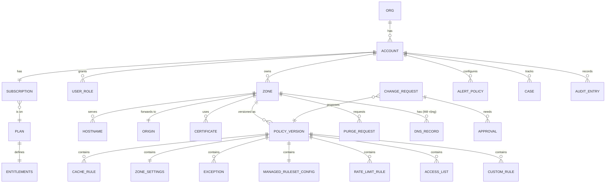
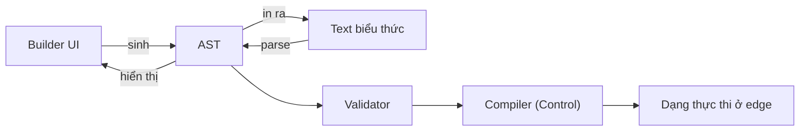

# 5.6 Mô hình dữ liệu

## Management (logic)

| Entity | Ghi chú |
|---|---|
| **PolicyVersion** | Bất biến sau khi duyệt. Một zone có đúng một version đang enforce và có thể có một version đang canary. Rollback là tạo PolicyVersion mới trỏ về nội dung của bản cũ, không sửa lịch sử. |
| **CustomRule** | Lưu **text** làm nguồn sự thật, kèm AST đã parse; có priority, hành động, chế độ log-only, ngày hết hạn tuỳ chọn (cho rule tạm) |
| **ManagedRulesetConfig** | Ruleset release đang theo (cố định hay tự nhận bản mới), paranoia level, ngưỡng anomaly inbound/outbound, danh sách rule ID tắt |
| **Exception** | Phạm vi bắt buộc: rule ID (hoặc nhóm) + điều kiện (path, method, tham số, header); không có "tắt toàn bộ" ẩn |
| **ZoneSettings** | Fail mode, Under Attack mode (bật/tắt, hạn tự tắt), TLS, giới hạn body |
| **Entitlements** | Thuộc gói, không thuộc zone; Control và Analytics thực thi ([ADR-0007](../09-adr/0007-log-by-subscription-entitlements.md)) |
| **CacheRule** | Điều kiện (path, đuôi file, header), TTL, cache key tuỳ biến, bỏ qua cache, miễn WAF cho tài nguyên tĩnh ([ADR-0035](../09-adr/0035-cdn-and-dns-strategy.md)) |
| **PurgeRequest** | Theo URL, prefix, tag (Mở rộng); đi fast lane; trạng thái hoàn tất theo % node |
| **DnsRecord** | Mở rộng, khi khách chuyển DNS authoritative sang NCC: loại, tên, giá trị, TTL, proxied (trả IP edge thay vì IP origin) |
| **AuditEntry** | Chỉ ghi thêm; gồm diff, người làm, kênh (UI/API/IaC), IP, change request liên quan |

## Mô hình rule

- Builder và text là hai cách hiển thị một AST; sửa ở đâu cũng được, chuyển qua lại không mất
  thông tin ([ADR-0003](../09-adr/0003-rule-language-existing-syntax-with-builder.md)).
- Text là thứ được lưu, diff, review và dùng trong IaC.
- Field và toán tử là tập đóng, có kiểu (IP, chuỗi, số, danh sách); validator từ chối field không
  biết thay vì bỏ qua.
- Managed ruleset dùng SecLang riêng; khách không viết SecLang, chỉ cấu hình (paranoia, ngưỡng,
  tắt rule, exclusion). System ruleset của NCC viết bằng SecLang.
