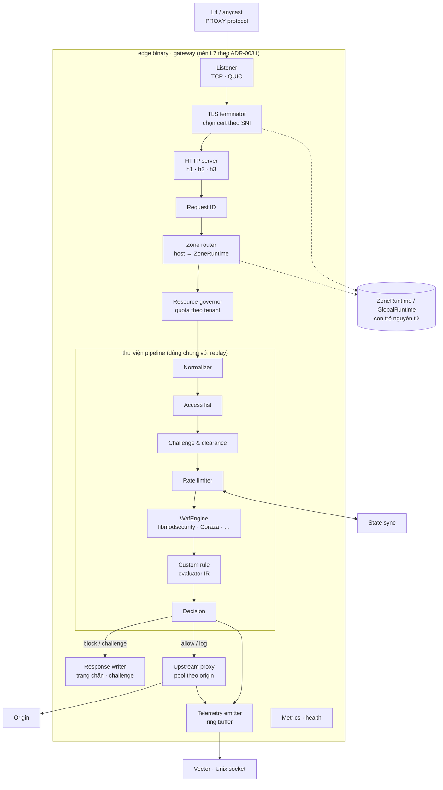

# 5.8.1 Edge gateway

Một binary chạy trên mỗi edge node, chứa gateway, policy agent và state sync
([ADR-0015](../../09-adr/0015-snapshot-format-and-distribution.md)). File này mô tả phần gateway; agent
và state sync ở [02-edge-agent-and-state.md](02-edge-agent-and-state.md).

> **Nền L7 và engine WAF chưa chọn** ([ADR-0031](../../09-adr/0031-edge-l7-and-waf-engine-options.md),
> shortlist A1 Rust + Pingora + libmodsecurity, D2 Go + Coraza, B2 Envoy + Coraza wasm). Thiết kế
> component dưới đây đúng với mọi tổ hợp; chỗ nào cách làm khác nhau theo tổ hợp thì ghi rõ.

## Component diagram



## Thành phần

| Component | Trách nhiệm | Thiết kế |
|---|---|---|
| **Listener** | Nhận kết nối TCP (443, 80) và QUIC (443/udp) | Listener của nền L7; PROXY protocol v2 khi đứng sau L4 load balancer của đối tác; giới hạn kết nối theo IP nguồn. QUIC/HTTP/3 theo khả năng của nền (A: chưa xác nhận Pingora, phương án `quinn` + `h3`; B, D: có sẵn) |
| **TLS terminator** | Chọn cert theo SNI, thương lượng TLS | Callback chọn cert tra bảng `hostname → cert` trong GlobalRuntime; thư viện TLS theo nền (A: rustls/BoringSSL, B: BoringSSL, D: `crypto/tls`); session ticket key xoay qua bundle chung; ALPN `h2`, `http/1.1` |
| **HTTP server** | h1/h2/h3 do nền L7 cung cấp | Timeout header/idle/body theo cấu hình zone; giới hạn kích thước header |
| **Request ID** | Định danh duy nhất cho mỗi request | UUIDv7 (có thứ tự thời gian); ghi vào header gửi origin (`X-Request-ID`), trang chặn và mọi bản ghi telemetry |
| **Zone router** | Tìm cấu hình zone theo `Host` | Map bất biến trong GlobalRuntime; host lạ trả 421 / trang mặc định, ghi event |
| **Resource governor** | Cô lập tenant | Semaphore số request đồng thời và ngân sách CPU kiểm tra body theo tenant; vượt quota thì hạ cấp theo fail mode của zone |
| **Normalizer** | Chuẩn hoá trước khi kiểm tra | Decode percent/unicode, gộp `//`, `/./`, `/../`; giới hạn số tham số, độ sâu JSON; giữ cả bản gốc cho engine WAF (CRS tự chuẩn hoá bằng transform riêng) |
| **Access list** | IP/CIDR/geo/ASN | Trie IPv4/IPv6 dựng sẵn khi nạp snapshot; geo/ASN tra MMDB trong RAM; kết quả `allow` gắn cờ bỏ qua các phase đã cấu hình |
| **Challenge & clearance** | Under Attack mode, challenge của rule | Token = HMAC-SHA256(zone, hạn, IP prefix, UA hash) với khoá trong bundle chung (khoá hiện tại + khoá trước); challenge JS proof-of-work, mức khó theo cấu hình |
| **Rate limiter** | Counter theo khoá rule | Sliding window hai bucket, map phân mảnh theo hash để giảm tranh chấp; hot key gửi state sync ([ADR-0021](../../09-adr/0021-valkey-for-hot-key-rate-limit-sync.md)) |
| **WafEngine** | Chạy CRS + system ruleset | Interface, engine chờ chọn: libmodsecurity v3 (A1, qua FFI), Coraza (D2 nhúng, B2 qua proxy-wasm). Một instance rules dựng sẵn theo `(ruleset release, cấu hình CRS của zone)`, dùng chung giữa các zone cùng cấu hình; mỗi request một transaction; đọc body tối đa theo entitlements, phần còn lại stream thẳng |
| **Custom rule** | Biểu thức của khách theo priority | Thực thi IR do Control biên dịch từ CEL ([ADR-0032](../../09-adr/0032-cel-checked-at-control-ir-at-edge.md)); nếu edge là Go có thể dùng thẳng `cel-go`. Dựng sẵn lúc nạp snapshot; first match wins; giới hạn số bước đánh giá |
| **Decision** | Kết hợp kết quả các phase | allow / log / challenge / block; log-only hạ mọi hành động; ghi `Verdict` (phase, rule ID, hành động, điểm anomaly) |
| **Response writer** | Trang chặn, challenge | Template theo zone (logo, màu), luôn in request ID và thời điểm |
| **Upstream proxy** | Chuyển tới origin | Pool kết nối theo origin của nền L7; mTLS client cert; timeout, retry cho request idempotent, health check thụ động |
| **Telemetry emitter** | Phát bản ghi | Ring buffer không khoá, task riêng gửi Unix socket tới Vector; đầy thì bỏ access log trước, tăng bộ đếm `telemetry_dropped_total` |
| **Metrics · health** | Quan sát nền tảng | Prometheus `/metrics` trên cổng nội bộ: độ trễ theo phase, verdict, lỗi upstream, mức đầy ring buffer, version snapshot |

## Hợp đồng của thư viện `pipeline`

Thư viện dùng chung với replay worker và công cụ `edge-verify`
([ADR-0026](../../09-adr/0026-replay-on-request-samples-with-shared-pipeline.md)); không phụ thuộc mạng
hay kiểu của nền L7, để replay dựng request từ mẫu Parquet. Ví dụ dưới viết bằng Rust để minh
hoạ (tổ hợp A1); với D2 là interface Go tương đương, với B2 là phần chạy trong wasm hoặc `ext_proc`.

```rust
pub trait Phase: Send + Sync {
    fn name(&self) -> &'static str;
    /// Không được chặn I/O; `budget` là ngân sách thời gian của phase.
    fn eval(&self, req: &Request, state: &mut State, budget: Duration) -> Outcome;
}

pub enum Outcome {
    Continue,
    Allow { rule_id: RuleId },
    Log { rule_id: RuleId },
    Challenge { rule_id: RuleId },
    Block { rule_id: RuleId, score: u16 },
    SkipPhases(PhaseSet),
    Error(PhaseError),          // lỗi hoặc quá hạn → áp fail mode của zone
}

pub trait WafEngine: Send + Sync {
    fn new_transaction(&self, req: &Request) -> Box<dyn WafTransaction + '_>;
}

pub struct Pipeline {
    phases: Vec<Arc<dyn Phase>>, // thứ tự lấy từ ZoneRuntime
    fail_mode: FailMode,         // Open | Closed
}

impl Pipeline {
    pub fn run(&self, req: &Request) -> Verdict { /* ... */ }
}
```

- `Request` là bản đã chuẩn hoá, sở hữu dữ liệu của nó, không giữ kiểu của nền L7.
- Mỗi phase có ngân sách thời gian riêng (cấu hình trong snapshot); quá hạn trả `Error`, pipeline áp
  fail mode và phát event `phase_timeout`.

## Hiệu năng

- Mục tiêu chung: không cấp phát trên đường request với các phase rẻ (access list, rate limit, custom
  rule); buffer tái sử dụng theo worker.
- Theo tổ hợp:
  - A1 (Rust): không GC; chi phí lớn nhất là ranh giới FFI với libmodsecurity, nên truyền header và
    body theo lô, không gọi FFI cho từng trường.
  - D2 (Go): `sync.Pool` cho đối tượng theo request, `GOMEMLIMIT`/`GOGC` tinh chỉnh qua benchmark; rủi ro
    chính là GC pause khi Coraza cấp phát nhiều.
  - B2 (Envoy): chi phí chuyển dữ liệu vào wasm mỗi request; giới hạn kích thước body đưa vào wasm.
- Benchmark chuẩn (CI): traffic mẫu với CRS paranoia 1 và 2, 50 custom rule; báo p50/p99 theo phase.
  Ngưỡng QS-1 là điều kiện merge cho thay đổi trong thư viện `pipeline`.

## An toàn

- Code của mình viết bằng ngôn ngữ an toàn bộ nhớ (Rust an toàn, Go, hoặc wasm), không viết module C/C++ mới.
- Nếu engine là libmodsecurity (C++): pin version, vá CVE trong 72 giờ qua rollout phần mềm edge thường
  (hoặc fast lane cho cấu hình giảm thiểu, ví dụ tắt transform bị lỗi), fuzz lớp tích hợp.

## Lỗi và hành vi

| Tình huống | Hành vi |
|---|---|
| Phase lỗi hoặc quá hạn | Fail mode của zone; event `phase_error` |
| Engine WAF lỗi hoặc panic | Bắt tại ranh giới, coi là lỗi phase, áp fail mode; worker bị lỗi lặp lại thì được khởi động lại |
| Origin không trả lời | 502/504 với trang lỗi có request ID; event upstream |
| Snapshot chưa nạp lúc khởi động | Không mở listener cho tới khi nạp xong (health check đỏ) |
| Tenant vượt quota tài nguyên | Hạ cấp theo fail mode của tenant đó; tenant khác không bị ảnh hưởng |
| Ring buffer telemetry đầy | Bỏ access log, giữ security event tới khi đầy hẳn; bộ đếm lộ ra metrics |
