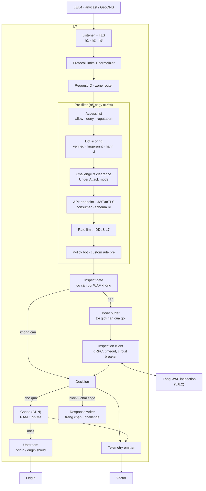

# 5.8.1 L7 (tầng 1)

Tầng đầu của edge ([ADR-0033](../../09-adr/0033-two-tier-edge-proxy-and-waf.md)): nhận mọi kết nối,
lọc rẻ những gì lọc được, phục vụ cache, và chỉ chuyển sang tầng WAF ([5.8.2](02-waf-inspection.md))
những request cần kiểm tra sâu. Tài nguyên chính là **RAM, số kết nối, băng thông**, không phải CPU
kiểm tra nội dung.

> Nền L7 của tầng này **chưa chọn** ([ADR-0031](../../09-adr/0031-edge-l7-and-waf-engine-options.md)).
> Thiết kế component dưới đây đúng với mọi phương án; chỗ khác nhau theo phương án thì ghi rõ.

## Component diagram

## Thứ tự xử lý

| # | Bước | Ở tầng | Chi phí | Kết quả có thể |
|---|---|---|---|---|
| 1 | L3/L4 | Hạ tầng / đối tác | — | Rớt gói |
| 2 | TLS, HTTP; ghi fingerprint JA4, HTTP/2 | L7 | RAM, CPU TLS | Đóng kết nối |
| 3 | Giới hạn giao thức, chuẩn hoá | L7 | Rất thấp | 400/413/431 |
| 4 | Access list (trust, skip, deny, reputation; IP, CIDR, ASN, quốc gia) | L7 | Rất thấp (trie) | Block; trust bỏ qua bot và challenge (bước 7, phần bot của bước 10); skip bỏ qua đúng chặng đã chỉ định; không chặng nào bỏ qua được DDoS L7 ở bước 5 |
| 5 | DDoS L7 (bộ đếm theo zone và nguồn, giảm thiểu tự động) | L7 | Thấp | Block / challenge; cắt flood trước khi edge phải phát trang challenge |
| 6 | Bot scoring (chỉ tính, chưa hành động) | L7 | Thấp | `bot.score`, `bot.class`, `bot.category` ([8.16](../../08-cross-cutting/16-bot-management.md)) |
| 7 | Under Attack mode, challenge | L7 | Thấp | Challenge; bot đã xác minh bỏ qua theo cấu hình |
| 8 | API: khớp endpoint, xác thực (JWT, mTLS, API key), danh tính consumer, kiểm schema không cần body | L7 | Thấp | 401/403/404/400 ([8.17](../../08-cross-cutting/17-api-security.md)) |
| 9 | Rate limit theo rule của khách | L7 | Thấp | Block / challenge; khoá theo IP, header, cookie, API key, JWT claim |
| 10 | Policy bot, custom rule **phần pre** | L7 | Thấp | Theo hành động của policy/rule (dùng được `bot.*`, `jwt.*`, `api.*`) |
| 11 | Inspect gate | L7 | Rất thấp | Gọi hay không gọi WAF |
| 12 | Schema body API, GraphQL, **rồi** managed ruleset và custom rule **phần inspect** | **WAF** | **Cao** | Verdict; sai schema thì dừng, không quét signature ([BR-35](../../../requirements/02-requirements.md#4-quy-tắc-nghiệp-vụ)) |
| 13 | Quyết định | L7 | Rất thấp | allow / log / challenge / block |
| 14 | Cache lookup | L7 | RAM / đĩa | Phục vụ từ cache |
| 15 | Proxy tới origin (hoặc origin shield) | L7 | Mạng | Response |

Thứ tự này là quy tắc nghiệp vụ [BR-32](../../../requirements/02-requirements.md#4-quy-tắc-nghiệp-vụ). Mục tiêu: khi bị tấn công, phần lớn lưu lượng bị
loại ở bước 4–10 với chi phí gần như không đáng kể, tầng WAF chỉ thấy phần còn lại. DDoS L7 đứng ngay sau
access list để flood bị cắt trước khi edge tốn công phát challenge.

**Xung đột rule** ([BR-33](../../../requirements/02-requirements.md#4-quy-tắc-nghiệp-vụ)):

- Trong một chặng, rule chạy theo priority từ trên xuống; hành động kết thúc đầu tiên (block, challenge,
  allow, trust) dừng chặng đó; `log` ghi lại rồi chạy tiếp.
- Trong access list, mục cụ thể hơn thắng: IP > CIDR > ASN > quốc gia. Ví dụ trust một IP ở Việt Nam
  thắng block cả quốc gia Việt Nam.
- Giữa NCC và khách: block của lớp rule khẩn NCC > allow của khách > block của khách > allow của NCC. Lớp
  rule khẩn chạy trước rule của khách ở cả L7 và WAF; khách không tắt được, support đặt log-only có hạn
  cho đúng một zone ([8.15 §4](../../08-cross-cutting/15-config-propagation-and-apply.md#4-fast-lane-không-được-kích-hoạt-build-nặng)).

**WAF đứng trước cache theo mặc định**, để payload tấn công trong query của một URL đã cache vẫn bị phát
hiện và ghi nhận. Zone có thể bật "bỏ qua WAF cho tài nguyên tĩnh" (theo path/đuôi file, chỉ GET/HEAD
không body) để giảm tải WAF cho site nhiều static.

## Thành phần

| Component | Thiết kế |
|---|---|
| **SNI passthrough** | Mở rộng, Enterprise: hostname chọn passthrough được định tuyến theo SNI ở tầng TCP tới origin mà không giải mã; chỉ có DDoS L3/L4, access list theo IP và log kết nối; không có WAF, bot, cache, trang lỗi ([FR-3-18](../../../requirements/02-requirements.md#f3-bảo-vệ-runtime-và-f4-hiệu-năng)) |
| **Listener + TLS** | TCP 443/80, QUIC 443/udp; PROXY protocol v2 sau L4 đối tác; chọn cert theo SNI từ snapshot; session ticket key xoay qua bundle chung |
| **Protocol limits + normalizer** | Giới hạn header, URL, số tham số, độ sâu JSON; từ chối request sai chuẩn (smuggling: `Content-Length` + `Transfer-Encoding` mâu thuẫn); chuẩn hoá path cho pre-filter, giữ bản gốc gửi WAF |
| **Client IP resolver** | Zone đứng sau CDN của khách: header IP thật (`X-Forwarded-For`, `True-Client-IP`, `CF-Connecting-IP`...) và dải IP CDN do khách khai, hoặc preset có dải tự cập nhật (Cloudflare, Akamai, CloudFront). Chỉ đọc header khi IP TCP nằm trong dải đó; `X-Forwarded-For` đọc từ phải sang, lấy IP đầu tiên không thuộc dải tin cậy; còn lại dùng IP TCP ([BR-31](../../../requirements/02-requirements.md#4-quy-tắc-nghiệp-vụ)). Mọi bước sau (access list, rate limit, bot) dùng IP đã giải |
| **Access list** | Trie IPv4/IPv6; geo/ASN từ MMDB; danh sách reputation của NCC trong bundle chung. Hai hành động tách biệt ([BR-28](../../../requirements/02-requirements.md#4-quy-tắc-nghiệp-vụ)): `trust` bỏ qua bot và challenge, WAF vẫn kiểm, vẫn chịu rate limit và DDoS L7; `skip` bỏ qua đúng một chặng đã chỉ định (bot, challenge, rate limit rule cụ thể, WAF managed cho path) trong phạm vi đã chỉ định. Cả hai vẫn ghi log |
| **Tarpit** | Hành động `tarpit` (Mở rộng): giữ request vài giây rồi trả 403. Trần số kết nối tarpit trên mỗi node (theo cả tenant); vượt trần thì block ngay, không giữ thêm, để botnet lớn không làm cạn connection slot của chính edge |
| **Challenge & clearance** | JS proof-of-work và challenge tương tác; clearance token HMAC (zone, hạn, IP prefix, UA hash), kiểm cục bộ; WAF tier trả verdict `challenge` thì L7 thực thi tại đây |
| **Bot scoring** | Tính `bot.score/class/category/signals` từ bot đã xác minh, danh sách khách, JA4 + fingerprint HTTP/2 + độ nhất quán với User-Agent, reputation, hành vi ngắn hạn, clearance token; chỉ tính, hành động ở bước 10 ([8.16](../../08-cross-cutting/16-bot-management.md)) |
| **API** | Route table từ schema của khách; JWT kiểm bằng JWKS trong snapshot, mTLS client cert, có mặt API key; băm danh tính consumer thành `api.consumer`; kiểm tham số path/query/header, content-type, kích thước ([8.17](../../08-cross-cutting/17-api-security.md)) |
| **Rate limit · DDoS L7** | Sliding window, hot key đồng bộ qua Valkey region ([ADR-0021](../../09-adr/0021-valkey-for-hot-key-rate-limit-sync.md)); ngưỡng thích ứng theo baseline zone |
| **Custom rule phần pre** | Rule chỉ dùng trường rẻ (IP, geo, ASN, method, host, path, query, header, cookie, bot score), thực thi IR ([ADR-0034](../../09-adr/0034-pre-filter-and-rule-split-across-tiers.md)) |
| **Inspect gate** | Không gọi WAF khi: đã bị chặn/challenge, nằm trong allow có phạm vi bỏ WAF, zone tắt WAF, tài nguyên tĩnh được miễn |
| **Body buffer** | Đọc body tới giới hạn theo gói (ví dụ 128 KB) vào RAM, gửi WAF theo chunk; phần vượt giới hạn stream thẳng tới origin, ghi cờ `body_truncated` |
| **Inspection client** | gRPC stream tới pool WAF trong PoP ([Inspection API](../05-contracts.md#inspection-api-l7--waf), **bản nháp, đang nghiên cứu**: mô hình stream, chuẩn hoá, retry, chọn instance còn mở); timeout theo zone; circuit breaker khi tầng WAF lỗi hoặc quá tải → fail mode của zone |
| **Cache** | Khoá cache mặc định `(zone, host, path, query đã sắp xếp, header Vary)`; tôn trọng `Cache-Control`; cache rule theo zone; RAM cho object nóng, NVMe cho object lớn; purge theo URL, prefix, tag; `stale-if-error` khi origin lỗi ([ADR-0035](../../09-adr/0035-cdn-and-dns-strategy.md)) |
| **Upstream** | Pool kết nối theo origin, mTLS tới origin, retry cho request idempotent, health check thụ động; Mở rộng: đi qua origin shield (tiered cache). **Origin pool** (Mở rộng, Business trở lên): active-passive, round-robin hoặc theo trọng số; health check chủ động từ edge-agent và thụ động (lỗi kết nối, 502/504) đếm theo node trong cửa sổ cấu hình, vượt ngưỡng thì đưa origin ra khỏi pool và chuyển sang dự phòng, phát event để báo khách; request không idempotent không bao giờ gửi lại sang origin khác |
| **Response builder** | Trang do edge sinh (403 WAF, 429, 502, 504, 503 bảo trì, challenge) lấy từ **CustomErrorPage** của zone, rồi của tenant, rồi mặc định của NCC; path API (theo schema hoặc `Accept: application/json`) trả JSON. Template là HTML, CSS tĩnh đã kiểm ở Management (không JavaScript, không tài nguyên ngoài); edge chỉ thay các chỗ giữ request ID, mã lỗi, thời điểm, và gửi kèm `Cache-Control: no-store` |
| **Telemetry** | Mốc thời gian theo chặng, `status_source`, `edge_error`, `cache_status`, `inspected`, `body_truncated` cho mọi request ([8.14](../../08-cross-cutting/14-latency-and-error-attribution.md)); header `X-WAAP-Error` và mã trên trang lỗi khi WAAP tự sinh response; `Server-Timing` nếu zone bật |

## Ngân sách độ trễ

| Phần | p99 |
|---|---|
| Xử lý của L7 (bước 2–11, 13) | ≤ 0,5 ms |
| Gọi WAF trong PoP (mạng + kiểm tra ở PL1) | ≤ 1,5 ms |
| **Tổng độ trễ thêm (QS-1)** | **≤ 2 ms** |
| Request không cần WAF (bị chặn sớm, cache hit tĩnh được miễn) | ≤ 0,5 ms |

## Lỗi và hành vi

| Tình huống | Hành vi |
|---|---|
| Tầng WAF timeout, lỗi, hoặc circuit breaker mở | Fail mode của zone (open: cho qua và ghi `waf_unavailable`; closed: 503 có request ID) |
| Origin lỗi | Phục vụ bản cũ trong cache nếu có (`stale-if-error`), nếu không 502/504 có request ID |
| Hết RAM cho body buffer | Từ chối request mới có body lớn của tenant vượt quota (governor), không ảnh hưởng tenant khác |
| Snapshot chưa nạp | Không mở listener |
