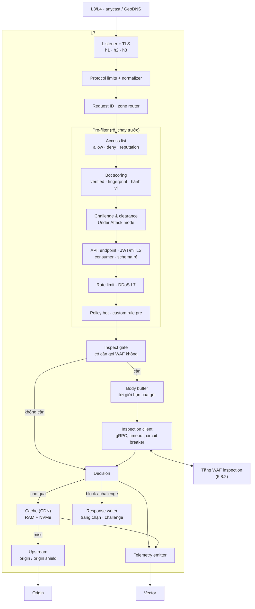

# 5.8.1 L7 (tầng 1)

Tầng đầu của edge ([ADR-0033](../../09-adr/0033-two-tier-edge-proxy-and-waf.md)): nhận mọi kết nối,
lọc rẻ những gì lọc được, phục vụ cache, và chỉ chuyển sang tầng WAF ([5.8.2](02-waf-inspection.md))
những request cần kiểm tra sâu. Tài nguyên chính là **RAM, số kết nối, băng thông**, không phải CPU
kiểm tra nội dung.

> Nền L7 của tầng này **chưa chọn** ([ADR-0031](../../09-adr/0031-edge-l7-and-waf-engine-options.md)).
> Thiết kế component dưới đây đúng với mọi phương án; chỗ khác nhau theo phương án thì ghi rõ.

## Component diagram

## Thứ tự xử lý

| # | Bước | Ở tầng | Chi phí | Kết quả có thể |
|---|---|---|---|---|
| 1 | L3/L4 | Hạ tầng / đối tác | — | Rớt gói |
| 2 | TLS, HTTP; ghi fingerprint JA4, HTTP/2 | L7 | RAM, CPU TLS | Đóng kết nối |
| 3 | Giới hạn giao thức, chuẩn hoá | L7 | Rất thấp | 400/413/431 |
| 4 | Access list (allow, deny, reputation) | L7 | Rất thấp (trie) | Block; allow bỏ qua bước 5–11 theo phạm vi cấu hình |
| 5 | Bot scoring (chỉ tính, chưa hành động) | L7 | Thấp | `bot.score`, `bot.class`, `bot.category` ([8.16](../../08-cross-cutting/16-bot-management.md)) |
| 6 | Under Attack mode, challenge | L7 | Thấp | Challenge; bot đã xác minh bỏ qua theo cấu hình |
| 7 | API: khớp endpoint, xác thực (JWT, mTLS, API key), danh tính consumer, kiểm schema không cần body | L7 | Thấp | 401/403/404/400 ([8.17](../../08-cross-cutting/17-api-security.md)) |
| 8 | Rate limit, DDoS L7 | L7 | Thấp | Block / challenge; khoá theo IP, phiên hoặc consumer API |
| 9 | Policy bot, custom rule **phần pre** | L7 | Thấp | Theo hành động của policy/rule (dùng được `bot.*`, `jwt.*`, `api.*`) |
| 10 | Inspect gate | L7 | Rất thấp | Gọi hay không gọi WAF |
| 11 | Managed ruleset, custom rule **phần inspect**, schema body API, GraphQL | **WAF** | **Cao** | Verdict |
| 12 | Quyết định | L7 | Rất thấp | allow / log / challenge / block |
| 13 | Cache lookup | L7 | RAM / đĩa | Phục vụ từ cache |
| 14 | Proxy tới origin (hoặc origin shield) | L7 | Mạng | Response |

Mục tiêu của thứ tự này: khi bị tấn công, phần lớn lưu lượng bị loại ở bước 4–9 với chi phí gần như
không đáng kể, tầng WAF chỉ thấy phần còn lại.

**WAF đứng trước cache theo mặc định**, để payload tấn công trong query của một URL đã cache vẫn bị phát
hiện và ghi nhận. Zone có thể bật "bỏ qua WAF cho tài nguyên tĩnh" (theo path/đuôi file, chỉ GET/HEAD
không body) để giảm tải WAF cho site nhiều static.

## Thành phần

| Component | Thiết kế |
|---|---|
| **Listener + TLS** | TCP 443/80, QUIC 443/udp; PROXY protocol v2 sau L4 đối tác; chọn cert theo SNI từ snapshot; session ticket key xoay qua bundle chung |
| **Protocol limits + normalizer** | Giới hạn header, URL, số tham số, độ sâu JSON; từ chối request sai chuẩn (smuggling: `Content-Length` + `Transfer-Encoding` mâu thuẫn); chuẩn hoá path cho pre-filter, giữ bản gốc gửi WAF |
| **Access list** | Trie IPv4/IPv6; geo/ASN từ MMDB; danh sách reputation của NCC trong bundle chung; `allow` có phạm vi (bỏ qua rate limit, challenge, WAF, hoặc tất cả) |
| **Challenge & clearance** | JS proof-of-work và challenge tương tác; clearance token HMAC (zone, hạn, IP prefix, UA hash), kiểm cục bộ; WAF tier trả verdict `challenge` thì L7 thực thi tại đây |
| **Bot scoring** | Tính `bot.score/class/category/signals` từ bot đã xác minh, danh sách khách, JA4 + fingerprint HTTP/2 + độ nhất quán với User-Agent, reputation, hành vi ngắn hạn, clearance token; chỉ tính, hành động ở bước 9 ([8.16](../../08-cross-cutting/16-bot-management.md)) |
| **API** | Route table từ schema của khách; JWT kiểm bằng JWKS trong snapshot, mTLS client cert, có mặt API key; băm danh tính consumer thành `api.consumer`; kiểm tham số path/query/header, content-type, kích thước ([8.17](../../08-cross-cutting/17-api-security.md)) |
| **Rate limit · DDoS L7** | Sliding window, hot key đồng bộ qua Valkey region ([ADR-0021](../../09-adr/0021-valkey-for-hot-key-rate-limit-sync.md)); ngưỡng thích ứng theo baseline zone |
| **Custom rule phần pre** | Rule chỉ dùng trường rẻ (IP, geo, ASN, method, host, path, query, header, cookie, bot score), thực thi IR ([ADR-0034](../../09-adr/0034-pre-filter-and-rule-split-across-tiers.md)) |
| **Inspect gate** | Không gọi WAF khi: đã bị chặn/challenge, nằm trong allow có phạm vi bỏ WAF, zone tắt WAF, tài nguyên tĩnh được miễn |
| **Body buffer** | Đọc body tới giới hạn theo gói (ví dụ 128 KB) vào RAM, gửi WAF theo chunk; phần vượt giới hạn stream thẳng tới origin, ghi cờ `body_truncated` |
| **Inspection client** | gRPC stream tới pool WAF trong PoP ([Inspection API](../05-contracts.md#inspection-api-l7--waf), **bản nháp, đang nghiên cứu**: mô hình stream, chuẩn hoá, retry, chọn instance còn mở); timeout theo zone; circuit breaker khi tầng WAF lỗi hoặc quá tải → fail mode của zone |
| **Cache** | Khoá cache mặc định `(zone, host, path, query đã sắp xếp, header Vary)`; tôn trọng `Cache-Control`; cache rule theo zone; RAM cho object nóng, NVMe cho object lớn; purge theo URL, prefix, tag; `stale-if-error` khi origin lỗi ([ADR-0035](../../09-adr/0035-cdn-and-dns-strategy.md)) |
| **Upstream** | Pool kết nối theo origin, mTLS tới origin, retry cho request idempotent, health check thụ động; Mở rộng: đi qua origin shield (tiered cache) |
| **Telemetry** | Mốc thời gian theo chặng, `status_source`, `edge_error`, `cache_status`, `inspected`, `body_truncated` cho mọi request ([8.14](../../08-cross-cutting/14-latency-and-error-attribution.md)); header `X-WAAP-Error` và mã trên trang lỗi khi WAAP tự sinh response; `Server-Timing` nếu zone bật |

## Ngân sách độ trễ

| Phần | p99 |
|---|---|
| Xử lý của L7 (bước 2–10, 12) | ≤ 0,5 ms |
| Gọi WAF trong PoP (mạng + kiểm tra ở PL1) | ≤ 1,5 ms |
| **Tổng độ trễ thêm (QS-1)** | **≤ 2 ms** |
| Request không cần WAF (bị chặn sớm, cache hit tĩnh được miễn) | ≤ 0,5 ms |

## Lỗi và hành vi

| Tình huống | Hành vi |
|---|---|
| Tầng WAF timeout, lỗi, hoặc circuit breaker mở | Fail mode của zone (open: cho qua và ghi `waf_unavailable`; closed: 503 có request ID) |
| Origin lỗi | Phục vụ bản cũ trong cache nếu có (`stale-if-error`), nếu không 502/504 có request ID |
| Hết RAM cho body buffer | Từ chối request mới có body lớn của tenant vượt quota (governor), không ảnh hưởng tenant khác |
| Snapshot chưa nạp | Không mở listener |
