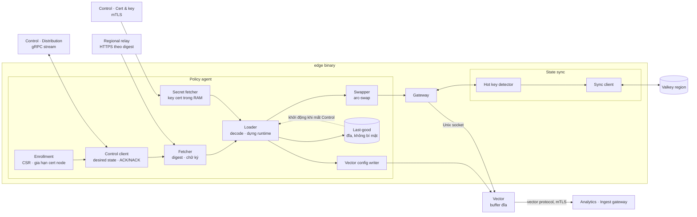
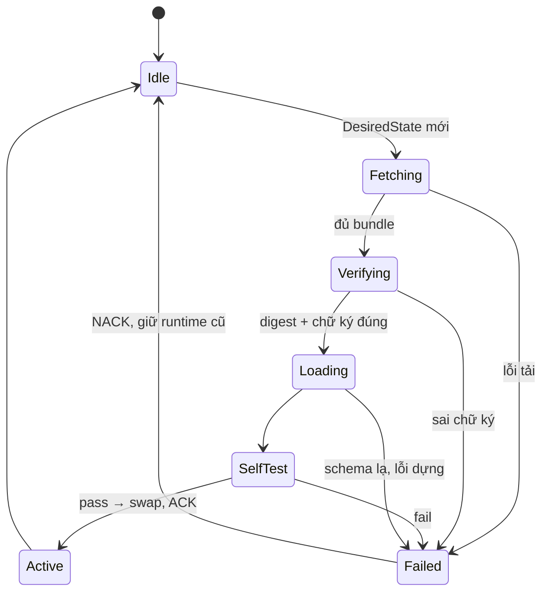

# 5.8.2 Policy agent, state sync, log shipping trên node

Ba thành phần chạy cạnh gateway trên mỗi node. Policy agent và state sync là module trong cùng
binary Rust; Vector là process riêng.

## Component diagram

## Policy agent

| Component | Trách nhiệm | Thiết kế |
|---|---|---|
| **Enrollment** | Danh tính node | Lần đầu: bootstrap token một lần dùng + CSR → OpenBao PKI cấp cert ngắn hạn (24 h); tự gia hạn ở 2/3 thời hạn; cert chứa node ID, nơi chạy, region |
| **Control client** | Kênh điều khiển | gRPC stream hai chiều có mTLS; nhận `DesiredState{manifest_digest, nonce, urgent}`; trả `Ack{nonce}` hoặc `Nack{nonce, error}`; heartbeat 10 s kèm `NodeStatus` |
| **Fetcher** | Lấy bundle | Kéo manifest + bundle còn thiếu theo digest từ relay; kiểm SHA-256 từng bundle, kiểm chữ ký Ed25519 của manifest bằng khoá công khai nhúng sẵn (kèm danh sách khoá xoay vòng) |
| **Loader** | Biến bundle thành runtime | Giải nén zstd, decode protobuf, kiểm schema version; dựng trie IP, evaluator IR của custom rule, instance engine WAF (libmodsecurity), template, template; chạy **self-test** (vài request mẫu đi qua pipeline) trước khi chấp nhận |
| **Swapper** | Áp nguyên khối | `ArcSwap<GlobalRuntime>` và map zone bất biến; request đang chạy giữ runtime cũ tới khi xong |
| **Last-good** | Khởi động độc lập | Ghi manifest + bundle đã nạp thành công ra đĩa; khởi động khi không gọi được Control thì nạp từ đây |
| **Secret fetcher** | Private key cert | Gọi Cert & key service qua mTLS lấy key của zone được gán, chỉ giữ trong RAM; mất kết nối khi khởi động thì zone đó không phục vụ TLS cho tới khi lấy được |
| **Vector config writer** | Đồng bộ cấu hình log | Sinh file cấu hình Vector (tỉ lệ lấy mẫu theo zone, luật che) từ snapshot, gọi reload |

### Trạng thái nạp

## State sync

| Component | Thiết kế |
|---|---|
| **Hot key detector** | Mỗi counter cục bộ có cờ hot khi vượt 10% ngưỡng của rule trong cửa sổ hiện tại; chỉ hot key được đồng bộ |
| **Sync client** | Mỗi 1 s gửi pipeline `INCRBY key Δ` + `EXPIRE` theo cửa sổ tới Valkey của region, nhận tổng; khoá Valkey: `rl:{tenant}:{rule}:{hash(key)}:{window}`; giới hạn số khoá mỗi lần gửi theo tenant |
| **Hợp nhất** | `count = max(local, regional_last + local_unsynced)` |
| **Lỗi** | Valkey không trả lời → dùng `local`, metrics `ratelimit_sync_degraded` |

## Log shipping (Vector)

| Giai đoạn | Thiết kế |
|---|---|
| Nguồn | Unix socket, bản ghi protobuf có độ dài tiền tố |
| Biến đổi | Lấy mẫu access log theo zone (security event không lấy mẫu); che trường theo cấu hình khách bằng VRL; gắn `node_id`, `region` |
| Buffer | Disk buffer có giới hạn dung lượng; khi đầy, nguồn access log bị chặn trước, security event dùng buffer riêng |
| Sink | Ingest gateway của Analytics region được gán, qua giao thức `vector` (gRPC) có mTLS bằng cert node, nén zstd; chỉ xoá khỏi buffer đĩa khi gateway xác nhận đã ghi Kafka (end-to-end ack). Edge không biết Kafka tồn tại |
| Quan sát | Metrics của Vector (độ trễ, mức buffer, lỗi gửi) được gateway gom vào `/metrics` của node |
