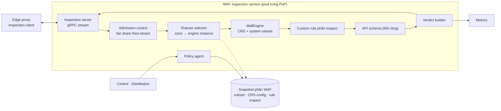

# 5.8.2 WAF inspection (tầng 2)

Dịch vụ kiểm tra nội dung, tách khỏi proxy ([ADR-0033](../../09-adr/0033-two-tier-edge-proxy-and-waf.md)).
Không giữ kết nối của client, không gọi origin: nhận request đã qua pre-filter từ proxy, chạy ruleset,
trả **verdict**. Tài nguyên chính là **CPU**. Engine chưa chọn
([ADR-0031](../../09-adr/0031-edge-l7-and-waf-engine-options.md)).

## Component diagram

## Thành phần

| Component | Thiết kế |
|---|---|
| **Inspection server** | gRPC stream hai chiều: nhận header, rồi body theo chunk, rồi `end`; trả `Verdict` ngay khi có kết luận (có thể trước khi hết body nếu đã vượt ngưỡng anomaly) |
| **Admission control** | Mỗi tenant có phần CPU theo gói (weighted fair queueing, trọng số Free 1 / Pro 2 / Business 4 / Enterprise 8, [8.18](../../08-cross-cutting/18-segments-and-plans.md)); khi quá tải từ chối gói thấp trước; hàng đợi đầy → trả `Overloaded` ngay để proxy áp fail mode, không để request chờ lâu |
| **Ruleset selector** | Map `zone → profile`; instance engine dựng sẵn theo **profile** `(ruleset release, paranoia, ngưỡng)`, dùng chung giữa mọi zone cùng profile; rule tắt của zone áp bằng lọc kết quả; chỉ zone có exclusion theo trường mới cần instance riêng (LRU); instance riêng chưa sẵn thì kiểm bằng profile chuẩn kèm lọc rule tắt, gắn cờ `waf_profile_fallback`, dựng ở nền ([ADR-0040](../../09-adr/0040-config-distribution-at-scale.md)) |
| **WafEngine** | Interface; engine chờ chọn: Coraza (Go), libmodsecurity v3 (C++), SecLang thuần Rust (dài hạn). CRS anomaly scoring, paranoia level, rule tắt, exclusion của khách |
| **Custom rule phần inspect** | Rule cần body, tham số đã parse, JSON path; và mọi rule đứng sau rule đầu tiên cần body theo thứ tự priority ([ADR-0034](../../09-adr/0034-pre-filter-and-rule-split-across-tiers.md)) |
| **API schema** | Mở rộng: kiểm body JSON theo JSON Schema của endpoint (endpoint đã được proxy khớp, gửi kèm `api.endpoint_id`); GraphQL: parse, độ sâu, độ phức tạp, introspection, batch ([8.17](../../08-cross-cutting/17-api-security.md)) |
| **Verdict builder** | `{action, rule_ids, anomaly_score, matched_fields (đã che), phase, engine_time_us}` |
| **Policy agent** | Cùng cơ chế với proxy ([5.8.4](04-edge-agent-and-state.md)); chỉ nạp phần snapshot của tầng WAF |

## Triển khai trong PoP

| Kích thước PoP | Cách đặt |
|---|---|
| Nhỏ (vài node) | Proxy và WAF cùng host, hai process, cgroup giới hạn CPU riêng cho WAF; gọi qua Unix socket |
| Lớn | Hai pool node riêng: proxy (RAM, NIC lớn), WAF (nhiều core); gọi qua mạng nội bộ PoP, mTLS |

Scale độc lập: số node WAF theo CPU dùng cho kiểm tra (thường tăng khi bị tấn công tầng ứng dụng), số
node proxy theo kết nối và băng thông (tăng khi bị flood hoặc traffic cache lớn).

## Hiệu năng và cô lập

- Mục tiêu p99 cho một lần kiểm tra ở PL1 (gồm mạng trong PoP): ≤ 1,5 ms.
- Engine chạy trong process riêng nên lỗi bộ nhớ hoặc crash của engine (nếu là libmodsecurity) không
  kéo theo proxy và kết nối của client; process WAF chết thì proxy chuyển sang instance khác trong pool.
- Nếu engine là Go (Coraza), GC chỉ ảnh hưởng tầng này; proxy không bị dừng theo.

## Lỗi và hành vi

| Tình huống | Hành vi |
|---|---|
| Quá tải (hàng đợi đầy) | Trả `Overloaded`; proxy áp fail mode của zone; metrics `waf_overloaded_total{tenant}` |
| Engine lỗi trên một request | Trả `Error`; proxy áp fail mode; mẫu request (đã che) gửi về để điều tra |
| Process WAF chết | Proxy loại instance khỏi pool qua health check, thử instance khác |
| Toàn bộ pool WAF của PoP mất | Circuit breaker ở proxy mở; fail mode của từng zone; cảnh báo P1 |
