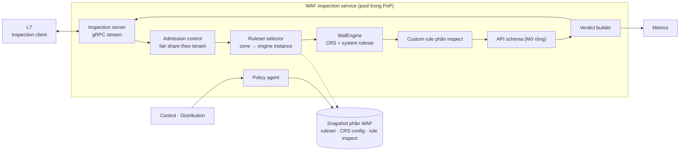

# 5.8.2 WAF inspection (tầng 2)

Dịch vụ kiểm tra nội dung, tách khỏi L7 ([ADR-0033](../../09-adr/0033-two-tier-edge-proxy-and-waf.md)).
Không giữ kết nối của client, không gọi origin: nhận request đã qua pre-filter từ L7, chạy ruleset,
trả **verdict**. Tài nguyên chính là **CPU**. Engine chưa chọn
([ADR-0031](../../09-adr/0031-edge-l7-and-waf-engine-options.md)).

## Component diagram

## Thành phần

| Component | Thiết kế |
|---|---|
| **Inspection server** | Theo [Inspection API](../05-contracts.md#inspection-api-l7--waf) (bản nháp, đang nghiên cứu). gRPC stream hai chiều: nhận header, rồi body theo chunk, rồi `end`; trả `Verdict` ngay khi có kết luận (có thể trước khi hết body nếu đã vượt ngưỡng anomaly) |
| **Admission control** | Mỗi tenant có phần CPU theo gói (weighted fair queueing, trọng số Free 1 / Pro 2 / Business 4 / Enterprise 8, [8.18](../../08-cross-cutting/18-segments-and-plans.md)); khi quá tải từ chối gói thấp trước; hàng đợi đầy → trả `Overloaded` ngay để L7 áp fail mode, không để request chờ lâu |
| **Ruleset selector** | Map `zone → profile`; instance engine dựng sẵn theo **profile** `(ruleset release, paranoia, ngưỡng)`, dùng chung giữa mọi zone cùng profile; rule tắt của zone áp bằng lọc kết quả; chỉ zone có exclusion theo trường mới cần instance riêng (LRU); instance riêng chưa sẵn thì kiểm bằng profile chuẩn kèm lọc rule tắt, gắn cờ `waf_profile_fallback`, dựng ở nền ([ADR-0040](../../09-adr/0040-config-distribution-at-scale.md)) |
| **WafEngine** | Interface; engine chờ chọn: Coraza (Go), libmodsecurity v3 (C++), SecLang thuần Rust (dài hạn). CRS anomaly scoring, paranoia level, rule tắt, exclusion của khách |
| **Custom rule phần inspect** | Rule cần body, tham số đã parse, JSON path; và mọi rule đứng sau rule đầu tiên cần body theo thứ tự priority ([ADR-0034](../../09-adr/0034-pre-filter-and-rule-split-across-tiers.md)) |
| **API schema** | Mở rộng: kiểm body JSON theo JSON Schema của endpoint (endpoint đã được L7 khớp, gửi kèm `api.endpoint_id`); GraphQL: parse, độ sâu, độ phức tạp, introspection, batch ([8.17](../../08-cross-cutting/17-api-security.md)) |
| **Verdict builder** | `{action, rule_ids, anomaly_score, matched_fields (đã che), phase, engine_time_us}` |
| **Policy agent** | Cùng cơ chế với L7 ([5.8.4](04-edge-agent-and-state.md)); chỉ nạp phần snapshot của tầng WAF |

## Phạm vi giao thức

WAF chỉ kiểm được traffic mà tầng L7 đã giải mã TLS (cần cert của zone, kể cả kiểu keyless). Khách không
cho giải mã thì chỉ còn bảo vệ L3/L4.

### Giao thức vào edge

| Giao thức | Mức bảo vệ |
|---|---|
| HTTP/1.1, HTTP/2 | Đầy đủ. L7 chuẩn hoá request (giải nén header, gộp cookie, chuẩn hoá path); WAF nhận cùng một dạng, không phụ thuộc bản HTTP |
| HTTP/3 (QUIC) | Như trên; phụ thuộc nền L7 được chọn ([ADR-0031](../../09-adr/0031-edge-l7-and-waf-engine-options.md), T10) |

### Nội dung body

| Loại | Mức bảo vệ | Ghi chú |
|---|---|---|
| Query, header, cookie, form urlencoded | Đầy đủ: CRS, system ruleset, custom rule | |
| JSON | Đầy đủ; Business trở lên kiểm thêm theo JSON Schema | [8.17](../../08-cross-cutting/17-api-security.md) |
| XML, SOAP | CRS (gồm XXE, injection trong phần tử và thuộc tính) | Engine phải parse XML, tắt thực thể ngoài; tiêu chí T13 của [ADR-0031](../../09-adr/0031-edge-l7-and-waf-engine-options.md) |
| multipart (upload file) | Kiểm field, tên file, loại khai báo và magic bytes, kích thước, số phần | **Không quét malware** trong nội dung file; nếu làm là tính năng riêng, chạy bất đồng bộ |
| GraphQL | Parse, độ sâu, độ phức tạp, introspection, batch | Mở rộng, [8.17](../../08-cross-cutting/17-api-security.md) |
| Body vượt giới hạn của gói | Chỉ kiểm phần đầu tới giới hạn (8 KB → 1 MB theo gói, [8.18](../../08-cross-cutting/18-segments-and-plans.md)) | Phần vượt: theo chính sách zone `body_overflow = pass \| block`, mặc định `pass`, có event `body_truncated` |
| Body nén (gzip, br) từ client | L7 giải nén có giới hạn tỉ lệ và kích thước trước khi gửi WAF | Vượt giới hạn giải nén coi như body vượt giới hạn; chống zip bomb |

### Kết nối dài và streaming

| Giao thức | Mức bảo vệ | Giai đoạn |
|---|---|---|
| WebSocket | Kiểm request bắt tay (header, auth, bot, rate limit, custom rule). Sau khi nâng cấp kết nối, frame **không** đi qua CRS; chỉ có giới hạn kích thước frame, số frame/giây, thời gian sống của kết nối, số kết nối đồng thời mỗi IP | MVP |
| WebSocket, kiểm frame | Frame text/JSON đi qua rule riêng (không dùng CRS nguyên bản), theo mẫu hoặc cứ N frame một lần | Nâng cao |
| Server-Sent Events, response chunked | Request được kiểm; response chảy thẳng tới client, không đệm, không kiểm | MVP |
| gRPC, gRPC-Web | Rule theo method (path `/package.Service/Method`), metadata (header), auth JWT/mTLS, rate limit theo method; giới hạn kích thước message. Body protobuf nhị phân không qua CRS | MVP (theo method), Mở rộng (rate limit theo consumer) |
| gRPC, kiểm nội dung | Khách tải file descriptor `.proto`; WAF decode message thành cây trường và chạy rule, kiểm schema như JSON | Nâng cao |

### Response

Không kiểm body response ở MVP (chỉ header và status cho analytics). Phát hiện dữ liệu nhạy cảm trong
response là giai đoạn Nâng cao ([8.17](../../08-cross-cutting/17-api-security.md)).

### Ngoài phạm vi WAF

| Traffic | Sản phẩm | Bảo vệ |
|---|---|---|
| TCP/UDP không phải HTTP (game, MQTT, SMTP, database, SSH, RDP, cổng tuỳ ý) | Proxy L4 (Mở rộng, [7.5 §7](../../07-deployment/05-capacity-and-sharding.md#7-cổng)) | DDoS L3/L4, access list IP/geo/ASN, giới hạn kết nối và băng thông; không kiểm nội dung |
| DNS | DNS điều hướng, DNS authoritative ([5.8.3](03-dns-and-traffic-steering.md)) | Rate limit truy vấn, chống amplification |

## Triển khai trong PoP

| Kích thước PoP | Cách đặt |
|---|---|
| Nhỏ (vài node) | L7 và WAF cùng host, hai process, cgroup giới hạn CPU riêng cho WAF; gọi qua Unix socket |
| Lớn | Hai pool node riêng: L7 (RAM, NIC lớn), WAF (nhiều core); gọi qua mạng nội bộ PoP, mTLS |

Scale độc lập: số node WAF theo CPU dùng cho kiểm tra (thường tăng khi bị tấn công tầng ứng dụng), số
node L7 theo kết nối và băng thông (tăng khi bị flood hoặc traffic cache lớn).

## Hiệu năng và cô lập

- Mục tiêu p99 cho một lần kiểm tra ở PL1 (gồm mạng trong PoP): ≤ 1,5 ms.
- Engine chạy trong process riêng nên lỗi bộ nhớ hoặc crash của engine (nếu là libmodsecurity) không
  kéo theo L7 và kết nối của client; process WAF chết thì L7 chuyển sang instance khác trong pool.
- Nếu engine là Go (Coraza), GC chỉ ảnh hưởng tầng này; L7 không bị dừng theo.

## Lỗi và hành vi

| Tình huống | Hành vi |
|---|---|
| Quá tải (hàng đợi đầy) | Trả `Overloaded`; L7 áp fail mode của zone; metrics `waf_overloaded_total{tenant}` |
| Engine lỗi trên một request | Trả `Error`; L7 áp fail mode; mẫu request (đã che) gửi về để điều tra |
| Process WAF chết | L7 loại instance khỏi pool qua health check, thử instance khác |
| Toàn bộ pool WAF của PoP mất | Circuit breaker ở L7 mở; fail mode của từng zone; cảnh báo P1 |
