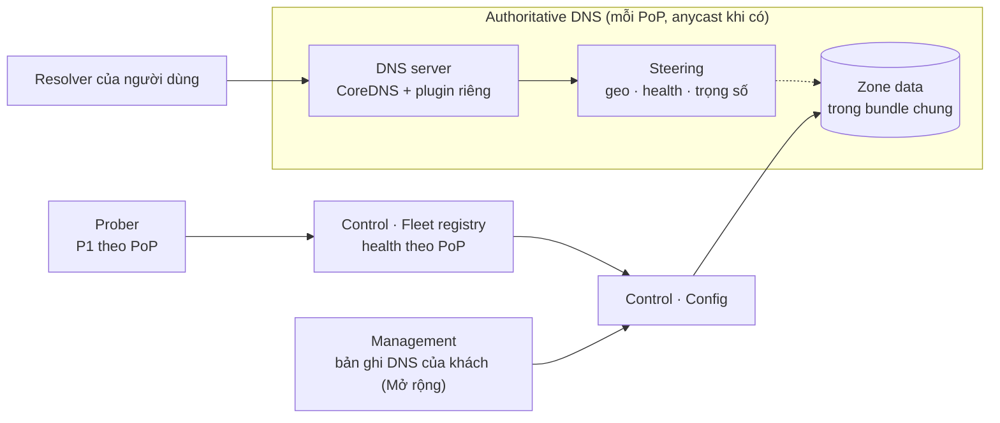

# 5.8.3 DNS và điều hướng traffic

Hai loại DNS khác nhau, đừng gộp ([ADR-0035](../../09-adr/0035-cdn-and-dns-strategy.md)):

| | DNS điều hướng (nội bộ) | DNS authoritative cho zone của khách |
|---|---|---|
| Để làm gì | Đưa người dùng tới PoP gần nhất và đang khoẻ | Khách chuyển hẳn quản lý DNS của domain sang NCC |
| Tên miền | Của NCC, ví dụ `shop-example-com.edge.waap.example` | Của khách, ví dụ `example.com` |
| Khi nào cần | **Từ MVP**, kể cả khi chưa có anycast | Mở rộng (sản phẩm bán thêm) |
| Khách cấu hình | `CNAME shop.example.com → …edge.waap.example` | Đổi nameserver tại registrar |

## Component diagram

## DNS điều hướng

| Component | Thiết kế |
|---|---|
| **DNS server** | CoreDNS (Apache-2.0) với plugin riêng đọc zone data từ snapshot; chạy ở mọi PoP; anycast khi PoP có, nếu không thì danh sách NS phân tán theo địa lý |
| **Steering** | Mỗi zone có CNAME đích riêng (`z<zone_id>.edge.<ncc>`); DNS trả **VIP của cell** chứa zone ([ADR-0041](../../09-adr/0041-cells-and-zone-placement.md)) tại PoP chọn theo: (1) vị trí resolver hoặc EDNS Client Subnet, (2) PoP đang khoẻ, (3) trọng số theo dung lượng còn lại; TTL ngắn (30–60 s); chuyển zone sang cell khác (cân bằng, cách ly khi bị tấn công) bằng cách đổi câu trả lời |
| **Rút PoP** | PoP lỗi probe hoặc quá tải bị loại khỏi câu trả lời trong ≤ 60 s ([8.13 A1](../../08-cross-cutting/13-operational-behaviors.md#a1-một-pop-xuống-cấp-hoặc-sập)) |
| **Định tuyến tấn công** | Zone đang bị tấn công lớn có thể được gán nhóm PoP riêng (cô lập ảnh hưởng tới khách khác) bằng cách đổi câu trả lời cho hostname edge của zone đó |

## DNS authoritative cho khách (Mở rộng)

| Tính năng | Ghi chú |
|---|---|
| Quản lý bản ghi qua portal, API, Terraform | Thuộc module zone của Management ([5.8.12](12-management.md)) |
| Bản ghi "proxied" | Bản ghi A/AAAA/CNAME bật proxy thì trả IP của edge thay vì IP origin, giấu origin |
| DNSSEC | Ký zone, khoá trong OpenBao |
| Load balancing, origin failover | Nhiều origin theo pool, health check từ edge, chuyển origin khi lỗi |
| Bảo vệ chính DNS | Rate limit truy vấn, chống DNS amplification, response rate limiting |

## Lỗi và hành vi

| Tình huống | Hành vi |
|---|---|
| Fleet registry không cập nhật | DNS dùng trạng thái cuối cùng biết được; probe vẫn rút PoP chết qua đường riêng |
| Một PoP DNS sập | Resolver tự thử NS khác (nhiều NS ở nhiều PoP) |
| Zone data lỗi trong snapshot | Như mọi snapshot: không qua self-test thì không ký, node giữ bản cũ |
