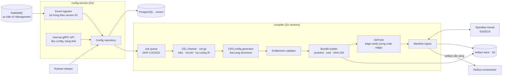

# 5.8.5 Config service và compiler (Control plane)

Nhận ý định từ Management, lưu thành bản bất biến, biên dịch ra snapshot đã ký.

## Component diagram



## Thành phần

| Component | Trách nhiệm | Thiết kế |
|---|---|---|
| **Event ingester** | Nhận `PolicyVersionPublished`, `ZoneChanged`, `EntitlementsChanged` | Consumer RabbitMQ, xác nhận sau khi ghi DB; bỏ trùng theo `(aggregate_id, version_id)`; sự kiện đến sai thứ tự bị giữ lại tới khi bản cha có mặt |
| **Config repository** | Lưu bản bất biến | Bảng chỉ insert, không update; mỗi bản có `id`, `parent_id`, `content_hash` |
| **Internal gRPC API** | Phục vụ orchestrator, console NCC, Management (đọc trạng thái) | Đọc version, lịch sử, trạng thái biên dịch và rollout |
| **Job queue** | Lập lịch biên dịch | Bảng `compile_jobs`, worker lấy bằng `FOR UPDATE SKIP LOCKED`; job khẩn có priority cao hơn |
| **CEL checker** | Kiểm tra và hạ rule xuống IR | `cel-go`: parse lại text, check với môi trường biến/hàm cố định, ước lượng chi phí; vượt giới hạn của gói → lỗi biên dịch trả về Management; hợp lệ thì hạ checked AST xuống IR cho edge ([ADR-0032](../../09-adr/0032-cel-checked-at-control-ir-at-edge.md)) |
| **CRS config generator** | Sinh cấu hình SecLang cho zone | `SecAction` cho paranoia level và ngưỡng anomaly; `SecRuleRemoveById` cho rule tắt; exception thành `SecRule ... "ctl:ruleRemoveTargetById=..."` có điều kiện path/method |
| **API compiler** | Biên dịch schema của khách | OpenAPI → route table + kiểm tham số/header (phần proxy) và validator body JSON + giới hạn GraphQL (phần WAF); kiểm schema hợp lệ, cảnh báo route trùng hoặc mơ hồ ([8.17](../../08-cross-cutting/17-api-security.md)) |
| **JWKS fetcher** | Kéo JWKS của khách | Theo URL khách khai báo, định kỳ (mặc định 10 phút) và khi edge báo `kid` lạ; kiểm định dạng và khoá; khoá đổi thì phát bundle zone qua fast lane; URL qua SSRF guard |
| **Entitlement validator** | Áp giới hạn gói | Số rule, kích thước body kiểm tra, tính năng được bật |
| **Bundle builder** | Đóng gói | Protobuf → zstd → SHA-256; bundle zone chia **phần proxy** và **phần WAF** ([5.5](../05-contracts.md#snapshot-gồm-gì)), tham chiếu digest của bundle chung; **chia custom rule theo tầng**: xếp theo priority, rule đầu tiên cần trường đắt (body, tham số đã parse, JSON path) và mọi rule sau nó vào phần WAF, các rule trước vào phần proxy ([ADR-0034](../../09-adr/0034-pre-filter-and-rule-split-across-tiers.md)) |
| **Self-test** | Bảo đảm bundle chạy được | Gọi `edge-verify` (build từ cùng code với edge, chạy sidecar cạnh compiler) để nạp bundle bằng chính loader của edge, chạy corpus request mẫu của zone (onboarding) và corpus chung; lỗi → không ký |
| **Manifest signer** | Ký | Gọi OpenBao transit `sign` với khoá Ed25519; manifest gồm danh sách digest, schema version, thời điểm, ID khoá |

## Dữ liệu (PostgreSQL · control)

```sql
-- rút gọn
zone_config_versions (id, zone_id, tenant_id, parent_id, policy_version_id,
                      payload jsonb, content_hash, channel, created_at)        -- chỉ insert
global_versions      (id, parent_id, crs_release, system_release, geo_release,
                      settings jsonb, content_hash, created_at)
entitlement_versions (id, tenant_id, plan, limits jsonb, created_at)
compile_jobs         (id, kind, ref_id, priority, status, error, locked_at, attempts)
artifacts            (digest, kind, ref_id, size, schema_version, created_at)
manifests            (digest, global_digest, zone_digests jsonb, signature, key_id, created_at)
```

## Snapshot (protobuf, rút gọn)

```protobuf
message Manifest {
  uint32 schema_version = 1;
  string global_digest  = 2;
  map<string, string> zone_digests = 3;   // zone_id -> digest
  google.protobuf.Timestamp created_at = 4;
  string key_id = 5;                       // chữ ký nằm ngoài message
}

message ZoneBundle {
  string zone_id = 1; string tenant_id = 2; string policy_version_id = 3;
  repeated string hostnames = 4;
  Origin origin = 5; TlsSettings tls = 6; FailMode fail_mode = 7;
  repeated AccessListEntry access_lists = 8;
  repeated RateLimitRule rate_limits = 9;
  repeated CompiledRule custom_rules = 10;  // IR đã hạ từ CEL, theo priority
  CrsConfig crs = 11;                        // SecLang directives sinh ra
  UnderAttack under_attack = 12;
  EdgeEntitlements entitlements = 13;        // lấy mẫu, giới hạn tài nguyên
  map<string, uint32> phase_budget_us = 14;
}
```

## Lỗi

| Tình huống | Hành vi |
|---|---|
| Rule không qua checker | Job thất bại, lỗi chi tiết (vị trí, lý do) gửi lại Management; PolicyVersion đánh dấu `compile_failed`, không rollout |
| Self-test fail | Như trên, kèm request mẫu gây lỗi |
| OpenBao không sẵn sàng | Job chờ và thử lại; đường khẩn cảnh báo NOC ngay |
