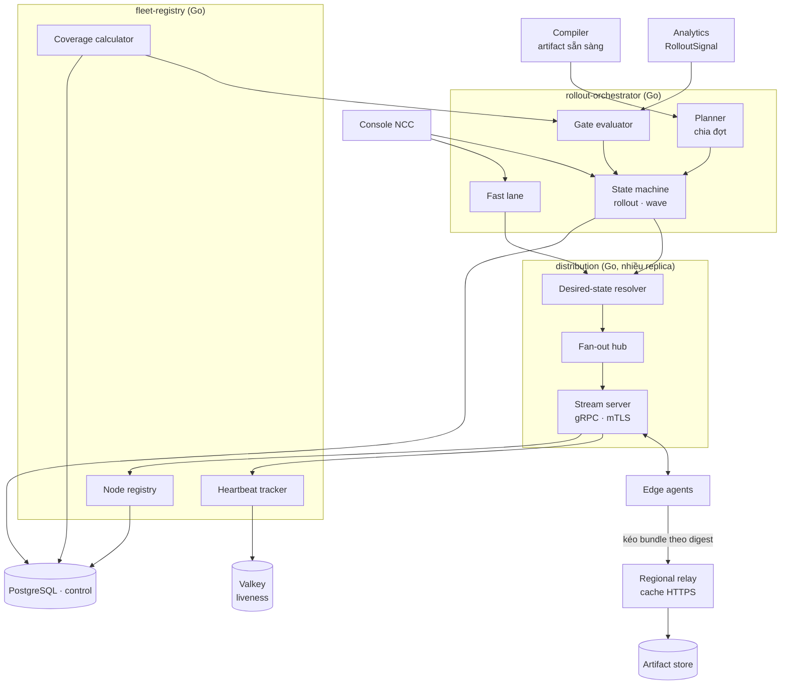
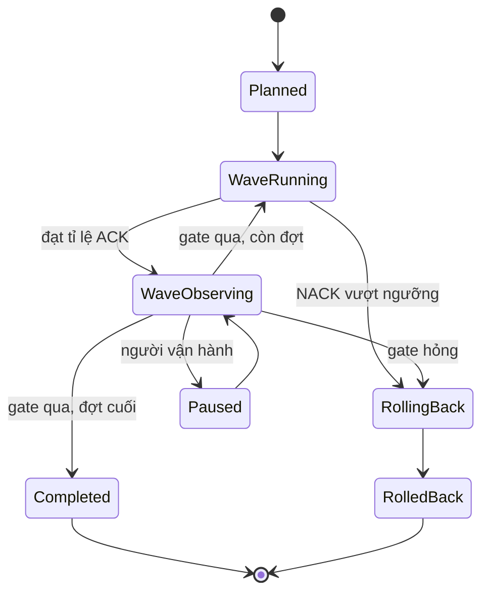

# 5.8.6 Rollout orchestrator, distribution, fleet registry (Control plane)

Quyết định node nào chạy manifest nào, đưa manifest tới node, và theo dõi kết quả.

## Component diagram



## Rollout orchestrator

| Component | Thiết kế |
|---|---|
| **Planner** | Với mỗi manifest mới, sinh kế hoạch đợt: canary (nhóm node canary của mỗi region, hoặc toàn fleet ở chế độ log-only cho ruleset mới) → từng region → toàn fleet. Kế hoạch theo loại thay đổi: policy của một zone (lớp A), bundle chung có phần lớp B (so le tối đa 25% node WAF mỗi PoP), node profile (lớp C, hot restart), phần mềm edge (lớp D) ([8.15](../../08-cross-cutting/15-config-propagation-and-apply.md)) |
| **State machine** | Lưu trong PostgreSQL, worker lấy bằng `SKIP LOCKED`; mỗi đợt có thời gian quan sát tối thiểu |
| **Gate evaluator** | Điều kiện qua đợt: tỉ lệ ACK ≥ 99% node đích, không NACK, độ trễ p99 không tăng quá ngưỡng, tỉ lệ chặn và tỉ lệ 5xx của zone không lệch quá ngưỡng so với version trước (từ Analytics) |
| **Fast lane** | Bỏ qua planner: một đợt duy nhất, toàn fleet, cờ `urgent`; vẫn ghi rollout và vẫn rollback được |



## Distribution

| Component | Thiết kế |
|---|---|
| **Desired-state resolver** | Tính manifest đích cho từng node từ trạng thái rollout và phân công zone của node (MVP: mọi node phục vụ mọi zone) |
| **Stream server** | gRPC stream hai chiều, xác thực bằng cert node; mỗi node một stream; gửi `DesiredState` khi thay đổi và khi node vừa kết nối |
| **Fan-out hub** | Phát thay đổi desired state tới mọi replica distribution (qua PostgreSQL `LISTEN/NOTIFY` hoặc Valkey pub/sub); node nối vào replica nào cũng nhận được |
| **Regional relay** | Reverse proxy cache cho artifact, khoá theo digest, cache vĩnh viễn (nội dung bất biến); xác thực node bằng mTLS; đặt ở mỗi region và tuỳ chọn ở PoP lớn |

Giao thức (rút gọn):

```protobuf
service Distribution {
  rpc Session(stream NodeMessage) returns (stream ControlMessage);
}
message ControlMessage { oneof m { DesiredState desired = 1; KeyRotation keys = 2; } }
message DesiredState   { string manifest_digest = 1; string nonce = 2; bool urgent = 3; }
message NodeMessage    { oneof m { Hello hello = 1; Ack ack = 2; Nack nack = 3; NodeStatus status = 4; } }
message Nack           { string nonce = 1; string stage = 2; string error = 3; }
```

## Fleet registry

| Component | Thiết kế |
|---|---|
| **Node registry** | Node ID, nơi chạy (PoP riêng / đối tác / cloud / hạ tầng khách), region, PoP, phiên bản phần mềm, nhóm canary, trạng thái enroll/thu hồi |
| **Heartbeat tracker** | Cập nhật liveness trong Valkey (TTL 30 s), ghi định kỳ vào PostgreSQL; node mất heartbeat bị loại khỏi mẫu số khi tính tỉ lệ ACK |
| **Coverage calculator** | "Bao nhiêu % node đang sống chạy manifest X"; phục vụ gate, console NCC, trạng thái trả về Management |

## Quy mô

Một replica distribution giữ được hàng nghìn stream; scale ngang theo số node. Băng thông chính là
tải bundle, do relay gánh; Control chỉ phục vụ relay, không phục vụ từng node.
