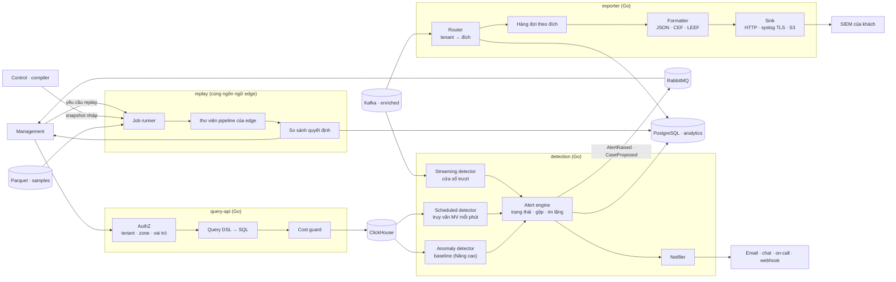

# 5.8.9 Query API, detection & alerting, export, replay (Analytics plane)

## Component diagram

## Query API

| Component | Thiết kế |
|---|---|
| **AuthZ** | Nhận danh tính đã xác thực từ Management (token dịch vụ + claim người dùng); xác định tập zone được đọc theo RBAC/ABAC |
| **Query DSL → SQL** | Truy vấn có cấu trúc (bộ lọc theo trường cho phép, khoảng thời gian, group by, top-N), không nhận SQL tự do; builder luôn chèn `tenant_id = ? AND zone_id IN (?)` và tham số hoá mọi giá trị |
| **Cost guard** | Giới hạn khoảng thời gian theo entitlements; setting ClickHouse mỗi truy vấn: `max_execution_time`, `max_rows_to_read`, `max_memory_usage`; quota theo tenant |
| **Lớp phòng thủ thứ hai** | User ClickHouse chỉ đọc cho query-api, row policy theo tenant set qua setting phiên |

Loại truy vấn: tra request ID, danh sách event có lọc, chuỗi thời gian (từ MV), top-N (IP, path,
rule, ASN, quốc gia), hiệu quả rule theo policy version, số liệu sử dụng.

## Detection & alerting

Danh mục cảnh báo WAF/DDoS, cấu hình ngưỡng và công thức tính chi tiết ở
[10-alerting-rules-and-algorithms.md](10-alerting-rules-and-algorithms.md).

| Component | Thiết kế |
|---|---|
| **Streaming detector** | Consumer `telemetry.enriched.v1`; với alert policy loại "nhanh" (ví dụ > N block trong 1 phút từ một ASN), giữ counter cửa sổ trượt theo khoá trong RAM, phân mảnh theo partition |
| **Scheduled detector** | Mỗi phút chạy truy vấn của alert policy trên MV (tỉ lệ 5xx, tỉ lệ chặn, traffic tăng vọt) |
| **Anomaly detector** | Nâng cao: baseline theo zone, giờ trong tuần (EWMA + mùa vụ), lưu trong ClickHouse; vượt dải → tín hiệu cho alert engine |
| **Alert engine** | Trạng thái alert (`firing`, `resolved`) trong PostgreSQL; gộp theo khoá; giờ im lặng; đề xuất mitigation (chặn ASN/IP có hạn, bật Under Attack mode) gửi Management dạng `CaseProposed` |
| **Notifier** | Chi tiết ở [11-notification-fanout.md](11-notification-fanout.md). Kênh: email (SMTP relay), chat (Slack, Teams, Telegram), on-call (PagerDuty, Opsgenie), webhook ký HMAC; retry có backoff, bỏ trùng theo khoá alert |

## Exporter

| Component | Thiết kế |
|---|---|
| **Router** | Cấu hình đích lấy từ Management (qua sự kiện); mỗi bản ghi enriched được định tuyến tới các đích của tenant đó |
| **Bộ lọc** | Theo đích: loại bản ghi (security event, access log, audit log), hành động (block, challenge, log, allow), zone, trường xuất; lấy mẫu riêng cho log allow. Lọc trước khi xếp hàng nên bản ghi bị loại không tốn hàng đợi. Bản nâng cao (bán thêm) dùng biểu thức cùng ngôn ngữ của rule, đã kiểm chi phí, thay vì regex ([FR-7-11](../../../requirements/02-requirements.md#f7-quan-sát-và-điều-tra)) |
| **Audit log** | Management phát audit entry (kèm hash của entry trước, theo account) sang topic riêng; exporter đẩy cùng đường với event tới đích có bật audit, giữ nguyên chuỗi hash để khách tự kiểm toàn vẹn ([FR-1-19](../../../requirements/02-requirements.md#f1-tenant-và-danh-tính)) |
| **Hàng đợi theo đích** | Mỗi đích có hàng đợi và offset riêng (lưu PostgreSQL), nên đích chậm không làm chậm đích khác; đích tụt hậu quá retention Kafka → đánh dấu mất dữ liệu, báo khách |
| **Formatter** | JSON (mặc định), CEF, LEEF; chọn trường xuất |
| **Sink** | HTTP (Splunk HEC, Elastic/OpenSearch bulk, Datadog, endpoint tuỳ ý), syslog qua TLS, ghi object storage của khách |
| **Bảo mật** | Đích kiểm qua SSRF guard (cùng chính sách với `metap-cron` webhook); credential đích lưu qua `SecretStore` |

## API discovery và dữ liệu bot

| Component | Thiết kế |
|---|---|
| **API discovery job** | Hằng giờ trên access log và mẫu request: gom path thành template, thống kê theo endpoint, so với kho API, gửi endpoint mới/shadow/zombie/không dùng về Management qua RabbitMQ; sinh schema nháp ([8.17 §4](../../08-cross-cutting/17-api-security.md#4-api-discovery-a1)) |
| **BOLA detector** (Nâng cao) | Theo `(endpoint template, api.consumer)`: số ID khác nhau, tỉ lệ 403/404 từ origin, độ tuần tự; so baseline median/MAD; vượt ngưỡng → cảnh báo API3 |
| **Bot reputation aggregator** | Hằng ngày: gộp theo JA4, fingerprint HTTP/2, ASN, IP từ toàn fleet (ẩn danh tenant), xuất bảng reputation cho ruleset release |
| **Bot model training** (Nâng cao) | Nhãn từ kết quả challenge, bot đã xác minh, phản hồi của khách; huấn luyện, đánh giá trên tập giữ lại, chuyển cho ruleset release |

## Replay

| Component | Thiết kế |
|---|---|
| **Job runner** | Nhận yêu cầu (zone, snapshot nháp, khoảng thời gian, cỡ mẫu); lấy snapshot nháp do compiler sinh (chưa ký, không rollout) |
| **Thư viện pipeline** | Replay worker viết bằng ngôn ngữ của edge, cùng code với edge ([ADR-0026](../../09-adr/0026-replay-on-request-samples-with-shared-pipeline.md)); không có I/O mạng; rate limit được mô phỏng theo thời gian trong mẫu |
| **So sánh** | Với mỗi mẫu: quyết định gốc vs quyết định mới; kết quả: số request thêm bị chặn, bớt bị chặn, theo rule, kèm ví dụ; lưu PostgreSQL, trả Management |
| **Quy mô** | Mặc định 7 ngày, tối đa N mẫu theo gói; worker scale ngang, chia theo file Parquet |
