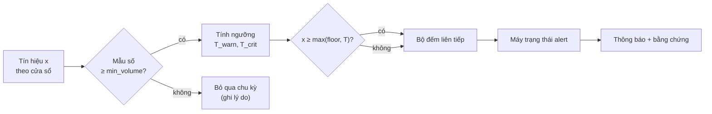
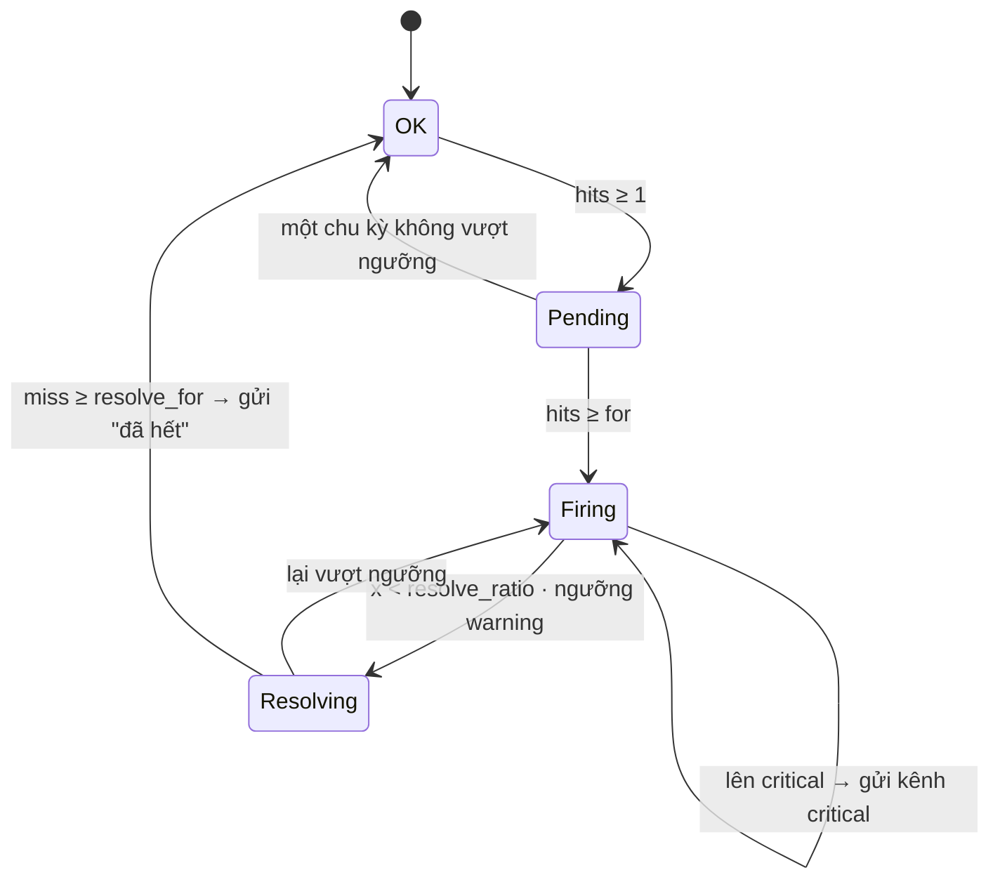

# 5.8.10 Cảnh báo WAF và DDoS: cấu hình ngưỡng và thuật toán

Chi tiết hoá phần detection & alerting ở [31](09-query-detection-export-replay.md#detection--alerting)
và luồng [6.10 E](../../06-runtime/10-analytics-flows.md#e-phát-hiện-cảnh-báo-case). Nguyên tắc
([ADR-0027](../../09-adr/0027-explicit-alert-formulas.md)): mỗi cảnh báo là một **template có công thức
tường minh**; khách chỉnh tham số, không viết truy vấn; mỗi lần cảnh báo kèm đủ số liệu đầu vào để
người nhận tự kiểm lại phép tính.

## 1. Mô hình một alert policy

| Trường | Ý nghĩa | Giá trị cho phép |
|---|---|---|
| `template` | Loại cảnh báo trong danh mục §3 | `W1`…`W6`, `D1`…`D6`, `O1`…`O3`, `BOT1`…`BOT3`, `API1`…`API3` |
| `scope` | Áp cho zone nào | một zone, nhiều zone, nhóm zone (tag), cả account |
| `window` | Cửa sổ tính tín hiệu | `1m`, `5m`, `15m`, `1h` (tuỳ template) |
| `evaluate_every` | Chu kỳ đánh giá | `10s` (streaming) hoặc `1m` (theo lịch) |
| `mode` | Cách so ngưỡng | `static`, `relative`, `statistical` (§4.3) |
| `warning`, `critical` | Ngưỡng hai mức | số tuyệt đối (static), hệ số `k` (relative), `z` (statistical) |
| `floor` | Giá trị tối thiểu để được coi là bất thường | số tuyệt đối, luôn áp dụng |
| `min_volume` | Mẫu số tối thiểu để tính tỉ lệ | số request trong cửa sổ |
| `for` | Số lần đánh giá liên tiếp vượt ngưỡng mới bật | 1–10 |
| `resolve_ratio`, `resolve_for` | Điều kiện tự tắt (hysteresis) | mặc định 0,8 và 5 |
| `group_by` | Tách cảnh báo theo khoá | tuỳ template: `zone`, `client_ip`, `asn`, `country`, `rule_id`, `path` |
| `renotify` | Nhắc lại khi vẫn đang bật | `15m`…`24h`, hoặc tắt |
| `channels` | Kênh gửi theo mức | email, chat, on-call, webhook |
| `suggest_mitigation` | Có kèm đề xuất hành động không | bật/tắt (§5) |

Ví dụ (dạng lưu ở Management, cũng là dạng của Terraform provider):

```yaml
name: "Flood L7 - shop.example.com"
template: D1
scope: { zones: ["shop.example.com"] }
window: 1m
evaluate_every: 10s
mode: relative
warning:  { k: 3 }
critical: { k: 6 }
floor: 1000          # rps
for: 3
resolve_ratio: 0.8
resolve_for: 5
channels:
  warning:  ["slack:#soc"]
  critical: ["slack:#soc", "pagerduty:waap-oncall"]
suggest_mitigation: true
```

Validator ở Management từ chối tổ hợp vô nghĩa (ví dụ `window: 1m` với `evaluate_every: 1m` ở template
streaming, `critical` thấp hơn `warning`, `min_volume` = 0 cho tín hiệu tỉ lệ).

## 2. Tín hiệu đầu vào

Mọi tín hiệu tính từ dữ liệu đã có trong pipeline Analytics:

| Ký hiệu | Định nghĩa | Nguồn |
|---|---|---|
| `R` | Tổng request của zone trong cửa sổ | access log, **đã nhân ngược tỉ lệ lấy mẫu** (`count / sampling_rate`) |
| `B_phase` | Request bị chặn hoặc challenge ở một phase (`waf`, `custom`, `ratelimit`, `ddos`, `uam`, `acl`) | security event (không lấy mẫu, số chính xác) |
| `B_rule` | Request bị chặn bởi một rule ID | security event |
| `U` | Số IP nguồn khác nhau | access log (ước lượng HyperLogLog) |
| `E5` | Response 5xx từ origin | access log, nhân ngược tỉ lệ lấy mẫu |
| `L95` | p95 độ trễ origin | access log (quantile state) |
| `rps` | `R / window_seconds` | |

Bucket thời gian: streaming detector giữ bucket **10 giây**; cửa sổ `W` là tổng của `W / 10s` bucket
gần nhất (cửa sổ trượt theo bước 10 s). Scheduled detector đọc MV theo phút.

Lưu ý về lấy mẫu: khi gói có lấy mẫu access log với tỉ lệ `s`, `R` là ước lượng với sai số tương đối
xấp xỉ `1/sqrt(s · R_thật)`. Với `min_volume` mặc định (1.000 request), `s = 0,1` cho sai số khoảng
3%; con số này hiển thị kèm cảnh báo.

## 3. Danh mục cảnh báo

### WAF

| ID | Tên | Công thức tín hiệu `x` | `group_by` | Mặc định |
|---|---|---|---|---|
| **W1** | Tỉ lệ chặn WAF tăng | `x = (B_waf + B_custom) / R`, chỉ tính khi `R ≥ min_volume` | zone | relative, warning `k=2`, critical `k=4`, floor 1%, window 5m |
| **W2** | Một rule bắn đột biến | `x = B_rule` trong cửa sổ | zone, rule_id | statistical, warning `z=4`, critical `z=8`, floor 50, window 5m |
| **W3** | Tấn công tập trung từ một nguồn | `x = B_waf + B_custom` của một khoá nguồn | client_ip hoặc asn | static, warning 100, critical 1.000, window 1m |
| **W4** | Quét lỗ hổng | `x = số nhóm tấn công CRS khác nhau` (SQLi, XSS, LFI, RFI, RCE, PHP, Java, scanner) bị một IP kích hoạt | client_ip | static, warning 3, critical 5, window 5m |
| **W5** | Nghi chặn nhầm | `x = U_blocked(rule) / U(zone)`: tỉ lệ IP khác nhau bị một rule chặn; chỉ tính khi `U_blocked(rule) ≥ 20` | zone, rule_id | static, warning 5%, critical 15%, window 15m |
| **W6** | Thay đổi lớn sau khi đổi policy | `x = |chặn_rate(v_mới) − chặn_rate(v_cũ)|` theo điểm phần trăm, trong 30 phút sau khi version mới đạt 100% node | zone | static, warning 2 pp, critical 5 pp |

Ghi chú:

- **W3 vs W5:** cùng là nhiều request bị chặn, nhưng W3 là ít nguồn và nhiều request mỗi nguồn (tấn
  công), W5 là rất nhiều nguồn khác nhau cùng bị một rule chặn (thường là chặn nhầm người dùng thật).
- W5 không đề xuất chặn mà đề xuất **mở màn hình xử lý chặn nhầm** cho rule đó.

### DDoS

| ID | Tên | Công thức tín hiệu `x` | `group_by` | Mặc định |
|---|---|---|---|---|
| **D1** | Flood L7 (lưu lượng tăng đột biến) | `x = rps` của zone | zone | relative, warning `k=3`, critical `k=6`, floor 1.000 rps, window 1m, `for=3` |
| **D2** | Mitigation DDoS đang hoạt động | `x = (B_ddos + B_ratelimit + B_uam) / window_seconds` (request bị giảm thiểu mỗi giây) | zone | static, warning 100 rps, critical 1.000 rps, window 1m |
| **D3** | Nguồn phân tán (botnet) | `x = U / U_baseline` **và** `top1_share = max_ip(R_ip) / R < 5%` | zone | relative, warning `k=5`, critical `k=10`, floor 5.000 IP, window 5m |
| **D4** | Origin quá tải | `x₁ = E5 / R` hoặc `x₂ = L95`; bật khi một trong hai vượt | zone | static, warning 5% / 2 s, critical 20% / 5 s, `min_volume` 500, window 5m |
| **D5** | Đề xuất bật Under Attack mode | Tổ hợp: `D1 ≥ warning` **và** (`D4 ≥ warning` **hoặc** `D3 ≥ warning`) trong cùng chu kỳ | zone | không có ngưỡng riêng, dùng ngưỡng của D1, D3, D4 |
| **D6** | Rate limit rule kích hoạt hàng loạt | `x = B_rule` với rule loại rate limit | zone, rule_id | static, warning 1.000, critical 10.000, window 5m |

### Origin và nền tảng

Dựa trên `status_source` và `edge_error` ([8.14](../../08-cross-cutting/14-latency-and-error-attribution.md)).

| ID | Tên | Công thức tín hiệu `x` | `group_by` | Mặc định |
|---|---|---|---|---|
| **O1** | Không kết nối được origin | `x = R(status_source = origin_unreachable) / R`, kèm phân bố `edge_error` | zone, edge_error | static, warning 1%, critical 5%, `min_volume` 200, window 5m |
| **O2** | Lỗi do nền tảng trong zone | `x = R(status_source = edge_platform) / R` | zone | static, warning 0,1%, critical 1%, `min_volume` 1.000, window 5m; luôn gửi kèm cho NOC |
| **O3** | Origin chậm | `x = p95(origin_ttfb_us)` | zone | relative, warning `k=2`, critical `k=4`, floor 500 ms, window 15m |

### Bot và API

| ID | Tên | Công thức tín hiệu `x` | `group_by` | Mặc định |
|---|---|---|---|---|
| **BOT1** | Lưu lượng tự động tăng | `x = R(bot.class ∈ {likely_automated, automated}) / R` | zone, nhóm path | relative, warning `k=2`, critical `k=4`, floor 5%, `min_volume` 1.000, window 15m |
| **BOT2** | Nghi credential stuffing | Trên endpoint đăng nhập khách khai báo: `x = số lần đăng nhập thất bại` (theo status/response origin) theo IP, ASN hoặc fingerprint | zone, asn | static, warning 50, critical 500, window 5m |
| **BOT3** | Bot giả danh | `x = R(bot.signals ∋ impersonation)` | zone | static, warning 100, critical 1.000, window 15m |
| **API1** | Vi phạm schema tăng | `x = R(vi phạm schema) / R(endpoint)` | zone, endpoint | relative, warning `k=3`, critical `k=10`, floor 1%, `min_volume` 200, window 15m |
| **API2** | Lỗi xác thực tăng | `x = R(JWT không hợp lệ hoặc 401/403 từ origin) / R` trên endpoint có xác thực | zone, endpoint | relative, warning `k=3`, critical `k=6`, floor 2%, window 5m |
| **API3** | Nghi duyệt đối tượng (BOLA, Nâng cao) | `x = số ID khác nhau theo (endpoint, consumer)` so với baseline | zone, endpoint, consumer | statistical, warning `z=6`, critical `z=12`, window 15m |

Endpoint mới hoặc shadow do discovery tìm thấy là **thông báo** (không phải cảnh báo), gửi theo lịch.

L3/L4 (khi hạ tầng hoặc đối tác cung cấp telemetry): template `D7` cùng mô hình, tín hiệu là gói/giây
và băng thông, để ở giai đoạn Mở rộng.

## 4. Thuật toán

### 4.1 Luồng đánh giá



### 4.2 Bước đánh giá (mỗi chu kỳ, mỗi khoá `group_by`)

```text
nếu là tín hiệu tỉ lệ và mẫu_số < min_volume:
    bỏ qua chu kỳ (không tăng, không reset bộ đếm)
T_warn, T_crit = ngưỡng(mode, baseline)              # §4.3
level = critical  nếu x ≥ max(floor, T_crit)
        warning   nếu x ≥ max(floor, T_warn)
        none      ngược lại
nếu level ≥ warning: hits += 1, miss = 0
ngược lại nếu x < resolve_ratio · max(floor, T_warn): miss += 1, hits = 0
ngược lại: giữ nguyên hits, miss                     # vùng trễ, không bật không tắt

riêng trạng thái Pending: level = none → hits = 0      # phải vượt liên tiếp đủ `for` lần
```

### 4.3 Ba cách tính ngưỡng

| Mode | `T` | Dùng khi |
|---|---|---|
| `static` | `T = giá trị khách nhập` | Tín hiệu có ý nghĩa tuyệt đối (số nhóm tấn công, rps bị giảm thiểu) |
| `relative` | `T = k · E` | Tín hiệu theo mùa vụ rõ (lưu lượng), khách hiểu "gấp k lần bình thường" |
| `statistical` | `T = E + z · S` | Tín hiệu dao động không đều (số lần một rule bắn) |

Trong đó `E` (mức kỳ vọng) và `S` (độ phân tán) lấy từ baseline:

- **Tập lịch sử H:** giá trị của tín hiệu ở **cùng phút trong tuần** của 4 tuần trước, mỗi tuần lấy
  ±15 phút quanh thời điểm đó (tổng 4 × 31 = 124 điểm).
- `E = median(H)`, `S = 1,4826 · median(|h − E|)` (MAD quy đổi tương đương độ lệch chuẩn khi dữ liệu
  gần chuẩn; dùng median và MAD vì không bị một đợt tấn công cũ kéo lệch như trung bình và độ lệch chuẩn).
- **Zone mới, chưa đủ 7 ngày lịch sử:** `H` = mọi điểm 1 phút trong 24 giờ gần nhất; chưa đủ 24 giờ
  thì chỉ dùng `static` và `floor`, cảnh báo ghi rõ "chưa có baseline".
- **Loại khỏi H** những phút đã có alert `critical` của chính template đó, để đợt tấn công tuần trước
  không nâng ngưỡng tuần này.
- Baseline được tính lại mỗi giờ bằng job đọc `traffic_1m`, lưu bảng `alert_baselines(zone, signal,
  minute_of_week, E, S, n, computed_at)`.

### 4.4 Máy trạng thái của một alert



- Mỗi khoá `(policy_id, giá trị group_by)` có tối đa một alert đang mở.
- `renotify`: alert vẫn `Firing` thì nhắc lại theo chu kỳ, kèm số liệu mới nhất.
- **Chống bão:** một policy sinh quá 20 alert mới trong 10 phút (ví dụ W3 theo IP khi bị botnet) thì
  gộp thành một alert tổng hợp "N nguồn vượt ngưỡng", liệt kê top 20.

## 5. Bằng chứng kèm mỗi cảnh báo

Người nhận phải tự kiểm lại được phép tính mà không cần mở hệ thống:

```json
{
  "template": "D1", "level": "critical", "zone": "shop.example.com",
  "window": "1m", "evaluated_at": "2026-11-06T14:21:30Z",
  "value": 13250, "unit": "rps",
  "threshold": { "mode": "relative", "k": 6, "expected": 2050, "computed": 12300, "floor": 1000 },
  "baseline": { "method": "median 4 tuần, cùng phút trong tuần ±15'", "points": 124 },
  "consecutive": 4, "for": 3,
  "sampling": { "rate": 0.1, "relative_error": 0.009 },
  "top_contributors": {
    "asn": [["AS64500", 0.41], ["AS64511", 0.22]],
    "path": [["/login", 0.63]],
    "country": [["XX", 0.38]]
  },
  "suggested_mitigation": {
    "action": "enable_under_attack_mode", "expires_in": "2h",
    "reason": "D1 critical + D4 warning (5xx 9,4%)"
  },
  "links": { "dashboard": "...", "investigate": "..." }
}
```

`top_contributors` lấy từ cùng cửa sổ, cho biết nên chặn theo khoá nào. Đề xuất mitigation chỉ là đề
xuất: người dùng chấp nhận thì thành ChangeRequest (kênh khẩn cho Under Attack mode và rule tạm có hạn).

| Template | Đề xuất |
|---|---|
| W3 | Thêm IP/ASN vào access list chặn, hạn 24 h |
| W4 | Chặn IP, hạn 24 h |
| W5 | Mở màn hình xử lý chặn nhầm của rule |
| W6 | So sánh version, rollback |
| D1, D5 | Bật Under Attack mode, hạn 2 h |
| D3 | Bật Under Attack mode hoặc rate limit theo path có top share cao |
| D4 | Rate limit theo path nặng nhất; kiểm tra origin |

## 6. Chạy ở đâu

| Template | Detector | Lý do |
|---|---|---|
| D1, D2, W3, W4, BOT2 | Streaming (bucket 10 s trên Kafka enriched) | Cần phản ứng trong vài chục giây |
| W1, W2, W5, D3, D4, D6, O1, O2, O3, BOT1, BOT3, API1, API2 | Scheduled (mỗi phút trên MV) | Cửa sổ 5–15 phút, cần baseline hoặc đếm IP khác nhau |
| W6 | Scheduled, kích hoạt khi có version mới đạt 100% node | Gắn với rollout |
| D5 | Alert engine, tổ hợp kết quả các template khác | Không có tín hiệu riêng |

Streaming detector đọc baseline mới nhất từ `alert_baselines` (cache trong RAM, làm mới mỗi giờ).

Dữ liệu cần có thêm trong ClickHouse để tính các tín hiệu trên: MV `traffic_1m` có thêm cột `phase`,
`status_class`, `asn`, state `uniq(client_ip)` và `quantiles(0.95)(origin_latency_ms)`; MV
`rule_ip_15m` (số IP khác nhau theo rule) cho W5.

## 7. Thử policy trước khi bật

Portal có nút **Xem thử trên 7 ngày**: chạy đúng thuật toán §4 trên dữ liệu `traffic_1m` 7 ngày qua,
trả về số lần policy sẽ bật, thời điểm, mức. Khách chỉnh ngưỡng tới khi số lần bật hợp lý rồi mới lưu.
Cùng code thuật toán với detector (package Go dùng chung), nên kết quả xem thử khớp với thực tế.

## 8. Ví dụ tính tay

Zone có `E = 2.050 rps` ở 14:21 thứ Năm (median 124 điểm), D1 mode `relative`, warning `k=3`, critical
`k=6`, floor 1.000, `for=3`, `resolve_ratio=0,8`, `resolve_for=5`, đánh giá mỗi 10 s.

| Thời điểm | `x` (rps) | `T_warn` = max(1.000, 3·2.050) | `T_crit` = max(1.000, 6·2.050) | Mức | Trạng thái |
|---|---|---|---|---|---|
| 14:21:00 | 5.900 | 6.150 | 12.300 | none | OK |
| 14:21:10 | 7.800 | 6.150 | 12.300 | warning | Pending (1/3) |
| 14:21:20 | 9.600 | 6.150 | 12.300 | warning | Pending (2/3) |
| 14:21:30 | 13.250 | 6.150 | 12.300 | critical | **Firing**, gửi kênh critical |
| … | | | | | |
| 14:40:00 | 4.700 | 6.150 | | < 0,8·6.150 = 4.920 | Resolving (1/5) |
| 14:40:40 | 4.300 | | | | **OK** sau 5 lần, gửi "đã hết" |
