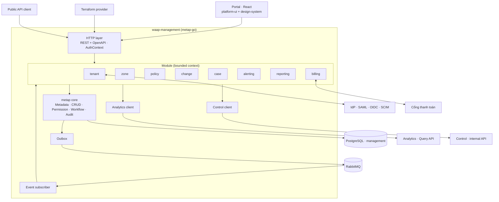

# 5.8.10 Management plane

Một **modular monolith** trên `metap-go`, không tách microservice như demo. Đội nhỏ, các context
dùng chung tenant, quyền, audit; tách service khi có lý do scale cụ thể.

## Component diagram

## Module

| Module | Entity chính (EntityDefinition) | Workflow | Hành động ngoài CRUD |
|---|---|---|---|
| **tenant** | Org, Account, Member, Role binding, ApiKey, SsoConnection | — | Đăng nhập SAML/OIDC, SCIM `/Users` `/Groups`, tạo/thu hồi API key |
| **zone** | Zone, Hostname, Origin, CertRequest | `pending → verifying → active ↔ paused → removed` | Xác minh DNS, kiểm origin, đổi fail mode |
| **policy** | PolicyDraft, CustomRule, AccessList, RateLimitRule, ManagedRulesetConfig, Exception, ZoneSettings, PolicyVersion | — | Validate CEL (gọi cùng thư viện checker với Control), tạo PolicyVersion bất biến, rollback |
| **change** | ChangeRequest, Approval | `draft → simulating → pending_approval → approved → publishing → enforced` / `rejected` / `rolled_back` | Gửi replay, duyệt 4-eyes, publish (ghi outbox), kênh khẩn (Under Attack mode, rule tạm) |
| **case** | Case, CaseLink, Mitigation | `open → acknowledged → mitigating → resolved` | Chấp nhận đề xuất từ `CaseProposed` thành ChangeRequest khẩn có hạn |
| **alerting** | AlertPolicy, NotificationChannel, ExportDestination | — | Thử kênh, phát cấu hình sang Analytics |
| **reporting** | SavedSearch, ReportDefinition, ReportRun | — | Chạy báo cáo theo lịch (`metap-cron`), xuất PDF/CSV |
| **billing** | Plan, Subscription, Entitlements, Invoice, UsageRecord | `trial → active → past_due → suspended` | Phát `EntitlementsChanged`, nhận `UsageReport`, gọi cổng thanh toán |

Audit dùng `metap-audit` cho mọi entity; FP label (đánh dấu chặn nhầm) ghi ở Management rồi phát
sang Analytics để join vào hiệu quả rule.

## Tích hợp

| Hướng | Cơ chế |
|---|---|
| Management → Control | Outbox → RabbitMQ (`PolicyVersionPublished`, `ZoneChanged`, `EntitlementsChanged`); đọc trạng thái biên dịch/rollout qua Control internal API |
| Management → Analytics | Query API (đồng bộ); cấu hình alert/export/FP label qua RabbitMQ |
| Analytics → Management | RabbitMQ (`AlertRaised`, `CaseProposed`, `UsageReport`, kết quả replay) |
| Người dùng | REST + OpenAPI sinh từ metadata; UI và Terraform dùng cùng API |

## Quyền mặc định

| Vai trò | Quyền |
|---|---|
| Account owner | Toàn quyền account, billing |
| Security admin | Zone, policy, duyệt, alert, export |
| SOC analyst | Đọc mọi thứ, tạo exception và rule tạm qua ChangeRequest, quản lý case, bật Under Attack mode |
| Developer | Đọc zone được giao, tạo exception trong phạm vi được giao (cần duyệt) |
| Viewer | Chỉ đọc dashboard và event |
| Billing | Gói, hoá đơn |

ABAC giới hạn theo zone hoặc nhóm zone (tag). Duyệt 4-eyes: người duyệt khác người tạo, bật theo account.
