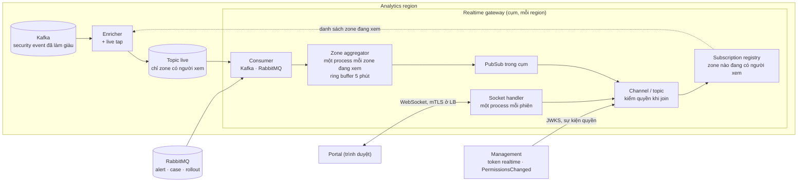
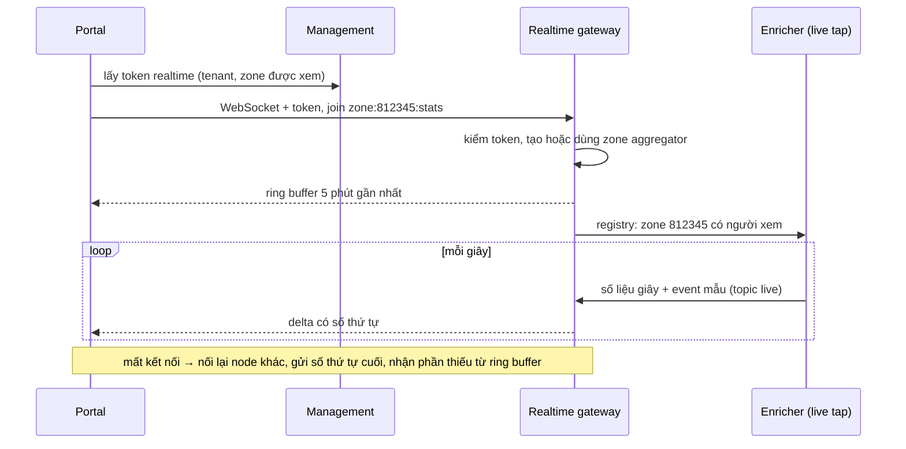

# 5.8.13 Realtime gateway (Analytics plane)

Đẩy dữ liệu gần realtime tới portal: số liệu traffic từng giây của zone đang xem, security event mới,
cảnh báo, tiến độ lan truyền cấu hình, cập nhật case. Công nghệ chờ chọn theo
[ADR-0044](../../09-adr/0044-realtime-gateway-and-notifier-runtime.md) (đề xuất Elixir + Phoenix
Channels).

## Vì sao cần thành phần riêng

| | Query API ([5.8.9](09-query-detection-export-replay.md)) | Realtime gateway |
|---|---|---|
| Kiểu | Hỏi đáp (request/response) | Đẩy (kết nối dài, WebSocket) |
| Nguồn | ClickHouse, archive | Kafka (luồng đã làm giàu), RabbitMQ |
| Độ trễ tới người xem | Theo dashboard refresh (giây tới phút) | ≤ 5 s p95 từ edge tới màn hình |
| Tải | Theo số truy vấn | Theo **số phiên mở** và số zone đang được xem |

Ở quy mô 1 triệu zone ([7.5](../../07-deployment/05-capacity-and-sharding.md)), số phiên portal mở cùng
lúc ước tính:

| Tình huống | Phiên đồng thời | Ghi chú |
|---|---|---|
| Bình thường | 10.000–30.000 | Đội SOC của khách để màn hình giám sát mở cả ngày |
| Đợt tấn công lớn hoặc sự kiện bán hàng | **50.000–100.000** | Mọi khách bị ảnh hưởng cùng mở dashboard; vài chục nghìn kết nối mới trong vài phút |

Polling Query API mỗi vài giây với số phiên này là hàng chục nghìn truy vấn ClickHouse mỗi giây, đúng
lúc ClickHouse đang chịu tải ghi cao nhất vì tấn công. Vì vậy luồng realtime tách khỏi luồng truy vấn.

## Component diagram

## Thành phần

| Component | Thiết kế |
|---|---|
| **Socket handler** | WebSocket (fallback long-polling); mỗi phiên là một process nhẹ, có hàng đợi gửi giới hạn; client chậm thì bỏ bớt event mẫu, chỉ giữ số liệu tổng, không để hàng đợi phình |
| **Channel / topic** | `zone:{id}:stats` (số liệu mỗi giây), `zone:{id}:events` (security event mẫu), `tenant:{id}:alerts`, `tenant:{id}:cases`, `rollout:{version}` (độ phủ theo node, [8.15](../../08-cross-cutting/15-config-propagation-and-apply.md)). Join kiểm token realtime: tenant, danh sách zone được xem, vai trò |
| **Token realtime** | Management cấp cho phiên portal, JWT hạn 5 phút, làm mới qua chính kết nối; gateway kiểm bằng JWKS của Management, không gọi database. Đổi quyền hay khoá user: Management phát `PermissionsChanged`, gateway đóng channel tương ứng ngay |
| **Subscription registry** | Tập zone đang có ít nhất một người xem trong region; đồng bộ cho enricher mỗi vài giây |
| **Live tap (trong enricher)** | Enricher (Go, [5.8.8](08-ingestion-and-storage.md)) chỉ ghi vào topic `live` cho zone có trong registry: số liệu gộp mỗi giây và security event đã che, **trần 50 event/s mỗi zone** (lấy mẫu khi vượt). Đầu vào của gateway tỉ lệ với số zone đang được xem, không với tổng traffic hay cường độ tấn công |
| **Zone aggregator** | Một process cho mỗi zone đang xem: nhận số liệu giây, tính top rule, top IP (heavy hitter), top quốc gia, phân bố hành động; giữ ring buffer 5 phút để client mới join hoặc kết nối lại có ngay lịch sử gần; tự dừng khi không còn người xem |
| **PubSub trong cụm** | Một message của zone gửi một lần tới các node có phiên đang xem zone đó, rồi fan-out trong node |
| **Consumer** | Kafka (topic `live`, chia partition theo tenant cho các node) và RabbitMQ (alert, case, rollout từ Management và Control) |

## Luồng: mở dashboard của một zone

## Năng lực và triển khai

| Đại lượng | Thiết kế |
|---|---|
| Phiên mỗi node | Mục tiêu 10.000 (bảo thủ; BEAM giữ được nhiều hơn nhiều), ≈ 100 KB RAM mỗi phiên |
| Node mỗi region | Theo đỉnh của region: 100.000 phiên toàn cầu chia 2–3 region → 4–6 node mỗi region + N+1 |
| Message ra | ≈ 1–3 message số liệu/s mỗi phiên + event mẫu tới 10/s → đỉnh ≈ 1 triệu message/s toàn cầu, ≈ 300 B mỗi message |
| Đặt ở đâu | Mỗi Analytics region, cạnh Kafka; portal nối vào endpoint realtime của region chứa tenant, nên dữ liệu không rời region ([8.6](../../08-cross-cutting/00-index.md)) |
| Đặc tính tải | Chủ yếu là số kết nối và RAM; CPU thấp. Không phụ thuộc cường độ tấn công nhờ live tap có trần |

## Theo gói

| | Free có trần, Pro | Business | Enterprise |
|---|---|---|---|
| Số liệu live | Mỗi 5 s | Mỗi 1 s | Mỗi 1 s |
| Event live | — | 10 event/s mỗi zone đang xem | 50 event/s |
| Phiên đồng thời mỗi tenant | 3 | 25 | Theo hợp đồng |

## Lỗi và hành vi

| Tình huống | Hành vi |
|---|---|
| Một node gateway chết | Client tự nối lại node khác qua load balancer (backoff có jitter), gửi số thứ tự cuối, lấy phần thiếu từ ring buffer của zone aggregator (đã có trên node mới qua PubSub, hoặc dựng lại từ topic `live`) |
| Kafka hoặc enricher trễ | Gateway gửi trạng thái "dữ liệu trễ X giây" để portal hiển thị; không tự chuyển sang polling ClickHouse |
| Hàng chục nghìn kết nối mới cùng lúc (đợt tấn công) | Giới hạn tốc độ kết nối mới theo tenant và theo node; token realtime kiểm cục bộ nên không dồn tải vào Management; zone aggregator dùng chung cho mọi người xem cùng zone |
| Quá tải | Hạ cấp theo thứ tự: giảm event mẫu, giãn số liệu Free/Pro lên 10 s, từ chối phiên mới vượt hạn mức của gói; không bao giờ ảnh hưởng luồng ghi log hay Query API |
| Management không cấp được token mới | Phiên đang mở giữ tới khi token hết hạn; portal báo không thể nối lại; dashboard vẫn dùng được qua Query API |
