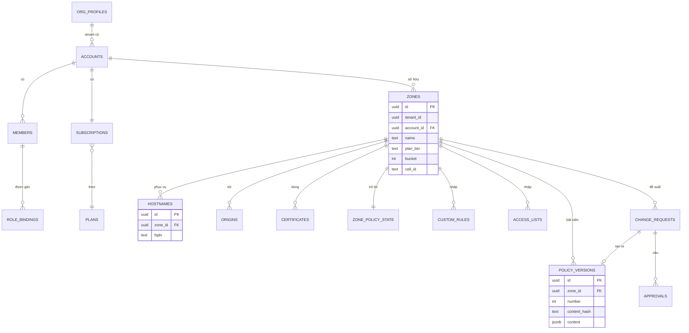

# 5.8.14 Database của Management plane

> **Trạng thái: thiết kế v1 (2026-11-06), cần đối chiếu lại** với [bản đồ phân rã chức năng](../../../requirements/01-functional-decomposition.md)
> và [requirements](../../../requirements/02-requirements.md) sau khi hai mục đó được review: đã thấy thiếu một số đối tượng dữ liệu
> (bản đồ phân rã, mục "Đối chiếu với thiết kế hiện có"). Các quyết định nền tảng (DB1–DB4, MG1–MG5) không đổi.
> Quyết định nền:
> [ADR-0046](../../09-adr/0046-management-database-tenancy-and-storage.md). Mô hình logic ở
> [5.6](../06-data-model.md); module và workflow ở [5.8.12](12-management.md).

Management dùng PostgreSQL qua `metap-go`: phần lớn bảng là **entity do metadata khai báo**, reconciler
của metap tự tạo và giữ schema. Một số bảng lớn, chỉ ghi thêm, hoặc dùng chung toàn nền tảng thì viết
bằng migration SQL như bảng nền tảng của metap.

## 1. Ràng buộc từ metap-go

Mỗi bảng entity có sẵn các cột:

| Cột | Ý nghĩa |
|---|---|
| `id` uuid, `tenant_id` uuid | Khoá chính; tenant của bản ghi |
| `code`, `status` | Mã hiển thị; trạng thái workflow (nếu entity có workflow) |
| `data` jsonb | Mọi field khai báo trong metadata, mặc định nằm ở đây |
| `version` integer | Optimistic locking: update và delete kiểm `WHERE version = $n` |
| `deleted` boolean | Xoá mềm |
| `created_at`, `updated_at`, `created_by`, `updated_by` | Dấu vết |

| Quy tắc | Hệ quả cho thiết kế |
|---|---|
| Field `indexed`/`sortable`/`unique`/`searchable` được nâng thành cột sinh ra từ `data` có index; field `reference` có `refEntity` thành cột thật có FK `ON DELETE RESTRICT` | Chỉ nâng field thật sự dùng để lọc, sắp xếp, nối; còn lại để trong `data` |
| `unique` là partial unique index `WHERE deleted = false`; composite unique theo nhiều field | Xoá mềm rồi tạo lại cùng giá trị được |
| Ghi entity và ghi outbox trong cùng transaction; audit ghi sau commit (`metap-audit`) | Sự kiện sang Control/Analytics không bao giờ mất |
| Reference chỉ trỏ được tới entity cùng schema | Tham chiếu sang `metadata.users` (user của metap) là uuid thường, không FK |
| Mỗi transaction đặt `SET LOCAL search_path` theo tenant (`Router::begin`) | Dùng được với PgBouncer chế độ transaction |

### Thiếu sót của metap-go đã sửa ở metap-go (Phase 103)

WAAP là sản phẩm dẫn đường cho `metap-go`, nên các thiếu sót tìm được khi thiết kế được sửa thẳng ở nền
tảng thay vì vá trong Management (`metap-docs`, roadmap Phase 103):

| # | Thiếu sót | Trạng thái ở `metap-go` | Management dùng thế nào |
|---|---|---|---|
| MG1 | Không có index nào bắt đầu bằng `tenant_id` | **Đã sửa:** mọi bảng entity có index `tenant_id`; index của field `indexed`/`sortable` là `(tenant_id, field)` | Không cần index tay |
| MG2 | `unique` có hiệu lực trên toàn bảng | **Đã sửa:** `uniqueScope` = `tenant` (mặc định) hoặc `global` | Mặc định cho mọi unique; `global` chỉ cho giá trị định danh ngoài tenant (cũng chỉ trong một database, nên vẫn cần `waap_global` ở mục 6) |
| MG3 | Reconciler không tạo được bảng partition | Chưa làm, có chủ đích | Bảng lớn chỉ ghi thêm ở migration SQL (mục 5) |
| MG4 | `metadata.audit_trail_entries` không partition | **Đã sửa:** partition theo tháng (migration 0038), `cron-scheduler` tạo trước partition; không xoá dòng nào | Archive theo tháng (mục 5) |
| MG5 | Field hệ thống đi qua CRUD làm tăng `version` và ghi audit | **Đã sửa:** field `system` + `CrudService.SetSystemFields` | `api_keys.lastUsedAt`, `zones.lastSeenAt`, bộ đếm |

Khi làm còn tìm thấy và sửa một lỗi thật của reconciler: `DROP INDEX` không ghi schema nên không bao giờ
xoá được index của bảng ở schema sản phẩm, làm reconcile không hội tụ khi một index đổi hình dạng mà giữ
tên (gốc của lỗi "partial unique index không hội tụ" ghi trong `CLAUDE.md` của repo này).

## 2. Tenant và nơi đặt dữ liệu

| Khái niệm WAAP | Ánh xạ |
|---|---|
| **Org** (công ty khách) | **Tenant của metap** (`control.tenants`): ranh giới cô lập dữ liệu, quyền, audit |
| Account | Entity trong tenant; gắn subscription, gói, region dữ liệu |
| Zone và mọi thứ của zone | Entity trong tenant, có `account_id` |
| NCC (vận hành) | `PLATFORM_TENANT_ID` của metap; giữ danh mục gói, ruleset release, dữ liệu dùng chung |

| Chiến lược | Dùng cho | Lý do |
|---|---|---|
| **Bảng chung, schema `waap`, phân biệt bằng `tenant_id`** | Mọi org mặc định (Free có trần, Pro, Business, phần lớn Enterprise) | Hàng trăm nghìn org; schema riêng cho mỗi org (`t_<uuid>`) sẽ làm catalog PostgreSQL phình ra hàng chục triệu object |
| **Database riêng (`DedicatedDb`)** | Enterprise cần cô lập vật lý, residency của cấu hình, hoặc khối lượng rất lớn | Đã có trong `metap-control`; theo hợp đồng |
| Schema riêng cho mỗi tenant | Không dùng ở SaaS | Chỉ hợp khi số tenant nhỏ (on-prem một khách) |

Schema trong database dùng chung:

| Schema | Chứa | Quản lý bởi |
|---|---|---|
| `waap` | Entity của các module (mục 4) | Reconciler của metap |
| `waap_ops` | Bảng lớn, chỉ ghi thêm, partition (mục 5) | Migration SQL |
| `waap_global` | Registry dùng chung mọi tenant, kể cả tenant ở database riêng (mục 6) | Migration SQL |
| `metadata`, `control` | Bảng nền tảng của metap: user, role, policy quyền, outbox, audit, cron, tenant | Migration của metap |

## 3. Quy mô ước lượng (thiết kế cho 1 triệu zone)

| Bảng | Số dòng | Kích thước | Ghi |
|---|---|---|---|
| Org / account | ≈ 400k / 500k | < 1 GB | Thấp |
| Member (user × account) | ≈ 1,5 triệu | < 1 GB | Thấp |
| Zone / hostname / origin | 1M / 3M / 1,2M | ≈ 5 GB | ≈ 1,7 thay đổi/s, đỉnh 30/s |
| Metadata cert | ≈ 2 triệu | ≈ 2 GB | Gia hạn ≈ 0,4/s |
| Đối tượng policy nháp (rule, list, exception…) | ≈ 15 triệu | ≈ 10 GB | Theo thay đổi |
| PolicyVersion | ≈ 50 triệu/năm | ≈ 150 GB/năm sau nén | 1 dòng mỗi lần publish |
| ChangeRequest, Approval | ≈ 50 triệu/năm | ≈ 30 GB/năm | |
| Audit | ≈ 300 triệu/năm | ≈ 300 GB/năm | Partition tháng, archive |
| Usage theo zone và ngày | ≈ 365 triệu/năm | ≈ 70 GB/năm | 1 triệu dòng/ngày, ghi theo lô |
| Outbox | Tạm thời | Nhỏ nếu drain kịp | Partition ngày, drop partition đã phát |

Kết luận: tổng dữ liệu nóng năm đầu khoảng 200–400 GB, ghi vài chục tới vài trăm dòng mỗi giây. **Một
primary PostgreSQL với replica đọc là đủ, không cần shard**; tải chính là đọc từ portal, API, Terraform,
đi vào replica. Tách thêm database chỉ cho tenant Enterprise dùng database riêng.

## 4. Entity theo module (schema `waap`)

Cột nêu dưới đây là field được nâng thành cột (lọc, sắp xếp, nối, unique). Field khác nằm trong `data`.
"Unique" ghi phạm vi: **tenant** (mặc định của `uniqueScope`), **zone** (composite với `zone_id`, cũng
theo tenant) hay **toàn cục** (qua `waap_global`).

### tenant

| Bảng | Cột chính | Ràng buộc, index | Ghi chú |
|---|---|---|---|
| `org_profiles` | `display_name`, `country`, `data_region`, `tier` | 1 dòng mỗi tenant | Hồ sơ org; tenant chính là org |
| `accounts` | `slug`, `name`, `data_region` | Unique tenant: `slug` | Đơn vị gói và thanh toán |
| `members` | `user_id` (uuid → `metadata.users`), `account_id` ref, `email` | Unique: `(account_id, user_id)` | Workflow `invited → active → suspended` |
| `role_bindings` | `member_id` ref, `role`, `scope_type` (`account` / `zone_tag` / `zone`), `scope_value` | Index `(member_id)` | Biên dịch thành policy quyền của metap (RBAC + ABAC theo zone, tag) |
| `api_keys` | `account_id` ref, `prefix`, `secret_hash` (argon2id), `scopes`, `expires_at` | Unique toàn cục: `prefix` (qua `waap_global`) | Chỉ giữ hash; `lastUsedAt` là field `system`, ghi bằng `SetSystemFields` (MG5) |
| `sso_connections` | `account_id` ref, `kind` (`saml` / `oidc`), `domains` | Domain email unique toàn cục (qua `waap_global`) | Bí mật (client secret, cert ký) ở `SecretStore`, chỉ lưu tham chiếu |
| `scim_tokens` | `sso_connection_id` ref, `token_hash` | | |

### zone

| Bảng | Cột chính | Ràng buộc, index | Ghi chú |
|---|---|---|---|
| `zones` | `account_id` ref, `name` (apex domain), `plan_tier`, `cell_id`, `bucket` (= hash `zone_id` mod 4.096), `tags` (GIN) | Index `(account_id)`, `name` searchable (trigram), `bucket` | Workflow `pending → verifying → active ↔ paused → removed`. `plan_tier` sao chép từ subscription để Control xếp pool cell ([8.18](../../08-cross-cutting/18-segments-and-plans.md)) |
| `hostnames` | `zone_id` ref, `fqdn` (chữ thường, đã chuẩn hoá IDN), `ports`, `verification` | Unique toàn cục khi active: qua `waap_global.hostname_claims` | Khoá của routing index ([ADR-0040](../../09-adr/0040-config-distribution-at-scale.md)) |
| `origins` | `zone_id` ref, `address`, `port`, `tls_mode`, `pool` (Mở rộng) | Index `(zone_id)` | |
| `certificates` | `zone_id` ref, `kind` (`universal` / `uploaded` / `custom`), `not_after`, `sans` | Index `not_after` (cho renewal scheduler) | **Không có private key**: key do Cert & key manager ở Control giữ, mã hoá bằng OpenBao; ở đây chỉ metadata và tham chiếu |
| `zone_policy_state` | `zone_id` ref, `enforced_version_id`, `canary_version_id`, `coverage` | Unique: `zone_id` | Con trỏ do sự kiện từ Control cập nhật; tách khỏi `zones` để không đụng optimistic lock của người sửa zone |
| `custom_error_pages` | `tenant_id`, `zone_id` ref (null = cấp tenant), `error_kind` (`waf_block` / `rate_limited` / `origin_502` / `origin_504` / `maintenance_503` / `challenge`), `format` (`html` / `json`), `content_hash` | Unique: `(tenant_id, zone_id, error_kind, format)` | Nội dung (HTML, CSS tĩnh, ảnh nhúng) đã kiểm ở module zone, lưu object storage khi lớn |
| `trusted_proxy_ranges` | `zone_id` ref, `preset` (`cloudflare` / `akamai` / `cloudfront` / `custom`), `client_ip_header`, `cidrs` | Unique: `zone_id` | Preset có dải do NCC cập nhật |
| `origin_pools` (Mở rộng) | `zone_id` ref, `mode` (`active_passive` / `round_robin` / `weighted`), `health_check` | Index `(zone_id)` | `origins.pool` trỏ vào đây |
| `dns_records` (Mở rộng) | `zone_id` ref, `type`, `name`, `proxied` | Unique zone: `(zone_id, type, name, value)` | |

### policy (nháp) và PolicyVersion (bất biến)

Người dùng sửa các **đối tượng nháp** (mỗi rule, list, exception là một dòng). Khi publish, toàn bộ nháp
của zone được chuẩn hoá thành **một tài liệu** và ghi vào `policy_versions`, không sửa được nữa.

| Bảng | Cột chính | Ràng buộc, index | Ghi chú |
|---|---|---|---|
| `custom_rules` | `zone_id` ref, `name`, `priority`, `enabled`, `mode` (`enforce` / `log_only`), `expires_at` | Unique zone: `(zone_id, name)`; index `(zone_id, priority)` | Text CEL là nguồn sự thật, AST trong `data` |
| `rate_limit_rules` | `zone_id` ref, `name`, `priority` | Như trên | |
| `access_lists` | `zone_id` ref, `name`, `kind` (IP / CIDR / ASN / quốc gia), `item_count` | Unique zone: `(zone_id, name)` | Item ≤ 10.000 trong `data`; lớn hơn thì nội dung là file nén trên object storage, lưu tham chiếu và hash |
| `waf_exceptions` | `zone_id` ref, `rule_ids`, `scope` | Index `(zone_id)` | Bắt buộc có phạm vi |
| `managed_ruleset_configs` | `zone_id` ref, `release_channel`, `paranoia` | Unique: `zone_id` | |
| `zone_settings` | `zone_id` ref | Unique: `zone_id` | Fail mode, TLS, body, Under Attack |
| `cache_rules` | `zone_id` ref, `priority` | Index `(zone_id, priority)` | |
| `bot_policies` | `zone_id` ref | Unique: `zone_id` | [8.16](../../08-cross-cutting/16-bot-management.md) |
| `api_endpoints` | `zone_id` ref, `host`, `method`, `path_template`, `state` | Unique zone: `(zone_id, host, method, path_template)` | Workflow `discovered → confirmed` / `shadow` / `zombie` / `unused` |
| `api_schemas` | `zone_id` ref, `version`, `content_hash` | Unique zone: `(zone_id, version)` | OpenAPI lớn lưu trên object storage |
| `api_auth_configs` | `zone_id` ref | Unique: `zone_id` | JWKS URL, CA client (cert công khai) |
| **`policy_versions`** | `zone_id` ref, `number`, `content_hash` (SHA-256), `parent_version_id`, `change_request_id` ref, `schema_version` | Unique zone: `(zone_id, number)`; index `content_hash` | `content` (jsonb) là toàn bộ policy đã chuẩn hoá; không bao giờ update. Rollback = version mới có nội dung của bản cũ |

Vì sao tài liệu bất biến thay vì sao chép từng dòng sang bảng "version":

- Một lần đọc đủ cho compiler ở Control; diff giữa hai version là diff hai tài liệu.
- `content_hash` trùng với digest bundle ở Control, nên truy được version nào đang chạy ở edge.
- Truy vấn bên trong lịch sử rất hiếm; khi cần thì đọc tài liệu.
- Kích thước: zone điển hình vài KB, Enterprise tới khoảng 1 MB (TOAST nén). Version không còn enforce sau
  180 ngày chuyển `content` sang object storage, giữ `content_hash` và metadata trong bảng.

### change, case, bot, alerting, reporting

| Bảng | Cột chính | Ràng buộc, index | Ghi chú |
|---|---|---|---|
| `change_requests` | `zone_id` ref (hoặc null cho thay đổi nhiều zone), `batch_id`, `base_version_id`, `kind` (`normal` / `emergency` / `emergency_override`), `author_member_id`, `expires_at`, `pending_review` | Index `(zone_id, status)`, `(batch_id)`; index `(expires_at)` where `pending_review` | Workflow ở 5.8.12; nội dung đề xuất là tài liệu trong `data`. `emergency_override` bắt buộc `expires_at` |
| `change_batches` | `account_id` ref, `zone_count`, `source` (`ui` / `api` / `terraform`) | | Thay đổi hàng loạt (QS-27) |
| `approvals` | `change_request_id` ref, `approver_member_id`, `decision` | Unique: `(change_request_id, approver_member_id)` | Người duyệt khác người tạo: kiểm ở service |
| `cases`, `case_links`, `mitigations` | `account_id` ref, `severity`, `zone_ids` | Index `(account_id, status)` | Link tới event là `request_id` hoặc id ngoài, không FK |
| `custom_bot_lists`, `bot_feedback` | `zone_id` ref | | Phản hồi phân loại gửi Analytics |
| `alert_policies`, `notification_channels`, `export_destinations` | `account_id` ref, `kind` | | Credential của kênh, đích export ở `SecretStore` |
| `fp_labels` | `zone_id` ref, `request_id`, `rule_id`, `label` | Unique zone: `(zone_id, request_id, rule_id)` | Phát sang Analytics |
| `saved_searches`, `report_definitions`, `report_runs` | `account_id` ref | | File báo cáo trên object storage |

### billing

| Bảng | Cột chính | Ràng buộc, index | Ghi chú |
|---|---|---|---|
| `plans` | `code`, `currency`, `version` | Thuộc `PLATFORM_TENANT_ID`; unique `(code, version)` | Danh mục gói có version; đổi giá là version mới |
| `subscriptions` | `account_id` ref, `plan_id`, `period_start`, `period_end` | Unique: `account_id` | Workflow `trial → active → past_due → suspended` |
| `entitlement_overrides` | `account_id` ref | | Ngoại lệ theo hợp đồng Enterprise; entitlements hiệu lực = gói + override |
| `invoices`, `invoice_lines` | `account_id` ref, `period`, `total`, `currency` | Unique: `(account_id, period)` | Phí nền + phí vượt ([ADR-0043](../../09-adr/0043-usage-based-pricing-and-metering.md)) |
| `payment_methods` | `account_id` ref, `gateway`, `token`, `last4` | | Chỉ token của cổng thanh toán; **không lưu số thẻ** (ngoài phạm vi PCI DSS) |
| `quota_states` | `zone_id` ref, `period`, `metric`, `level` (80% / 100% / trần) | Unique: `(zone_id, period, metric)` | Cập nhật từ `QuotaStateChanged` |

## 5. Bảng ngoài reconciler (schema `waap_ops`, migration SQL)

| Bảng | Partition | Giữ | Ghi chú |
|---|---|---|---|
| `usage_daily` | Theo tháng | 13 tháng nóng, sau đó Parquet | Khoá `(tenant_id, zone_id, day)`; ghi theo lô từ `UsageReport`, chi tiết theo giờ ở ClickHouse |
| `purge_requests` | Theo ngày | 7 ngày | Có thể tới 500 lệnh/s; một dòng mỗi lệnh (gồm danh sách URL), trạng thái hoàn tất theo % node |
| `audit_archive_index` | Theo tháng | Vĩnh viễn | Chỉ mục tới file Parquet của tháng audit đã archive |
| `metadata.audit_trail_entries` (của metap) | Theo tháng (đã có, MG4) | 13 tháng trong PostgreSQL, sau đó detach và archive Parquet, **không xoá** | Partition dùng chung mọi tenant nên không giữ theo gói về vật lý; giới hạn theo gói (7 ngày / 30 ngày / 1 năm) áp ở Query API khi đọc |
| `metadata.outbox_events` (của metap) | Chưa partition | Tới khi đã phát | Theo dõi kích thước; partition theo ngày là việc của metap khi số liệu thật cần |

## 6. Registry toàn cục (schema `waap_global`)

Một số giá trị phải duy nhất **trên toàn nền tảng**, kể cả với tenant ở database riêng:

| Bảng | Khoá | Dùng cho |
|---|---|---|
| `hostname_claims` | `fqdn` (unique) → `tenant_id`, `zone_id`, `state` (`pending` / `active`) | Một hostname chỉ thuộc một zone đang active. Nhiều org cùng thêm một domain chưa xác minh được, ai xác minh trước thì claim chuyển `active` |
| `api_key_prefixes` | `prefix` → `tenant_id` | Tra tenant từ API key trước khi biết tenant |
| `sso_domains` | `domain` → `tenant_id`, `sso_connection_id` | Đăng nhập SSO theo domain email |
| `tenant_directory` | `tenant_id` → nơi đặt (shared / database nào), `data_region` | Router của metap tra trước khi mở transaction |

Ghi claim dùng thứ tự **claim trước, entity sau**: ghi `pending` vào `waap_global`, rồi tạo entity trong
database của tenant, rồi chuyển `active` khi xác minh xong. Lỗi giữa chừng để lại claim `pending` có hạn,
được dọn định kỳ.

## 7. Truy cập, vận hành

| Chủ đề | Thiết kế |
|---|---|
| Cụm | CloudNativePG: primary + 2 replica qua hai AZ của core region ([7.2](../../07-deployment/00-index.md#72-topology-saas)) |
| Pool kết nối | PgBouncer chế độ transaction (an toàn vì search_path đặt bằng `SET LOCAL`) |
| Đọc | Portal, API danh sách, Terraform `plan` đọc replica; đọc ngay sau ghi của cùng người dùng đi primary |
| Ghi | Mọi ghi đi primary qua `CrudService` (permission, validate, outbox, audit) |
| Sao lưu | WAL archive liên tục lên object storage, PITR; RPO ≤ 5 phút, RTO ≤ 1 giờ |
| Migration | Entity: reconciler khi khởi động, xem trước bằng `reconcile-plan`; bảng `waap_ops`, `waap_global`: migration SQL đánh số |
| Bí mật | Không có trong database: private key cert (Control + OpenBao), credential kênh và đích export, secret SSO (`SecretStore`), API key chỉ lưu hash |
| Xoá dữ liệu tenant | Xoá mềm entity, rồi job xoá cứng theo tenant sau thời gian giữ; database riêng thì drop database ([8.13 B9](../../08-cross-cutting/13-operational-behaviors.md#b9-xoá-dữ-liệu-tenant)) |

## 8. Các quyết định đã chốt

| # | Câu hỏi | Quyết định |
|---|---|---|
| DB1 | Tenant = org hay = account | **Org.** User, SSO, SCIM thuộc org; account là ranh giới gói và quyền bên trong. Org có account ở nhiều region dữ liệu thì cả org đặt theo region chặt nhất (DB4) |
| DB2 | MG1–MG5 làm ở `metap-go` hay vá riêng | **Làm ở `metap-go`** (Phase 103): MG1, MG2, MG4, MG5 xong; MG3 không cần cho WAAP |
| DB3 | Giữ nội dung PolicyVersion bao lâu trong PostgreSQL | **180 ngày** cho version không còn enforce; sau đó nội dung sang object storage, giữ `content_hash` và metadata |
| DB4 | Residency của cấu hình | Org yêu cầu residency dùng **database riêng đặt trong region** (`DedicatedDb`, ghi ở `tenant_directory`); Management ở core region kết nối tới. Giới hạn ghi rõ trong hợp đồng: residency áp cho dữ liệu **lưu trữ**; snapshot đã biên dịch vẫn phải tới edge ở mọi PoP phục vụ zone |
