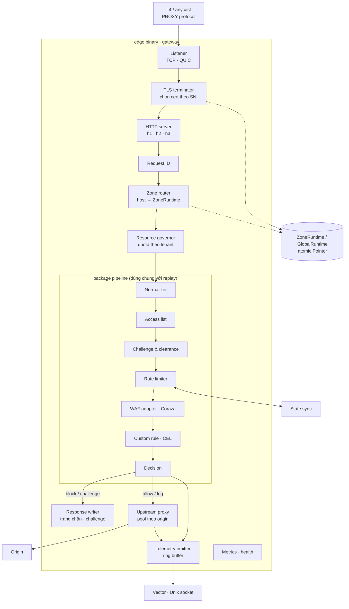

# C3 · Edge gateway

Một binary Go chạy trên mỗi edge node, chứa gateway, policy agent và state sync
([ADR-0013](../../09-adr/0013-edge-gateway-custom-go-with-coraza.md),
[ADR-0015](../../09-adr/0015-snapshot-format-and-distribution.md)). File này mô tả phần gateway;
agent và state sync ở [11-edge-agent-and-state.md](11-edge-agent-and-state.md).

## Component diagram



## Thành phần

| Component | Trách nhiệm | Thiết kế |
|---|---|---|
| **Listener** | Nhận kết nối TCP (443, 80) và QUIC (443/udp) | Hỗ trợ PROXY protocol v2 khi đứng sau L4 load balancer của đối tác để lấy IP client thật; giới hạn kết nối theo IP nguồn |
| **TLS terminator** | Chọn cert theo SNI, thương lượng TLS | `tls.Config.GetCertificate` tra bảng `hostname → *tls.Certificate` trong GlobalRuntime; session ticket key xoay qua bundle chung; ALPN `h2`, `http/1.1` |
| **HTTP server** | h1/h2 qua `net/http`, h3 qua `quic-go` | Timeout header/idle/body theo cấu hình zone; giới hạn kích thước header |
| **Request ID** | Định danh duy nhất cho mỗi request | UUIDv7 (có thứ tự thời gian); ghi vào header gửi origin (`X-Request-ID`), trang chặn và mọi bản ghi telemetry |
| **Zone router** | Tìm cấu hình zone theo `Host` | Map bất biến trong GlobalRuntime; host lạ trả 421 / trang mặc định, ghi event |
| **Resource governor** | Cô lập tenant | Semaphore số request đồng thời và ngân sách CPU kiểm tra body theo tenant; vượt quota thì hạ cấp theo fail mode của zone |
| **Normalizer** | Chuẩn hoá trước khi kiểm tra | Decode percent/unicode, gộp `//`, `/./`, `/../`; giới hạn số tham số, độ sâu JSON; giữ cả bản gốc cho Coraza (CRS tự chuẩn hoá theo transform riêng) |
| **Access list** | IP/CIDR/geo/ASN | Trie IPv4/IPv6 dựng sẵn khi nạp snapshot; geo/ASN tra MMDB trong RAM; kết quả `allow` gắn cờ bỏ qua các phase đã cấu hình |
| **Challenge & clearance** | Under Attack mode, challenge của rule | Token = HMAC-SHA256(zone, hạn, IP prefix, UA hash) với khoá trong bundle chung (khoá hiện tại + khoá trước); challenge JS proof-of-work, mức khó theo cấu hình |
| **Rate limiter** | Counter theo khoá rule | Sliding window hai bucket, map phân mảnh theo hash để giảm tranh chấp; hot key gửi state sync ([ADR-0021](../../09-adr/0021-valkey-for-hot-key-rate-limit-sync.md)) |
| **WAF adapter** | Chạy CRS + system ruleset | Một `coraza.WAF` dựng sẵn theo `(ruleset release, cấu hình CRS của zone)`, dùng chung giữa các zone cùng cấu hình; mỗi request một transaction; đọc body tối đa theo entitlements, phần còn lại stream thẳng |
| **Custom rule** | Biểu thức CEL theo priority | `cel.Program` dựng từ checked AST lúc nạp snapshot; first match wins; đánh giá với giới hạn chi phí runtime |
| **Decision** | Kết hợp kết quả các phase | allow / log / challenge / block; log-only hạ mọi hành động; ghi `Verdict` (phase, rule ID, hành động, điểm anomaly) |
| **Response writer** | Trang chặn, challenge | Template theo zone (logo, màu), luôn in request ID và thời điểm |
| **Upstream proxy** | Chuyển tới origin | `httputil.ReverseProxy` với `http.Transport` riêng cho mỗi origin: pool kết nối, mTLS client cert, timeout, retry cho request idempotent, health check thụ động |
| **Telemetry emitter** | Phát bản ghi | Ring buffer không khoá trong RAM, writer goroutine gửi Unix socket tới Vector; đầy thì bỏ access log trước, tăng bộ đếm `telemetry_dropped_total` |
| **Metrics · health** | Quan sát nền tảng | Prometheus `/metrics` trên cổng nội bộ: độ trễ theo phase, verdict, lỗi upstream, mức đầy ring buffer, version snapshot |

## Hợp đồng của package `pipeline`

Package dùng chung với replay ([ADR-0026](../../09-adr/0026-replay-on-request-samples-with-shared-pipeline.md)),
không phụ thuộc mạng hay `net/http` server.

```go
type Phase interface {
    Name() string
    // Eval không được chặn I/O; ctx mang deadline theo ngân sách của phase.
    Eval(ctx context.Context, r *Request, s *State) Outcome
}

type Outcome struct {
    Action   Action      // Continue, Allow, Log, Challenge, Block, SkipPhases
    RuleID   string
    Score    int         // anomaly score (WAF)
    Err      error       // lỗi hoặc quá hạn → áp fail mode của zone
}

type Pipeline struct {
    Phases   []Phase     // thứ tự lấy từ ZoneRuntime
    FailMode FailMode    // Open | Closed
}

func (p *Pipeline) Run(ctx context.Context, r *Request) Verdict
```

- `Request` là bản đã chuẩn hoá, không giữ `*http.Request`, để replay dựng được từ mẫu Parquet.
- Mỗi phase có ngân sách thời gian riêng (cấu hình trong snapshot); quá hạn trả `Err`, pipeline áp
  fail mode và phát event `phase_timeout`.

## Mô hình cấp phát và hiệu năng

- Không cấp phát trên đường request với các phase rẻ (access list, rate limit, CEL): dùng
  `sync.Pool` cho `Request`, `State`, buffer.
- `GOMEMLIMIT` đặt theo RAM của node; `GOGC` tinh chỉnh qua benchmark.
- Benchmark chuẩn (CI): traffic mẫu với CRS paranoia 1 và 2, 50 custom rule; báo p50/p99 theo
  phase. Ngưỡng QS-1 là điều kiện merge cho thay đổi trong `pipeline`.

## Lỗi và hành vi

| Tình huống | Hành vi |
|---|---|
| Phase lỗi hoặc quá hạn | Fail mode của zone; event `phase_error` |
| Origin không trả lời | 502/504 với trang lỗi có request ID; event upstream |
| Snapshot chưa nạp lúc khởi động | Không mở listener cho tới khi nạp xong (health check đỏ) |
| Tenant vượt quota tài nguyên | Hạ cấp theo fail mode của tenant đó; tenant khác không bị ảnh hưởng |
| Ring buffer telemetry đầy | Bỏ access log, giữ security event tới khi đầy hẳn; bộ đếm lộ ra metrics |
