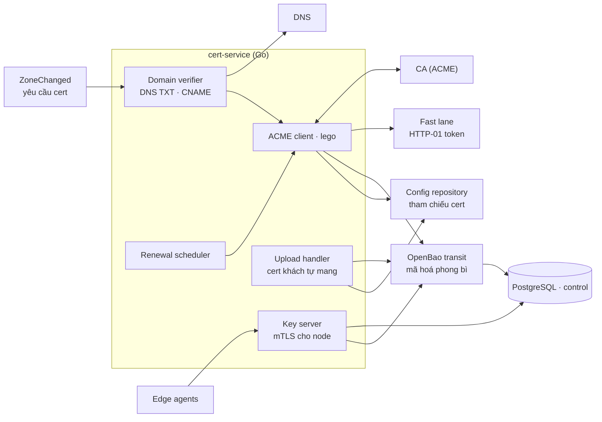
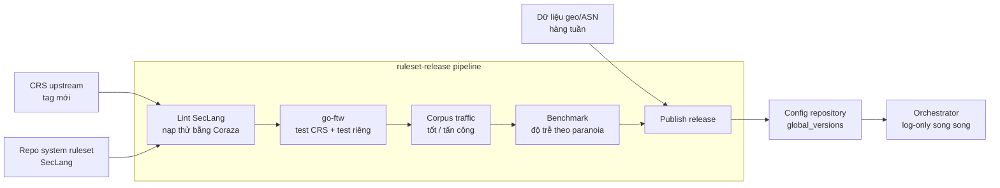

# C3 · Cert & key manager, ruleset release (Control plane)

## Cert & key manager

| Component | Thiết kế |
|---|---|
| **Domain verifier** | Kiểm bản ghi TXT xác minh và CNAME trỏ về edge; kết quả là điều kiện để xin cert |
| **ACME client** | `lego`; HTTP-01 (token phát xuống edge qua fast lane, edge trả lời `/.well-known/acme-challenge/`), DNS-01 khi khách uỷ quyền DNS; nhiều CA để dự phòng |
| **Upload handler** | Cert khách tự mang: kiểm chuỗi, khớp hostname, hạn |
| **Lưu trữ** | Private key mã hoá phong bì bằng OpenBao transit, lưu ciphertext trong PostgreSQL; cert công khai và digest đưa vào bundle zone |
| **Renewal scheduler** | Gia hạn khi còn 30 ngày; thất bại liên tiếp → cảnh báo khách và NOC |
| **Key server** | Node gọi qua mTLS, chỉ nhận key của zone được gán; giải mã bằng OpenBao, trả qua kênh mTLS; ghi audit mỗi lần cấp |

## Ruleset release

Pipeline phát hành CRS upstream, system ruleset của NCC, và dữ liệu geo/ASN, chạy như CI.

| Bước | Điều kiện qua |
|---|---|
| Lint | Mọi rule nạp được bằng Coraza; không trùng rule ID giữa CRS và system ruleset (system ruleset dùng dải ID riêng) |
| go-ftw | 100% test CRS chính thức pass ở các paranoia level hỗ trợ; test riêng của system ruleset pass |
| Corpus | Traffic tốt: tỉ lệ chặn không tăng quá ngưỡng so với release trước; traffic tấn công: tỉ lệ phát hiện không giảm |
| Benchmark | p99 theo paranoia không tăng quá ngưỡng |
| Rollout | Log-only song song trên toàn fleet (bản cũ quyết định, bản mới chỉ ghi), so sánh trên traffic thật ([06 §6.7](../../06-runtime/00-index.md#67-phát-hành-crs-hoặc-system-ruleset-mới)) |

Rule khẩn (zero-day) đi nhánh rút gọn: lint + test riêng cho rule đó + corpus traffic tốt, rồi fast lane.
