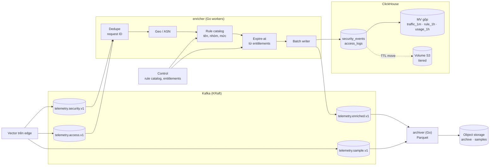

# C3 · Ingestion, xử lý luồng, lưu trữ (Analytics plane)

## Component diagram



## Kafka

| Topic | Khoá | Retention | Consumer |
|---|---|---|---|
| `telemetry.security.v1` | `tenant_id` | 3 ngày | enricher |
| `telemetry.access.v1` | `tenant_id` | 3 ngày | enricher |
| `telemetry.sample.v1` | `tenant_id` | 3 ngày | archiver |
| `telemetry.enriched.v1` | `tenant_id` | 3 ngày | archiver, exporter, streaming detector |
| `node.status.v1` | `node_id` | 1 ngày | metrics nền tảng |

Schema bản ghi định nghĩa bằng protobuf trong một repo schema chung; đổi schema theo quy tắc N/N-1
([08 §8.4](../../08-cross-cutting/00-index.md#84-version-và-tương-thích)).

## Enricher

| Component | Thiết kế |
|---|---|
| **Dedupe** | LRU theo partition giữ request ID trong cửa sổ 10 phút; at-least-once từ edge thành gần-đúng-một-lần trong store |
| **Geo / ASN** | MMDB cùng release với edge (lấy từ bundle chung) |
| **Rule catalog** | Cache tên, nhóm, mức nghiêm trọng của rule ID (CRS, system, custom) từ Control |
| **Expire-at** | `expire_at = ts + retention(tenant, loại bản ghi)` theo entitlements hiện hành |
| **Batch writer** | Ghi ClickHouse theo lô (kích thước hoặc 1 s), insert bất đồng bộ; commit offset Kafka sau khi ghi thành công cả ClickHouse lẫn topic enriched |

## ClickHouse

```sql
-- rút gọn
CREATE TABLE security_events (
  ts DateTime64(3), tenant_id UUID, zone_id UUID, request_id UUID,
  policy_version_id UUID, phase LowCardinality(String), rule_id String,
  action LowCardinality(String), anomaly_score UInt16,
  client_ip IPv6, country LowCardinality(String), asn UInt32,
  method LowCardinality(String), host String, path String, status UInt16,
  user_agent String, node_id String, region LowCardinality(String),
  fp_label Nullable(UInt8), expire_at DateTime,
  INDEX idx_req request_id TYPE bloom_filter GRANULARITY 4
) ENGINE = ReplicatedMergeTree
PARTITION BY toYYYYMMDD(ts)
ORDER BY (tenant_id, zone_id, ts)
TTL ts + INTERVAL 3 DAY TO VOLUME 'cold', expire_at DELETE;

CREATE MATERIALIZED VIEW traffic_1m ENGINE = AggregatingMergeTree
ORDER BY (tenant_id, zone_id, minute, action, rule_id, policy_version_id, country)
AS SELECT tenant_id, zone_id, toStartOfMinute(ts) AS minute, action, rule_id,
          policy_version_id, country, countState() AS hits, uniqState(client_ip) AS ips
   FROM access_logs GROUP BY ...;
```

| Bảng / view | Mục đích |
|---|---|
| `security_events`, `access_logs` | Raw, tra theo request ID, điều tra, xử lý chặn nhầm |
| `traffic_1m`, `traffic_1h` | Dashboard traffic; tổng traffic (đã nhân ngược tỉ lệ lấy mẫu) làm mẫu số |
| `rule_efficacy_1h` | Số lần khớp, tỉ lệ chặn, số nhãn FP theo rule và policy version |
| `usage_1h` | Metering cho billing |
| `fp_labels` | Nhãn chặn nhầm từ Management, join vào `rule_efficacy` |

- **Cluster:** shard theo `tenant_id`, replica 2; Keeper cho điều phối.
- **Retention theo tenant:** cột `expire_at`; hạ gói không xoá ngay vì `expire_at` của dòng cũ giữ
  nguyên, chỉ dòng mới dùng retention mới.
- **Tiered storage:** 3 ngày trên SSD, sau đó volume S3 tới `expire_at`.

## Archiver

| Component | Thiết kế |
|---|---|
| Ghi | Đọc `telemetry.enriched.v1` và `telemetry.sample.v1`, gom theo `tenant/region/date/hour`, ghi Parquet (zstd) lên object storage của region |
| Bố cục | `s3://archive-{region}/{tenant_id}/{kind}/dt=2026-11-06/hr=14/part-*.parquet` |
| Retention | Lifecycle policy theo tenant prefix; legal hold đánh dấu bằng tag object |
| Đọc | Replay và yêu cầu pháp lý; truy vấn ad-hoc của NCC bằng ClickHouse `s3()` table function |
