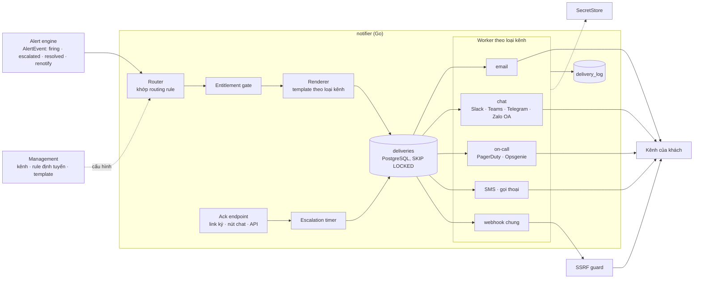
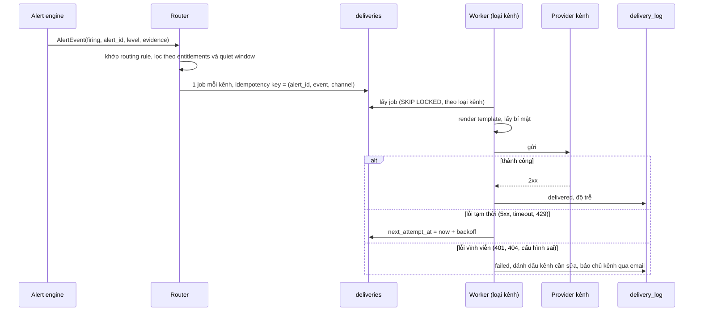

# C3 · Notification: fan-out nhiều kênh, khách tự tích hợp, mở kênh theo gói

Nhận sự kiện cảnh báo từ alert engine ([32](32-alerting-rules-and-algorithms.md)) và gửi tới mọi kênh
khách cấu hình. Quyết định nền: [ADR-0028](../../09-adr/0028-notification-adapters-and-plan-gated-channels.md).

Ba yêu cầu:

1. **Fan-out:** một cảnh báo tới nhiều kênh, kênh này lỗi không làm chậm kênh khác.
2. **Khách tự nối vào hệ thống của họ** mà không cần NCC viết tích hợp riêng.
3. **Email luôn có; kênh khác theo gói.**

## Component diagram



## Mô hình dữ liệu (cấu hình ở Management)

| Entity | Trường chính |
|---|---|
| **NotificationChannel** | `type`, cấu hình (URL, room, số điện thoại, email), tham chiếu bí mật (token, khoá ký webhook), trạng thái xác minh, người sở hữu |
| **RoutingRule** | Điều kiện khớp (template cảnh báo, mức, zone hoặc tag zone, khung giờ) → danh sách bước; mỗi bước có kênh và thời gian chờ ack trước khi lên bước sau |
| **MessageTemplate** | Template theo loại kênh, ghi đè được; chỉ dùng biến trong danh sách cho phép |
| **QuietWindow** | Khung giờ im lặng hoặc bảo trì theo zone; mặc định không chặn mức critical |
| **DeliveryLog** | Mỗi lần gửi: kênh, trạng thái, mã trả về của provider, số lần thử, độ trễ |

Ví dụ routing rule:

```yaml
match: { level: critical, templates: [D1, D5], zone_tags: [production] }
steps:
  - channels: ["slack:#soc", "email:soc@example.com"]
    wait_for_ack: 10m
  - channels: ["pagerduty:waap-oncall"]
    wait_for_ack: 15m
  - channels: ["sms:+84xxxxxxxxx"]
```

Không có routing rule nào khớp thì gửi email tới danh sách liên hệ bảo mật của account (luôn có).

## Luồng gửi



| Quy tắc | Giá trị |
|---|---|
| Backoff | Lũy thừa có jitter: 10 s, 30 s, 1 m, 5 m, 15 m; tối đa 8 lần hoặc 2 giờ |
| Cô lập | Mỗi loại kênh một pool worker; mỗi kênh cụ thể một giới hạn tốc độ (ví dụ Slack 1 tin/s mỗi webhook) |
| Idempotency | Khoá `(alert_id, event, channel)`: alert engine gửi lặp không sinh tin lặp |
| Gộp | Renotify và cảnh báo tổng hợp (chống bão) gửi một tin cho nhiều alert |
| Dự phòng | Mọi kênh của một cảnh báo critical đều lỗi → gửi email tới liên hệ bảo mật của account |
| SLO | Từ `firing` tới gửi thành công qua kênh push: p95 ≤ 30 s |

## Khách tự tích hợp

Khách không chạy code của họ trong hệ thống. Có bốn cách để khách tự nối:

| Cách | Mô tả |
|---|---|
| **Webhook chung** | Gửi `POST` theo **CloudEvents 1.0**, schema JSON có version (`com.waap.alert.v1`). Header `X-Waap-Signature: t=<unix>,v1=<HMAC-SHA256(secret, t + "." + body)>`, từ chối nếu lệch quá 5 phút (chống replay). Đây là cách nối vào ITSM, SOAR, hệ thống tự động hoá của khách |
| **Template body** | Khách định nghĩa body webhook bằng template (biến cho phép: alert, zone, giá trị, ngưỡng, top nguồn, link) để khớp API có sẵn của hệ thống đích mà không cần dịch vụ trung gian |
| **API kéo và ack** | `GET /alerts?state=firing`, `POST /alerts/{id}/ack`: hệ thống của khách tự kéo và đóng vòng |
| **Ack ngược** | Link ack có ký trong email/SMS, nút ack trong Slack/Teams, API; ack dừng escalation |

Webhook URL qua SSRF guard (chặn địa chỉ nội bộ, link-local, metadata cloud; không theo redirect) như
cron webhook của `metap`. Bí mật kênh lưu qua `SecretStore`, không bao giờ hiện lại sau khi lưu.

Thêm kênh mới (ví dụ ServiceNow, Jira) là viết thêm một adapter phía NCC:

```go
type ChannelAdapter interface {
    Type() string
    ValidateConfig(cfg json.RawMessage) error
    // Send phân loại lỗi: ErrRetryable (thử lại) hoặc ErrPermanent (sửa cấu hình).
    Send(ctx context.Context, msg Rendered, cfg json.RawMessage, sec Secrets) (Result, error)
    Test(ctx context.Context, cfg json.RawMessage, sec Secrets) error
}
```

## Kênh theo gói

Bảng đề xuất, giá trị cụ thể chốt cùng mô hình giá ([11.3](../../11-risks/00-index.md#113-quyết-định-còn-mở)).
Thực thi bằng entitlements ([ADR-0007](../../09-adr/0007-log-by-subscription-entitlements.md)).

| Năng lực | Starter | Pro | Business | Enterprise |
|---|---|---|---|---|
| Email | ✓ | ✓ | ✓ | ✓ |
| Webhook chung (CloudEvents, ký HMAC) | 1 | 5 | 20 | Không giới hạn |
| Chat (Slack, Teams, Telegram, Zalo OA) | — | ✓ | ✓ | ✓ |
| On-call (PagerDuty, Opsgenie) | — | — | ✓ | ✓ |
| SMS, gọi thoại | — | — | Có hạn mức | Có hạn mức lớn |
| Template body webhook, template tin tuỳ biến | — | — | ✓ | ✓ |
| Routing rule nhiều bước, escalation | — | 1 bước | 3 bước | Không giới hạn |
| API kéo và ack | — | ✓ | ✓ | ✓ |
| Số routing rule | 3 | 20 | 100 | Không giới hạn |

Thực thi ở hai chỗ:

- **Management** từ chối tạo kênh hoặc rule vượt gói.
- **Router** kiểm lại lúc gửi. Khi khách hạ gói, kênh vượt gói chuyển sang trạng thái "tạm dừng do gói",
  không bị xoá; cảnh báo vẫn tới email. Khách được báo trước khi kênh bị dừng.

SMS và gọi thoại có chi phí theo tin nên tính vào metering, vượt hạn mức thì chuyển sang email.

## Giám sát chính notifier

| Chỉ số | Cảnh báo NOC |
|---|---|
| Tỉ lệ gửi thành công theo loại kênh | < 99% trong 15 phút (loại trừ lỗi vĩnh viễn do cấu hình khách) |
| Độ trễ firing → delivered p95 | > 30 s trong 10 phút |
| Số job tồn trong `deliveries` | Tăng liên tục 10 phút |
| Lỗi theo provider (Slack, SMTP relay, SMS) | Tỉ lệ lỗi một provider > 10%: chuyển provider dự phòng nếu có |
