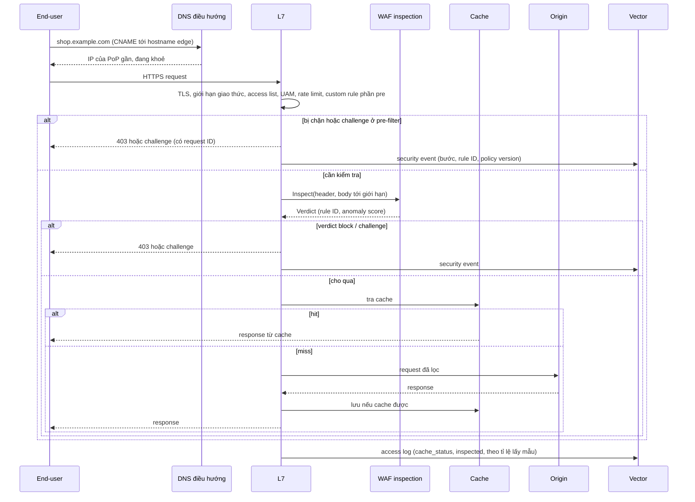
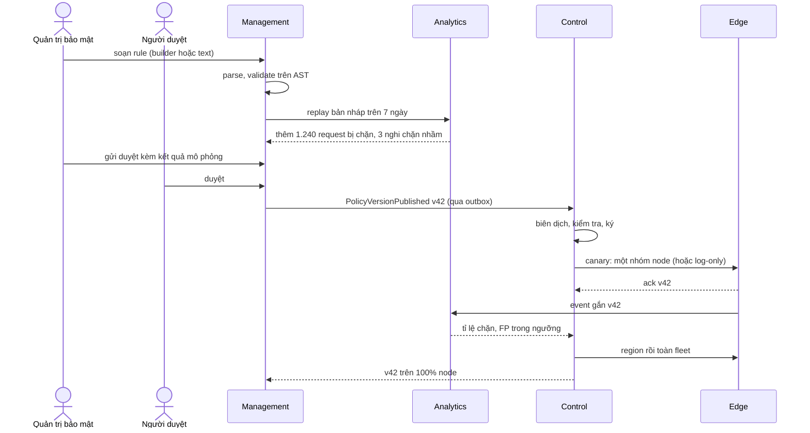
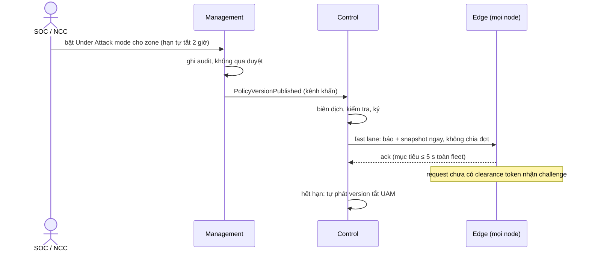
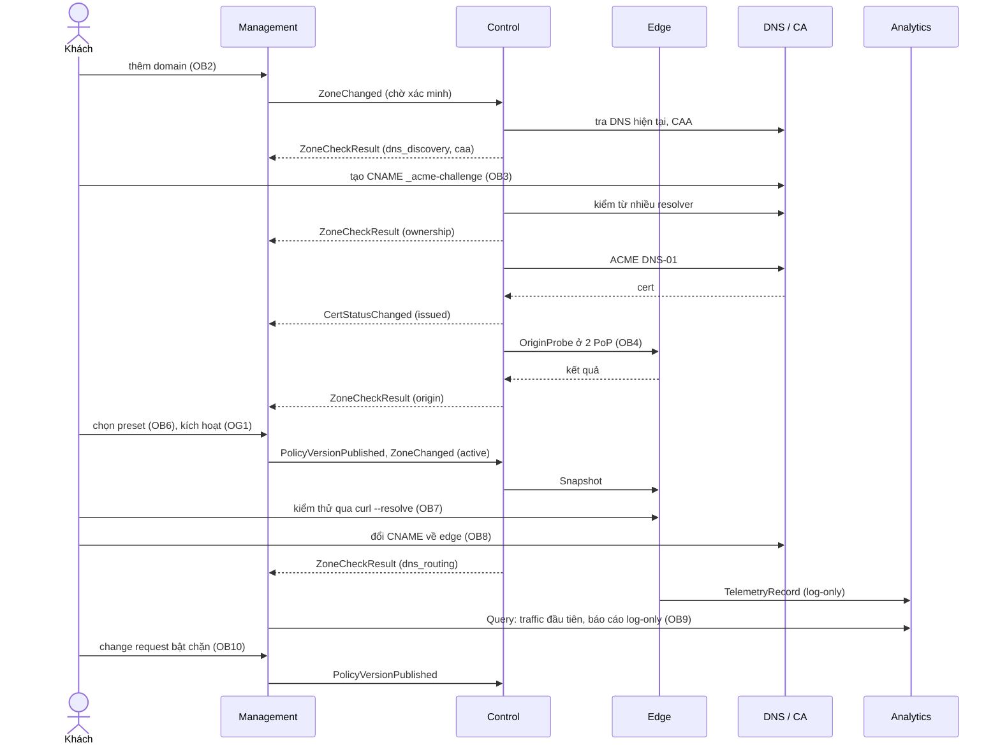
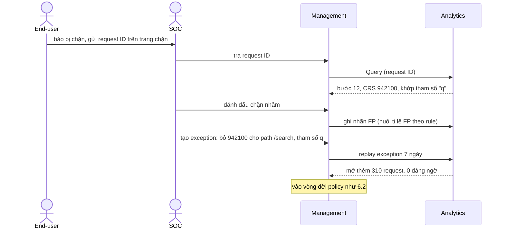
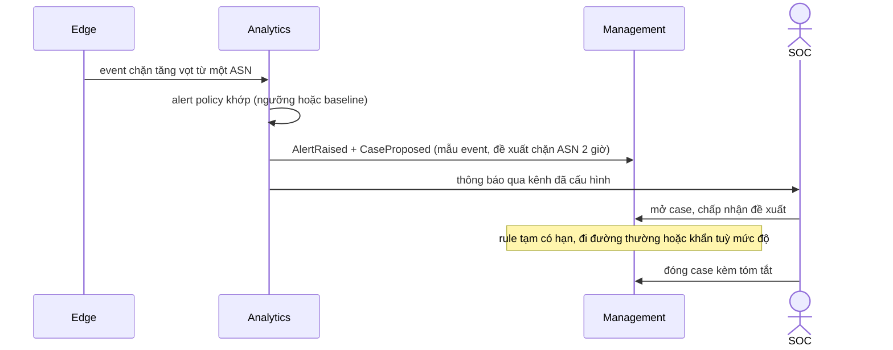

# 6. Runtime View

Các kịch bản chính, mỗi kịch bản là một luồng xuyên plane.

| # | Kịch bản |
|---|---|
| 6.1 | [Một request qua edge](#61-một-request-qua-edge) |
| 6.2 | [Thay đổi policy theo đường thường](#62-thay-đổi-policy-theo-đường-thường) |
| 6.3 | [Bật Under Attack mode, rule khẩn](#63-bật-under-attack-mode-rule-khẩn) |
| 6.4 | [Onboarding một zone](#64-onboarding-một-zone) |
| 6.5 | [Xử lý một request bị chặn nhầm](#65-xử-lý-một-request-bị-chặn-nhầm) |
| 6.6 | [Cảnh báo và case](#66-cảnh-báo-và-case) |
| 6.7 | [Phát hành CRS hoặc system ruleset mới](#67-phát-hành-crs-hoặc-system-ruleset-mới) |
| 6.8 | [Edge node khởi động, mất kết nối, phục hồi](#68-edge-node-khởi-động-mất-kết-nối-phục-hồi) |
| 6.9 | [Đổi gói subscription](#69-đổi-gói-subscription) |
| 6.10 | [Luồng Analytics](10-analytics-flows.md): đường ghi, ngân sách độ trễ, dashboard, điều tra, cảnh báo, export, replay, gate, metering, retention, lỗi theo chặng |

## 6.1 Một request qua edge

Không bước nào gọi mạng ra ngoài PoP, ngoài kết nối tới origin. Request bị chặn ở pre-filter không
tốn CPU của tầng WAF.

## 6.2 Thay đổi policy theo đường thường

Gate hỏng ở bất kỳ đợt nào: orchestrator dừng, đưa các node đã nhận về version trước, báo trạng
thái về Management.

## 6.3 Bật Under Attack mode, rule khẩn

Rule khẩn của NCC (zero-day) đi cùng đường, bắt đầu từ console NCC thay vì Management của khách,
và nằm trong bundle chung.

## 6.4 Onboarding một zone

> **Chờ onboarding.** Sequence này theo bản nháp chưa duyệt ở
> [requirements §3.1](../../requirements/03-business-analysis/01-onboarding.md), chỉ cho một kịch bản (DNS đầy
> đủ, origin có IP public, cổng chuẩn). Onboarding đang được phân tích lại theo nhiều kịch bản.

Đường chính của bản nháp: xác minh và cert xong
**trước** khi khách đổi DNS, bật chặn chỉ sau giai đoạn log-only có số liệu.

## 6.5 Xử lý một request bị chặn nhầm

## 6.6 Cảnh báo và case

## 6.7 Phát hành CRS hoặc system ruleset mới

1. Ruleset release kéo CRS mới (hoặc nhận bản system ruleset từ threat research).
2. Chạy regression: traffic mẫu tốt (không được chặn) và mẫu tấn công (phải chặn), đo độ trễ.
3. Gắn version, đưa vào config store.
4. Rollout trên toàn fleet ở chế độ **log-only song song**: bản cũ vẫn quyết định, bản mới chỉ
   ghi event, để so sánh tỉ lệ chặn trên traffic thật.
5. Zone chọn "tự nhận bản mới" được chuyển sau khi gate qua; zone cố định version thấy thông báo
   và danh sách rule thay đổi.

## 6.8 Edge node khởi động, mất kết nối, phục hồi

- **Khởi động:** node xác thực với Control bằng danh tính đã cấp khi enrollment, kéo bundle chung
  và mọi bundle zone được gán, kiểm chữ ký, nạp; chỉ nhận traffic sau khi nạp xong.
- **Mất Control:** chạy tiếp bằng snapshot hiện có vô thời hạn; health check của PoP vẫn xanh.
- **Mất Analytics:** log vào buffer đĩa; đầy thì bỏ access log trước, giữ security event.
- **Phục hồi:** agent so version với Control, kéo bản đầy đủ nếu lệch; log shipper xả buffer theo
  thứ tự thời gian.

## 6.9 Đổi gói subscription

1. Khách đổi gói trong Management; thanh toán xác nhận.
2. Management phát `EntitlementsChanged`.
3. Control đưa giới hạn áp ở edge (tỉ lệ lấy mẫu, số rule, giới hạn tài nguyên) vào bundle zone
   kế tiếp; Analytics áp retention và giới hạn truy vấn mới.
4. Hạ gói không xoá ngay dữ liệu cũ hơn retention mới: dữ liệu hết hạn theo lịch, khách được báo trước.
