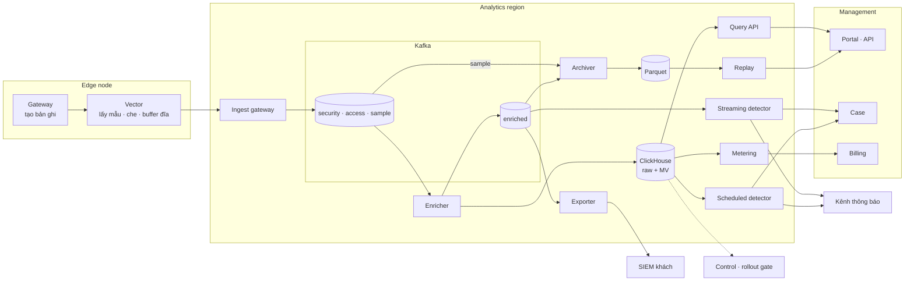
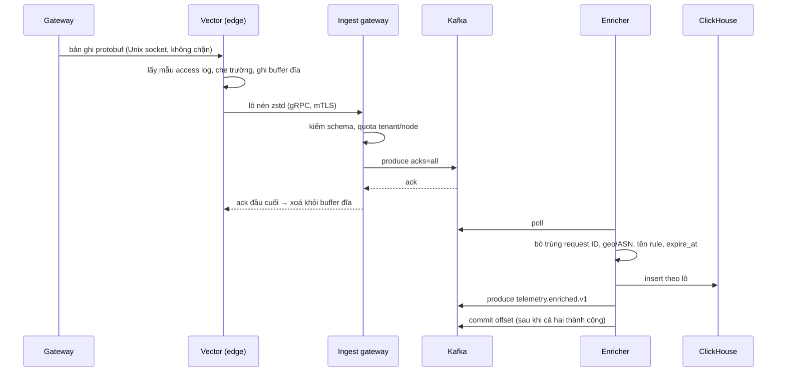
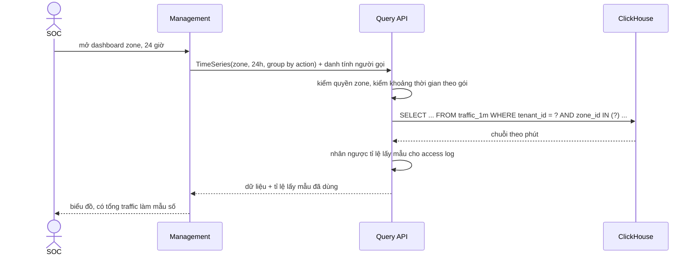
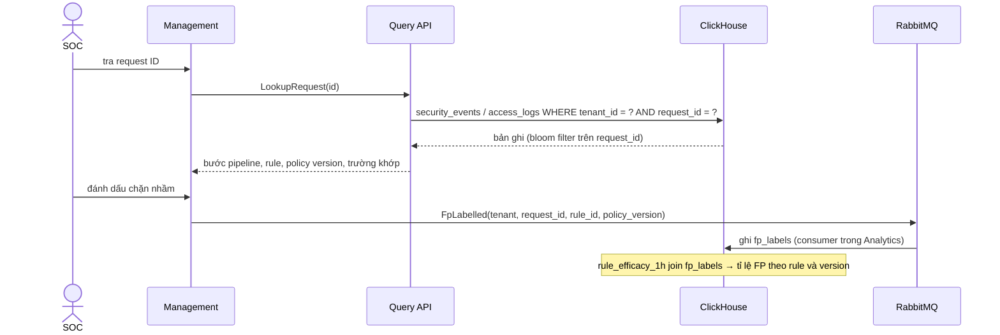
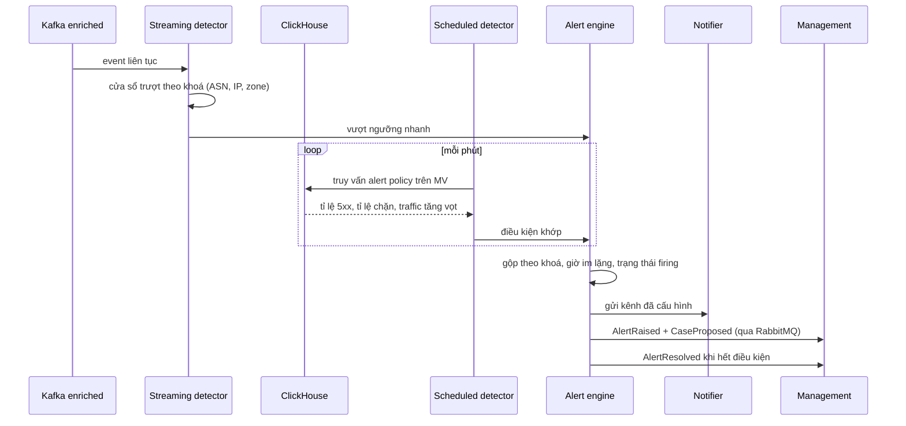
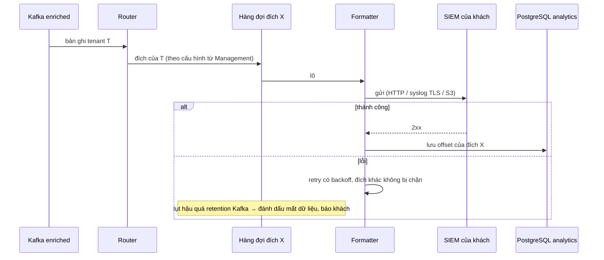
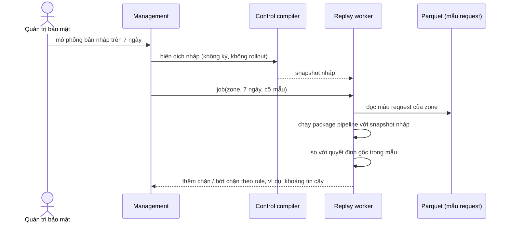
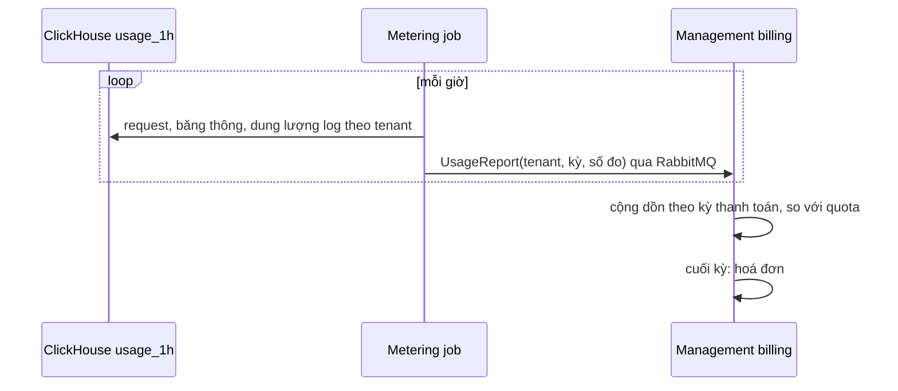

# 6.10 Luồng Analytics

Toàn bộ đường đi của dữ liệu traffic: từ lúc gateway tạo bản ghi tới từng kiểu đọc. Thành phần chi
tiết ở [level-3/30](../05-building-blocks/level-3/30-ingestion-and-storage.md) và
[level-3/31](../05-building-blocks/level-3/31-query-detection-export-replay.md).

| # | Luồng |
|---|---|
| A | [Toàn cảnh](#a-toàn-cảnh) |
| B | [Đường ghi và ngân sách độ trễ](#b-đường-ghi-và-ngân-sách-độ-trễ) |
| C | [Dashboard](#c-dashboard) |
| D | [Điều tra và nhãn chặn nhầm](#d-điều-tra-và-nhãn-chặn-nhầm) |
| E | [Phát hiện, cảnh báo, case](#e-phát-hiện-cảnh-báo-case) |
| F | [Xuất sang SIEM](#f-xuất-sang-siem) |
| G | [Replay](#g-replay) |
| H | [Gate cho rollout](#h-gate-cho-rollout) |
| I | [Metering và billing](#i-metering-và-billing) |
| J | [Retention và xoá dữ liệu](#j-retention-và-xoá-dữ-liệu) |
| K | [Backpressure và lỗi theo từng chặng](#k-backpressure-và-lỗi-theo-từng-chặng) |

## A. Toàn cảnh

Một luồng ghi (gateway → Kafka → enricher), sau đó rẽ ra theo kiểu đọc. Mọi nhánh đọc đều từ Kafka
hoặc ClickHouse hoặc Parquet, không nhánh nào đọc database của Management hay Control.

## B. Đường ghi và ngân sách độ trễ

| Chặng | Ngân sách p95 | Ghi chú |
|---|---|---|
| Gateway → Vector | < 100 ms | Ring buffer trong RAM, ghi không chặn |
| Vector gom lô và gửi | ≤ 2 s | Lô theo kích thước hoặc thời gian |
| Ingest gateway → Kafka ack | ≤ 1 s | `acks=all` |
| Kafka → enricher | ≤ 1 s | Consumer lag là chỉ số chính |
| Enricher gom lô → ClickHouse | ≤ 2 s | |
| ClickHouse hiển thị dữ liệu | ≤ 5 s | Async insert, merge chạy nền |
| **Tổng tới tra cứu được** | **≤ 15 s** | Còn dư so với QS-11 (≤ 60 s) để chịu đỉnh tải |

## C. Dashboard

- Dashboard luôn đọc từ materialized view (`traffic_1m`, `traffic_1h`, `rule_efficacy_1h`), không quét bảng raw.
- Khoảng ≤ 6 giờ dùng `traffic_1m`, dài hơn dùng `traffic_1h`; Query API tự chọn.
- Security event không bị lấy mẫu nên số chặn là số thật; chỉ tổng traffic là ước lượng khi gói có lấy mẫu.

## D. Điều tra và nhãn chặn nhầm

Nhãn chặn nhầm là dữ liệu của người dùng nên được tạo ở Management (có audit), rồi chép sang
Analytics để tính toán; Analytics không phải nơi gốc của nhãn.

## E. Phát hiện, cảnh báo, case

| Loại phát hiện | Nguồn | Độ trễ | Ví dụ |
|---|---|---|---|
| Nhanh | Streaming trên Kafka | Giây | Hơn N request bị chặn trong 1 phút từ một ASN |
| Theo lịch | Scheduled trên MV | ≤ 2 phút | Tỉ lệ 5xx của origin > 5% trong 5 phút |
| Bất thường | Baseline trong ClickHouse (Nâng cao) | Phút | Traffic lệch khỏi dải bình thường theo giờ trong tuần |

## F. Xuất sang SIEM

Export đọc từ Kafka chứ không từ ClickHouse, nên log tới SIEM của khách cùng nhịp với dashboard và
không cạnh tranh tài nguyên truy vấn.

## G. Replay

## H. Gate cho rollout

Trong lúc một đợt rollout đang quan sát, orchestrator hỏi Analytics chỉ số của các zone liên quan,
tách theo `policy_version_id`:

| Chỉ số | So sánh |
|---|---|
| Tỉ lệ chặn | Version mới vs version cũ, cùng khoảng thời gian, trên các node đã nhận vs chưa nhận |
| Tỉ lệ 5xx tới origin | Không tăng quá ngưỡng |
| Độ trễ thêm tại edge (từ metrics nền tảng) | p99 không tăng quá ngưỡng |

Vì mọi bản ghi mang policy version, so sánh này không cần biết node nào ở đợt nào.

## I. Metering và billing

`UsageReport` idempotent theo `(tenant, giờ)`: chạy lại một giờ ghi đè chứ không cộng thêm.

## J. Retention và xoá dữ liệu

| Dữ liệu | Nơi | Cơ chế hết hạn |
|---|---|---|
| Kafka topic | Kafka | 3 ngày, cố định |
| Raw (`security_events`, `access_logs`) | ClickHouse | 3 ngày trên SSD rồi sang volume S3; xoá theo `expire_at` của từng dòng (theo gói lúc ghi) |
| Số liệu gộp | ClickHouse | Dài hơn raw (ví dụ 13 tháng), vì nhỏ và cần cho báo cáo năm |
| Archive, mẫu request | Parquet | Lifecycle theo prefix tenant; legal hold bằng tag |
| Nhãn FP, trạng thái alert | ClickHouse / PostgreSQL | Theo vòng đời rule, alert |

Chấm dứt hợp đồng: xoá theo `tenant_id` ở ClickHouse (partition theo ngày, lọc theo tenant), xoá
prefix trong object storage, xoá đích export; ghi biên bản xoá vào audit.

## K. Backpressure và lỗi theo từng chặng

| Chặng hỏng | Dữ liệu nằm ở đâu | Tác động người dùng | Phục hồi |
|---|---|---|---|
| Vector trên node chậm | Ring buffer gateway, rồi bỏ access log | Thiếu access log của node đó | Tự hết khi Vector bắt kịp |
| Ingest gateway / mạng tới region | Buffer đĩa Vector | Log trễ | Xả buffer theo thứ tự thời gian |
| Quota tenant bị vượt | Bị bỏ tại gateway (access log trước) | Thiếu access log của tenant đó, có số đếm | Tăng gói hoặc tự hết khi traffic giảm |
| Kafka | Buffer đĩa Vector (qua ack đầu cuối) | Log trễ | Như trên |
| Enricher chậm | Kafka (3 ngày) | Dashboard, tra cứu, export, streaming detector đều trễ vì cùng phụ thuộc dữ liệu đã làm giàu | Scale enricher, consumer lag là cảnh báo chính |
| ClickHouse | Kafka | Dashboard, tra cứu, scheduled detector ngừng; streaming detector và export vẫn chạy | Enricher retry, không commit offset cho tới khi ghi được |
| Đích SIEM của khách | Hàng đợi đích + Kafka | Chỉ đích đó trễ | Retry; quá 3 ngày thì mất phần quá hạn, báo khách |
