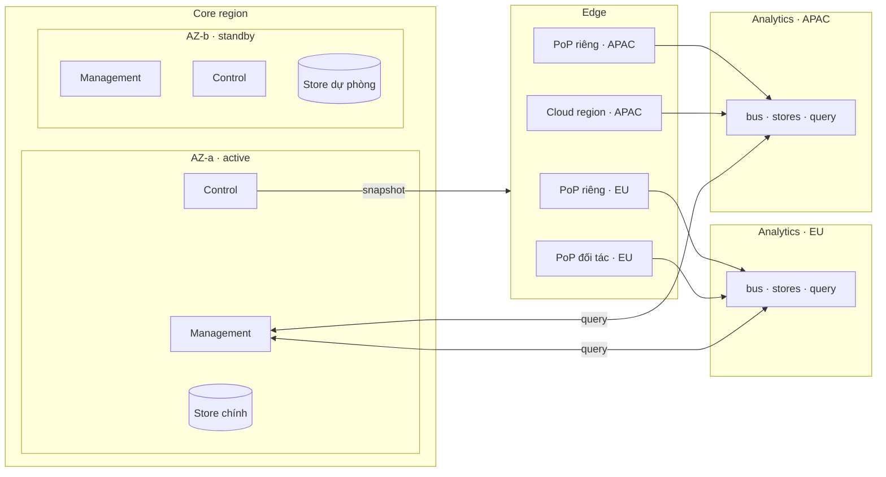

# 7. Deployment View

Ước lượng tải, số node và sharding ở quy mô 1 triệu zone: [7.5](05-capacity-and-sharding.md).

## 7.1 Ba mô hình triển khai

Cùng các plane, khác chỗ đặt ([ADR-0006](../09-adr/0006-saas-first-on-prem-capable.md)).

| Mô hình | Management | Control | Analytics | Edge | Giai đoạn |
|---|---|---|---|---|---|
| **SaaS** | NCC | NCC | NCC, theo region dữ liệu | PoP của NCC + hạ tầng đối tác | MVP |
| **Hybrid** | NCC | NCC | NCC, hoặc tại khách nếu log không được rời | Trong hạ tầng của khách | Mở rộng |
| **On-prem** | Khách | Khách | Khách | Khách | Nâng cao |

Hệ quả cho thiết kế: plane không dùng dịch vụ chỉ có trên một cloud; mỗi plane đóng gói được
thành bản cài độc lập; kết nối edge → Control đi từ trong ra ngoài (node gọi lên), để hybrid không
cần mở cổng vào hạ tầng của khách.

## 7.2 Topology SaaS

- **Core region:** Management và Control, active/standby qua hai availability zone. Sập core
  không ảnh hưởng traffic.
- **Analytics theo region dữ liệu:** log của tenant ở lại region đã chọn. Thêm region khi có khách
  yêu cầu residency.
- **Edge:** PoP riêng và node trên hạ tầng đối tác/cloud, cùng artifact. Mỗi PoP có pool edge proxy
  (RAM, NIC, NVMe cho cache), pool WAF inspection (CPU), DNS điều hướng; PoP nhỏ đặt proxy và WAF chung
  host với cgroup CPU riêng ([ADR-0033](../09-adr/0033-two-tier-edge-proxy-and-waf.md)). Định tuyến vào
  PoP gần nhất bằng anycast hoặc DNS điều hướng ([5.8.3](../05-building-blocks/08-components/03-dns-and-traffic-steering.md)).

## 7.3 Vùng chịu lỗi

| Sự cố | Traffic của khách | Người dùng thấy |
|---|---|---|
| Core region sập | Không ảnh hưởng; edge chạy bằng snapshot hiện có | Không sửa được policy; dashboard vẫn xem được nếu Analytics còn sống |
| Một Analytics region sập | Không ảnh hưởng | Log trễ, chờ trong buffer đĩa ở edge; cảnh báo của region đó trễ theo |
| Một PoP sập | Định tuyến sang PoP gần nhất | Fleet registry báo node mất; không mất config |
| Snapshot lỗi lọt qua compiler | Chỉ nhóm canary bị ảnh hưởng | Gate dừng đợt, tự rollback |
| Pool WAF của một PoP sập hoặc quá tải | Kết nối không bị ảnh hưởng; zone áp fail mode; pre-filter, challenge, cache vẫn chạy | Event `waf_unavailable`; cảnh báo P1/P2 cho NOC |
| Bus của Analytics đầy | Không ảnh hưởng | Edge giữ log trong buffer; bỏ access log trước security event nếu kéo dài |

## 7.4 Môi trường

| Môi trường | Mục đích |
|---|---|
| Dev | Từng plane chạy cục bộ, edge chạy với snapshot giả |
| Staging | Đủ 4 plane, traffic tổng hợp; regression cho ruleset release |
| Canary PoP | Một nhóm node production nhận mọi bản phần mềm edge và ruleset trước |
| Production | Toàn fleet |

Phần mềm edge (không phải config) cũng rollout theo đợt qua canary PoP, cùng cơ chế gate với
snapshot.
