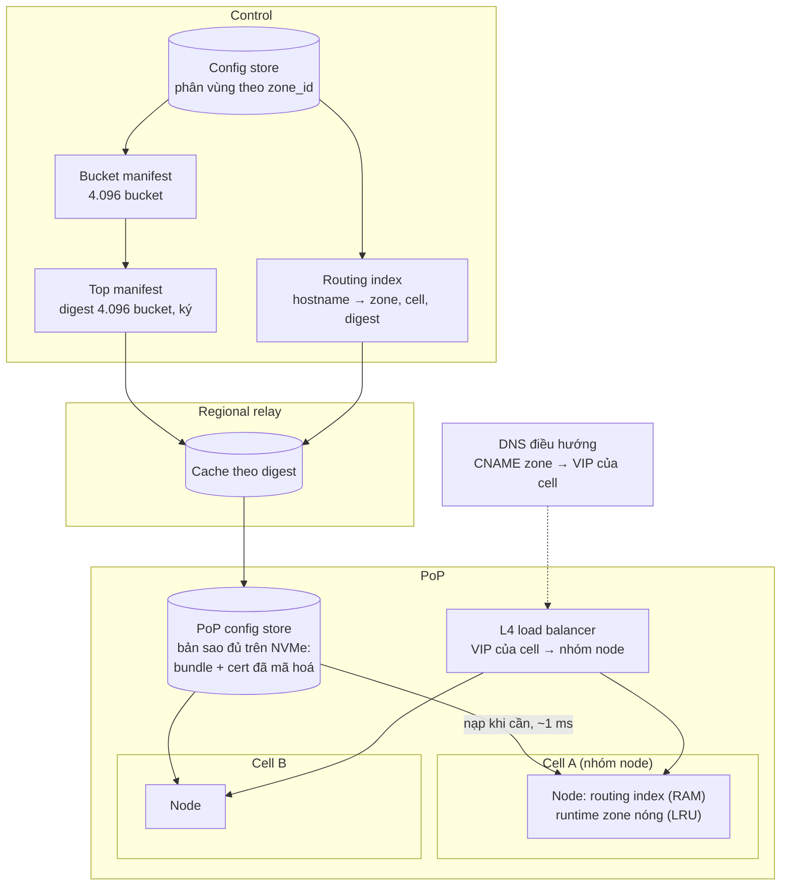
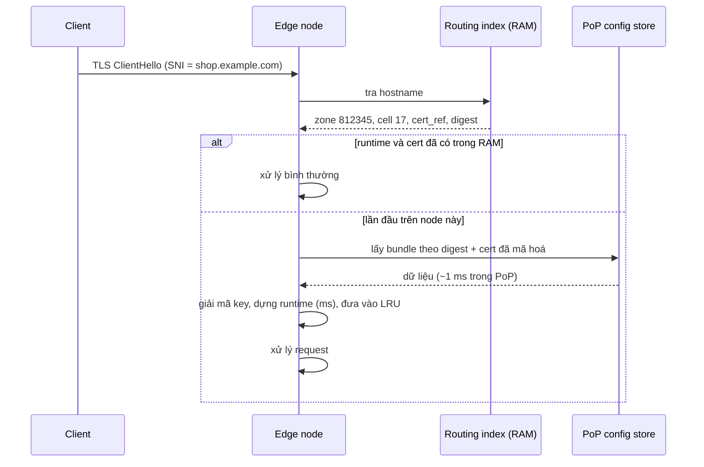

# 7.5 Ước lượng tải và sharding ở quy mô 1 triệu website

Mục tiêu thiết kế: **1.000.000 zone**, chưa tính subdomain, phục vụ trên cổng chuẩn. Mọi con số dưới đây
là **ước lượng có giả định ghi rõ**, dùng để chọn kiến trúc và cỡ hạ tầng; phải đối chiếu lại bằng số đo
thật sau spike ([ADR-0031](../09-adr/0031-edge-l7-and-waf-engine-options.md)) và sau khi có khách thật.
Quyết định nền: [ADR-0040](../09-adr/0040-config-distribution-at-scale.md),
[ADR-0041](../09-adr/0041-cells-and-zone-placement.md).

## 1. Giả định

| # | Giả định | Giá trị | Ghi chú |
|---|---|---|---|
| G1 | Số zone | 1.000.000 | Phần lớn là site nhỏ |
| G2 | Hostname trung bình mỗi zone | 3 | → khoảng 3.000.000 hostname |
| G3 | Số cert | khoảng 2.000.000 | Wildcard và SAN gộp nhiều hostname |
| G4 | Phân bố traffic | Theo phân khúc ([8.18](../08-cross-cutting/18-segments-and-plans.md)) | 65% Free, 15% Pro, 18% Business, 2% Enterprise. Free + Pro (82% zone) ≈ 16% traffic; Enterprise (2%) ≈ 47%; trong mỗi phân khúc lệch kiểu log-normal |
| G5 | Zone hoạt động | Zone có traffic ở một PoP trong 10 phút: Free 10%, Pro 40%, Business 80%, Enterprise 100% | ≈ 290.000 zone mỗi PoP lớn; PoP nhỏ ít hơn nhiều |
| G6 | Request hợp lệ | Trung bình 3 triệu rps, đỉnh 10 triệu rps | Đỉnh theo giờ của từng region cộng lại |
| G7 | Tấn công L7 | Thêm tới 30 triệu rps, dồn vào một ít zone | Phần lớn bị loại ở pre-filter |
| G8 | Kích thước response trung bình | 25 KB | |
| G9 | Tỉ lệ request phải qua WAF | 60% trung bình; chi phí theo profile của gói | Free dùng profile lite (≈ 0,25 PL1), Business ≈ 1,3, Enterprise ≈ 1,8 → ≈ 2,67 triệu đơn vị PL1/s trung bình |
| G10 | Thay đổi cấu hình | Trung bình 1 lần/zone/tuần | Đỉnh khi khách chạy Terraform hàng loạt |
| G11 | Lấy mẫu access log | Theo gói: Free 1%, Pro 10%, Business 25%, Enterprise 50% (≈ 33% trung bình theo traffic) | Security event không lấy mẫu, chiếm khoảng 5% request |
| G12 | Số PoP | 30 | Kích cỡ PoP chênh nhau nhiều |

Năng lực một node (phải đo lại trong spike):

| Loại node | Cấu hình | Năng lực giả định |
|---|---|---|
| L7 | 64 core, 256 GB RAM, 2×100 GbE, NVMe | 80.000 rps có TLS (phần lớn resume session) |
| WAF inspection | 64 core, 128 GB RAM | 1.500 request kiểm tra/s mỗi core ở CRS PL1 → khoảng 90.000 rps mỗi node ở 100% |

## 2. Ước lượng tải

### Traffic và băng thông

| Đại lượng | Trung bình | Đỉnh |
|---|---|---|
| Request hợp lệ | 3 triệu rps | 10 triệu rps |
| Băng thông ra client (G8) | 3M × 25 KB ≈ 75 GB/s ≈ **600 Gbps** | **≈ 2 Tbps** |
| Request qua WAF (G9) | 1,8 triệu rps (≈ 2,67 triệu đơn vị PL1) | 6 triệu rps (≈ 8,9 triệu đơn vị PL1) |
| Băng thông mỗi PoP (đều) | 20 Gbps | 67 Gbps; PoP lớn trên 200 Gbps |

### Số node

| Tầng | Tính | Kết quả |
|---|---|---|
| L7 | 10M rps ÷ (80k × 60% mức sử dụng mục tiêu) ≈ 210; cộng dư cho tấn công (pre-filter loại rẻ, ước 1/3 chi phí request thường: 30M ÷ 3 ÷ 48k ≈ 210); cộng N+1 mỗi PoP | **≈ 450 node** |
| WAF inspection | 8,9M đơn vị PL1 ÷ (90k × 60%) ≈ 165; cộng N+1 mỗi PoP | **≈ 210 node** (nếu mọi zone chạy PL1 thì chỉ ≈ 150; phần tăng do Business, Enterprise dùng profile nặng, Free gần như không tốn) |
| Trung bình mỗi PoP | | 15 L7 + 7 WAF; PoP lớn gấp 3–5 lần |

### Cấu hình

| Dữ liệu | Tính | Tổng |
|---|---|---|
| Bundle zone (phần L7 + WAF, nén) | Free ≈ 2 KB, Pro ≈ 4 KB, Business ≈ 15 KB, Enterprise ≈ 200 KB (p99.9 tới 5 MB); trung bình khoảng 8 KB | 1M × 8 KB ≈ **8 GB nén** |
| Runtime trong RAM nếu nạp hết | Khoảng 10 lần bản nén (trie, chương trình rule, bảng) | ≈ **80 GB**, không đặt được lên mỗi node |
| Cert + key (đã mã hoá) | 2M × 4 KB | ≈ **8 GB** |
| Routing index (hostname → zone) | 3M × 64 B | ≈ **200 MB** |
| Instance CRS ở WAF | Giả định 95% zone dùng khoảng 50 profile chuẩn, mỗi instance 50 MB | ≈ 2,5 GB mỗi node WAF + phần LRU cho profile riêng |

### Thay đổi và phân phối

| Đại lượng | Tính | Kết quả |
|---|---|---|
| Thay đổi cấu hình zone | 1M ÷ 604.800 s | **≈ 1,7/s**; đỉnh khoảng 30/s |
| Gia hạn cert | 2M ÷ 60 ngày | ≈ 0,4/s |
| Purge | Lệnh nhỏ, không phải bundle | Đỉnh khoảng 500/s |
| Dữ liệu đẩy tới mỗi PoP | 30/s × 8 KB | ≈ 240 KB/s, không đáng kể |

### Telemetry

| Đại lượng | Tính | Kết quả |
|---|---|---|
| Access log sau lấy mẫu (G11) | Σ rps phân khúc × tỉ lệ mẫu của gói | ≈ 1 triệu bản ghi/s trung bình (Enterprise ≈ 70%), 3,3M/s đỉnh |
| Security event | 3M × 5% | 150.000/s trung bình, trên 1M/s khi bị tấn công |
| Kafka (nén, khoảng 150 B/bản ghi) | 1,15M/s × 150 B | ≈ 170 MB/s ≈ 15 TB/ngày; với 3 bản sao và 3 ngày retention ≈ 135 TB |
| ClickHouse (khoảng 120 B/dòng sau nén) | ≈ 100 tỉ dòng/ngày | ≈ 12 TB/ngày; hot 3 ngày ≈ 36 TB, chia theo region; retention dài theo gói ở archive |
| Insert ClickHouse | | 1,15M dòng/s trung bình, 4M dòng/s đỉnh |

### DNS điều hướng

3M bản ghi; với TTL 60 s ước khoảng 300.000 truy vấn/s toàn cục, khoảng 10.000 qps mỗi PoP.

### Phiên portal và realtime

| Đại lượng | Ước lượng | Kết quả |
|---|---|---|
| Phiên portal đồng thời | 10.000–30.000 bình thường; 50.000–100.000 trong đợt tấn công lớn | Realtime gateway riêng, không polling ClickHouse ([5.8.13](../05-building-blocks/08-components/13-realtime-gateway.md)) |
| Zone đang được xem cùng lúc | ≤ 50.000 | Live tap chỉ ghi cho các zone này, trần 50 event/s mỗi zone |
| Message realtime ra client | ≈ 1 triệu message/s ở đỉnh, ≈ 300 B mỗi message | 4–6 node gateway mỗi region + N+1 |

## 3. Kết luận từ ước lượng

0. **Chi phí của 82% zone (Free + Pro) là chi phí theo zone, của 2% zone Enterprise là chi phí theo
   request.** Kiến trúc tách pool cell theo gói và phân bổ tài nguyên theo gói
   ([8.18](../08-cross-cutting/18-segments-and-plans.md), [ADR-0042](../09-adr/0042-plan-tiers-drive-placement-and-isolation.md)).

1. **Không đẩy runtime của mọi zone vào RAM mọi node** được: 80 GB cấu hình + 8 GB cert, trong khi tại
   một thời điểm mỗi PoP chỉ có 10–30% zone thật sự có traffic.
2. **Manifest liệt kê mọi zone không dùng được**: 1M digest × 40 B = 40 MB mỗi lần ký, trong khi có
   khoảng 2 thay đổi/s.
3. **ACK theo zone theo node** (1M × 600 node) là quá nhiều để theo dõi; phải ACK theo một version tổng.
4. **Đĩa thì đủ**: toàn bộ bundle (8 GB) và cert (8 GB) vừa trên NVMe của mỗi PoP, nên chỉ cần bỏ RAM
   khỏi phương trình, không cần bỏ dữ liệu khỏi PoP.
5. **Traffic đuôi dài** nghĩa là gom zone theo nhóm node sẽ tăng tỉ lệ trúng RAM và cache HTTP, đồng thời
   cho phép cô lập zone lớn hoặc đang bị tấn công.

## 4. Sharding: bốn lớp

| Lớp | Giữ gì | Ở đâu | Cập nhật |
|---|---|---|---|
| **L1. Routing index** | `(hostname, cổng) → zone_id, cell_id, cert_ref, digest bundle proxy/WAF` | RAM của **mọi node** (≈ 200 MB) | Delta theo bucket, áp lớp A |
| **L2. PoP config store** | Bundle zone + cert/key đã mã hoá của mọi zone thuộc các cell PoP phục vụ | NVMe, **một bản sao mỗi PoP** (≈ 16 GB) | Đồng bộ theo bucket manifest (anti-entropy), kéo qua regional relay |
| **L3. Runtime của node** | Runtime đã dựng của zone **đang có traffic** trên node đó | RAM, LRU có ngân sách | Nạp khi có request đầu tiên; làm nóng trước theo danh sách zone nóng; bỏ khi digest đổi |
| **L4. Cell** | Nhóm node trong mỗi PoP phục vụ một tập zone | Mọi PoP (PoP nhỏ: nhiều cell dùng chung node) | Gán zone vào cell ở Control; di chuyển zone giữa cell bằng DNS/VIP |

### L1–L3: nạp khi cần

- **Ngân sách RAM** của node cho runtime zone (ví dụ 32 GB L7, phần WAF tính riêng); LRU theo kích
  thước thật, không theo số zone.
- **Làm nóng trước:** Analytics tính mỗi giờ danh sách zone nóng theo PoP và cell; node nạp sẵn sau khi
  khởi động và sau khi có version mới của zone nóng.
- **Đổi version:** routing index mang digest mới; zone nóng được dựng lại ngay ở nền (lớp A), zone nguội
  chỉ bị đánh dấu cũ và dựng lại khi có request tiếp theo.
- **PoP store chưa có bundle** (vừa đổi, chưa đồng bộ xong): node lấy trực tiếp từ regional relay theo
  digest; không bao giờ phục vụ bằng cấu hình mới hơn routing index.

### L4: cell

| Câu hỏi | Thiết kế |
|---|---|
| Cell là gì | Một nhóm node L7 (và phần WAF tương ứng) trong mỗi PoP, có **VIP riêng**. DNS điều hướng trả VIP của cell chứa zone; L4 load balancer của PoP chuyển VIP đó tới nhóm node của cell, không cần đọc SNI |
| Số cell | Bắt đầu 32–64 cell chuẩn + cell riêng cho zone lớn + cell cách ly |
| Gán zone | Trước hết theo **pool của gói** (Free mật độ cao, chuẩn cho Pro/Business, Enterprise) theo [ADR-0042](../09-adr/0042-plan-tiers-drive-placement-and-isolation.md); trong pool theo hash `zone_id`; zone thuộc top traffic được cân bằng theo tải; tenant enterprise lớn có thể có cell riêng |
| Di chuyển zone | Đổi `cell_id` trong routing index và bản ghi DNS (TTL 60 s); hai cell cùng phục vụ zone trong thời gian chuyển |
| Lợi ích | Mỗi node chỉ cần runtime của zone trong cell (RAM, cache HTTP trúng nhiều hơn); rollout canary theo cell; bad config hay tấn công chỉ ảnh hưởng một cell; zone bị tấn công được chuyển sang cell cách ly |
| PoP nhỏ | Nhiều cell chia chung node; vẫn giữ VIP riêng để chuyển được khi cần |

Chi tiết các phương án và lựa chọn: [ADR-0041](../09-adr/0041-cells-and-zone-placement.md).

## 5. Phân phối cấu hình ở quy mô này

| Vấn đề ở thiết kế cũ | Thiết kế mới |
|---|---|
| Một manifest liệt kê mọi zone | **Manifest hai tầng**: 4.096 bucket theo hash `zone_id`. Bucket manifest liệt kê digest của khoảng 250 zone; top manifest liệt kê 4.096 digest bucket (≈ 128 KB), ký Ed25519. Một thay đổi chỉ sinh một bucket manifest mới và một top manifest mới |
| Ký mỗi thay đổi | Gom thay đổi theo cửa sổ 1 s, ký tối đa 1 top manifest/s; fast lane có cửa sổ riêng ngắn hơn |
| ACK theo zone | Node ACK **version của top manifest**; version tăng đơn điệu nên "node đã ACK V" nghĩa là có mọi zone ở version ≤ V. Độ phủ của một zone suy ra từ version tổng |
| Node tải hết bundle | PoP store đồng bộ đủ; node chỉ nạp runtime khi cần |
| Rollout theo zone | Canary theo **cell** (và theo bucket), không theo từng zone; gate tính trên tổng của cell canary |
| Thay đổi hàng loạt (đổi mặc định cho 100.000 zone) | Biên dịch song song theo bucket; rollout theo cell; giới hạn tốc độ để không vượt năng lực dựng runtime của node |

Instance CRS ở tầng WAF dùng chung theo **profile**: zone chỉ khác nhau ở rule bị tắt dùng chung instance
của profile và lọc kết quả theo danh sách rule tắt; chỉ zone có exclusion theo trường (target) mới cần
instance riêng, dựng theo LRU. Zone có profile riêng mà instance chưa sẵn trên node: request được kiểm bằng
profile chuẩn cùng danh sách rule tắt, gắn cờ `waf_profile_fallback`, instance được dựng ở nền.

## 6. Các tầng khác ở quy mô này

| Tầng | Sharding |
|---|---|
| Management | PostgreSQL, bảng phân vùng theo `zone_id`; 1M zone và khoảng 50M version/năm vẫn trong khả năng một cụm có replica đọc |
| Config store, compiler | Phân vùng theo bucket; worker compiler lấy job theo bucket nên thay đổi hàng loạt chạy song song |
| Kafka | Khoá partition `(tenant_id, zone_id)` cho tenant lớn để không dồn một partition; tenant nhỏ theo `tenant_id` |
| ClickHouse | Shard theo `tenant_id`; tenant lớn được rải thêm theo `zone_id` |
| DNS điều hướng | Mỗi zone một CNAME đích riêng (`z<zone_id>.edge.<ncc>`), DNS trả VIP của cell; 3M bản ghi trong RAM mỗi server DNS |

## 7. Cổng

| Loại | Thiết kế |
|---|---|
| HTTP/HTTPS cổng chuẩn (80, 443) | Mọi node nghe; cổng nằm trong khoá của routing index |
| Danh sách cổng HTTP(S) bổ sung cố định (ví dụ 8080, 8443) | Mọi node nghe danh sách cố định này (node profile, lớp C); zone khai báo cổng nào dùng và cổng origin tương ứng |
| Cổng tuỳ ý, giao thức không phải HTTP | Sản phẩm proxy L4 riêng (Mở rộng) với VIP riêng cho zone; không đi qua pipeline WAF |
