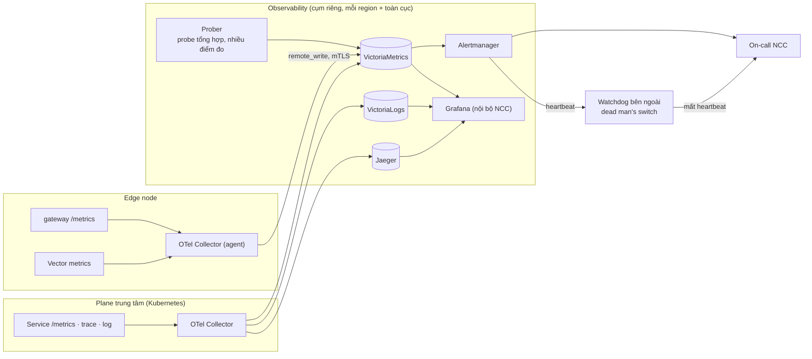

# 8.12 Giám sát nền tảng

Giám sát chính hệ thống WAAP (của NCC), tách khỏi telemetry của khách. Phân tích theo từng hành vi
vận hành ở [13-operational-behaviors.md](13-operational-behaviors.md). Quyết định nền:
[ADR-0029](../09-adr/0029-independent-platform-observability.md).

## 1. Nguyên tắc

1. **Đo hành vi, không đo process.** "Process còn sống" không chứng minh được gì. Mỗi hành vi quan
   trọng có một **probe tổng hợp** chạy đúng hành vi đó từ đầu tới cuối: gửi request tấn công phải bị
   chặn, đổi config phải tới mọi node, log phải tra cứu được, cảnh báo phải tới kênh.
2. **SLO trước, cảnh báo sau.** Cảnh báo cho người trực chỉ bắn khi SLO đang bị đe doạ (theo tốc độ
   tiêu error budget). Chỉ số thành phần dùng để chẩn đoán, không đánh thức người.
3. **Độc lập với thứ đang bị giám sát.** Metrics và cảnh báo của nền tảng không đi qua Kafka hay
   ClickHouse của Analytics; Analytics sập thì NOC vẫn thấy.
4. **Giám sát cả bộ giám sát.** Cảnh báo "watchdog" bắn liên tục; ngừng nhận nó nghĩa là hệ thống
   cảnh báo đã hỏng.

## 2. Stack



| Vai trò | Công nghệ | License |
|---|---|---|
| Thu thập | OpenTelemetry Collector | Apache-2.0 |
| Metrics | VictoriaMetrics (Prometheus-compatible) | Apache-2.0 |
| Log của nền tảng | VictoriaLogs | Apache-2.0 |
| Trace | Jaeger | Apache-2.0 |
| Cảnh báo | Alertmanager → on-call | Apache-2.0 |
| Dashboard | Grafana, chỉ nội bộ NCC, không phát hành cho khách ([ADR-0024](../09-adr/0024-licensing-policy-for-shipped-components.md)) | AGPL |
| Probe tổng hợp | Prober tự viết bằng Go, chạy ở ít nhất 3 điểm đo ngoài mạng PoP | — |

Bản on-prem dùng cùng stack trừ Grafana; dashboard vận hành cho khách on-prem nằm trong portal.

## 3. SLI và SLO

Mỗi SLI là một tỉ lệ `sự kiện tốt / tổng sự kiện` đo được bằng metrics có sẵn.

| # | Hành vi | SLI | SLO (30 ngày) |
|---|---|---|---|
| S1 | Phục vụ traffic | `1 − (response có status_source = edge_platform / tổng request)`; lỗi của website (`origin`, `origin_unreachable`) và hành động bảo mật (`edge_policy`) không tính ([8.14](14-latency-and-error-attribution.md#3-phân-loại-lỗi-mỗi-response-có-một-nguồn)) | 99,99% |
| S2 | Độ trễ thêm tại edge | Tỉ lệ request có `edge_us` (thời gian do WAAP gây ra, không gồm chờ origin và client) ≤ 2 ms | 99% |
| S3 | Bảo vệ thật sự hoạt động | Tỉ lệ probe tấn công bị chặn đúng rule (probe §4 P2) | 99,99% |
| S4 | Lan truyền config thường | Tỉ lệ thay đổi đạt 100% node sống trong ≤ 60 s | 99% |
| S5 | Lan truyền khẩn | Tỉ lệ thay đổi khẩn đạt 95% node trong ≤ 5 s | 99% |
| S6 | Độ tươi log | Tỉ lệ phút mà probe log tra cứu được trong ≤ 60 s | 99,5% |
| S7 | Không mất security event | `event nhận vào ClickHouse / event edge phát ra` (đối soát bộ đếm theo node, theo giờ) | 99,99% |
| S8 | Cảnh báo tới khách | Tỉ lệ cảnh báo gửi thành công trong ≤ 60 s (kênh push) | 99,5% |
| S9 | Portal và API | Tỉ lệ request portal/API thành công và < 1 s | 99,9% |
| S10 | Export SIEM | Tỉ lệ đích có độ trễ export ≤ 5 phút (loại trừ đích lỗi do khách) | 99% |
| S11 | Tách tầng | Tỉ lệ request đi qua WAF trả verdict trong deadline (không `Overloaded`, không timeout) | 99,9% |
| S12 | Purge cache | Tỉ lệ purge đạt 95% node trong ≤ 5 s | 99% |

## 4. Probe tổng hợp theo hành vi

Probe chạy liên tục trên các **zone canary** của NCC (zone thật trên mọi PoP, cấu hình biết trước).

| # | Probe | Cách làm | Chu kỳ | Nuôi SLI |
|---|---|---|---|---|
| P1 | Phục vụ | Request hợp lệ tới zone canary qua từng PoP (DNS/anycast thật và trực tiếp IP PoP); kiểm mã 200, độ trễ, header request ID | 30 s / PoP / điểm đo | S1, S2 |
| P2 | Chặn đúng | Request mang payload SQLi/XSS chuẩn của CRS, request từ IP trong access list chặn, request vượt rate limit; kiểm 403/429 và rule ID trong header debug của zone canary | 60 s / PoP | S3 |
| P3 | Lan truyền | Mỗi 5 phút đổi một giá trị trong policy zone canary (một custom rule có hằng số đổi theo thời gian); đo (a) thời điểm 100% node ack, (b) thời điểm P2 thấy hành vi mới trên mọi PoP | 5 phút | S4 |
| P4 | Lan truyền khẩn | Mỗi giờ bật/tắt Under Attack mode trên zone canary qua fast lane; đo thời gian tới 95% node | 1 giờ | S5 |
| P5 | Độ tươi log | Request có request ID đánh dấu; hỏi Query API tới khi thấy bản ghi | 1 phút | S6 |
| P6 | Cảnh báo | Zone canary có alert policy ngưỡng thấp; prober tạo đợt request vượt ngưỡng; đo thời gian tới khi webhook test của NCC nhận tin | 15 phút | S8 |
| P7 | Export | Đích export test của NCC nhận log zone canary; đo độ trễ request → đích | 5 phút | S10 |
| P8 | Portal | Đăng nhập, đọc dashboard, tạo bản nháp rule (không publish) | 5 phút | S9 |

P2 là điểm khác biệt chính so với giám sát thông thường: nó bắt được trường hợp mọi thứ "xanh" nhưng
WAF thực tế không chặn (ruleset nạp sai, phase bị bỏ qua, fail-open kéo dài).

## 5. Thuật toán cảnh báo: tốc độ tiêu error budget

Error budget của SLO `t` trong 30 ngày là `1 − t`. Tốc độ tiêu (burn rate) trong cửa sổ `w`:

```text
burn(w) = tỉ_lệ_lỗi(w) / (1 − t)
```

`burn = 1` nghĩa là tiêu đúng hết budget sau 30 ngày. Cảnh báo dùng **hai cửa sổ** (dài để chắc
chắn, ngắn để tắt nhanh khi đã hết lỗi):

| Mức | Điều kiện | Ý nghĩa | Hành động |
|---|---|---|---|
| Page | `burn(1h) > 14,4` **và** `burn(5m) > 14,4` | Hết 2% budget trong 1 giờ | Gọi on-call |
| Page | `burn(6h) > 6` **và** `burn(30m) > 6` | Hết 5% budget trong 6 giờ | Gọi on-call |
| Ticket | `burn(3d) > 1` **và** `burn(6h) > 1` | Đang tiêu nhanh hơn kế hoạch | Ticket trong giờ làm việc |

Ví dụ S1 (99,99%, budget 0,01%): trong 1 giờ có 0,2% request lỗi do nền tảng → `burn = 0,002 / 0,0001
= 20 > 14,4`; nếu 5 phút gần nhất cũng > 14,4 thì page.

Cảnh báo theo **giá trị tuyệt đối** chỉ dùng cho thứ không có SLO nhưng sẽ gây sự cố nếu để lâu
(đĩa đầy, cert sắp hết hạn, consumer lag tăng liên tục) và luôn có `for` để tránh nhấp nháy.

## 6. Tín hiệu chẩn đoán theo thành phần

Dùng khi điều tra sau khi cảnh báo SLO bắn; tên metrics theo quy ước `waap_<thành phần>_<đo>`.

| Thành phần | Tín hiệu chính |
|---|---|
| Edge proxy | `waap_edge_requests_total{zone,phase,verdict,status_source,edge_error}`, `waap_edge_stage_duration_seconds{stage}` (client_tls, pre, waf, cache, origin_connect, origin_ttfb, client_send), `waap_edge_phase_duration_seconds{phase}`, `waap_edge_failmode_triggered_total{reason}`, `waap_edge_prefilter_dropped_total{phase}`, `waap_edge_inspect_calls_total{result}`, `waap_edge_inspect_duration_seconds`, `waap_edge_cache_requests_total{status}`, `waap_edge_cache_bytes`, `waap_edge_purge_duration_seconds`, `waap_edge_connections_open`, `waap_edge_body_buffer_bytes`, `waap_edge_upstream_errors_total{origin}` |
| WAF inspection | `waap_waf_inspect_duration_seconds{engine}`, `waap_waf_queue_depth`, `waap_waf_overloaded_total{tenant}`, `waap_waf_cpu_seconds_total{tenant}`, `waap_waf_engine_errors_total`, `waap_waf_process_restarts_total` |
| DNS điều hướng | Truy vấn/giây theo PoP, tỉ lệ NXDOMAIN/SERVFAIL, độ trễ cập nhật trạng thái PoP |
| Policy agent | `waap_agent_manifest_version{}` (info), `waap_agent_load_duration_seconds`, `waap_agent_nack_total{stage}`, `waap_agent_last_good_age_seconds`, `waap_agent_control_connected` |
| State sync | `waap_ratelimit_sync_degraded`, `waap_ratelimit_hot_keys` |
| Vector (edge) | buffer đĩa đã dùng, sự kiện bị bỏ, độ trễ gửi tới ingest gateway |
| Ingest gateway | Bản ghi nhận/từ chối theo lý do, throttle theo tenant, độ trễ ack Kafka |
| Kafka | Consumer lag theo group, under-replicated partitions, dung lượng đĩa |
| Enricher | Lag, kích thước lô, lỗi ghi ClickHouse, tỉ lệ trùng bị loại |
| ClickHouse | Lỗi insert, số part, merge chậm, dung lượng theo volume, truy vấn chậm |
| Compiler, orchestrator | Job tồn, thời gian biên dịch, rollout bị dừng, gate hỏng |
| Distribution, fleet | Số stream, node mất heartbeat, độ phủ version |
| Cert | Cert hết hạn < 14 ngày, lỗi gia hạn liên tiếp |
| Notifier, exporter | Như [33](../05-building-blocks/08-components/11-notification-fanout.md) và [31](../05-building-blocks/08-components/09-query-detection-export-replay.md) |
| OpenBao, PostgreSQL, Valkey, RabbitMQ | Trạng thái HA, độ trễ, kết nối, dung lượng |

## 7. Đối soát mất dữ liệu (S7)

Mỗi node đếm số security event đã phát theo giờ (`waap_edge_security_events_emitted_total`, theo
tenant). Job đối soát mỗi giờ so tổng theo `(node, giờ)` với số dòng trong ClickHouse của giờ đó (theo
`node_id`). Chênh lệch > 0,01% sau 2 giờ (đủ thời gian cho log trễ) → ticket; chênh lệch kéo dài hoặc
tập trung một node → page. Đây là cách duy nhất biết chắc "không mất log", thay vì chỉ thấy pipeline
không báo lỗi.
