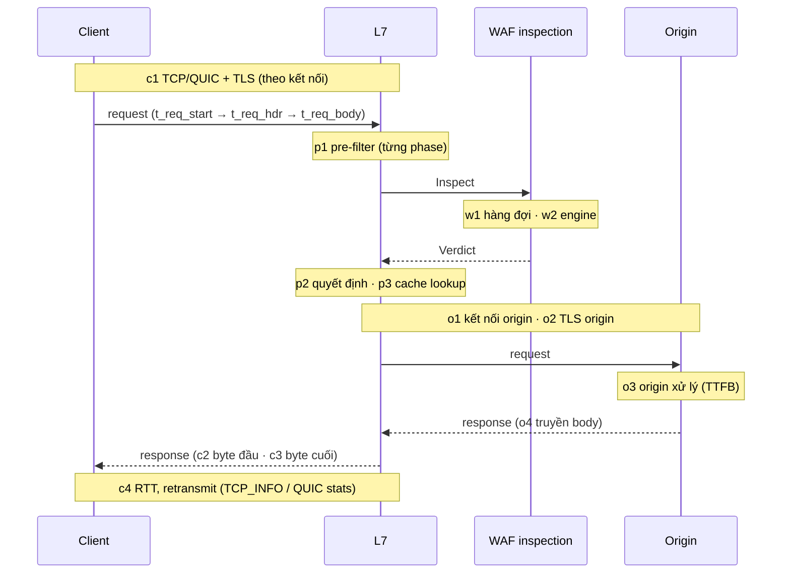

# 8.14 Đo độ trễ theo tầng và quy lỗi về đúng nguồn

Hai câu hỏi vận hành hay gặp nhất, từ khách lẫn từ NOC: **"chậm ở đâu?"** và **"lỗi này của website
hay của WAAP?"**. Quyết định nền: [ADR-0036](../09-adr/0036-request-timing-and-error-attribution.md).

## 1. Các chặng của một request



## 2. Điểm đo và chỉ số

Mọi mốc thời gian dùng đồng hồ monotonic của process, tính bằng micro giây, ghi vào bản ghi telemetry
của request ([5.8.8](../05-building-blocks/08-components/08-ingestion-and-storage.md)).

| Nhóm | Trường | Đo cái gì | Ai đo |
|---|---|---|---|
| **Client → edge** | `client_tls_us` | Bắt tay TLS (chỉ request đầu của kết nối) | L7 |
| | `client_rtt_us`, `client_retrans` | RTT và số gói gửi lại tới client (`TCP_INFO` trên Linux, thống kê của QUIC) | L7 |
| | `req_recv_us` | Từ byte đầu tới hết header (+ body nếu buffer) | L7 |
| **L7** | `pre_us{phase}` | Thời gian từng phase pre-filter | L7 |
| | `cache_us`, `cache_status` | Tra cache, kết quả HIT/MISS/EXPIRED/BYPASS/STALE | L7 |
| **WAF** | `waf_rtt_us` | Từ lúc gửi Inspect tới lúc nhận verdict (do L7 đo) | L7 |
| | `waf_queue_us`, `waf_engine_us` | Chờ hàng đợi và thời gian engine (WAF trả trong verdict) | WAF |
| | `waf_net_us` | `waf_rtt_us − waf_queue_us − waf_engine_us` | Tính ra |
| **Edge → origin** | `origin_connect_us`, `origin_tls_us` | Mở kết nối, bắt tay TLS tới origin (0 nếu dùng lại kết nối trong pool) | L7 |
| | `origin_ttfb_us` | Từ lúc gửi xong request tới byte đầu của response | L7 |
| | `origin_transfer_us` | Từ byte đầu tới byte cuối của response từ origin | L7 |
| **Edge → client** | `client_ttfb_us` | Từ lúc nhận xong request tới byte đầu gửi client | L7 |
| | `client_send_us` | Từ byte đầu tới byte cuối ghi ra socket client | L7 |
| **Tổng hợp** | `edge_us` | Thời gian do WAAP gây ra = L7 + WAF, **không gồm** chờ origin và chờ client | Tính ra |
| | `total_us` | Từ byte đầu của request tới byte cuối của response | L7 |

Công thức tách trách nhiệm cho một request:

```text
total_us = req_recv_us                       # client gửi chậm hay mạng client
         + edge_us                           # WAAP: pre-filter + WAF + quyết định + cache lookup
         + origin_connect_us + origin_tls_us # mạng edge → origin
         + origin_ttfb_us                    # website xử lý
         + max(origin_transfer_us, client_send_us)  # truyền body (song song, giới hạn bởi bên chậm hơn)
```

Response phục vụ từ cache có `origin_* = 0`.

## 3. Phân loại lỗi: mỗi response có một nguồn

Mọi response, không chỉ response lỗi, mang hai trường: **`status_source`** (ai sinh ra status code) và
**`edge_error`** (mã chi tiết khi WAAP tự sinh response thay cho origin).

| `status_source` | Nghĩa | Ví dụ | Lỗi của ai |
|---|---|---|---|
| `origin` | Status do origin trả, WAAP chuyển nguyên | 200, 404, 500 của website | Website |
| `cache` | Phục vụ từ cache | 200 HIT, 200 STALE khi origin lỗi | — |
| `edge_policy` | WAAP chặn hoặc thách thức theo policy của khách | 403 block, 429 rate limit, challenge | Không phải lỗi; là hành động bảo mật, có rule ID |
| `edge_request` | Request sai chuẩn hoặc vượt giới hạn | 400, 408, 413, 414, 431 | Client |
| `client_abort` | Client đóng kết nối trước khi nhận xong | Ghi log với mã nội bộ 499, không gửi gì | Client / mạng client |
| `origin_unreachable` | WAAP không lấy được response từ origin | 502, 504 (xem bảng mã dưới) | Website hoặc mạng tới website |
| `edge_platform` | Lỗi của chính WAAP | 500, 503 do WAAP sinh | **WAAP** |

Mã chi tiết `edge_error`, hiện trên trang lỗi, trong header `X-WAAP-Error` và trong log:

| `edge_error` | Status gửi client | Nguyên nhân | `status_source` |
|---|---|---|---|
| `origin_connect_refused` | 502 | Origin từ chối kết nối | `origin_unreachable` |
| `origin_connect_timeout` | 504 | Không mở được kết nối tới origin trong thời hạn | `origin_unreachable` |
| `origin_dns_failed` | 502 | Không phân giải được tên origin | `origin_unreachable` |
| `origin_tls_failed` | 502 | Bắt tay TLS tới origin lỗi | `origin_unreachable` |
| `origin_cert_invalid` | 502 | Cert của origin không hợp lệ (khi zone bật kiểm cert) | `origin_unreachable` |
| `origin_response_timeout` | 504 | Đã kết nối nhưng origin không trả byte đầu trong thời hạn | `origin_unreachable` |
| `origin_bad_response` | 502 | Origin trả response sai chuẩn, rỗng, hoặc đóng giữa chừng | `origin_unreachable` |
| `waf_unavailable_closed` | 503 | Tầng WAF không trả lời và zone chọn fail-closed | `edge_platform` |
| `config_missing` | 503 | Node chưa có cấu hình cho hostname này | `edge_platform` |
| `edge_internal` | 500 | Lỗi nội bộ của L7 | `edge_platform` |
| `edge_overloaded` | 503 | L7 quá tải, từ chối để bảo vệ | `edge_platform` |

Gửi status chuẩn (502/503/504) cho client thay vì mã riêng ngoài chuẩn, để công cụ giám sát và thư viện
HTTP của khách xử lý đúng; phần phân biệt nằm ở `X-WAAP-Error`, trang lỗi và log.

Cách đọc nhanh cho khách và support:

```text
5xx với status_source = origin             → website lỗi
5xx với status_source = origin_unreachable → website hoặc mạng tới website (xem edge_error)
5xx với status_source = edge_platform      → lỗi của WAAP, tính vào SLI S1 của NCC
403/429 với status_source = edge_policy    → bị chặn theo rule (xem rule ID), không phải lỗi hệ thống
```

## 4. Hiển thị cho khách

| Nơi | Nội dung |
|---|---|
| **Trace của một request** (tra theo request ID) | Waterfall các chặng §1 với thời gian thật, `status_source`, `edge_error`, rule khớp, cache status |
| **Dashboard độ trễ** | p50/p95/p99 theo chặng (edge, WAF, origin TTFB, mạng tới origin, mạng tới client) theo thời gian; câu trả lời trực tiếp cho "chậm ở đâu" |
| **Dashboard lỗi** | 5xx tách theo `status_source` và `edge_error`; tỉ lệ lỗi của website và của WAAP vẽ riêng |
| **Header `Server-Timing`** (tuỳ chọn theo zone, mặc định tắt) | `edge;dur=0.4, waf;dur=1.1, origin;dur=85, cache;desc=MISS` để khách xem ngay trong devtools; mặc định tắt vì để lộ thông tin cho người ngoài |
| **Cảnh báo** | D4 (origin quá tải), O1 (không kết nối được origin), O2 (lỗi do nền tảng) ([5.8.10](../05-building-blocks/08-components/10-alerting-rules-and-algorithms.md)) |

## 5. Đo trải nghiệm thật của client

Edge đo được mọi thứ cho tới byte cuối ghi ra socket, cùng RTT và gửi lại gói. Phần edge không thấy:
DNS phía client, thời gian trình duyệt dựng trang, và mạng chặng cuối khi kết nối đi qua proxy khác.

| Cách | Giai đoạn | Mô tả |
|---|---|---|
| Chỉ số từ edge (§2) | MVP | `client_rtt_us`, `client_retrans`, `client_ttfb_us`, `client_send_us` theo quốc gia/ASN |
| Probe tổng hợp cho zone của khách | Mở rộng | Prober của NCC (cùng hạ tầng [8.12 §4](12-platform-monitoring.md#4-probe-tổng-hợp-theo-hành-vi)) gọi URL khách chọn từ nhiều điểm, đo toàn bộ đường đi kể cả DNS |
| RUM (real user monitoring) | Mở rộng | Đoạn JS tuỳ chọn (khách tự thêm hoặc L7 chèn khi zone bật) gửi Navigation/Resource Timing kèm request ID lấy từ `Server-Timing`, về một endpoint ingest riêng; nối với trace của request |

## 6. Dùng cho vận hành nội bộ

- **SLI S1** ([8.12](12-platform-monitoring.md#3-sli-và-slo)) chỉ đếm `status_source = edge_platform`;
  lỗi của website không bao giờ làm cháy error budget của NCC, và ngược lại không thể bị che đi.
- **SLI S2** dùng `edge_us`, không dùng `total_us`, nên origin chậm không làm sai chỉ số độ trễ của WAAP.
- Runbook "khách báo site chậm hoặc lỗi": [8.13 A15](13-operational-behaviors.md#a15-khách-báo-site-chậm-hoặc-lỗi).
