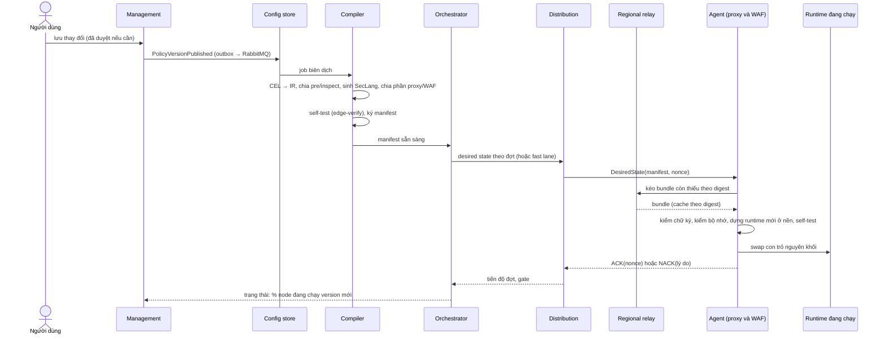
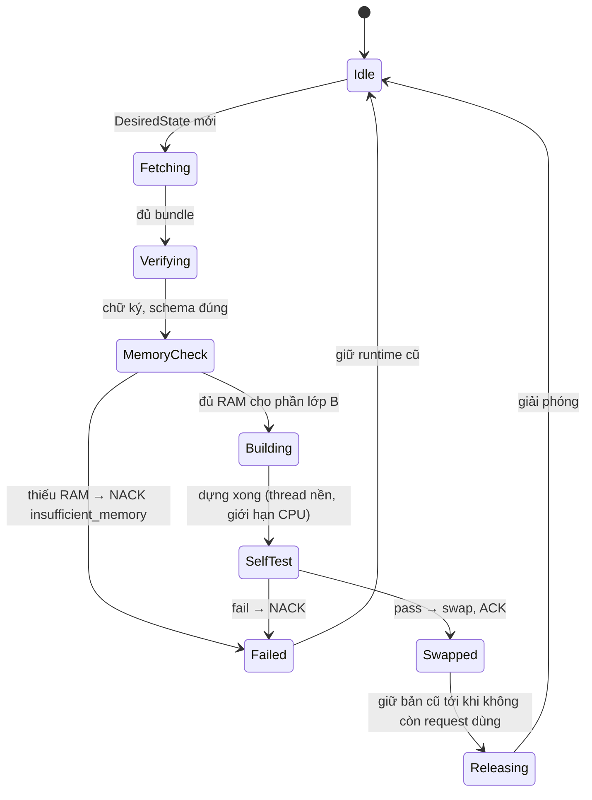

# 8.15 Luồng cấu hình xuống edge và cách áp dụng

Từ lúc người dùng bấm lưu tới lúc từng node edge chạy cấu hình mới, và với mỗi loại cấu hình thì node
áp dụng bằng cách nào: đổi nóng, build nền rồi đổi, reload process, hay nâng phần mềm. Quyết định nền:
[ADR-0037](../09-adr/0037-config-apply-classes.md). Thành phần liên quan: [5.8.5](../05-building-blocks/08-components/05-config-and-compiler.md),
[5.8.6](../05-building-blocks/08-components/06-rollout-distribution-fleet.md),
[5.8.4](../05-building-blocks/08-components/04-edge-agent-and-state.md).

## 1. Luồng đầu cuối

| Bước | Ngân sách p95 (đường thường) | Fast lane |
|---|---|---|
| Management → config store (outbox) | ≤ 2 s | ≤ 1 s |
| Biên dịch + self-test + ký | ≤ 10 s | ≤ 2 s (chỉ phần thay đổi nhỏ, xem §4) |
| Orchestrator + distribution báo node | ≤ 2 s | ≤ 0,5 s |
| Node kéo bundle qua relay | ≤ 3 s | ≤ 1 s |
| Node dựng runtime + swap (loại A) | ≤ 1 s | ≤ 0,5 s |
| **Tổng tới 100% node, không tính thời gian quan sát giữa các đợt** | **≤ 30 s** | **≤ 5 s tới 95% node** |

Thời gian quan sát canary (mặc định vài phút) nằm ngoài ngân sách trên; đó là chủ đích để an toàn.

## 2. Bốn lớp áp dụng

| Lớp | Cách áp dụng | Ảnh hưởng request/kết nối đang chạy | Kênh phân phối |
|---|---|---|---|
| **A. Đổi nóng** | Dựng runtime mới (ms), swap con trỏ | Không: request đang chạy dùng bản cũ tới khi xong | Rollout thường hoặc fast lane |
| **B. Build nền rồi đổi nóng** | Dựng ở thread nền có giới hạn CPU, cần RAM gấp đôi phần đó trong lúc swap; so le giữa các node trong PoP | Không, nhưng tốn CPU/RAM trong vài giây | Rollout thường (không qua fast lane) |
| **C. Reload process** | Process mới nhận lại socket đang nghe (hot restart), process cũ drain kết nối tới hạn | Kết nối mới vào process mới; kết nối cũ được drain, có thể bị đóng nếu quá hạn drain | Rollout như phần mềm, theo node profile |
| **D. Nâng phần mềm** | Như C, binary mới | Như C | Rollout phần mềm ([8.13 B1](13-operational-behaviors.md#b1-rollout-phần-mềm-edge)) |

## 3. Cấu hình nào thuộc lớp nào

| Cấu hình | Phạm vi | Tầng | Lớp | Ghi chú về trạng thái |
|---|---|---|---|---|
| Access list (IP/CIDR/geo/ASN) của zone | Zone | Proxy | A | Danh sách rất lớn (> 100.000 mục) dựng trie ở nền, vẫn tính là A vì vài chục ms |
| Rate limit rule | Zone | Proxy | A | Counter giữ theo `(rule_id, hash(khoá, ngưỡng, cửa sổ))`: đổi ngưỡng/khoá thì counter của rule đó bắt đầu lại, rule khác giữ nguyên |
| Under Attack mode bật/tắt | Zone | Proxy | A | Fast lane; clearance token cũ vẫn hợp lệ |
| Custom rule phần pre (IR) | Zone | Proxy | A | |
| Custom rule phần inspect | Zone | WAF | A | |
| Cấu hình CRS của zone (paranoia, ngưỡng, rule tắt, exclusion) | Zone | WAF | A nếu cấu hình đã có instance trong node; **B** nếu là tổ hợp mới | Instance engine dùng chung theo hash cấu hình; tổ hợp mới phải build |
| Cache rule | Zone | Proxy | A | Object đã cache giữ nguyên; đổi cache key làm object cũ không còn được trúng, tự bị đẩy ra theo LRU; muốn xoá ngay thì purge |
| Purge | Zone | Proxy | A (lệnh, không phải cấu hình) | Fast lane; đánh dấu vô hiệu theo URL/prefix/tag, không quét đĩa đồng bộ |
| Origin (địa chỉ, TLS, timeout) | Zone | Proxy | A | Pool kết nối mới cho cấu hình mới; pool cũ drain khi hết request |
| Cert của zone (thêm, gia hạn) | Zone | Proxy | A | Map SNI → cert swap; handshake mới dùng cert mới, kết nối TLS đang mở giữ cert cũ |
| Fail mode, giới hạn body, timeout | Zone | Cả hai | A | |
| Chế độ đứng sau CDN (dải IP tin cậy, header IP client) | Zone | Proxy | A | |
| Entitlements áp ở edge | Tenant | Cả hai | A | Tỉ lệ lấy mẫu áp qua cấu hình Vector (reload Vector, không ảnh hưởng traffic) |
| Zone data DNS điều hướng | Toàn cục | DNS | A | Plugin CoreDNS đọc snapshot, swap tại chỗ |
| **Ruleset release** (CRS upstream, system ruleset) | Toàn cục | WAF | **B** | Build hàng nghìn rule mất vài giây, RAM gấp đôi; so le theo node trong PoP |
| **Rule khẩn của NCC** | Toàn cục | WAF (và proxy nếu là rule pre) | A | Tách thành **lớp rule khẩn nhỏ** riêng, không build lại cả CRS, nên đi fast lane được (§4) |
| **Dữ liệu geo/ASN (MMDB)**, reputation list lớn | Toàn cục | Proxy | **B** | Hàng trăm MB; nạp vào vùng nhớ mới rồi swap |
| Khoá HMAC clearance, session ticket key | Toàn cục | Proxy | A | Luôn giữ khoá hiện tại + khoá trước |
| Khoá công khai kiểm chữ ký manifest | Toàn cục | Agent | A | Thêm khoá mới trước, ký bằng khoá mới sau ([8.13 B5](13-operational-behaviors.md#b5-xoay-khoá)) |
| **Node profile**: cổng nghe, số worker, giới hạn RAM, kích thước cache đĩa, tham số HTTP/2/3 toàn cục, kích thước pool WAF, địa chỉ relay | Node / PoP | Cả hai | **C** | Bundle riêng có chữ ký, rollout như phần mềm |
| Cấu hình Vector (đích, buffer) | Node | Vector | C (chỉ Vector) | Vector hot reload; không ảnh hưởng traffic |
| Binary proxy, WAF, agent | Node | Cả hai | **D** | |
| Cert mTLS của node | Node | Agent | A | Tự gia hạn, không cần thao tác |

Nguyên tắc phân lớp: mọi thứ thuộc **zone hoặc tenant** phải là lớp A, vì khách đổi thường xuyên và
phải có hiệu lực trong vài giây. Lớp B chỉ dành cho dữ liệu lớn dùng chung do NCC phát hành. Lớp C/D chỉ
dành cho cấu hình của node, không bao giờ do khách kích hoạt.

## 4. Fast lane không được kích hoạt build nặng

- Rule khẩn của NCC nằm trong một **lớp rule khẩn** riêng, nhỏ, đánh giá **trước** CRS ở tầng WAF (và ở
  proxy nếu chỉ dùng trường rẻ). Thêm rule khẩn chỉ dựng lại lớp này, không build lại instance CRS.
- Khi rule khẩn được đưa vào system ruleset ở release kế tiếp (lớp B, rollout thường), nó được gỡ khỏi
  lớp khẩn.
- Compiler từ chối đưa vào fast lane bất kỳ thay đổi nào sinh ra việc lớp B (ví dụ đổi paranoia sang tổ
  hợp chưa có instance); thay đổi đó đi đường thường và portal nói rõ lý do.

## 5. Áp dụng trên node

| Quy tắc | Lý do |
|---|---|
| Dựng runtime mới ở thread nền, độ ưu tiên thấp, giới hạn CPU | Không giành CPU với request |
| Kiểm RAM trước khi build lớp B; thiếu thì NACK chứ không để OOM | Một release ruleset không được làm sập node |
| So le build lớp B trong một PoP (tối đa 25% node WAF build cùng lúc) | PoP vẫn đủ năng lực kiểm tra trong lúc build |
| Giữ sẵn **3 manifest gần nhất** (đã giải nén) trên đĩa | Rollback không cần tải lại, chỉ swap |
| Bundle chung áp trước, bundle zone sau trong cùng một lần swap | Bundle zone luôn tham chiếu được bundle chung |

## 6. Hai tầng swap lệch nhau

Proxy và WAF là hai process, swap độc lập nên có khoảng lệch ngắn (thường dưới 1 giây) khi proxy đã ở
version N còn WAF vẫn ở N−1, hoặc ngược lại.

- Mọi Inspect request mang `policy_version_id` của proxy ([5.5](../05-building-blocks/05-contracts.md#inspection-api-edge-proxy--waf)).
- Tầng WAF giữ runtime của **version hiện tại và version trước** cho mỗi zone; nếu proxy hỏi version
  đó thì dùng đúng version đó, nếu không có thì dùng version mới nhất mình có và gắn cờ `version_skew`
  vào verdict.
- Telemetry ghi `version_skew`; orchestrator coi một node chỉ "đã nhận" version N khi **cả hai tầng**
  đã ACK.

## 7. Cấu hình không xuống edge

| Cấu hình | Đi đâu |
|---|---|
| Alert policy, kênh thông báo, đích SIEM export, nhãn chặn nhầm | Analytics (qua RabbitMQ) |
| Gói, hoá đơn, người dùng, vai trò, SSO | Chỉ Management |
| Entitlements phần retention và giới hạn truy vấn | Analytics |

## 8. Quan sát

| Chỉ số | Dùng cho |
|---|---|
| Thời gian từng bước ở §1 (theo manifest) | SLI S4/S5, tìm bước chậm |
| `waap_agent_build_duration_seconds{class}`, `waap_agent_build_memory_bytes` | Theo dõi lớp B, phát hiện release ruleset làm tăng RAM |
| `waap_agent_nack_total{stage,reason}` | Gồm `insufficient_memory`, `signature`, `schema`, `self_test` |
| `waap_edge_version_skew_total` | Khoảng lệch giữa hai tầng có kéo dài bất thường không |
| Số node theo node profile version | Theo dõi rollout lớp C |
