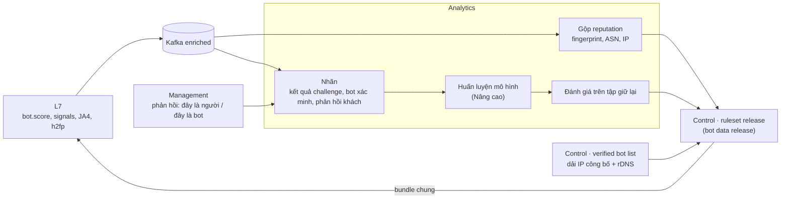

# 8.16 Bot management

Phân loại mỗi request là người, bot tốt đã xác minh, hay tự động hoá không mong muốn, và cho khách quyết
định làm gì với từng loại. Quyết định nền: [ADR-0038](../09-adr/0038-bot-management-layered-scoring.md).
Giai đoạn: **Mở rộng** cho phần lõi, **Nâng cao** cho mô hình hành vi và chống chiếm tài khoản
([1.2](../01-introduction/00-index.md#12-tổng-quan-yêu-cầu)).

## 1. Bài toán của khách

| Loại bot | Gây hại | Ví dụ |
|---|---|---|
| Bot tốt | Không; chặn nhầm thì mất SEO, mất giám sát | Googlebot, Bingbot, công cụ uptime, bot của đối tác |
| Crawler AI | Lấy nội dung để huấn luyện mô hình; khách muốn tự quyết | Crawler của các công ty AI |
| Scraper | Lấy giá, nội dung, dữ liệu | Đối thủ quét giá |
| Credential stuffing | Chiếm tài khoản | Thử hàng loạt user/password bị lộ ở `/login` |
| Gom hàng, đặt chỗ | Mua hết hàng giới hạn, giữ chỗ ảo | Bot săn vé, sneaker |
| Carding | Thử thẻ đánh cắp | Gọi liên tục `/checkout` với số tiền nhỏ |
| Spam form | Rác dữ liệu | Đăng ký giả, comment spam |

Điểm chung: bot xấu ngày càng giả trình duyệt tốt (headless Chrome, proxy dân cư), nên không có một tín
hiệu nào đủ; phải chồng nhiều lớp tín hiệu và để người dùng thật đi qua mà không bị làm phiền.

## 2. Các lớp tín hiệu

Tất cả chạy ở **tầng L7** ([ADR-0034](../09-adr/0034-pre-filter-and-rule-split-across-tiers.md)):
rẻ, không cần đọc body, và phải có kết quả trước rate limit và custom rule.

| # | Lớp | Tín hiệu | Chi phí | Dữ liệu cần |
|---|---|---|---|---|
| BS1 | **Bot đã xác minh** | IP thuộc dải công bố của bot (Google, Bing…), hoặc đã xác minh bằng reverse DNS + forward DNS; chữ ký HTTP Message Signatures của agent (chuẩn đang hình thành cho bot tự định danh) | Rất thấp (tra bảng) | Danh sách bot đã xác minh trong bundle chung |
| BS2 | **Danh sách của khách** | Đối tác, công cụ giám sát theo IP, header, API key | Rất thấp | Bundle zone |
| BS3 | **Fingerprint tĩnh** | JA4 (TLS ClientHello), fingerprint HTTP/2 (SETTINGS, thứ tự pseudo-header), thứ tự và tập header; **độ nhất quán** giữa các tín hiệu với User-Agent tự khai (UA nói Chrome nhưng TLS là thư viện Python) | Thấp | Bảng reputation fingerprint trong bundle chung |
| BS4 | **Reputation mạng** | ASN datacenter/hosting, proxy dân cư đã biết, Tor, lịch sử lạm dụng gộp từ toàn fleet (ẩn danh) | Rất thấp | Danh sách reputation trong bundle chung |
| BS5 | **Hành vi ngắn hạn** | Theo IP, phiên (cookie), consumer API: tốc độ theo path, độ đều của nhịp gửi, tỉ lệ trang HTML/tài nguyên phụ, tỉ lệ lỗi 4xx, số path khác nhau | Thấp (counter cục bộ) | State trong L7, hot key qua Valkey |
| BS6 | **Tín hiệu từ trình duyệt** | Kết quả JS challenge: proof-of-work, kiểm môi trường (dấu hiệu headless, automation, API trình duyệt mâu thuẫn); tuỳ chọn đoạn JS thu tín hiệu chạy ngầm trên trang | Chỉ khi challenge hoặc khi zone bật JS ngầm | Clearance token mang kết quả |
| BS7 | **Mô hình** | Mô hình cây quyết định (gradient boosted trees) nhận đặc trưng từ BS3–BS6, trả điểm | Thấp (µs) | Mô hình trong bundle chung, huấn luyện ở Analytics |

## 3. Kết quả: điểm và lớp

Mỗi request có:

| Trường | Giá trị |
|---|---|
| `bot.score` | 1 (chắc chắn tự động) … 99 (chắc chắn người) |
| `bot.class` | `verified_bot`, `likely_human`, `likely_automated`, `automated` |
| `bot.category` | Với bot đã xác minh: `search`, `monitoring`, `ai_crawler`, `social`, `partner`, `other` |
| `bot.signals` | Bitmask các tín hiệu đã kích hoạt (để giải thích và gỡ lỗi) |

Cách tính, theo thứ tự:

```text
nếu BS2 khớp (khách cho phép)            → class = verified_bot (category = partner), score = 99 về mặt policy
nếu BS1 khớp và UA khớp bot đó           → class = verified_bot, category theo danh sách
nếu UA tự xưng bot tốt mà BS1 không khớp → class = automated, signal = impersonation
ngược lại:
    score = mô hình(BS3, BS4, BS5, BS6)      # Mở rộng: luật trọng số cố định; Nâng cao: mô hình
    class = likely_human     nếu score ≥ 50
            likely_automated nếu 10 ≤ score < 50
            automated        nếu score < 10
nếu clearance token hợp lệ (đã qua challenge gần đây) → nâng score theo mức challenge đã qua
```

Ở giai đoạn Mở rộng, `score` là tổng có trọng số của các tín hiệu với bảng trọng số công bố trong tài
liệu sản phẩm (giống tinh thần [ADR-0027](../09-adr/0027-explicit-alert-formulas.md): giải thích được).
Mô hình học máy chỉ thay thế khi đo được tốt hơn trên tập đánh giá và vẫn trả `signals` để giải thích.

## 4. Policy của khách

| Cấu hình | Ví dụ |
|---|---|
| Hành động theo `bot.class` và nhóm path | Nhóm "login, checkout": `likely_automated` → challenge tương tác, `automated` → block. Nhóm "static": không làm gì |
| Hành động theo `bot.category` | Crawler AI: allow / block / chỉ cho phép trang theo `robots.txt` |
| Bot đã xác minh bỏ qua những gì | Mặc định bỏ qua Under Attack mode và challenge, vẫn chịu rate limit |
| Dùng trong custom rule | `bot.score < 30 && http.request.uri.path.startsWith("/api/search")` (phần pre, chạy ở L7) |
| Chế độ chỉ quan sát | Bật bot management ở log-only trước để xem phân bố trước khi enforce |

Các hành động: allow, log, managed challenge (edge tự chọn JS hay tương tác theo điểm), challenge JS
(không tương tác), challenge tương tác, rate limit chặt hơn, block.

**Mặc định** ([BR-34](../../requirements/02-requirements.md#4-quy-tắc-nghiệp-vụ)), khách sửa được mọi mốc:

| Nhóm path | `score` < 10 | 10 ≤ `score` < 50 | `score` ≥ 50 |
|---|---|---|---|
| Thường | Managed challenge | Log | Allow |
| Nhạy cảm (login, checkout) | Block | Challenge tương tác | Allow |
| API | Không challenge; rate limit theo consumer | Như cột trái | Allow |

Bot đã xác minh (BS1) không đi qua bảng này: theo mục "bỏ qua những gì" ở trên.

## 5. Challenge

| Loại | Khi nào | Người dùng thấy |
|---|---|---|
| JS không tương tác | `likely_automated`, Under Attack mode | Trang chờ dưới 1 giây, không phải làm gì |
| Tương tác | Path nhạy cảm và điểm thấp, hoặc JS challenge thất bại | Một thao tác đơn giản; có phương án cho người dùng cần hỗ trợ tiếp cận |

- Challenge do chính edge phát và kiểm, không phụ thuộc dịch vụ CAPTCHA bên thứ ba (không gửi dữ liệu
  người dùng ra ngoài, chạy được on-prem). Tích hợp CAPTCHA bên thứ ba là tuỳ chọn cho khách muốn.
- Qua challenge thì nhận clearance token (HMAC, [8.8](00-index.md#88-challenge-và-clearance)) mang mức
  đã qua và thời điểm; token có hạn theo zone.
- Với API (client không chạy JS), không challenge; dùng danh tính consumer và rate limit ([8.17](17-api-security.md)).

## 6. Vòng học ở Analytics



| Dữ liệu phát xuống edge | Nguồn | Chu kỳ | Lớp áp dụng ([8.15](15-config-propagation-and-apply.md)) |
|---|---|---|---|
| Danh sách bot đã xác minh | Dải IP công bố của các bot lớn + kiểm rDNS định kỳ | Hằng ngày | A |
| Reputation fingerprint, ASN, IP | Gộp từ toàn fleet, ẩn danh theo tenant | Hằng ngày | B (bảng lớn) |
| Mô hình bot | Huấn luyện ở Analytics, qua đánh giá và log-only song song như ruleset release | Hằng tuần hoặc khi cần | A nếu nhỏ, B nếu lớn |
| Policy bot của zone | Management | Khi khách đổi | A |

Mô hình và dữ liệu bot đi cùng quy trình phát hành như ruleset: đánh giá trên tập giữ lại, log-only song
song trên traffic thật, so sánh tỉ lệ challenge và tỉ lệ người dùng thật bị làm phiền trước khi chuyển mặc định.

## 7. Đo hiệu quả

| Chỉ số | Ý nghĩa |
|---|---|
| Tỉ lệ người thật bị challenge | Ước bằng tỉ lệ qua challenge tương tác thành công; phải thấp |
| Tỉ lệ bot đã xác minh bị chặn | Mục tiêu 0; khác 0 là lỗi |
| Phân bố `bot.class` theo zone, path | Dashboard bot cho khách |
| Tỉ lệ request mang `impersonation` | Bot giả làm Googlebot |
| Độ trễ tính điểm | ≤ 50 µs p99 ở L7 |

## 8. Quyền riêng tư

- JA4, fingerprint HTTP/2, hash header là dữ liệu thiết bị: lưu dạng hash, theo retention của gói, không
  dùng để theo dõi người dùng chéo khách hàng.
- Gộp reputation chéo tenant chỉ dùng thống kê theo fingerprint, IP, ASN; không chia sẻ dữ liệu request của
  tenant này cho tenant khác.
- Đoạn JS thu tín hiệu ngầm mặc định **tắt**; khách bật thì có trách nhiệm thông báo trong chính sách
  quyền riêng tư của họ (Nghị định 13/2023, GDPR).

## 9. Chống chiếm tài khoản (Nâng cao)

| Tính năng | Cách làm |
|---|---|
| Phát hiện credential stuffing | Trên endpoint đăng nhập khách khai báo: tỉ lệ đăng nhập thất bại (theo status/response của origin) theo IP, ASN, fingerprint, phiên trong cửa sổ trượt |
| Kiểm mật khẩu đã lộ | Edge băm thông tin đăng nhập, gửi tiền tố hash tới dịch vụ dạng k-anonymity, gắn cờ cho origin qua header; không lưu, không log mật khẩu |
| Hành động | Challenge tương tác, rate limit theo tài khoản đích, báo khách qua cảnh báo BOT2 |
