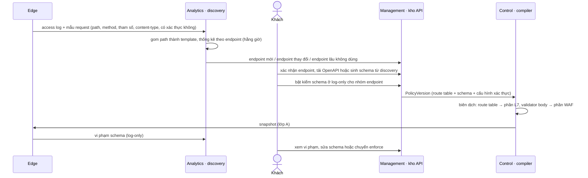

# 8.17 API security

Bảo vệ API của khách theo mô hình **cho phép những gì đã khai báo** thay vì chỉ chặn những gì trông nguy
hiểm. Quyết định nền: [ADR-0039](../09-adr/0039-api-security-positive-model.md). Giai đoạn: **Mở rộng**
cho discovery, schema, JWT, rate limit theo consumer; **Nâng cao** cho phát hiện BOLA và kiểm tra dữ liệu
nhạy cảm trong response.

## 1. Vì sao API khác website

| Website | API |
|---|---|
| Client là trình duyệt, challenge JS được | Client là app, server, thiết bị; **không challenge được** |
| Danh tính thường là IP, cookie | Danh tính là API key, JWT, cert client |
| Tấn công chủ yếu là payload độc (SQLi, XSS) | Ngoài payload còn có lạm dụng logic: gọi sai thứ tự, duyệt ID của người khác (BOLA), gọi endpoint không công bố |
| CRS bắt được phần lớn | CRS bắt payload, không bắt được lạm dụng logic hay endpoint "ma" |

Nên API security dựa trên ba thứ: **biết API có gì** (discovery, schema), **biết ai đang gọi** (danh tính
consumer), và **biết thế nào là bất thường với từng consumer**.

## 2. Năng lực

| # | Năng lực | Ở đâu | Giai đoạn |
|---|---|---|---|
| A1 | **API discovery**: học endpoint từ traffic | Analytics | Mở rộng |
| A2 | **Kho API** (inventory): endpoint đã xác nhận, gắn schema, gắn nhãn nhạy cảm | Management | Mở rộng |
| A3 | **Kiểm theo schema** (OpenAPI 3.x) | L7 (đường, method, tham số, header) + WAF (body) | Mở rộng |
| A4 | **Xác thực ở edge**: JWT, mTLS client cert, có mặt API key | L7 | Mở rộng |
| A5 | **Danh tính consumer** làm khoá cho rate limit, quota, analytics | L7 | Mở rộng |
| A6 | **Bảo vệ GraphQL**: độ sâu, độ phức tạp, chặn introspection, giới hạn batch | WAF | Mở rộng |
| A7 | **Phát hiện BOLA / duyệt đối tượng** | Analytics + L7 | Nâng cao |
| A8 | **Dữ liệu nhạy cảm trong response** (số thẻ, khoá bí mật, PII) | WAF, theo mẫu | Nâng cao |
| A9 | **Dashboard API**: theo endpoint: traffic, lỗi, độ trễ ([8.14](14-latency-and-error-attribution.md)), lỗi xác thực, vi phạm schema | Analytics + Management | Mở rộng |

## 3. Luồng từ discovery tới enforce

## 4. API discovery (A1)

| Bước | Cách làm |
|---|---|
| Gom path | Thay đoạn có dạng số, UUID, hash, base64, hoặc có số giá trị khác nhau rất lớn ở cùng vị trí bằng tham số: `/users/123/orders/9f8c…` → `/users/{id}/orders/{id}` |
| Gộp theo endpoint | `(host, method, path template)`: số lượng, tỉ lệ lỗi, độ trễ, tham số query/body đã thấy và kiểu suy ra, content-type, có header xác thực không, tỉ lệ consumer khác nhau |
| So với kho | **Endpoint mới** (chưa có trong kho), **shadow** (có traffic nhưng không nằm trong schema khách đã tải), **zombie** (khai báo deprecated mà vẫn có traffic), **không dùng** (trong schema mà không có traffic N ngày) |
| Sinh schema nháp | Từ tham số và kiểu đã thấy; khách duyệt trước khi dùng |

Chạy hằng giờ trên dữ liệu đã lấy mẫu; endpoint ít traffic cần thời gian dài hơn để xuất hiện, ghi rõ
trên giao diện.

## 5. Kiểm theo schema (A3)

| Kiểm | Tầng | Lý do |
|---|---|---|
| Endpoint có trong schema không (route table theo host, method, path template) | L7 | Rẻ; endpoint lạ bị chặn hoặc ghi log trước khi tốn CPU WAF |
| Tham số path, query, header bắt buộc, kiểu và giới hạn | L7 | Không cần body |
| Content-type, kích thước body | L7 | Không cần đọc body |
| Body JSON theo JSON Schema của endpoint | **WAF** | Cần đọc body |
| GraphQL: parse, độ sâu, độ phức tạp, introspection, batch (A6) | **WAF** | Cần đọc body |

- Compiler biên dịch OpenAPI thành **route table** (phần L7) và **validator theo endpoint** (phần WAF),
  cùng manifest nên hai tầng khớp version ([8.15 §6](15-config-propagation-and-apply.md#6-hai-tầng-swap-lệch-nhau)).
- Chế độ theo endpoint hoặc nhóm: tắt, log-only, enforce. Mặc định log-only khi mới tải schema.
- Vi phạm trả 400 (dữ liệu sai) hoặc 404/403 (endpoint không khai báo) với `status_source = edge_policy`
  và mã vi phạm cụ thể.

## 6. Xác thực và danh tính consumer (A4, A5)

| Cơ chế | Cách làm ở edge |
|---|---|
| **JWT** | Kiểm chữ ký bằng JWKS của khách, `exp`, `nbf`, `iss`, `aud`; claim dùng được trong rule (`jwt.claims.sub`, `jwt.claims.scope`) |
| **JWKS** | Khách khai báo URL JWKS; **Control** kéo định kỳ (và khi gặp `kid` lạ được báo về), kiểm, đưa vào bundle zone qua fast lane; edge không bao giờ tự gọi ra ngoài trên đường request |
| **mTLS client cert** | L7 kiểm cert client theo CA khách tải lên; subject/SAN dùng làm danh tính |
| **API key** | Kiểm có mặt và định dạng ở MVP của tính năng; kiểm giá trị (danh sách hash key đồng bộ từ khách qua API) ở Nâng cao |
| **Danh tính consumer** | Khách chọn nguồn: `jwt.claims.sub`, header API key, cert subject, cookie; edge băm thành `api.consumer` và dùng làm khoá rate limit, quota, analytics |

Rate limit và quota theo consumer thay vì theo IP là điểm khác biệt chính với website: nhiều consumer có
thể sau một NAT, một consumer có thể gọi từ nhiều IP.

## 7. Phát hiện BOLA và duyệt đối tượng (A7, Nâng cao)

Broken Object Level Authorization: một consumer truy cập đối tượng của người khác bằng cách đổi ID.

| Bước | Cách làm |
|---|---|
| Tín hiệu | Với mỗi `(endpoint template, consumer)`: số ID khác nhau trong cửa sổ, tỉ lệ 403/404 từ origin, độ tuần tự của ID |
| Phát hiện | So với baseline của endpoint (median/MAD như [5.8.10](../05-building-blocks/08-components/10-alerting-rules-and-algorithms.md#43-ba-cách-tính-ngưỡng)); vượt ngưỡng → cảnh báo API3 |
| Hành động | Đề xuất rate limit theo consumer trên endpoint đó, hoặc chặn consumer có hạn; WAAP không biết quyền nghiệp vụ nên chỉ phát hiện bất thường, việc sửa lỗi phân quyền là của origin |

## 8. Dữ liệu nhạy cảm trong response (A8, Nâng cao)

Kiểm response cần gửi response từ L7 sang WAF, tốn gấp đôi chi phí. Thiết kế: chỉ bật theo endpoint
khách chọn, có lấy mẫu; WAF tìm mẫu (số thẻ qua kiểm Luhn, khoá API dạng phổ biến, mẫu PII do khách định
nghĩa); hành động: log, che trong response, hoặc chặn.

## 9. Dữ liệu và cấu hình

| Dữ liệu | Nơi giữ | Xuống edge | Lớp áp dụng |
|---|---|---|---|
| Kho API, schema, nhóm endpoint, chế độ | Management | Route table (L7), validator (WAF) | A |
| Cấu hình xác thực (JWT issuer/audience, CA client, nguồn danh tính consumer) | Management | L7 | A |
| JWKS | Control kéo từ khách | L7 | A, fast lane khi xoay khoá |
| Endpoint đã phát hiện, thống kê | Analytics → Management | Không | — |
| Baseline BOLA | Analytics | Không (chỉ cảnh báo, đề xuất) | — |

## 10. Đo hiệu quả

| Chỉ số | Ý nghĩa |
|---|---|
| Tỉ lệ endpoint có traffic nằm trong kho | Độ phủ của kho API |
| Số endpoint shadow, zombie | Rủi ro bề mặt tấn công |
| Vi phạm schema theo endpoint (log-only vs enforce) | Sẵn sàng chuyển enforce chưa |
| Tỉ lệ JWT không hợp lệ, hết hạn | Lỗi tích hợp của khách hoặc tấn công |
| Độ trễ kiểm schema | L7 ≤ 20 µs; WAF (body JSON 10 KB) ≤ 300 µs p99 |
