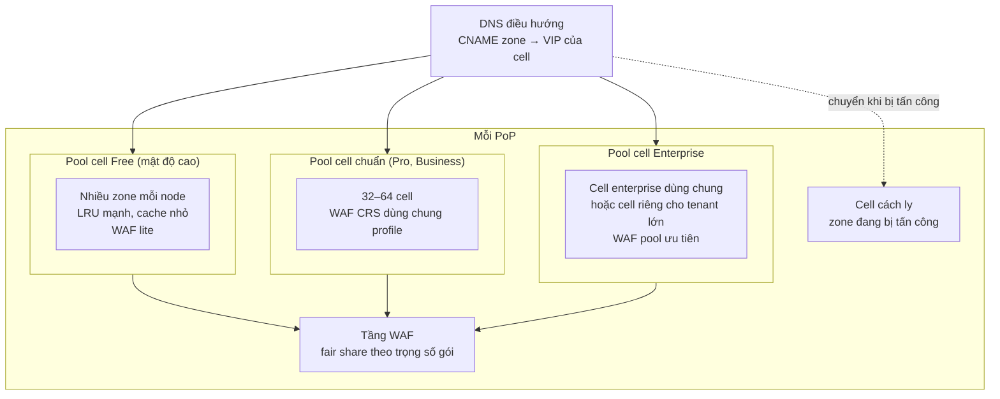

# 8.18 Phân khúc khách, gói giá và kiến trúc theo gói

Phần này nối ba thứ: **ai là khách** (phân khúc, tải của từng loại site), **khách trả gì** (gói giá,
giới hạn), và **kiến trúc phục vụ họ thế nào** (cell, tài nguyên, thứ tự hy sinh khi quá tải). Ước lượng
tổng ở [7.5](../07-deployment/05-capacity-and-sharding.md) dùng mô hình phân khúc này. Quyết định:
[ADR-0042](../09-adr/0042-plan-tiers-drive-placement-and-isolation.md).

Giá trong tài liệu là **giá tham chiếu để kiểm tra kiến trúc có lãi ở từng gói**, không phải giá bán;
business chốt giá, tiền tệ và chiết khấu. Kiến trúc chỉ cam kết: mọi giới hạn của gói là entitlement
đổi được không cần deploy ([ADR-0007](../09-adr/0007-log-by-subscription-entitlements.md)).

## 1. Phân khúc

Giả định 80% zone là site kiểu người dùng cá nhân và nhỏ (như phần lớn khách Cloudflare), 18% là doanh
nghiệp, 2% là enterprise.

| Phân khúc | Gói | Tỉ lệ zone | Số zone | Ví dụ site |
|---|---|---|---|---|
| **S1. Cá nhân** | Free | 65% | 650.000 | Blog, portfolio, landing page, site sự kiện, dự án phụ |
| **S2. Nhỏ, bán chuyên** | Pro | 15% | 150.000 | Shop nhỏ, blog có quảng cáo, site agency làm cho khách |
| **S3. Doanh nghiệp** | Business | 18% | 180.000 | Thương mại điện tử vừa, SaaS nhỏ, báo, site công ty có API |
| **S4. Enterprise** | Enterprise | 2% | 20.000 (khoảng 1.500 tenant) | Ngân hàng, sàn TMĐT lớn, game, chính phủ, telco |

### Tải mỗi zone theo phân khúc

Trong từng phân khúc, traffic cũng lệch mạnh (gần log-normal): trung vị nhỏ hơn trung bình nhiều lần,
và vài zone "viral" vượt hẳn.

| Phân khúc | Trung vị rps | Trung bình rps | p99 rps | Đỉnh quan sát | Tỉ lệ zone có traffic ở một PoP (10 phút) | Response TB | Cache hit |
|---|---|---|---|---|---|---|---|
| Free | 0,01 | 0,3 | 5 | 500 (viral) | 10% | 30 KB | 85% |
| Pro | 0,1 | 2 | 30 | 2.000 | 40% | 30 KB | 75% |
| Business | 0,5 | 6 | 150 | 10.000 | 80% | 25 KB | 60% |
| Enterprise | 5 | 70 | 2.000 | 200.000 | 100% | 20 KB | 45% (nhiều API) |

### Tổng hợp theo phân khúc

| Phân khúc | Zone | rps trung bình | Tỉ lệ traffic | Request qua WAF | Profile WAF | Đơn vị CPU WAF (PL1 = 1) |
|---|---|---|---|---|---|---|
| Free | 650k | 195k | 6,5% | 50% | Lite (≈ 0,25) | 24k |
| Pro | 150k | 300k | 10% | 55% | CRS PL1 (1,0) | 165k |
| Business | 180k | 1,08M | 36% | 60% | PL1–2 + API schema (≈ 1,3) | 842k |
| Enterprise | 20k | 1,4M | 47% | 65% | PL2+, custom, API (≈ 1,8) | 1,64M |
| **Tổng** | 1M | **≈ 3M** | 100% | | | **≈ 2,67M** |

Nhận xét dẫn tới kiến trúc:

1. **82% zone (Free + Pro) chỉ tạo khoảng 16% traffic và khoảng 7% tải CPU WAF**, nhưng chiếm phần lớn
   số zone, cert, bản ghi DNS và dòng trong routing index. Chi phí của họ là **chi phí theo zone** (cấu
   hình, cert, RAM nguội, DNS, support, chống lạm dụng), không phải chi phí theo request.
2. **2% zone enterprise tạo gần một nửa traffic và khoảng 60% tải WAF.** Chi phí của họ là theo request,
   và họ là nhóm cần SLA, cô lập, cấu hình phức tạp.
3. Hai nhóm có **đặc tính tải ngược nhau**: Free là rất nhiều zone nguội, Enterprise là ít zone rất
   nóng. Đặt chung một cách phục vụ thì một trong hai bên chịu thiệt (RAM bị zone nguội chiếm, hoặc zone
   nóng làm nhiễu láng giềng nhỏ).

## 2. Chi phí phục vụ theo gói

Mô hình chi phí hạ tầng hằng tháng ở quy mô 1 triệu zone (đơn giá giả định, phải thay bằng báo giá thật):

| Khoản | Giả định | Tháng |
|---|---|---|
| Node L7 | 450 × 1.500 USD (khấu hao + colo + điện) | 675k |
| Node WAF | 210 × 1.200 USD | 252k |
| Băng thông | ≈ 1,2 Tbps tính theo p95 × 0,5 USD/Mbps | 600k |
| Analytics (Kafka, ClickHouse, object storage) | Theo ≈ 1,1 triệu bản ghi/s | 150k |
| Control, Management, DNS, Ops chung | | 50k |
| **Tổng** | | **≈ 1,73M USD** |

Phân bổ theo đơn vị gây chi phí: L7 và băng thông theo traffic; WAF theo đơn vị CPU WAF; Analytics
theo số bản ghi log; phần chung theo số zone.

| Gói | L7 + băng thông | WAF | Analytics | Chung | Tổng | **Chi phí / zone / tháng** | Zone p99 trong gói |
|---|---|---|---|---|---|---|---|
| Free | 83k | 2k | 2k | 33k | 120k | **≈ 0,18 USD** | ≈ 2,5 USD |
| Pro | 128k | 16k | 6k | 8k | 158k | **≈ 1,05 USD** | ≈ 15 USD |
| Business | 459k | 79k | 42k | 9k | 589k | **≈ 3,3 USD** | ≈ 80 USD |
| Enterprise | 600k | 155k | 100k | 1k | 856k | **≈ 43 USD** (≈ 570 USD / tenant) | Tính theo hợp đồng |

Đơn giá biên dùng để định giá phần vượt mức (từ bảng trên):

| Đơn vị | Chi phí |
|---|---|
| 1 rps trung bình trong tháng (≈ 2,6 triệu request) qua L7 + băng thông | ≈ 0,43 USD |
| 1 rps trung bình qua WAF ở PL1 | ≈ 0,09 USD |
| 1 bản ghi log/s lưu theo retention mặc định | ≈ 0,14 USD |
| 1 zone nguội (cấu hình, cert, DNS, routing index) | ≈ 0,05 USD |

Ý nghĩa: **Free tốn khoảng 120k USD/tháng (≈ 7% hạ tầng)**, là chi phí thu hút khách và lấy dữ liệu tấn
công cho cả fleet. Muốn giữ được Free thì kiến trúc phải giữ chi phí theo zone nguội gần bằng 0 và cấm
Free dùng tài nguyên đắt (body inspection nặng, log đầy đủ, cache lớn).

## 3. Gói giá

```mermaid
flowchart LR
    subgraph F["Free · 0 USD"]
        f1["DDoS L3/L4/L7 không giới hạn"]
        f2["WAF lite: rule CVE nghiêm trọng"]
        f3["5 custom rule, 1 rate limit"]
        f4["CDN cơ bản, SSL tự động"]
        f5["Security event 24 giờ"]
    end
    subgraph P["Pro · ≈ 20–25 USD/zone"]
        p1["+ CRS đầy đủ PL1"]
        p2["+ 20 rule, 5 rate limit"]
        p3["+ Bot fight cơ bản"]
        p4["+ Log mẫu 10%, 3 ngày"]
        p5["+ Cảnh báo email + webhook"]
    end
    subgraph B["Business · ≈ 200–250 USD/zone"]
        b1["+ PL1–4, exclusion theo trường"]
        b2["+ 100 rule, 50 rate limit"]
        b3["+ Bot score, API schema"]
        b4["+ Log 25%, 30 ngày, export"]
        b5["+ SLA 100% edge, cert tuỳ chỉnh"]
    end
    subgraph E["Enterprise · theo hợp đồng"]
        e1["+ 1.000 rule, cell riêng"]
        e2["+ Bot, API, ATO nâng cao"]
        e3["+ Log tới 100%, 365 ngày, SIEM"]
        e4["+ SSO/SCIM, residency, 4-eyes"]
        e5["+ SLA tuỳ chỉnh, TAM, hybrid/on-prem"]
    end
    F --> P --> B --> E
```

Giá tham chiếu được chọn sao cho **zone p99 của mỗi gói vẫn có lãi** (Pro p99 ≈ 15 USD < 20 USD, Business
p99 ≈ 80 USD < 200 USD); zone vượt p99 nhiều lần bị xử lý bằng fair use (mục 5), không bằng tính tiền bất
ngờ. Enterprise định giá theo cam kết traffic (rps hoặc băng thông 95th) cộng add-on, sàn khoảng
3.000 USD/tháng/tenant.

### Bảng tính năng và giới hạn (entitlements)

| Nhóm | Entitlement | Free | Pro | Business | Enterprise |
|---|---|---|---|---|---|
| **DDoS** | L3/L4/L7 tự động, không tính theo dung lượng tấn công | Có | Có | Có | Có |
| | Under Attack mode | Có | Có | Có | Có + tự bật theo detection |
| | Ngưỡng DDoS tuỳ chỉnh | — | — | Có | Có |
| **WAF** | Profile managed | Lite (CVE nghiêm trọng, ≈ 10% rule) | CRS PL1 | CRS PL1–4 + system ruleset | Như Business + ruleset riêng |
| | Rule tắt / exclusion theo trường | — / — | Có / — | Có / Có | Có / Có |
| | Custom rule | 5 | 20 | 100 | 1.000 |
| | Rate limit rule | 1 (theo IP) | 5 | 50 (theo header, consumer) | 500 |
| | Kích thước body kiểm tra | 8 KB | 64 KB | 128 KB | Tới 1 MB |
| | Phần CPU WAF (trọng số fair share) | 1 | 2 | 4 | 8, hoặc pool riêng |
| **Bot** | Mức | Chặn bot xấu rõ ràng | Bot fight (lớp, không điểm) | `bot.score`, policy theo đường dẫn | + mô hình, ATO, verified bot tuỳ chỉnh |
| **API** | Discovery / schema / JWT | — | — | Có / 10 schema / Có | Có / không giới hạn / + mTLS, GraphQL |
| **CDN** | Dung lượng cache trên mỗi PoP | 100 MB, loại ra trước | 1 GB | 10 GB | Theo hợp đồng |
| | Purge | Toàn zone, 5 lần/phút | URL, 1.000/ngày | Prefix, tag | Không giới hạn |
| | Cache key, rule cache | Mặc định | 3 rule | 25 rule | 250 rule |
| **Cert, DNS** | SSL | Universal tự động | Universal | + cert tải lên | + cert riêng, keyless |
| | IP | Chung | Chung | Chung | Riêng / BYOIP (Nâng cao) |
| **Log** | Security event | Đủ, giữ 24 giờ, gộp | Đủ, 3 ngày | Đủ, 30 ngày | Đủ, tới 365 ngày |
| | Access log lấy mẫu | 1% (chỉ dashboard) | 10% | 25% | 50%, tới 100% |
| | Export / SIEM | — | — | 1 đích | 10 đích |
| | Mẫu request cho replay | — | — | Có | Có |
| **Cảnh báo** | Kênh | Email | Email, webhook | + Slack, Teams, PagerDuty | + mọi kênh, SMS |
| **Tenant** | Zone mỗi account | 3 (chống lạm dụng) | Theo zone mua | Theo zone mua | Không giới hạn |
| | SSO / SCIM / 4-eyes / audit | — / — / — / 7 ngày | — / — / — / 30 ngày | SSO / — / Có / 1 năm | Có / Có / Có / theo hợp đồng |
| **SLA, support** | Uptime edge | Không | 99,9% (không bồi hoàn) | 100%, bồi hoàn | 100%, bồi hoàn theo hợp đồng |
| | Support | Cộng đồng | Email | Email ưu tiên, chat | 24/7, TAM, kênh khẩn |
| **Triển khai** | | SaaS | SaaS | SaaS | SaaS, hybrid, on-prem |

Add-on bán riêng cho Pro và Business: bot management đầy đủ, API security, log retention dài, thêm rule,
DNS authoritative, load balancing origin.

## 4. Kiến trúc theo gói

Gói không chỉ là danh sách tính năng: nó quyết định zone được **đặt ở đâu**, được **bao nhiêu tài
nguyên**, và **hy sinh thứ tự nào** khi quá tải.

| Quyết định | Theo gói | Lý do |
|---|---|---|
| **Pool cell** | Free → pool mật độ cao; Pro, Business → cell chuẩn; Enterprise → cell enterprise hoặc cell riêng; mọi gói → cell cách ly khi bị tấn công | Tách hai đặc tính tải ngược nhau (nhiều zone nguội vs ít zone nóng); láng giềng của khách trả tiền nhiều không phải là 650.000 site miễn phí |
| **Ngân sách RAM runtime** | Pool Free: phần lớn RAM cho routing index + LRU nhỏ, dựng lại thường xuyên; pool Enterprise: giữ runtime mọi zone của cell luôn nóng | Zone Free nguội 90% thời gian; zone enterprise không được chịu độ trễ nạp lần đầu (QS-25 chỉ áp cho Free/Pro) |
| **Profile WAF** | Free dùng 1 profile lite; Pro dùng vài profile PL1 chuẩn; Business, Enterprise được exclusion và instance riêng | Free và Pro (800.000 zone) dùng chung chưa tới 10 instance engine, nên chi phí theo zone gần 0 |
| **Fair share CPU WAF** | Trọng số 1 / 2 / 4 / 8; Enterprise lớn có pool WAF riêng | Một zone Free bị flood không lấy được CPU của Business ([5.8.2](../05-building-blocks/08-components/02-waf-inspection.md)) |
| **Cache** | Quota theo gói, loại theo thứ tự Free → Pro → Business → Enterprise | Dung lượng NVMe là tài nguyên chung đắt nhất của PoP |
| **Log** | Lấy mẫu và retention theo gói; security event không bao giờ lấy mẫu | Analytics là chi phí theo bản ghi ([ADR-0007](../09-adr/0007-log-by-subscription-entitlements.md)) |
| **Rollout** | Canary chạy trên cell Free trước, rồi chuẩn, cuối cùng Enterprise | Cell Free có nhiều zone, nhiều loại traffic nhất, hậu quả thương mại nhỏ nhất; Enterprise chỉ nhận bản đã qua hai pool |
| **Thứ tự hàng đợi compiler** | Fast lane mọi gói (Under Attack, rule khẩn); đường thường: Enterprise, Business trước; thay đổi hàng loạt của Free chạy nền | Thay đổi của khách trả tiền không phải chờ một đợt Terraform 100.000 zone Free |
| **Cách ly khi bị tấn công** | Free: tự chuyển sang cell cách ly ngay khi vượt ngưỡng; Business, Enterprise: chuyển khi ảnh hưởng tới cell, có cảnh báo cho khách | Free chịu chuyển cell (DNS, TTL 60 s) dễ hơn; khách lớn cần thông báo |
| **Hỗ trợ on-prem, hybrid** | Chỉ Enterprise | Chi phí đóng gói, vận hành riêng |

### Thứ tự hy sinh khi PoP quá tải

Khi năng lực PoP không đủ (tấn công lớn, mất node), hệ thống hạ cấp theo thứ tự cố định, mỗi bước có
event và metrics riêng ([8.13](13-operational-behaviors.md)):

1. Giảm access log mẫu của Free, rồi Pro về 0 (security event vẫn giữ).
2. Thu nhỏ cache của pool Free; tắt làm nóng trước cho Free.
3. Request của Free tới tài nguyên tĩnh bỏ qua WAF lite (pre-filter, bot cơ bản, rate limit vẫn chạy).
4. Hàng đợi WAF từ chối theo trọng số: Free nhận `Overloaded` trước, áp fail mode của zone.
5. Chuyển zone Free đang chiếm tải sang cell cách ly; nếu vẫn thiếu, rút pool Free của PoP này khỏi
   DNS để người dùng Free sang PoP gần kế tiếp.
6. Chỉ khi các bước trên chưa đủ mới chạm tới Pro, sau đó Business. Enterprise không bị hạ cấp trước
   khi mọi gói khác đã hạ.

DDoS L3/L4 và pre-filter L7 **không bao giờ** bị hạ theo gói: đó là lớp bảo vệ chung của cả PoP.

## 5. Fair use và lạm dụng

| Tình huống | Hành vi |
|---|---|
| Zone Free hoặc Pro vượt xa p99 của gói (ví dụ Free > 50 rps trung bình 7 ngày) | Không chặn, không tính tiền đột ngột: gửi thông báo, đề nghị nâng gói; sau 30 ngày giảm cache quota và chuyển sang pool mật độ cao nhất |
| Zone dùng CDN để phát file lớn (video, bản cài) trên gói không phải Enterprise | Rule cache theo loại nội dung; vượt ngưỡng băng thông thì không cache nội dung đó nữa (vẫn proxy) |
| Đăng ký Free hàng loạt để lừa đảo, phishing | Giới hạn 3 zone/account, xác minh domain, điểm rủi ro khi đăng ký; Trust and Safety có quy trình gỡ proxy và chặn tài khoản |
| Khách bị tấn công liên tục | Không tính phí dung lượng tấn công ở mọi gói; chi phí được hấp thụ nhờ pre-filter rẻ và cell cách ly |

## 6. Đổi gói

| Hướng | Hiệu lực |
|---|---|
| Nâng gói | Entitlements mới ≤ 5 phút (QS-14); zone được chuyển sang pool cell mới qua DNS (TTL 60 s), hai cell cùng phục vụ trong thời gian chuyển; profile WAF đổi lớp A/B ([ADR-0037](../09-adr/0037-config-apply-classes.md)) |
| Hạ gói | Cấu hình vượt giới hạn gói mới không bị xoá: rule vượt số lượng bị tắt theo thứ tự priority, khách chọn lại; log cũ hết hạn theo lịch, báo trước |
| Hết hạn thanh toán | Về Free sau thời gian ân hạn; không bao giờ ngừng proxy đột ngột (DNS của khách đang trỏ vào edge) |
