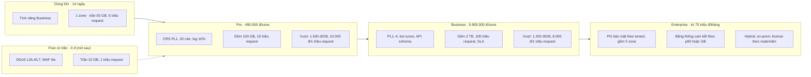
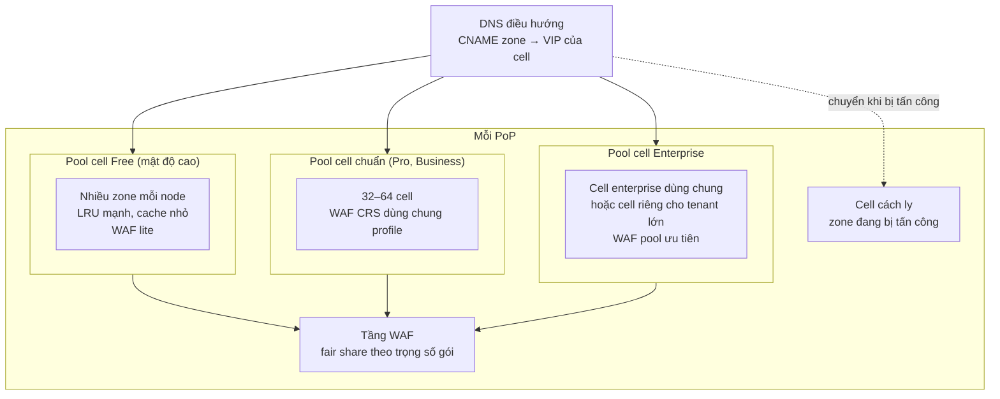

# 8.18 Phân khúc khách, gói giá và kiến trúc theo gói

Phần này nối ba thứ: **ai là khách** (phân khúc, tải của từng loại site), **khách trả gì** (gói giá,
giới hạn), và **kiến trúc phục vụ họ thế nào** (cell, tài nguyên, thứ tự hy sinh khi quá tải). Ước lượng
tổng ở [7.5](../07-deployment/05-capacity-and-sharding.md) dùng mô hình phân khúc này. Quyết định:
[ADR-0042](../09-adr/0042-plan-tiers-drive-placement-and-isolation.md).

Giá trong tài liệu là **giá tham chiếu để kiểm tra mô hình chi phí và kiến trúc**, không phải giá bán;
business chốt giá, tiền tệ và chiết khấu. Kiến trúc chỉ cam kết: mọi giới hạn của gói là entitlement
đổi được không cần deploy ([ADR-0007](../09-adr/0007-log-by-subscription-entitlements.md)).

## 1. Phân khúc

Giả định 80% zone là site kiểu người dùng cá nhân và nhỏ (như phần lớn khách Cloudflare), 18% là doanh
nghiệp, 2% là enterprise. Đây là **mô hình tải để cỡ hạ tầng ở quy mô 1 triệu zone**, không phải dự báo
doanh thu: tỉ lệ zone trả phí thật thấp hơn nhiều và quyết định ở mục 3.

| Phân khúc | Gói | Tỉ lệ zone | Số zone | Ví dụ site |
|---|---|---|---|---|
| **Cá nhân** | Free | 65% | 650.000 | Blog, portfolio, landing page, site sự kiện, dự án phụ |
| **Nhỏ, bán chuyên** | Pro | 15% | 150.000 | Shop nhỏ, blog có quảng cáo, site agency làm cho khách |
| **Doanh nghiệp** | Business | 18% | 180.000 | Thương mại điện tử vừa, SaaS nhỏ, báo, site công ty có API |
| **Enterprise** | Enterprise | 2% | 20.000 (khoảng 1.500 tenant) | Ngân hàng, sàn TMĐT lớn, game, chính phủ, telco |

### Tải mỗi zone theo phân khúc

Trong từng phân khúc, traffic cũng lệch mạnh (gần log-normal): trung vị nhỏ hơn trung bình nhiều lần,
và vài zone "viral" vượt hẳn.

| Phân khúc | Trung vị rps | Trung bình rps | p99 rps | Đỉnh quan sát | Tỉ lệ zone có traffic ở một PoP (10 phút) | Response TB | Cache hit |
|---|---|---|---|---|---|---|---|
| Free | 0,01 | 0,3 | 5 | 500 (viral) | 10% | 30 KB | 85% |
| Pro | 0,1 | 2 | 30 | 2.000 | 40% | 30 KB | 75% |
| Business | 0,5 | 6 | 150 | 10.000 | 80% | 25 KB | 60% |
| Enterprise | 5 | 70 | 2.000 | 200.000 | 100% | 20 KB | 45% (nhiều API) |

### Tổng hợp theo phân khúc

| Phân khúc | Zone | rps trung bình | Tỉ lệ traffic | Request qua WAF | Profile WAF | Đơn vị CPU WAF (PL1 = 1) |
|---|---|---|---|---|---|---|
| Free | 650k | 195k | 6,5% | 50% | Lite (≈ 0,25) | 24k |
| Pro | 150k | 300k | 10% | 55% | CRS PL1 (1,0) | 165k |
| Business | 180k | 1,08M | 36% | 60% | PL1–2 + API schema (≈ 1,3) | 842k |
| Enterprise | 20k | 1,4M | 47% | 65% | PL2+, custom, API (≈ 1,8) | 1,64M |
| **Tổng** | 1M | **≈ 3M** | 100% | | | **≈ 2,67M** |

Nhận xét dẫn tới kiến trúc:

1. **82% zone (Free + Pro) chỉ tạo khoảng 16% traffic và khoảng 7% tải CPU WAF**, nhưng chiếm phần lớn
   số zone, cert, bản ghi DNS và dòng trong routing index. Chi phí của họ là **chi phí theo zone** (cấu
   hình, cert, RAM nguội, DNS, support, chống lạm dụng), không phải chi phí theo request.
2. **2% zone enterprise tạo gần một nửa traffic và khoảng 60% tải WAF.** Chi phí của họ là theo request,
   và họ là nhóm cần SLA, cô lập, cấu hình phức tạp.
3. Hai nhóm có **đặc tính tải ngược nhau**: Free là rất nhiều zone nguội, Enterprise là ít zone rất
   nóng. Đặt chung một cách phục vụ thì một trong hai bên chịu thiệt (RAM bị zone nguội chiếm, hoặc zone
   nóng làm nhiễu láng giềng nhỏ).

## 2. Mô hình chi phí

Mặc định tài liệu tính theo **công ty phần mềm thuê hạ tầng** (băng thông, colo hoặc server, IP, chống
DDoS L3/L4 đều đi thuê). Kiến trúc không gắn với hồ sơ nào: chạy trên hạ tầng nhà mạng chỉ làm đơn giá
nhỏ đi, không đổi thiết kế. Mọi đơn giá dưới đây là giả định, phải thay bằng báo giá thật; tỉ giá tham
chiếu 1 USD ≈ 25.000 đ.

### Đơn giá theo hồ sơ hạ tầng

| Khoản | Công ty phần mềm (mặc định) | Nhà mạng, datacenter có sẵn |
|---|---|---|
| Băng thông, tính theo p95 | ≈ 2,5 USD/Mbps (trong nước rẻ hơn, quốc tế đắt hơn nhiều) | ≈ 0,3–0,5 USD/Mbps (giá nội bộ) |
| Node L7 (64 core, 256 GB RAM, 2×25–100 GbE, NVMe) | ≈ 1.200 USD/tháng (thuê dedicated + colo) | ≈ 700 USD (khấu hao + colo nội bộ) |
| Node WAF (64 core, 128 GB RAM) | ≈ 900 USD/tháng | ≈ 500 USD |
| Chống DDoS L3/L4 | Đối tác scrubbing, 10–30k USD/tháng theo dung lượng | Năng lực sẵn của mạng |
| IPv4 cho VIP, cell | Thuê ≈ 0,5 USD/IP/tháng | Có sẵn |
| Plane trung tâm (Management, Control, Analytics) | Cloud hoặc colo, tăng theo quy mô | Như cột trái, rẻ hơn |

### Chi phí biên trên mỗi đơn vị (hồ sơ công ty phần mềm)

| Đơn vị | Cách tính | Chi phí |
|---|---|---|
| **1 GB băng thông sạch** ra client | 1 Mbps p95 ≈ 0,55 Mbps trung bình ≈ 180 GB/tháng; nhân 1,5 cho dung lượng dự phòng tấn công và cam kết chưa dùng | **≈ 0,021 USD ≈ 520 đ** (nhà mạng: ≈ 80 đ) |
| 1 triệu request qua L7 | 1.200 USD ÷ (80k rps × 25% mức dùng trung bình × 2,63 triệu giây) | ≈ 0,023 USD |
| 1 triệu request qua WAF ở PL1 | 900 USD ÷ (90k rps × 25% × 2,63 triệu giây); nhân trọng số profile | ≈ 0,015 USD × trọng số |
| 1 triệu bản ghi log (giữ nóng 3 ngày) | Theo chi phí Analytics | ≈ 0,05 USD; retention dài tính thêm theo GB-tháng archive |
| 1 zone (cấu hình, cert, DNS, routing index) | | ≈ 0,05 USD/tháng |

Mức dùng trung bình 25% là vì node được cỡ theo đỉnh cộng dư cho tấn công
([7.5](../07-deployment/05-capacity-and-sharding.md)), không theo trung bình.

**Hệ quả quan trọng nhất:** với công ty phần mềm, **băng thông là khoản lớn nhất và gần như không có
biên**: một trang 25 KB tốn ≈ 0,5 USD mỗi 1 triệu lượt về băng thông, gấp khoảng 10 lần phần xử lý L7 +
WAF. Không cạnh tranh được với nhà mạng hay CDN lớn về giá băng thông, nên:

- **Tách giá làm hai phần:** phí **bảo mật** theo zone và tính năng (biên cao, là giá trị khác biệt) và
  phí **phân phối** theo băng thông, request (gần giá vốn, có hạn mức đi kèm gói).
- Không bán "băng thông không giới hạn" ở bất kỳ gói nào.
- Hybrid và on-prem (khách tự mang băng thông) là sản phẩm có biên tốt nhất cho công ty phần mềm.

### Chi phí cố định (không phụ thuộc số khách)

| Khoản | Ra mắt | Tăng trưởng |
|---|---|---|
| Node tối thiểu (N+1 mỗi PoP) | 4 PoP × (3 L7 + 2 WAF) ≈ 22k USD | 10 PoP × (5 L7 + 3 WAF) ≈ 87k USD |
| Cam kết băng thông | 10 Gbps ≈ 25k USD | 50 Gbps ≈ 125k USD |
| Đối tác chống DDoS L3/L4 | 15k USD | 30k USD |
| Plane trung tâm | 12k USD | 40k USD |
| IPv4, geo/ASN, công cụ, audit tuân thủ (phân bổ) | 7k USD | 15k USD |
| Đội ngũ (kỹ sư, SRE/NOC, SOC và threat research, support, sales) | 25 người × 3.500 USD ≈ 88k USD | 60 người × 3.500 USD ≈ 210k USD |
| **Tổng mỗi tháng** | **≈ 170k USD ≈ 4,25 tỉ đ** | **≈ 510k USD ≈ 12,7 tỉ đ** |

Ngoài ra: phí cổng thanh toán (≈ 3% doanh thu), thuế, hoa hồng bán hàng.

## 3. Giai đoạn và điểm hoà vốn

| Giai đoạn | Hạ tầng | Khách | Doanh thu cần để hoà vốn (sau phí biến đổi ≈ 18%) | Ví dụ cơ cấu đạt hoà vốn |
|---|---|---|---|---|
| **Ra mắt** (năm 1) | 4 PoP (VN + 1 PoP khu vực) | Vài trăm zone trả phí | ≈ 205k USD/tháng | 40 Enterprise × 3.000 + 300 Business × 250 + 500 Pro × 20 USD |
| **Tăng trưởng** (năm 2–3) | 10 PoP (VN + SEA) | Khoảng 10.000 zone trả phí | ≈ 620k USD/tháng | 120 Enterprise × 3.500 + 700 Business × 250 + 1.500 Pro × 20 USD |
| **Quy mô** (1 triệu zone, [7.5](../07-deployment/05-capacity-and-sharding.md)) | 30 PoP | Có Free | Chỉ băng thông ≈ 1,2 Tbps × 2,5 USD ≈ **3 triệu USD/tháng** | Không khả thi với hồ sơ công ty phần mềm; cần hồ sơ nhà mạng, peering tại IX hoặc đối tác CDN |

Đọc bảng:

1. **Doanh thu đến từ Business và Enterprise.** Pro gần như không đóng góp vào hoà vốn; nó là bậc thang
   để khách nhỏ lên Business.
2. **Không có gói Free khi ra mắt.** Mỗi zone Free không mang doanh thu nhưng mang chi phí băng thông,
   support và chống lạm dụng; với hồ sơ công ty phần mềm, Free chỉ mở khi có trần cứng (mục 4) hoặc khi
   chuyển sang hồ sơ nhà mạng, peering.
3. **Thiết kế 1 triệu zone là năng lực kiến trúc**, không phải kế hoạch kinh doanh của công ty phần mềm:
   kiến trúc giữ được quy mô đó khi đơn giá hạ tầng cho phép (đối tác nhà mạng, triển khai cho một nhà
   mạng, hay white-label).
4. Mục tiêu sớm nhất cần đo là **chi phí băng thông thật trên mỗi GB** và **tỉ lệ zone trả phí**: hai số
   này quyết định gần hết lời lỗ.

## 4. Gói giá

Nguyên tắc:

- **Phí nền + hạn mức + phí vượt.** Mỗi gói có sẵn một lượng băng thông sạch và request; vượt thì tính
  theo đơn giá công bố, có cảnh báo ở 80% và 100%.
- **Traffic bị edge chặn hoặc challenge không tính tiền** (traffic tấn công); chỉ traffic sạch tới
  client được tính.
- **Giá bằng VND** cho thị trường trong nước; khách quốc tế dùng bảng USD riêng.
- **Zone phụ** cùng account (staging, domain phụ) giá thấp hơn zone chính.
- Gói thấp có **trần cứng** do edge thực thi; gói trả phí không bị cắt traffic, chỉ tính phí vượt.

### Giá tham chiếu và kiểm tra biên

| Gói | Phí nền | Hạn mức đi kèm | Đơn giá vượt | Chi phí biến đổi của phần đi kèm | Phần đóng góp vào chi phí cố định |
|---|---|---|---|---|---|
| **Dùng thử** | 0 đ, 14 ngày | 50 GB, 5 triệu request (trần cứng) | Không, dừng ở trần | ≈ 1,3 USD | Âm, giới hạn số lượt dùng thử mỗi khách |
| **Free có trần** | 0 đ | 10 GB, 1 triệu request mỗi tháng (trần cứng) | Không, hạ cấp khi chạm trần | ≈ 0,3 USD/zone | Âm; chỉ mở có giới hạn số zone hoặc ở hồ sơ nhà mạng |
| **Pro** | 490.000 đ (≈ 20 USD)/zone | 100 GB, 10 triệu request | 1.500 đ/GB; 10.000 đ/1 triệu request | ≈ 2,7 USD | ≈ 16 USD/zone |
| **Business** | 5.900.000 đ (≈ 236 USD)/zone | 2 TB, 100 triệu request | 1.200 đ/GB; 8.000 đ/1 triệu request | ≈ 50 USD | ≈ 180 USD/zone |
| **Enterprise** | Từ 75 triệu đ (≈ 3.000 USD)/tháng: phí bảo mật gồm 5 zone + băng thông cam kết | Theo hợp đồng | Băng thông 700–900 đ/GB hoặc 150.000 đ/Mbps p95; zone thêm theo bảng | Theo cam kết | Định giá từng hợp đồng để phần bảo mật có biên ≥ 70% |

Kiểm tra phí vượt: 1 GB vượt ở Business thu 1.200 đ, tốn ≈ 520 đ; 1 triệu request vượt thu 8.000 đ, tốn
≈ 1.500 đ (L7 + WAF + log). Zone nào dùng nhiều thì trả nhiều, không còn trường hợp một zone Business
10.000 rps chỉ trả 236 USD như mô hình giá phẳng trước đây.

Hết dùng thử hoặc quá hạn thanh toán: zone chuyển sang **chế độ chuyển tiếp tối giản** (không WAF,
không cache, trần 1 GB/ngày) trong 30 ngày, kèm thông báo để khách mua gói hoặc trỏ DNS về origin; hết
30 ngày thì tạm dừng zone. Không cắt traffic đột ngột, vì DNS của khách đang trỏ vào edge.

### Bảng tính năng và giới hạn (entitlements)

| Nhóm | Entitlement | Free có trần | Pro | Business | Enterprise |
|---|---|---|---|---|---|
| **Giá** | Phí nền (tham chiếu) | 0 đ (mở sau) | 490.000 đ/zone | 5.900.000 đ/zone | Từ 75 triệu đ/tháng |
| | Băng thông sạch / request đi kèm mỗi tháng | 10 GB / 1 triệu (trần cứng) | 100 GB / 10 triệu | 2 TB / 100 triệu | Theo hợp đồng |
| | Vượt hạn mức | Hạ cấp, không tính phí | Tính phí vượt | Tính phí vượt | Theo hợp đồng |
| **DDoS** | L3/L4/L7 tự động; traffic tấn công không tính phí | Có (L3/L4 trong giới hạn của đối tác chống DDoS) | Có | Có | Có, kèm cam kết dung lượng theo hợp đồng |
| | Under Attack mode | Có | Có | Có | Có + tự bật theo detection |
| | Ngưỡng DDoS tuỳ chỉnh | — | — | Có | Có |
| **WAF** | Profile managed | Lite (CVE nghiêm trọng, ≈ 10% rule) | CRS PL1 | CRS PL1–4 + system ruleset | Như Business + ruleset riêng |
| | Rule tắt / exclusion theo trường | — / — | Có / — | Có / Có | Có / Có |
| | Custom rule | 5 | 20 | 100 | 1.000 |
| | Rate limit rule | 1 (theo IP) | 5 | 50 (theo header, consumer) | 500 |
| | Kích thước body kiểm tra | 8 KB | 64 KB | 128 KB | Tới 1 MB |
| | Body XML, multipart | Có | Có | Có | Có |
| | WebSocket | Kiểm bắt tay, giới hạn cơ bản | Như Free | + giới hạn frame tuỳ chỉnh | + kiểm frame (Nâng cao) |
| | gRPC | — | Rule theo method | + rate limit theo method, consumer | + kiểm nội dung theo `.proto` (Nâng cao) |
| | Phần CPU WAF (trọng số fair share) | 1 | 2 | 4 | 8, hoặc pool riêng |
| **Bot** | Mức | Chặn bot xấu rõ ràng | Bot fight (lớp, không điểm) | `bot.score`, policy theo đường dẫn | + mô hình, ATO, verified bot tuỳ chỉnh |
| **API** | Discovery / schema / JWT | — | — | Có / 10 schema / Có | Có / không giới hạn / + mTLS, GraphQL |
| **CDN** | Dung lượng cache trên mỗi PoP | 100 MB, loại ra trước | 1 GB | 10 GB | Theo hợp đồng |
| | Purge | Toàn zone, 5 lần/phút | URL, 1.000/ngày | Prefix, tag | Không giới hạn |
| | Cache key, rule cache | Mặc định | 3 rule | 25 rule | 250 rule |
| **Cert, DNS** | SSL | Universal tự động | Universal | + cert tải lên | + cert riêng, keyless |
| | IP | Chung | Chung | Chung | Riêng / BYOIP (Nâng cao) |
| **Log** | Security event | Đủ, giữ 24 giờ, gộp | Đủ, 3 ngày | Đủ, 30 ngày | Đủ, tới 365 ngày |
| | Access log lấy mẫu | 1% (chỉ dashboard) | 10% | 25% | 50%, tới 100% |
| | Export / SIEM | — | — | 1 đích | 10 đích |
| | Mẫu request cho replay | — | — | Có | Có |
| **Cảnh báo** | Kênh | Email | Email, webhook | + Slack, Teams, PagerDuty | + mọi kênh, SMS |
| **Realtime** | Số liệu live / event live / phiên đồng thời mỗi tenant | 5 s / — / 3 | 5 s / — / 3 | 1 s / 10 event/s / 25 | 1 s / 50 event/s / theo hợp đồng |
| **Tenant** | Zone mỗi account | 3 (chống lạm dụng) | Theo zone mua | Theo zone mua | Không giới hạn |
| | SSO / SCIM / 4-eyes / audit | — / — / — / 7 ngày | — / — / — / 30 ngày | SSO / — / Có / 1 năm | Có / Có / Có / theo hợp đồng |
| **SLA, support** | Uptime edge | Không | 99,9% (không bồi hoàn) | 100%, bồi hoàn | 100%, bồi hoàn theo hợp đồng |
| | Support | Cộng đồng | Email | Email ưu tiên, chat | 24/7, TAM, kênh khẩn |
| **Triển khai** | | SaaS | SaaS | SaaS | SaaS; hybrid, on-prem tính license theo node/năm, không tính băng thông |

Add-on bán riêng cho Pro và Business: bot management đầy đủ, API security, log retention dài, thêm rule,
DNS authoritative, load balancing origin.

## 5. Kiến trúc theo gói

Gói không chỉ là danh sách tính năng: nó quyết định zone được **đặt ở đâu**, được **bao nhiêu tài
nguyên**, và **hy sinh thứ tự nào** khi quá tải.

Trong mục này, **"Free" chỉ mọi zone không trả phí**: Free có trần, dùng thử, và zone ở chế độ chuyển tiếp
tối giản. Chúng dùng chung pool mật độ cao và đứng đầu thứ tự hy sinh.

| Quyết định | Theo gói | Lý do |
|---|---|---|
| **Pool cell** | Free → pool mật độ cao; Pro, Business → cell chuẩn; Enterprise → cell enterprise hoặc cell riêng; mọi gói → cell cách ly khi bị tấn công | Tách hai đặc tính tải ngược nhau (nhiều zone nguội vs ít zone nóng); láng giềng của khách trả tiền nhiều không phải là hàng trăm nghìn site miễn phí hoặc dùng thử |
| **Ngân sách RAM runtime** | Pool Free: phần lớn RAM cho routing index + LRU nhỏ, dựng lại thường xuyên; pool Enterprise: giữ runtime mọi zone của cell luôn nóng | Zone Free nguội 90% thời gian; zone enterprise không được chịu độ trễ nạp lần đầu (QS-25 chỉ áp cho Free/Pro) |
| **Profile WAF** | Free dùng 1 profile lite; Pro dùng vài profile PL1 chuẩn; Business, Enterprise được exclusion và instance riêng | Free và Pro (800.000 zone) dùng chung chưa tới 10 instance engine, nên chi phí theo zone gần 0 |
| **Fair share CPU WAF** | Trọng số 1 / 2 / 4 / 8; Enterprise lớn có pool WAF riêng | Một zone Free bị flood không lấy được CPU của Business ([5.8.2](../05-building-blocks/08-components/02-waf-inspection.md)) |
| **Cache** | Quota theo gói, loại theo thứ tự Free → Pro → Business → Enterprise | Dung lượng NVMe là tài nguyên chung đắt nhất của PoP |
| **Log** | Lấy mẫu và retention theo gói; security event không bao giờ lấy mẫu | Analytics là chi phí theo bản ghi ([ADR-0007](../09-adr/0007-log-by-subscription-entitlements.md)) |
| **Rollout** | Canary chạy trên cell Free trước, rồi chuẩn, cuối cùng Enterprise | Cell Free có nhiều zone, nhiều loại traffic nhất, hậu quả thương mại nhỏ nhất; Enterprise chỉ nhận bản đã qua hai pool |
| **Thứ tự hàng đợi compiler** | Fast lane mọi gói (Under Attack, rule khẩn); đường thường: Enterprise, Business trước; thay đổi hàng loạt của Free chạy nền | Thay đổi của khách trả tiền không phải chờ một đợt Terraform 100.000 zone Free |
| **Cách ly khi bị tấn công** | Free: tự chuyển sang cell cách ly ngay khi vượt ngưỡng; Business, Enterprise: chuyển khi ảnh hưởng tới cell, có cảnh báo cho khách | Free chịu chuyển cell (DNS, TTL 60 s) dễ hơn; khách lớn cần thông báo |
| **Hỗ trợ on-prem, hybrid** | Chỉ Enterprise | Chi phí đóng gói, vận hành riêng |

### Thứ tự hy sinh khi PoP quá tải

Khi năng lực PoP không đủ (tấn công lớn, mất node), hệ thống hạ cấp theo thứ tự cố định, mỗi bước có
event và metrics riêng ([8.13](13-operational-behaviors.md)):

1. Giảm access log mẫu của Free, rồi Pro về 0 (security event vẫn giữ).
2. Thu nhỏ cache của pool Free; tắt làm nóng trước cho Free.
3. Request của Free tới tài nguyên tĩnh bỏ qua WAF lite (pre-filter, bot cơ bản, rate limit vẫn chạy).
4. Hàng đợi WAF từ chối theo trọng số: Free nhận `Overloaded` trước, áp fail mode của zone.
5. Chuyển zone Free đang chiếm tải sang cell cách ly; nếu vẫn thiếu, rút pool Free của PoP này khỏi
   DNS để người dùng Free sang PoP gần kế tiếp.
6. Chỉ khi các bước trên chưa đủ mới chạm tới Pro, sau đó Business. Enterprise không bị hạ cấp trước
   khi mọi gói khác đã hạ.

DDoS L3/L4 và pre-filter L7 **không bao giờ** bị hạ theo gói: đó là lớp bảo vệ chung của cả PoP.

## 6. Đo usage, hạn mức và trần cứng

Tính phí theo usage cần số đo **chính xác**, khác với log dùng cho điều tra (access log bị lấy mẫu theo
gói). Quyết định: [ADR-0043](../09-adr/0043-usage-based-pricing-and-metering.md).

| Thành phần | Thiết kế |
|---|---|
| **Bộ đếm usage trên node** | Policy agent giữ bộ đếm theo zone mỗi phút: request sạch, request bị chặn/challenge (không tính phí), byte ra client của traffic sạch, byte vào, đơn vị CPU WAF (số lần kiểm × trọng số profile), byte trúng cache. **Không lấy mẫu**; mỗi phút một bản ghi `UsageCounter` cho mỗi zone có traffic trên node, kèm số thứ tự để phát hiện mất bản ghi ([5.5](../05-building-blocks/05-contracts.md)) |
| **Gộp** | Analytics cộng chính xác vào `usage_1m` / `usage_1h` (SummingMergeTree, khoá `(node, zone, phút)` nên gửi lại không cộng trùng); p95 băng thông cho Enterprise tính từ mẫu 5 phút theo tenant |
| **Theo dõi hạn mức** | Mỗi 5 phút tính tổng kỳ theo zone; ngưỡng 80%, 100% và trần cứng phát `QuotaStateChanged` sang Management (thông báo cho khách, ghi hoá đơn) |
| **Trần cứng** | Với Dùng thử, Free có trần, chế độ chuyển tiếp tối giản: Management phát entitlements mới (`cap_reached`), Control đẩy qua fast lane (lớp A). Edge áp hành động của gói: tắt cache và WAF lite, giới hạn tốc độ chuyển tiếp; pre-filter và chống DDoS vẫn chạy. Độ trễ từ lúc vượt tới lúc áp ≤ 10 phút; phần vượt trong khoảng đó được bỏ qua |
| **Đối soát trước khi xuất hoá đơn** | Cửa sổ trễ 24 giờ cho bản ghi đến muộn; số thứ tự thiếu của node nào thì bù từ bộ đếm cục bộ còn lưu trên đĩa node (giữ 7 ngày) |

## 7. Lạm dụng

| Tình huống | Hành vi |
|---|---|
| Zone dùng edge để phát file lớn (video, bản cài) | Tính theo GB như mọi traffic; gói có trần thì chạm trần sớm; rule cache theo loại nội dung để không chiếm cache của PoP |
| Đăng ký dùng thử, Free hàng loạt để lừa đảo, phishing | 1 zone/account, xác minh domain và phương thức thanh toán cho dùng thử, điểm rủi ro khi đăng ký; Trust and Safety có quy trình gỡ zone khỏi edge và khoá tài khoản |
| Khách bị tấn công liên tục | Traffic tấn công không tính phí; chi phí được hấp thụ nhờ pre-filter rẻ và cell cách ly; Enterprise có điều khoản dung lượng tấn công trong hợp đồng |

## 8. Đổi gói

| Hướng | Hiệu lực |
|---|---|
| Nâng gói | Entitlements mới ≤ 5 phút (QS-14); zone được chuyển sang pool cell mới qua DNS (TTL 60 s), hai cell cùng phục vụ trong thời gian chuyển; profile WAF đổi lớp A/B ([ADR-0037](../09-adr/0037-config-apply-classes.md)) |
| Hạ gói | Cấu hình vượt giới hạn gói mới không bị xoá: rule vượt số lượng bị tắt theo thứ tự priority, khách chọn lại; log cũ hết hạn theo lịch, báo trước |
| Hết hạn thanh toán | Chế độ chuyển tiếp tối giản 30 ngày rồi tạm dừng zone (mục 4); không bao giờ cắt traffic đột ngột vì DNS của khách đang trỏ vào edge |
