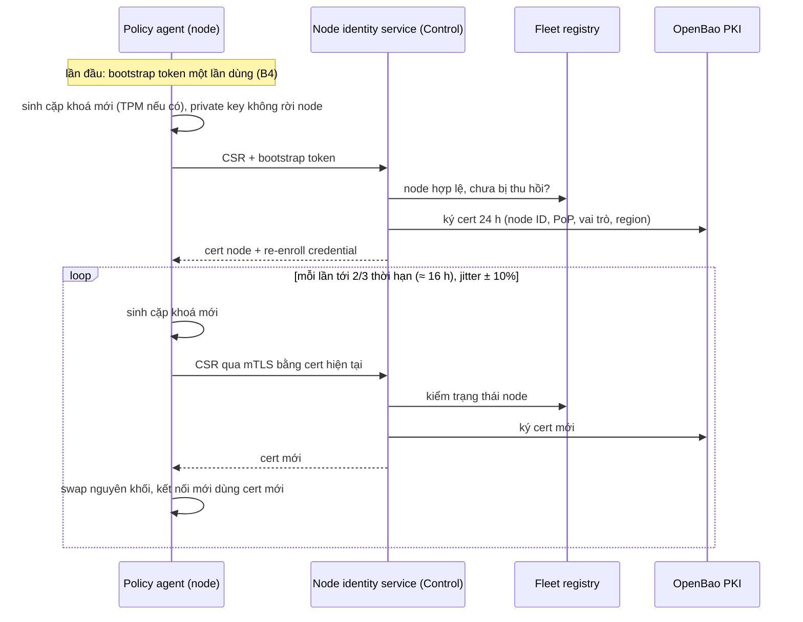

# 8.19 Danh tính node và mTLS tự gia hạn

Mọi kết nối nội bộ của nền tảng dùng mTLS bằng cert ngắn hạn do CA nội bộ (OpenBao PKI,
[ADR-0017](../09-adr/0017-openbao-for-signing-keys-and-node-pki.md)) cấp, và **không có bước gia hạn nào
cần người làm**. Quyết định: [ADR-0045](../09-adr/0045-short-lived-node-certs-and-reenroll.md).

## 1. Các loại mTLS và ai lo gia hạn

| Kết nối | Bên trình cert | Cert | Gia hạn |
|---|---|---|---|
| Node → Control (desired state, ACK), node → regional relay, node → ingest gateway | Edge node (L7, WAF) | Cert node, 24 h | Policy agent tự gia hạn (mục 2) |
| L7 ↔ WAF inspection (PoP lớn, qua mạng) | Cả hai phía, đều là node | Cert node, 24 h, SAN ghi vai trò `l7` / `waf` | Như trên; hai phía chỉ chấp nhận vai trò đối diện trong cùng PoP |
| Dịch vụ trung tâm (Control, relay, ingest gateway, realtime gateway, Kafka, ClickHouse…) | Pod trên Kubernetes | Cert dịch vụ, 7 ngày | cert-manager với issuer OpenBao, gia hạn ở 2/3 thời hạn, nạp lại không cần khởi động lại |
| Edge → origin (khách bật "xác thực edge với origin") | L7 | Cert client theo zone, do **Origin CA** của NCC cấp, 90 ngày | Cert service tự gia hạn ở 30 ngày cuối, phát xuống edge qua bundle (lớp A); khách tin **CA**, không ghim cert lá, nên gia hạn không cần khách làm gì |
| Edge → origin bằng cert client khách tự tải lên | L7 | Của khách | Khách lo; cảnh báo từ 30 ngày trước khi hết hạn ([8.13 A10](13-operational-behaviors.md#a10-cert-của-khách-sắp-hết-hạn-hoặc-gia-hạn-lỗi)) |
| Client của khách → edge (API security, [8.17](17-api-security.md)) | Client của khách | Do CA của khách cấp | Khách lo; edge chỉ kiểm theo CA khách tải lên, cảnh báo khi CA sắp hết hạn |

## 2. Vòng đời cert node

| Bước | Thiết kế |
|---|---|
| **Nội dung cert** | Node ID, PoP, region, vai trò (`l7`, `waf`), nơi chạy; SAN theo dạng SPIFFE ID (`spiffe://<ncc>/node/<id>`) để có thể chuyển sang SPIFFE/SPIRE sau này |
| **Ai ký** | Node không nói chuyện trực tiếp với OpenBao: gọi **node identity service** ở Control, dịch vụ này kiểm fleet registry (node tồn tại, đang hoạt động, chưa bị thu hồi, PoP và vai trò đúng) rồi mới nhờ OpenBao ký. OpenBao không lộ ra mạng của edge |
| **Khoá** | Mỗi lần gia hạn sinh cặp khoá mới (ECDSA P-256 hoặc Ed25519); private key nằm trong TPM nếu phần cứng có, nếu không thì chỉ trong RAM và file quyền `0600` |
| **Khi nào** | Bắt đầu ở 2/3 thời hạn, cộng jitter để hàng nghìn node không gia hạn cùng lúc; lỗi thì thử lại với backoff tới khi còn 1 h |
| **Nạp cert mới** | Cert nằm sau một con trỏ nguyên tử; TLS lấy cert qua callback ở mỗi handshake mới. Kết nối đang mở giữ cert cũ cho tới khi đóng; mọi kết nối dài (gRPC tới Control, L7 ↔ WAF, Vector) có **tuổi tối đa 1 h** rồi tự mở lại, để cert mới và danh sách thu hồi có hiệu lực mà không cắt traffic |
| **Vector** | Đọc cert từ file agent ghi; agent báo Vector nạp lại cấu hình sau mỗi lần gia hạn |
| **Lỗi gia hạn không ảnh hưởng traffic** | Cert node chỉ dùng cho kênh điều khiển và log. Hết hạn thì node vẫn phục vụ traffic bằng snapshot đang có (last-good); chỉ mất cập nhật config và gửi log (log nằm chờ trong buffer đĩa) |

## 3. Node mất kết nối lâu hơn thời hạn cert

Cert 24 h mà node offline 2 ngày (sự cố mạng, PoP đối tác bảo trì) thì cert đã hết hạn khi nối lại.
Không bắt người vận hành enroll lại bằng tay, mà dùng **re-enroll credential**:

| | Thiết kế |
|---|---|
| Là gì | Khoá riêng thứ hai cấp lúc enroll, chỉ dùng được cho một endpoint: xin cấp lại cert node |
| Lưu ở đâu | TPM nếu có; nếu không, file mã hoá trên đĩa node |
| Xoay | Đổi mỗi 7 ngày khi node đang online (cùng luồng gia hạn) |
| Điều kiện dùng được | Node trong registry, chưa bị thu hồi, offline ≤ 30 ngày, kết nối tới từ dải mạng của PoP đã đăng ký |
| Quá điều kiện | Offline > 30 ngày, hoặc node trên hạ tầng của khách ở chế độ hybrid mà khách yêu cầu duyệt: cần người vận hành duyệt (hoặc bootstrap token mới) theo [8.13 B4](13-operational-behaviors.md#b4-thêm-pop-enroll-node-ngừng-node) |
| Ghi nhận | Mỗi lần re-enroll ghi audit và sự kiện trong fleet registry; tần suất bất thường của một node là tín hiệu node bị chiếm |

## 4. Thu hồi

Không dùng CRL hay OCSP cho cert node:

- **Thời hạn ngắn là cơ chế thu hồi chính:** node bị thu hồi trong registry thì không gia hạn được, cert
  cũ hết hạn trong ≤ 24 h.
- **Thu hồi ngay:** danh sách node ID bị chặn phát qua fast lane tới mọi bên nhận kết nối của node
  (Control, relay, ingest gateway, WAF pool trong PoP); bên nhận từ chối handshake mới, và tuổi tối đa 1
  h của kết nối dài cắt nốt kết nối đang mở. Mục tiêu ≤ 5 phút (QS-40).
- Thu hồi cũng vô hiệu re-enroll credential của node đó.

## 5. Xoay CA và trust bundle

| Bước | Thiết kế |
|---|---|
| Cấu trúc | Root CA offline (giữ ngoài OpenBao, dùng khi tạo CA trung gian); CA trung gian trong OpenBao ký cert node và cert dịch vụ |
| Trust bundle | Danh sách CA được tin, phát qua bundle chung (lớp A) và cert-manager; luôn chứa CA hiện tại và CA kế tiếp trong giai đoạn xoay |
| Xoay CA trung gian (mỗi 12 tháng, [8.13 B5](13-operational-behaviors.md#b5-xoay-khoá)) | (1) Thêm CA mới vào trust bundle, chờ 100% node và dịch vụ ack; (2) bắt đầu ký bằng CA mới, node tự chuyển sau ≤ 24 h theo vòng gia hạn; (3) khi không còn cert nào ký bằng CA cũ, bỏ CA cũ khỏi bundle |
| Origin CA (cho edge → origin) | Thời hạn dài (10 năm), công bố công khai để khách cấu hình tin; xoay theo kế hoạch có báo trước nhiều tháng, hai CA song song |

## 6. Giám sát

| Tín hiệu | Cảnh báo |
|---|---|
| `waap_agent_cert_expiry_seconds` theo node | P3: một node còn < 6 h mà chưa gia hạn được. P1: > 1% node của một region còn < 6 h (thường do node identity service hoặc OpenBao) |
| Tỉ lệ gia hạn thành công của node identity service | P2: lỗi > 5% trong 15 phút |
| Số lần re-enroll theo node | P3: một node re-enroll > 3 lần/tuần |
| Cert dịch vụ trung tâm (cert-manager) | P2: cert còn < 2 ngày |
| Hạn CA trung gian, Origin CA | P2: còn < 90 ngày mà chưa có CA kế tiếp trong trust bundle |

Kịch bản đo được: QS-39, QS-40 ([10.3](../10-quality/00-index.md#103-kịch-bản)).
