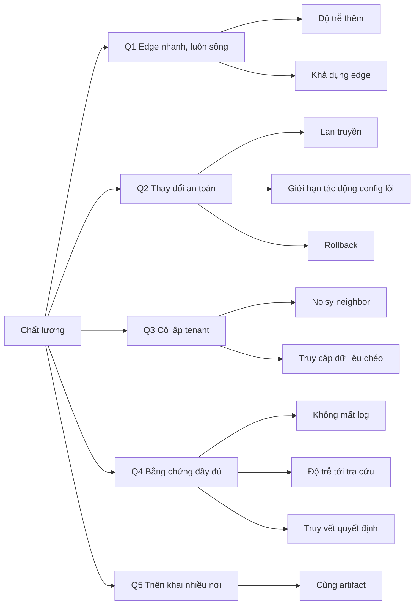

# 10. Quality Requirements

Các con số là **mục tiêu đề xuất**, cần chốt cùng product trước khi thiết kế chi tiết. Mỗi kịch
bản phải đo được bằng chỉ số nền tảng ở [08 §8.11](../08-cross-cutting/00-index.md#811-quan-sát-chính-nền-tảng).

## 10.1 Cây chất lượng

## 10.2 Kịch bản

| ID | Thuộc tính | Kịch bản | Mục tiêu |
|---|---|---|---|
| QS-1 | Độ trễ | Request đi qua WAF, zone có CRS paranoia 1 và 50 custom rule | Độ trễ thêm p99 ≤ 2 ms (proxy ≤ 0,5 ms + gọi WAF ≤ 1,5 ms), p50 ≤ 0,5 ms; request bị chặn ở pre-filter hoặc cache hit được miễn WAF p99 ≤ 0,5 ms |
| QS-2 | Khả dụng | Core region sập 4 giờ | Traffic khách không bị ảnh hưởng; edge ≥ 99,99%/tháng |
| QS-3 | Khả dụng | Management bảo trì | Portal ≥ 99,9%/tháng; traffic không bị ảnh hưởng |
| QS-4 | Lan truyền | Bản policy được duyệt, đường thường không có canary hold | p95 ≤ 30 s tới 100% node đang sống |
| QS-5 | Lan truyền | Bật Under Attack mode hoặc rule khẩn | ≤ 5 s tới 95% node, ≤ 15 s tới 100% |
| QS-6 | An toàn thay đổi | Snapshot làm tăng lỗi hoặc độ trễ lọt qua compiler | Chỉ nhóm canary bị ảnh hưởng; tự rollback trong ≤ 2 phút |
| QS-7 | Rollback | Người dùng bấm rollback | Version trước trên 100% node trong ≤ 60 s |
| QS-8 | Cô lập | Một tenant gửi body lớn và regex nặng gấp 10 lần bình thường | p99 của tenant khác trên cùng node tăng ≤ 10% |
| QS-9 | Cô lập | User tenant A gọi Query API với zone của tenant B | Bị từ chối; có audit |
| QS-10 | Không mất log | Analytics region không nhận log trong 6 giờ | Không mất security event; access log mất chỉ khi buffer đĩa đầy, có chỉ số báo |
| QS-11 | Độ trễ log | Request bị chặn | Tra cứu được theo request ID trong ≤ 60 s |
| QS-12 | Truy vết | Bất kỳ request bị chặn nào | Xác định được rule ID, bước pipeline, policy version, người duyệt version đó |
| QS-13 | Triển khai | Cùng bản build edge | Chạy trên PoP riêng, VM đối tác, container trong hạ tầng khách mà không đổi code |
| QS-14 | Thương mại | Khách đổi gói | Entitlements mới có hiệu lực ≤ 5 phút, không deploy |
| QS-15 | CDN | Khách purge một URL hoặc prefix | Không còn phục vụ bản cũ ở 95% node trong ≤ 5 s, 100% trong ≤ 30 s |
| QS-16 | Điều hướng | Một PoP sập | DNS điều hướng ngừng trả IP PoP đó trong ≤ 60 s |
| QS-17 | Tách tầng | Flood từ ít nguồn vào một zone | ≥ 95% request bị loại ở proxy; CPU tầng WAF của PoP tăng ≤ 20% |
| QS-18 | Tách tầng | Tầng WAF của một PoP quá tải hoặc sập | Kết nối client không bị ảnh hưởng; zone áp fail mode trong ≤ 1 lần deadline |

## 10.3 Quy mô thiết kế

Cần product xác nhận; dùng để chọn công nghệ.

| Chỉ số | Giả định ban đầu |
|---|---|
| Request / giây toàn fleet (đỉnh) | 1 triệu |
| Tenant / zone | 1.000 / 20.000 |
| Rule / zone (tối đa theo gói cao nhất) | 1.000 custom rule |
| Access log / ngày (trước lấy mẫu) | ~ 50 tỉ bản ghi |
| Retention tối đa | 365 ngày (archive), 30 ngày (hot) |
