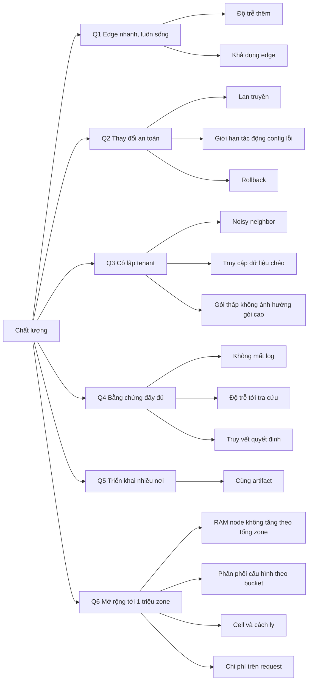

# 10. Quality Requirements

Các con số là **mục tiêu đề xuất**, cần chốt cùng product trước khi thiết kế chi tiết. Mỗi kịch
bản phải đo được bằng chỉ số nền tảng ở [08 §8.11](../08-cross-cutting/00-index.md#811-quan-sát-chính-nền-tảng).

## 10.1 Thuộc tính chất lượng

Các thuộc tính theo ISO/IEC 25010, cộng hai thuộc tính riêng của hệ thống phân tán (khả năng mở rộng,
cô lập). Mỗi thuộc tính trỏ tới mục tiêu ở [1.3](../01-introduction/00-index.md#13-mục-tiêu-chất-lượng),
kịch bản đo được (§10.3) và cơ chế kiến trúc đáp ứng nó.

| Thuộc tính | Định nghĩa trong hệ thống này | Mục tiêu | Kịch bản | Cơ chế chính |
|---|---|---|---|---|
| **Hiệu năng** | Độ trễ thêm do WAAP, thông lượng mỗi node | Q1 | QS-1, QS-2, QS-17, QS-20, QS-22, QS-25 | Edge hai tầng, pre-filter, nạp khi cần, cache ([ADR-0033](../09-adr/0033-two-tier-edge-proxy-and-waf.md), [ADR-0040](../09-adr/0040-config-distribution-at-scale.md)) |
| **Khả dụng** | Phục vụ traffic khi một phần hệ thống hỏng | Q1 | QS-2, QS-3, QS-16, QS-18 | Edge độc lập runtime, fail mode, DNS điều hướng ([ADR-0001](../09-adr/0001-four-planes.md)) |
| **Khả năng mở rộng** | Thêm zone, traffic, node mà chi phí mỗi đơn vị không tăng | Q6 | QS-24, QS-26, QS-27 | Manifest hai tầng, routing index, PoP store, cell ([ADR-0040](../09-adr/0040-config-distribution-at-scale.md), [ADR-0041](../09-adr/0041-cells-and-zone-placement.md)) |
| **Co giãn và hấp thụ tấn công** | Chịu đột biến traffic và tấn công không làm ảnh hưởng khách khác | Q1, Q3 | QS-17, QS-29 | Pre-filter rẻ, admission control WAF, cell cách ly |
| **Cô lập** | Tenant, cell, gói không ảnh hưởng lẫn nhau về dữ liệu, tài nguyên, cấu hình lỗi | Q3 | QS-8, QS-9, QS-28, QS-32 | Governor theo tenant, fair share WAF theo trọng số gói, pool cell theo gói, Query API |
| **An toàn thay đổi** | Không thay đổi nào gây sự cố diện rộng | Q2 | QS-4, QS-5, QS-6, QS-7, QS-15, QS-23 | Snapshot ký, canary theo cell, lớp áp dụng ([ADR-0037](../09-adr/0037-config-apply-classes.md)) |
| **Bảo mật** | Phát hiện và chặn tấn công đúng; bảo vệ chính nền tảng | — | QS-3 (S3), QS-20, QS-21 | CRS + system ruleset, bot, API security, mTLS, chữ ký |
| **Khả năng quan sát** | Biết chậm ở đâu, lỗi của ai, có mất dữ liệu không | Q4 | QS-10, QS-11, QS-12, QS-19 | Đo theo chặng, `status_source`, đối soát ([ADR-0036](../09-adr/0036-request-timing-and-error-attribution.md)) |
| **Khả năng triển khai** | Chạy trên PoP riêng, hạ tầng đối tác, on-prem | Q5 | QS-13 | Một artifact, Kubernetes cho plane trung tâm |
| **Hiệu quả chi phí** | Chi phí hạ tầng trên một đơn vị traffic và trên một zone nguội | Q6 | QS-30, QS-31, QS-33 | Lọc rẻ trước, dùng chung instance CRS, lấy mẫu log theo gói, pool cell theo gói ([8.18](../08-cross-cutting/18-segments-and-plans.md)) |
| **Khả năng vận hành** | Đổi cấu hình, nâng cấp, xử lý sự cố với ít thao tác tay | Q2, Q4 | QS-14, QS-27 | Rollout tự động có gate, runbook ([8.13](../08-cross-cutting/13-operational-behaviors.md)) |

## 10.2 Cây chất lượng

## 10.3 Kịch bản

| ID | Thuộc tính | Kịch bản | Mục tiêu |
|---|---|---|---|
| QS-1 | Độ trễ | Request đi qua WAF, zone có CRS paranoia 1 và 50 custom rule | Độ trễ thêm p99 ≤ 2 ms (L7 ≤ 0,5 ms + gọi WAF ≤ 1,5 ms), p50 ≤ 0,5 ms; request bị chặn ở pre-filter hoặc cache hit được miễn WAF p99 ≤ 0,5 ms |
| QS-2 | Khả dụng | Core region sập 4 giờ | Traffic khách không bị ảnh hưởng; edge ≥ 99,99%/tháng |
| QS-3 | Khả dụng | Management bảo trì | Portal ≥ 99,9%/tháng; traffic không bị ảnh hưởng |
| QS-4 | Lan truyền | Bản policy được duyệt, đường thường không có canary hold | p95 ≤ 30 s tới 100% node đang sống |
| QS-5 | Lan truyền | Bật Under Attack mode hoặc rule khẩn | ≤ 5 s tới 95% node, ≤ 15 s tới 100% |
| QS-6 | An toàn thay đổi | Snapshot làm tăng lỗi hoặc độ trễ lọt qua compiler | Chỉ nhóm canary bị ảnh hưởng; tự rollback trong ≤ 2 phút |
| QS-7 | Rollback | Người dùng bấm rollback | Version trước trên 100% node trong ≤ 60 s |
| QS-8 | Cô lập | Một tenant gửi body lớn và regex nặng gấp 10 lần bình thường | p99 của tenant khác trên cùng node tăng ≤ 10% |
| QS-9 | Cô lập | User tenant A gọi Query API với zone của tenant B | Bị từ chối; có audit |
| QS-10 | Không mất log | Analytics region không nhận log trong 6 giờ | Không mất security event; access log mất chỉ khi buffer đĩa đầy, có chỉ số báo |
| QS-11 | Độ trễ log | Request bị chặn | Tra cứu được theo request ID trong ≤ 60 s |
| QS-12 | Truy vết | Bất kỳ request bị chặn nào | Xác định được rule ID, bước pipeline, policy version, người duyệt version đó |
| QS-13 | Triển khai | Cùng bản build edge | Chạy trên PoP riêng, VM đối tác, container trong hạ tầng khách mà không đổi code |
| QS-14 | Thương mại | Khách đổi gói | Entitlements mới có hiệu lực ≤ 5 phút, không deploy |
| QS-15 | CDN | Khách purge một URL hoặc prefix | Không còn phục vụ bản cũ ở 95% node trong ≤ 5 s, 100% trong ≤ 30 s |
| QS-16 | Điều hướng | Một PoP sập | DNS điều hướng ngừng trả IP PoP đó trong ≤ 60 s |
| QS-17 | Tách tầng | Flood từ ít nguồn vào một zone | ≥ 95% request bị loại ở L7; CPU tầng WAF của PoP tăng ≤ 20% |
| QS-18 | Tách tầng | Tầng WAF của một PoP quá tải hoặc sập | Kết nối client không bị ảnh hưởng; zone áp fail mode trong ≤ 1 lần deadline |
| QS-19 | Quy lỗi | Bất kỳ response 5xx nào | Có `status_source` và (nếu WAAP tự sinh) `edge_error`; xác định được chặng chậm nhất từ trace trong ≤ 1 phút |
| QS-20 | Bot | Request từ bot đã xác minh (Googlebot thật) | Không bị chặn hay challenge; tính điểm bot ≤ 50 µs p99 |
| QS-21 | Bot | Người dùng thật trên zone bật bot management ở mức mặc định | Tỉ lệ bị challenge tương tác ≤ 1% |
| QS-22 | API | Request tới endpoint có schema | Kiểm ở L7 ≤ 20 µs, kiểm body JSON 10 KB ở WAF ≤ 300 µs p99 |
| QS-23 | API | Khách xoay khoá JWKS | Edge chấp nhận token ký bằng khoá mới trong ≤ 60 s |
| QS-24 | Mở rộng | Số zone tăng từ 1 triệu lên 2 triệu, tập zone hoạt động mỗi PoP không đổi | RAM dùng cho runtime trên mỗi node tăng ≤ 10% (chỉ phần routing index); không đổi thiết kế |
| QS-25 | Hiệu năng | Request đầu tiên của một zone Free hoặc Pro chưa có trong RAM node (zone Business, Enterprise luôn nóng trong cell của mình) | Độ trễ thêm ≤ 10 ms p99 cho request đó (lấy từ PoP store + dựng runtime); request sau trở lại QS-1 |
| QS-26 | Mở rộng | Một thay đổi cấu hình zone | Tới PoP store của mọi PoP ≤ 10 s; dữ liệu gửi mỗi PoP ≤ kích thước bundle + 1 KB; tối đa 1 top manifest/s |
| QS-27 | Vận hành | Thay đổi hàng loạt 100.000 zone (đổi mặc định, Terraform) | Hoàn tất ≤ 15 phút; QS-1 không vỡ trong lúc đó |
| QS-28 | Cô lập | Cấu hình lỗi hoặc tấn công trong một cell | p99 của cell khác thay đổi ≤ 5% |
| QS-29 | Hấp thụ tấn công | Flood L7 30 triệu rps nhắm một zone | Zone được chuyển sang cell cách ly ≤ 2 phút; zone khác không bị ảnh hưởng |
| QS-30 | Chi phí | 1 triệu request hợp lệ, CRS PL1 | CPU tổng (L7 + WAF) ≤ mục tiêu đặt sau spike; theo dõi theo release |
| QS-31 | Chi phí | Toàn fleet ở đỉnh 10 triệu rps | Mức sử dụng CPU trung bình node ≤ 60%, đủ dư cho tấn công theo [7.5](../07-deployment/05-capacity-and-sharding.md) |
| QS-32 | Cô lập theo gói | Pool Free của một PoP quá tải (nhiều zone Free bị flood cùng lúc) | p99 của zone Business, Enterprise cùng PoP thay đổi ≤ 5%; thứ tự hy sinh ở [8.18 §4](../08-cross-cutting/18-segments-and-plans.md#thứ-tự-hy-sinh-khi-pop-quá-tải) chạy đúng thứ tự, mỗi bước có event |
| QS-33 | Chi phí | Chi phí phục vụ một zone Free trung bình | ≤ 0,25 USD/tháng theo mô hình chi phí ở 8.18; zone p99 của mỗi gói trả phí vẫn có lãi ở giá tham chiếu |
| QS-34 | Thương mại | Khách nâng gói Free → Business | Entitlements mới ≤ 5 phút; zone sang pool cell mới không có request lỗi trong thời gian chuyển |

## 10.4 Quy mô thiết kế

Ước lượng chi tiết, giả định và cách tính ở [7.5](../07-deployment/05-capacity-and-sharding.md). Tóm tắt:

| Chỉ số | Giá trị thiết kế |
|---|---|
| Zone / hostname / cert | 1.000.000 / ≈ 3.000.000 / ≈ 2.000.000 |
| Request hợp lệ | 3 triệu rps trung bình, 10 triệu rps đỉnh; thêm tới 30 triệu rps tấn công L7 |
| Băng thông ra client | ≈ 600 Gbps trung bình, ≈ 2 Tbps đỉnh |
| Phân khúc | 65% Free, 15% Pro, 18% Business, 2% Enterprise ([8.18](../08-cross-cutting/18-segments-and-plans.md)) |
| Node | ≈ 450 L7, ≈ 210 WAF inspection, 30 PoP |
| Cấu hình | ≈ 8 GB bundle nén + 8 GB cert mỗi PoP store; ≈ 200 MB routing index mỗi node |
| Thay đổi cấu hình | ≈ 1,7/s trung bình, 30/s đỉnh |
| Telemetry | ≈ 1,15 triệu bản ghi/s trung bình; ≈ 12 TB/ngày trong ClickHouse |
| Chi phí phục vụ (giả định đơn giá) | ≈ 0,18 / 1,05 / 3,3 / 43 USD mỗi zone mỗi tháng cho Free / Pro / Business / Enterprise |
| Rule / zone (tối đa theo gói cao nhất) | 1.000 custom rule |
| Retention tối đa | 365 ngày (archive), 30 ngày (hot) |
