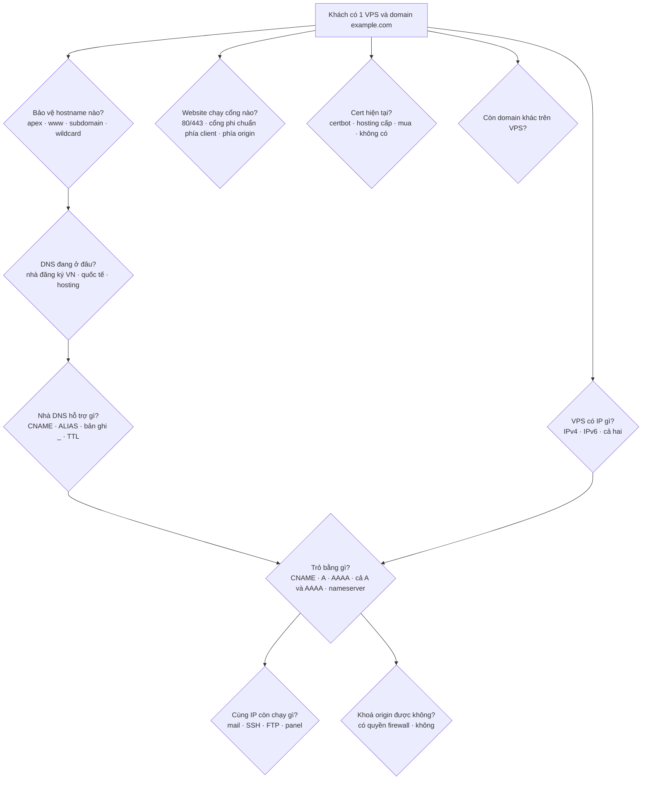
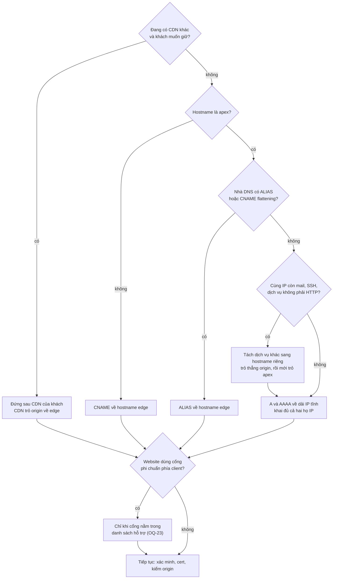
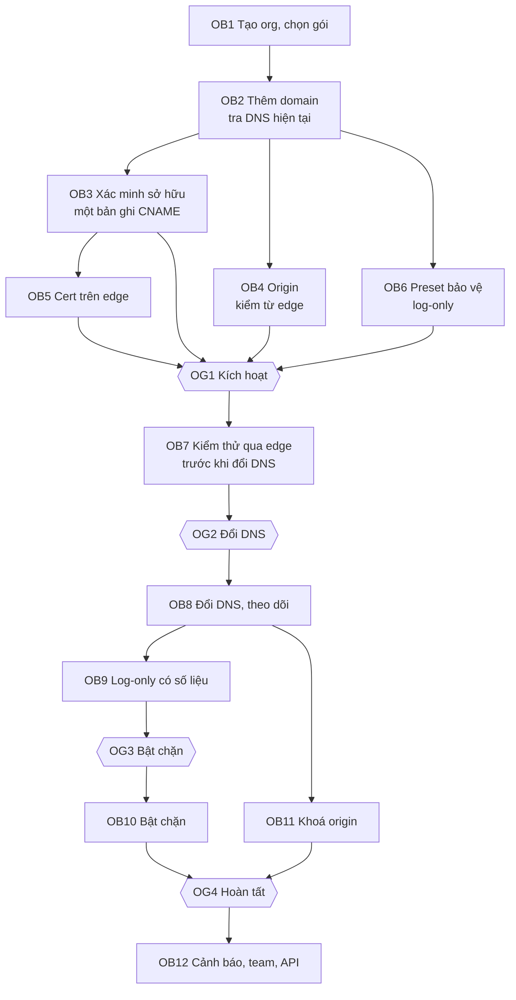

# 3.1 Onboarding một website

> **Trạng thái: đang mở, chưa có quyết định nào.** Trang này ghi lại các kịch bản và câu hỏi cần trả lời trước
> khi viết luồng onboarding. Cột "ghi chú ban đầu" chỉ là ý kiến lúc ghi, **không phải quyết định**. Lần phân
> tích tiếp (2026-11-07) thêm trục K–N, hồ sơ khách điển hình ([§6](#6-hồ-sơ-khách-điển-hình-đề-xuất-chờ-duyệt)),
> cây quyết định kết nối ([§7](#7-cây-quyết-định-cách-kết-nối-đề-xuất-chờ-duyệt)) và phân tích các câu ở
> [§8](#8-phân-tích-các-câu-còn-mở-đề-xuất-của-claude-chờ-duyệt); tất cả là đề xuất chờ duyệt.
>
> Bản nháp luồng đầu tiên được viết trước khi hỏi chủ dự án và **chưa được duyệt**. Nó được giữ ở
> [Phụ lục A](#phụ-lục-a-bản-nháp-luồng-đầu-tiên-chưa-duyệt) chỉ để tham khảo. Những chỗ ở §1, §2 và kiến
> trúc kéo theo từ bản nháp đó được đánh dấu **chờ onboarding** ([§5](#5-những-chỗ-đang-phụ-thuộc-vào-trang-này)).

## 1. Vì sao chưa có luồng

Onboarding không phải một luồng mà là tổ hợp của nhiều trục: origin của khách là gì, DNS do ai quản lý, trỏ
bằng cách nào, bảo vệ domain hay subdomain nào, chạy cổng và giao thức gì, cert đang do ai cấp, khách thuộc
phân khúc nào.

Chỉ một trường hợp "khách thuê một VPS và đã có domain riêng" đã tách ra nhiều nhánh:

- VPS có IPv4, IPv6 hay cả hai.
- Khách trỏ bằng CNAME hay bằng IP.
- Bảo vệ apex hay subdomain.
- Nhà DNS của khách có ALIAS không.
- Trên cùng IP còn chạy mail, SSH, FTP không.
- VPS đang tự gia hạn cert bằng certbot không.
- Một VPS có chạy nhiều domain không.

Mỗi nhánh đổi bước cần làm và rủi ro. Vì vậy phải liệt kê đủ kịch bản trước, rồi mới thiết kế luồng.

## 2. Kịch bản theo từng trục

Mã `KB1-<trục><số>` dùng để nhắc tới kịch bản khi phân tích.

### A. Origin của khách

| Mã | Kịch bản | Concern |
|---|---|---|
| KB1-A1 | Một VPS, một IP public, nginx hoặc apache | Kịch bản phổ biến nhất ở khách nhỏ. Thường chạy nhiều site trên cùng VPS (virtual host) nên nhiều domain dùng chung một IP origin |
| KB1-A2 | VPS chỉ IPv4 / IPv4 và IPv6 / chỉ IPv6 | Edge nhận client v4 và v6 nhưng nối tới origin theo họ IP origin có. Origin dual-stack thì chọn họ nào, có fallback không |
| KB1-A3 | Shared hosting (cPanel, DirectAdmin), IP dùng chung với khách khác | Khách không sửa được firewall nên không khoá origin theo IP được. Host thường tự cấp cert (AutoSSL). Origin nhận diện site theo Host header |
| KB1-A4 | Load balancer của cloud (ALB, GCP LB…), origin là hostname, IP thay đổi | Origin phải khai báo được bằng hostname, edge phải phân giải lại theo TTL |
| KB1-A5 | Một hostname, nhiều backend theo path (`/api` → server khác, `/static` → bucket) | Định tuyến origin theo path có thuộc phạm vi không |
| KB1-A6 | Nhiều origin cho một hostname (dự phòng, chia tải) | Health check, failover (đang ở mức Mở rộng) |
| KB1-A7 | Origin sau NAT, máy ở nhà, không có IP public | Cần tunnel từ origin ra edge |
| KB1-A8 | Đã có CDN hoặc WAF khác đứng trước | Thay hẳn, hay đứng sau CDN đó |
| KB1-A9 | Website tĩnh trên object storage | Host header gửi về origin khác hostname thật |
| KB1-A10 | Origin là nền tảng SaaS (Shopify, Wix, Haravan, Sapo…) | Nền tảng đó có cho đứng trước nó không, có kiểm Host, có tự cấp cert theo domain khách không |

### B. Nơi khách quản lý DNS

| Mã | Kịch bản | Concern |
|---|---|---|
| KB1-B1 | DNS tại nhà đăng ký trong nước (Mắt Bão, PA Việt Nam, Nhân Hoà, Tenten, iNET…) | Giao diện mỗi nhà một kiểu. Có nhà không có ALIAS ở apex, có thể không cho tên bản ghi bắt đầu bằng `_`, giới hạn độ dài TXT, TTL tối thiểu cao. Cần khảo sát thực tế từng nhà |
| KB1-B2 | DNS ở nhà cung cấp quốc tế (Cloudflare, Route53, Google Cloud DNS) | Có ALIAS hoặc flattening; nếu đang ở Cloudflare thì thường đang proxy luôn (KB1-A8) |
| KB1-B3 | Khách muốn chuyển hẳn nameserver sang NCC | NCC thành DNS hosting: phải quản lý mọi bản ghi (MX, TXT, SRV, CAA…), không chỉ bản ghi web |
| KB1-B4 | Người onboard không có quyền DNS (agency, phòng IT khác, nhà cung cấp cũ giữ) | Gửi hướng dẫn cho người giữ DNS; người đó có cần tài khoản không |
| KB1-B5 | Domain mới mua, chưa có bản ghi nào | Không có gì để gợi ý origin; DNS mặc định của nhà đăng ký |
| KB1-B6 | DNS do hosting quản lý kèm (shared hosting) | Khách sửa DNS qua giao diện hosting, thường hạn chế hơn KB1-B1 |

### C. Cách trỏ về edge

| Mã | Kịch bản | Concern |
|---|---|---|
| KB1-C1 | CNAME cho subdomain (`www`, `shop`, `api`) | Dễ nhất, cho phép đổi IP edge và điều hướng theo vị trí |
| KB1-C2 | Apex trỏ A (IPv4) / AAAA (IPv6) sang IP của NCC | Cần dải IP tĩnh v4 và v6. Chưa có anycast thì một IP gắn người dùng với một nơi, mất điều hướng theo vị trí và mất cách rút PoP bằng DNS |
| KB1-C3 | Khách muốn dùng A/AAAA cho cả subdomain, không dùng CNAME | Như KB1-C2; nhiều khách quen trỏ IP hơn CNAME |
| KB1-C4 | Chỉ khai A, không khai AAAA (hoặc ngược lại) | Người dùng IPv6 đi thẳng origin nếu AAAA còn trỏ về origin: một nửa traffic không qua WAF |
| KB1-C5 | Apex dùng ALIAS / CNAME flattening | Phụ thuộc nhà DNS (KB1-B1, KB1-B2) |
| KB1-C6 | Apex chuyển hướng sang `www` | Khách phải chấp nhận đổi URL chính; ai làm chuyển hướng (nhà DNS, origin, edge) |
| KB1-C7 | Đổi nameserver sang NCC | Xem KB1-B3 |
| KB1-C8 | Đứng sau CDN của khách: CDN trỏ origin về edge | Tin IP và header client nào |
| KB1-C9 | Trỏ A apex về edge làm hỏng dịch vụ khác trên cùng IP (SSH, mail, FTP, game, panel quản trị cổng 2083/8443…) | Edge chỉ proxy HTTP(S). Phải phát hiện và cảnh báo; khách phải tách hostname cho dịch vụ khác |
| KB1-C10 | Trỏ một phần (chỉ một số hostname, hoặc đổi dần theo trọng số) | Theo dõi trạng thái từng hostname |

### D. Quản lý domain và subdomain

| Mã | Kịch bản | Concern |
|---|---|---|
| KB1-D1 | Chỉ apex; apex và `www`; vài subdomain chọn lọc | Chọn hostname nào được bảo vệ; hostname không chọn thì vẫn đi thẳng origin |
| KB1-D2 | Wildcard `*.example.com` | Cert wildcard chỉ cấp được qua DNS-01; wildcard có bảo vệ subdomain chưa khai báo không |
| KB1-D3 | Subdomain nhiều cấp (`a.b.example.com`) | Wildcard một cấp không phủ được; cert riêng |
| KB1-D4 | Chỉ bảo vệ `shop.example.com`, không có quyền với apex (công ty con, apex do bên khác giữ) | Zone là domain gốc hay có thể là một hostname riêng |
| KB1-D5 | Một khách nhiều domain (`example.com`, `example.vn`, domain thương hiệu phụ) | Mỗi domain một zone? Dùng chung policy thế nào? Tính giá thế nào |
| KB1-D6 | Thêm subdomain sau onboarding | Có phải xác minh lại không, cert cấp thế nào, có tự bật bảo vệ không |
| KB1-D7 | Xoá subdomain, đổi subdomain sang origin khác | Giải phóng claim, cert |
| KB1-D8 | Domain IDN (tiếng Việt có dấu) | Lưu dạng punycode, hiển thị dạng Unicode |
| KB1-D9 | Subdomain do khách khác của NCC giữ (`a.example.com` ở tenant A, `b.example.com` ở tenant B) | Cho phép hay không; ai sở hữu domain gốc |

### E. Giao thức và cổng

| Mã | Kịch bản | Concern |
|---|---|---|
| KB1-E1 | Client dùng cổng chuẩn 80/443 | Chuẩn |
| KB1-E2 | Client dùng cổng phi chuẩn (`https://example.com:8443`, `:8080`, `:2053`) | Edge phải nghe cổng đó. Danh sách cổng cố định thì dễ; cổng tuỳ ý thì gần như phải cấp IP riêng hoặc proxy L4 |
| KB1-E3 | Edge nhận 443, origin chạy cổng phi chuẩn (8080, 3000, 8443) | Chỉ là cấu hình origin |
| KB1-E4 | Một hostname, nhiều cổng ra nhiều ứng dụng (443 web, 8443 admin) | Cấu hình theo (hostname, cổng) |
| KB1-E5 | Origin chỉ có HTTP, không có TLS | Edge HTTPS → origin HTTP: đoạn sau không mã hoá, dễ vòng chuyển hướng khi origin tự ép HTTPS |
| KB1-E6 | Chuyển hướng HTTP → HTTPS ở edge hay ở origin | Lặp chuyển hướng nếu cả hai cùng làm sai cách |
| KB1-E7 | WebSocket, gRPC, SSE, long polling, upload lớn, download lớn | Timeout, giới hạn body theo gói, buffer |
| KB1-E8 | HTTP/2, HTTP/3 phía client; HTTP/1.1 phía origin | Chuyển đổi giao thức |
| KB1-E9 | Traffic không phải HTTP (TCP/UDP: game, MQTT, SSH, SMTP) | Ngoài WAF; có làm proxy L4 không |

### F. Cert

| Mã | Kịch bản | Concern |
|---|---|---|
| KB1-F1 | NCC cấp cert tự động | Xác minh và cấp lúc nào so với lúc đổi DNS, để không có khoảng lỗi HTTPS |
| KB1-F2 | Khách tải cert riêng (EV, OV, cert mua) | Theo gói; khách tự gia hạn, nhắc hạn |
| KB1-F3 | VPS đang tự gia hạn Let's Encrypt bằng certbot (HTTP-01) | Sau khi trỏ về edge, gia hạn ở origin hỏng, trừ khi edge chuyển `/.well-known/acme-challenge/` không phải của NCC về origin |
| KB1-F4 | Cert ở origin tự ký, hết hạn, sai hostname | Nới kiểm cert phía origin tới đâu |
| KB1-F5 | Domain có CAA chỉ cho phép một CA khác | CA của NCC bị từ chối cấp |
| KB1-F6 | HSTS preload, HPKP cũ, client mobile pin cert | Không được có lúc nào sai cert; pin cert làm app mobile hỏng khi đổi cert |
| KB1-F7 | Client dùng mTLS tới website | Edge phải giữ CA của khách |

### G. Ứng dụng phụ thuộc IP client và hành vi cũ

| Mã | Kịch bản | Concern |
|---|---|---|
| KB1-G1 | Log, thống kê, rate limit ở origin theo IP | Sau khi qua edge, IP nguồn là IP edge; ứng dụng phải đọc header |
| KB1-G2 | Origin có allowlist IP (trang admin, API cho đối tác) | Allowlist ở origin không còn tác dụng; phải chuyển lên edge |
| KB1-G3 | Origin chặn theo quốc gia, fail2ban | Thấy IP edge, có thể tự chặn edge |
| KB1-G4 | Webhook từ đối tác (cổng thanh toán, ngân hàng) gọi vào | Dễ bị WAF hoặc bot chặn nhầm; cần allowlist ngay từ đầu |
| KB1-G5 | Ứng dụng mobile, client cũ không theo chuyển hướng, không hỗ trợ SNI hay TLS mới | Cấu hình TLS tối thiểu |

### H. Sau onboarding

| Mã | Kịch bản | Concern |
|---|---|---|
| KB1-H1 | Khách đổi IP origin, đổi hosting | Cập nhật origin không gián đoạn |
| KB1-H2 | Khách đổi nhà DNS, xoá nhầm bản ghi xác minh hoặc uỷ quyền | Gia hạn cert hỏng; phát hiện sớm |
| KB1-H3 | Domain hết hạn đăng ký, domain đổi chủ, domain bị bán lại | Chủ mới không được thừa hưởng cấu hình của chủ cũ; xác minh lại định kỳ |
| KB1-H4 | Khách muốn thôi dùng, trỏ DNS về origin | Hướng dẫn quay lui, origin còn chạy được không sau khi đã khoá origin |
| KB1-H5 | IP của edge thay đổi | Khách đã trỏ A và đã khoá firewall theo IP edge phải được báo trước |

### I. Thương mại

| Mã | Kịch bản | Concern |
|---|---|---|
| KB1-I1 | Một VPS chạy 5 domain nhỏ | 5 zone Pro có hợp lý không, hay cần gói theo nhóm domain |
| KB1-I2 | Zone staging, domain phụ | Giá zone phụ áp khi nào |
| KB1-I3 | Dùng thử theo domain hay theo org | Lạm dụng dùng thử bằng nhiều domain |
| KB1-I4 | Agency hoặc nhà phát triển quản lý website cho nhiều khách | Một org cho mỗi khách cuối hay một org agency; ai trả tiền; khách cuối có quyền gì |
| KB1-I5 | Nhà cung cấp hosting, VPS muốn bán lại (reseller) | Mô hình đối tác, nhãn trắng |

### J. Ai làm và hỗ trợ

| Mã | Kịch bản | Concern |
|---|---|---|
| KB1-J1 | Người onboard không rành DNS (chủ shop nhỏ) | Mức hướng dẫn: ảnh chụp theo từng nhà DNS, video, chat hỗ trợ |
| KB1-J2 | DevOps muốn làm hết bằng API hoặc Terraform | Onboarding không được bắt buộc qua UI |
| KB1-J3 | Enterprise onboard có kỹ sư NCC đi kèm | Danh sách việc chuẩn bị, khung giờ đổi DNS |
| KB1-J4 | Khách onboard đúng lúc đang bị tấn công | Cần đường tắt, chấp nhận rủi ro chặn nhầm |

### K. Xác minh khi không dùng được DNS như mong muốn

| Mã | Kịch bản | Concern |
|---|---|---|
| KB1-K1 | Nhà DNS không cho tạo bản ghi có tên bắt đầu bằng `_` | Cần tên bản ghi xác minh khác (`waap-verify.example.com`) và vẫn cần đường cấp cert trước khi đổi DNS |
| KB1-K2 | Người onboard chỉ sửa được website (upload file), không có quyền DNS | Xác minh bằng file `/.well-known/…` trên origin được, nhưng sau đó vẫn phải có người đổi DNS |
| KB1-K3 | Shared hosting, trình tạo website: chỉ thêm được thẻ `<meta>` vào trang | Xác minh bằng thẻ meta |
| KB1-K4 | Xác minh qua email `admin@`, `hostmaster@`, email trong WHOIS | WHOIS thường bị ẩn; email chung dễ bị chiếm |
| KB1-K5 | Cùng org đã xác minh apex cho một zone khác | Không bắt xác minh lại cho subdomain |
| KB1-K6 | Zone chuyển sang org khác (bán website) | Xác minh lại với org mới |

### L. Sự cố thường gặp ngay sau khi đổi DNS

| Mã | Kịch bản | Concern |
|---|---|---|
| KB1-L1 | Vòng chuyển hướng vô hạn: edge gửi HTTP về origin, origin ép HTTPS | Lỗi phổ biến nhất khi origin chưa có TLS (KB1-E5, KB1-E6) |
| KB1-L2 | Origin rate limit hoặc fail2ban theo IP: mọi request giờ đến từ vài IP của edge | Origin tự chặn edge, website sập cho mọi người |
| KB1-L3 | Ứng dụng khoá đăng nhập theo IP: một người nhập sai mật khẩu nhiều lần khoá cả IP edge | Khoá toàn bộ người dùng |
| KB1-L4 | Trang có nội dung hỗn hợp (`http://`), link tuyệt đối tới IP origin | Trình duyệt chặn tài nguyên; lộ IP origin |
| KB1-L5 | Cookie domain, CORS, `SameSite` sai sau khi đổi hostname | Đăng nhập hỏng |
| KB1-L6 | Webhook của cổng thanh toán, đối tác bị bot challenge hoặc WAF chặn | Mất giao dịch |
| KB1-L7 | Upload lớn bị `413` theo giới hạn body của gói | |
| KB1-L8 | WebSocket, SSE bị ngắt theo timeout | |
| KB1-L9 | DNS chưa lan truyền hết: một phần người dùng vẫn đi thẳng origin | Khoá origin quá sớm làm sập phần người dùng này |

### M. Onboarding hàng loạt và di chuyển từ nơi khác

| Mã | Kịch bản | Concern |
|---|---|---|
| KB1-M1 | Tạo zone hàng loạt bằng API, Terraform | Mọi bước kiểm (xác minh, origin) phải chạy được không cần UI |
| KB1-M2 | Chuyển từ Cloudflare hoặc CDN khác | Nhập bản ghi DNS, IP allowlist; rule của nhà cung cấp cũ không tự chuyển |
| KB1-M3 | Chuyển từ WAF tự vận hành (ModSecurity, thiết bị phần cứng) | Rule cũ có dùng được không; exception đã có của khách |
| KB1-M4 | Agency onboard hàng chục website của nhiều khách | Một người thuộc nhiều org (đã quyết ở 3.6) |

### N. Pháp lý và dữ liệu lúc onboarding

| Mã | Kịch bản | Concern |
|---|---|---|
| KB1-N1 | Chấp nhận điều khoản và thoả thuận xử lý dữ liệu khi đăng ký | Doanh nghiệp cần bản ký riêng; Nghị định 13/2023 |
| KB1-N2 | Chọn region lưu log, lưu cấu hình (Enterprise) | Chọn lúc onboard, đổi sau khó (KB7-H3) |
| KB1-N3 | Website thuộc lĩnh vực bị cấm | Từ chối trước, hay xử lý qua abuse sau (OQ-88) |
| KB1-N4 | Website của cơ quan nhà nước | Yêu cầu về cấp độ an toàn hệ thống thông tin, nơi lưu dữ liệu |

## 3. Ví dụ: một VPS và một domain riêng

Cây câu hỏi cho kịch bản bạn nêu. Mỗi nút là một câu hỏi onboarding phải hỏi khách, hoặc tự phát hiện; chưa
có câu trả lời.



## 4. Câu hỏi cần chủ dự án quyết

| ID | Câu hỏi | Kịch bản | Ghi chú ban đầu (không phải quyết định) |
|---|---|---|---|
| OQ-21 | Zone là domain gốc, hay cho phép onboard riêng một hostname khi khách không kiểm soát apex? | KB1-D4, KB1-D9 | Domain gốc làm mặc định, hostname riêng làm ngoại lệ có xác minh theo hostname |
| OQ-22 | Có cấp IP tĩnh v4 và v6 cho khách trỏ A/AAAA ngay từ MVP không: dải dùng chung theo region, IP riêng theo zone ở gói cao, hay chỉ CNAME và ALIAS? Có làm anycast không, khi nào? | KB1-C2, KB1-C3, KB1-C4 | Khách thuê VPS hay trỏ A, chỉ CNAME có lẽ không đủ |
| OQ-23 | Cổng phi chuẩn phía client: danh sách cố định cho mọi gói, cổng tuỳ ý ở gói cao kèm IP riêng, hay không hỗ trợ ở MVP? | KB1-E2, KB1-E4 | |
| OQ-24 | Traffic không phải HTTP trên cùng domain: chỉ cảnh báo và hướng dẫn tách hostname, hay có kế hoạch proxy L4? | KB1-C9, KB1-E9 | |
| OQ-25 | Có nhận quản lý toàn bộ DNS của khách (nameserver) ngay từ MVP không? | KB1-B3, KB1-C7 | Nếu có, cần màn quản lý mọi loại bản ghi |
| OQ-26 | Có cần hướng dẫn riêng cho từng nhà DNS trong nước không? Nhà nào không cho bản ghi bắt đầu bằng `_`? | KB1-B1, KB1-J1 | Cần khảo sát thực tế |
| OQ-27 | Phân khúc chính ở MVP: người thuê VPS, shared hosting, doanh nghiệp có đội IT? Giá cho nhiều domain trên một VPS? Agency, reseller? | KB1-A1, KB1-A3, KB1-I1, KB1-I4, KB1-I5 | |
| OQ-28 | Tunnel cho origin không có IP public có vào MVP không? | KB1-A7 | |
| OQ-29 | Định tuyến origin theo path, nhiều origin cho một hostname: MVP hay Mở rộng? | KB1-A5, KB1-A6 | |
| OQ-30 | Origin là nền tảng SaaS (Shopify, Haravan, Sapo…): có hỗ trợ chính thức không? | KB1-A10 | Cần kiểm từng nền tảng |
| OQ-31 | Edge có chuyển challenge ACME của origin (certbot) về origin không? | KB1-F3 | |
| OQ-32 | Khi khách khai A nhưng AAAA vẫn trỏ origin (hoặc ngược lại): chỉ cảnh báo, hay chặn bước hoàn tất? | KB1-C4 | |
| OQ-147 | Phương thức xác minh dự phòng nào khi không tạo được bản ghi `_acme-challenge`: TXT tên khác, file HTTP, thẻ meta, email? | KB1-K1…KB1-K4 | |
| OQ-148 | Có tự phát hiện các sự cố thường gặp (vòng chuyển hướng, origin chặn IP edge) trong lúc kiểm thử trước khi đổi DNS không? | KB1-L1…KB1-L3 | |
| OQ-149 | Có công cụ nhập cấu hình từ Cloudflare, nhà cung cấp khác không? | KB1-M2, KB1-M3 | |
| OQ-150 | Có từ chối onboard website thuộc lĩnh vực bị cấm ngay từ đầu không? | KB1-N3 | Gắn với OQ-88 |

## 5. Những chỗ đang phụ thuộc vào trang này

Các mục dưới đây được viết theo bản nháp ở Phụ lục A, đã đánh dấu **chờ onboarding** và sẽ được viết lại sau
khi các câu hỏi ở §4 có trả lời:

| Ở đâu | Nội dung |
|---|---|
| [§1 Bản đồ phân rã chức năng](../01-functional-decomposition.md#f2-zone-và-onboarding) | F2.1.5–F2.1.8, F2.2.6, F2.2.7, F2.3.6, F2.6, F2.7; việc chuyển kiểm DNS và kiểm origin sang Control (PC6); LK-27, LK-28 |
| [§2 Requirements](../02-requirements.md#f2-zone-và-onboarding) | FR-2-17…FR-2-30; sửa FR-2-02, FR-2-06, BR-2; BR-22…BR-24; OQ-16…OQ-20 |
| [Kiến trúc 5.5](../../architecture/05-building-blocks/05-contracts.md#hợp-đồng-bổ-sung-tạm-2026-11-06) | `ZoneCheckResult`, `OriginProbe` |
| [Kiến trúc 5.8.7](../../architecture/05-building-blocks/08-components/07-cert-ruleset-release.md) | DNS-01 qua uỷ quyền `_acme-challenge` là mặc định |
| [Kiến trúc 6.4](../../architecture/06-runtime/00-index.md#64-onboarding-một-zone) | Sequence onboarding |

## 6. Hồ sơ khách điển hình (đề xuất, chờ duyệt)

Gom các trục ở §2 thành vài hồ sơ hay gặp, mỗi hồ sơ có một lộ trình gợi ý. Onboarding nên hỏi vài câu đầu để
xếp khách vào hồ sơ, rồi chỉ hiện các bước của hồ sơ đó, thay vì một wizard chung cho mọi người.

| Hồ sơ | Nhận ra qua | Lộ trình gợi ý | Rủi ro chính cần chặn trước |
|---|---|---|---|
| **H1 Một VPS, vài website** | IP origin là máy chủ đơn; DNS ở nhà đăng ký trong nước | `www` và subdomain trỏ CNAME; apex dùng ALIAS nếu nhà DNS có, nếu không thì A và AAAA tĩnh (OQ-22); xác minh bằng CNAME `_acme-challenge`, dự phòng TXT tên khác (OQ-147); khoá origin bằng firewall theo dải IP edge | Mail, SSH cùng IP với apex (KB1-C9); certbot hết gia hạn được (KB1-F3); origin tự chặn edge (KB1-L2) |
| **H2 Shared hosting** | IP origin dùng chung nhiều site; DNS do hosting quản lý | Origin theo hostname, giữ Host header; TLS tới origin dùng cert của hosting; xác minh bằng file hoặc thẻ meta nếu DNS hạn chế | Không khoá được origin theo IP: chỉ cảnh báo, gợi ý header bí mật nếu hosting cho cấu hình |
| **H3 Cloud, container** | Origin là load balancer, hostname đổi IP | Origin khai bằng hostname; khoá origin bằng mTLS hoặc header bí mật; Terraform, API | Origin đổi IP liên tục, edge phải phân giải lại |
| **H4 Nền tảng SaaS** | CNAME hiện tại trỏ về Haravan, Sapo, Shopify… | Chỉ hỗ trợ khi nền tảng cho phép custom origin (OQ-30); nếu không thì báo rõ không hỗ trợ | Nền tảng từ chối Host lạ, tự cấp cert theo domain |
| **H5 Đã có CDN, WAF khác** | CNAME hoặc ASN của nhà cung cấp khác | Hai lựa chọn: thay hẳn (đổi DNS, nhập bản ghi, OQ-149) hoặc đứng sau CDN đó (chế độ F2.2.5) | Hai lớp cache, hai lớp WAF chặn chồng |
| **H6 Doanh nghiệp có đội IT** | Nhiều domain, có SSO, cần duyệt | Nhập hàng loạt, zone staging trước, account ở chế độ cần duyệt (BR-26), khung giờ đổi DNS | Đổi DNS sai giờ; thiếu người duyệt |
| **H7 Đang bị tấn công** | Khách chọn "đang bị tấn công" | Đường tắt: xác minh, cert, chặn ngay, bỏ giai đoạn log-only | Chặn nhầm; khách đổi DNS khi cert chưa có |
| **H8 Agency** | Một người tạo nhiều org | Mỗi khách một org, agency là thành viên; bàn giao owner khi xong | Agency giữ quyền owner sau khi bàn giao |

## 7. Cây quyết định cách kết nối (đề xuất, chờ duyệt)

Trả lời cho từng hostname, không cho cả zone.



## 8. Phân tích các câu còn mở (đề xuất của Claude, chờ duyệt)

| Câu | Phương án | Đánh đổi | Đề xuất |
|---|---|---|---|
| OQ-21 | (a) Zone luôn là domain gốc; (b) cho phép onboard riêng một hostname | (a) chặn công ty con không giữ apex; (b) cần xác minh theo hostname | Domain gốc là mặc định. Cho phép zone chỉ gồm một hostname khi khách chứng minh quyền với chính hostname đó; zone như vậy không giữ claim của apex, nên chủ apex vẫn onboard được phần còn lại |
| OQ-22 | (a) Dải IP dùng chung theo region; (b) IP riêng theo zone; (c) chỉ CNAME, ALIAS | (a) mất điều hướng theo vị trí, rút PoP chậm; (c) khách VPS không trỏ được apex | (a) từ MVP, có cả IPv4 và IPv6; UI luôn đề xuất CNAME hoặc ALIAS trước và nói rõ cái giá của A tĩnh. (b) cho Enterprise. Anycast theo lộ trình hạ tầng, khi có thì dải IP tĩnh tự tốt lên mà khách không phải đổi |
| OQ-23 | (a) Danh sách cổng cố định; (b) cổng tuỳ ý; (c) không hỗ trợ | (b) cần IP riêng hoặc proxy L4 | (a) cho mọi gói: một danh sách nhỏ cổng HTTP và HTTPS hay dùng (ví dụ 8080, 8443); cổng tuỳ ý chỉ cho Enterprise có IP riêng |
| OQ-24 | (a) Cảnh báo, hướng dẫn tách hostname; (b) proxy L4. *Liên quan: SSL passthrough theo SNI đã quyết ở mức Mở rộng cho Enterprise (FR-3-18), chỉ cho HTTPS, không phải proxy L4 tổng quát* | (b) là sản phẩm khác, ngoài WAF | (a) ở MVP. Phát hiện bằng DNS: bản ghi MX, SRV, hoặc hostname khác trỏ cùng IP với apex. Không quét cổng origin của khách |
| OQ-25 | DNS hosting ở MVP | Phải quản lý mọi loại bản ghi, DNSSEC; DNS sập là sập cả mail | Không ở MVP; để Mở rộng như ADR-0035 |
| OQ-26 | Hướng dẫn theo nhà DNS | Tốn công duy trì | Có, cho 5–6 nhà phổ biến trong nước, kèm ảnh; khảo sát thực tế trước MVP xem nhà nào không cho `_` |
| OQ-27 | Phân khúc chính ở MVP | | H1 (VPS) và H6 (doanh nghiệp có IT) là chính; H2 (shared hosting) chạy được nhưng không khoá được origin, nói rõ; H8 (agency) dùng nhiều org (đã quyết). Giá cho nhiều site theo OQ-54 |
| OQ-28 | Tunnel ở MVP | Phải viết và duy trì agent chạy ở máy khách | Mở rộng, nhưng ưu tiên cao: tunnel làm origin không cần IP public, khoá origin triệt để nhất |
| OQ-29 | Origin theo path, nhiều origin | | Mở rộng |
| OQ-30 | Nền tảng SaaS | Mỗi nền tảng một kiểu | Không hỗ trợ chính thức ở MVP; có trang hướng dẫn chung "đứng trước được nếu nền tảng cho dùng hostname origin riêng"; kiểm 2–3 nền tảng phổ biến nhất trước khi quyết |
| OQ-31 | Chuyển challenge ACME của origin | | Có, mặc định bật: token không phải của NCC thì chuyển về origin |
| OQ-32 | A/AAAA lệch | | Cảnh báo đỏ ở mọi bước và không cho hoàn tất onboarding (OG4) khi còn một họ IP trỏ thẳng origin; không chặn các bước khác |
| OQ-147 | Xác minh dự phòng | Email WHOIS dễ bị chiếm | TXT tên khác và file HTTP ở MVP; thẻ meta ở Mở rộng; không dùng email |
| OQ-148 | Tự phát hiện sự cố trước khi đổi DNS | | Có: trong bước kiểm thử, edge gửi vài request về origin và phát hiện vòng chuyển hướng, `403`/`429` từ origin (dấu hiệu origin chặn IP edge), nội dung hỗn hợp trên trang chủ |
| OQ-149 | Nhập cấu hình từ nơi khác | | Mở rộng: nhập bản ghi DNS và IP allowlist; rule không chuyển tự động, chỉ có hướng dẫn tương đương |
| OQ-150 | Từ chối lĩnh vực bị cấm từ đầu | Kiểm trước thì chậm, dễ sai | Điều khoản cấm, kiểm domain với danh sách đen đã biết lúc thêm zone, còn lại xử lý qua abuse (OQ-88) |

## Phụ lục A. Bản nháp luồng đầu tiên (chưa duyệt)

> Viết trước khi hỏi chủ dự án, chỉ đi theo một kịch bản: khách có DNS đầy đủ, origin có IP public, cổng
> chuẩn. **Không dùng làm căn cứ.** Giữ lại để không mất các ý đã có khi phân tích lại.

### A.1 Mục tiêu và định nghĩa "xong"

Onboarding bắt đầu khi khách nhập domain và kết thúc khi website **được bảo vệ thật**. Website được bảo
vệ thật khi đủ cả năm điều kiện sau:

1. Traffic của mọi hostname được chọn đi qua edge (DNS đã trỏ, edge đã thấy request thật).
2. HTTPS hợp lệ trên edge, không có lúc nào người dùng gặp lỗi cert.
3. Managed ruleset và các rule của khách ở chế độ **chặn**, sau một giai đoạn log-only có số liệu.
4. Origin chỉ nhận traffic từ edge. Nếu origin vẫn mở ra Internet thì kẻ tấn công đi vòng qua WAF được.
5. Có người nhận cảnh báo.

Phần lớn sản phẩm WAAP dừng ở điều kiện 1 và gọi đó là "đã onboard". Sản phẩm này coi 3 và 4 là một
phần của onboarding, vì không có chúng thì khách trả tiền mà chưa được bảo vệ.

**Rủi ro lớn nhất của onboarding là làm sập website của khách**, không phải để lọt tấn công. Các rủi ro đó
là:

- Lỗi cert lúc đổi DNS.
- Origin từ chối IP của edge.
- Chặn nhầm ngay ngày đầu.
- Mất IP thật của client.
- Upload hoặc WebSocket bị cắt.

Thứ tự các bước dưới đây được sắp để loại từng rủi ro này **trước khi** traffic thật đi qua edge.

### A.2 Tác nhân và biến thể theo phân khúc

| Tác nhân | Làm gì trong onboarding |
|---|---|
| Chủ tài khoản | Tạo org, chọn gói hoặc dùng thử, mời người |
| DevOps / người giữ DNS | Tạo bản ghi xác minh, đổi DNS, mở firewall origin cho edge, khoá origin |
| Quản trị bảo mật | Chọn preset, xem báo cáo log-only, quyết định bật chặn |
| Developer của ứng dụng | Kiểm thử trước khi đổi DNS, báo chỗ bị chặn nhầm |
| Sales, kỹ sư triển khai (NCC) | Dẫn onboarding cho Enterprise |

Một người có thể giữ nhiều vai trò; ở Free và Pro thường chỉ có một người làm tất cả.

| Phân khúc | Cách onboard | Khác biệt |
|---|---|---|
| Free, Pro | Tự phục vụ, wizard | Preset tự chọn theo phát hiện, ít câu hỏi; mục tiêu sẵn sàng đổi DNS trong 15 phút |
| Business | Tự phục vụ, có thể có hỗ trợ | Như trên, thêm nhập nhiều hostname, cert riêng, mời team, API/Terraform ngay từ đầu |
| Enterprise | Dự án có kỹ sư NCC đi kèm, 2–6 tuần | Kickoff và kiểm kê hostname, zone staging trước, khung giờ đổi DNS, cell riêng nếu có, thường có hợp đồng trước dùng thử |

### A.3 Khách cần chuẩn bị gì

Portal hiện danh sách này trước bước đầu tiên. Danh sách cũng có trong email chào mừng, vì người tạo org
thường không phải người giữ DNS.

| # | Cần có | Vì sao | Nếu thiếu |
|---|---|---|---|
| CB1 | Quyền sửa DNS của domain (registrar hoặc nhà cung cấp DNS) | Xác minh sở hữu, uỷ quyền cert, đổi DNS | Dừng ở bước xác minh; gửi hướng dẫn cho người giữ DNS (OB3) |
| CB2 | Địa chỉ origin, cổng, giao thức của từng hostname | Edge phải biết gửi traffic về đâu | Hệ thống gợi ý từ DNS hiện tại (OB2) |
| CB3 | Quyền sửa firewall hoặc security group của origin | Mở cho dải IP của edge, sau đó khoá origin | Origin từ chối edge; website lỗi sau khi đổi DNS |
| CB4 | Bản ghi CAA của domain cho phép CA của NCC (nếu domain có CAA) | Không có thì CA từ chối cấp cert | Phát hiện ở OB2, chặn ở OB5 |
| CB5 | Danh sách tính năng đặc biệt của ứng dụng: upload lớn, WebSocket, gRPC, API cho mobile, webhook từ đối tác, IP allowlist ở origin | Đây là các chỗ dễ bị cắt hoặc chặn nhầm | Hỏi trong preset (OB6) và trong checklist kiểm thử (OB7) |
| CB6 | Ứng dụng đọc IP client từ header nào | Sau khi đi qua edge, IP nguồn ở origin là IP của edge | Log và rate limit ở origin sai; hướng dẫn ở OB4 |
| CB7 | Khả năng hạ TTL của bản ghi DNS sẽ đổi, ít nhất 24 giờ trước khi đổi | Đổi nhanh và quay lui nhanh | Quay lui chậm theo TTL cũ |

### A.4 Các bước, thứ tự và cổng



Sau OB2 có ba nhánh chạy song song: xác minh và cert (OB3, OB5), origin (OB4), preset (OB6). Khách không
phải chờ một nhánh xong mới làm nhánh khác. Wizard vẫn hiện theo thứ tự trên, nhưng cho nhảy bước.

#### Vì sao thứ tự này

| Phải xong trước | Rồi mới | Lý do |
|---|---|---|
| Xác minh sở hữu (OB3) | Cấp cert (OB5), kích hoạt (OG1) | Không cấp cert hay nhận traffic cho domain mà tenant chưa chứng minh sở hữu; chặn chiếm domain của người khác |
| Cert trên edge (OB5) | Đổi DNS (OG2) | Nếu đổi DNS khi chưa có cert, HTTPS lỗi cho mọi người dùng tới khi cert về. Vì vậy cert phải lấy được **trước** khi traffic tới, tức là không dùng HTTP-01 ở lần cấp đầu (xem OB3, OB5) |
| Kiểm origin từ edge (OB4) | Đổi DNS (OG2) | Origin thường có firewall; nếu chưa mở cho edge thì website sập ngay khi đổi |
| Kiểm thử qua edge (OB7) | Đổi DNS (OG2) | Phát hiện chỗ hỏng (upload, WebSocket, chuyển hướng, cookie domain) khi chưa ảnh hưởng người dùng thật |
| Đổi DNS, có traffic thật (OB8) | Bật chặn (OG3) | Không có traffic thật thì không biết rule nào chặn nhầm |
| Log-only đủ lâu (OB9) | Bật chặn (OG3) | Rủi ro R2 (chặn nhầm làm mất niềm tin) |
| Traffic đã đi hết qua edge (OB8) | Khoá origin (OB11) | Khoá sớm thì người dùng còn theo DNS cũ bị cắt |

Có hai thứ **không** chờ log-only. Thứ nhất là chống DDoS L7 và lọc sớm (access list, sai giao thức rõ
ràng): chúng chạy từ request đầu tiên, vì đó là lý do nhiều khách onboard ngay lúc đang bị tấn công. Thứ
hai là trường hợp khách đang bị tấn công: khách chọn "bật chặn ngay" ở OB6, có cảnh báo rõ về rủi ro chặn
nhầm, và bỏ qua OG3.

#### Cổng

| Cổng | Điều kiện | Ai mở | Khi không đạt |
|---|---|---|---|
| **OG1 Kích hoạt** (cấu hình của zone được phát xuống edge) | Mọi hostname đã chọn đã xác minh sở hữu; mỗi hostname có cert `issued` (hoặc, với xác minh bằng TXT không uỷ quyền, khách đã tải cert lên hoặc xác nhận chấp nhận khoảng lỗi cert, [OQ-20](#a9-câu-hỏi-mở)); mỗi hostname có origin; origin kiểm từ edge đạt, hoặc khách xác nhận bỏ qua; preset đã chọn | Tự động khi đủ điều kiện, hoặc khách bấm | Nút "Kích hoạt" tắt, ghi rõ điều kiện còn thiếu |
| **OG2 Đổi DNS** | Zone đã kích hoạt; khuyến nghị đã kiểm thử qua edge (OB7) và đã hạ TTL | Khách (đổi DNS ở bên ngoài) | Không chặn được, vì DNS là của khách; portal cảnh báo nếu đổi khi OG1 chưa đạt (zone nhận traffic nhưng trả trang "chưa sẵn sàng" thay vì lỗi TLS, xem OB8) |
| **OG3 Bật chặn** | Ít nhất 7 ngày log-only **và** ít nhất 10.000 request thật ([OQ-17](#a9-câu-hỏi-mở)); khách đã xem báo cáo log-only | Khách, qua change request (duyệt 4-eyes nếu account bật) | Nhắc mỗi tuần; không tự bật ([OQ-4](../02-requirements.md#9-câu-hỏi-mở-cho-review)) |
| **OG4 Hoàn tất** | Đã bật chặn; origin đã khoá hoặc khách chủ động bỏ qua (ghi audit); có ít nhất một người nhận cảnh báo | Tự động | Zone vẫn chạy bình thường; trạng thái onboarding "chưa hoàn tất" hiện trên danh sách zone |

#### Trạng thái

Có hai trục trạng thái độc lập, đừng gộp vào một workflow:

- **`Zone.status`** (5.8.12): `pending → verifying → active ↔ paused → removed`. Đây là vòng đời vận hành:
  zone có đang nhận và xử lý traffic không.
- **Tiến độ onboarding**: mỗi bước OB có trạng thái `todo / in_progress / done / skipped / failed`. Tiến
  độ được tính từ kết quả kiểm (`ZoneCheckResult`, `CertStatusChanged`, traffic thấy được) và hành động
  của khách. Nó không chặn thao tác nào ngoài các cổng.

`Zone.status = active` tương ứng cổng OG1, không phải "đã onboard xong". Một zone `active` có thể chưa
có traffic (chưa đổi DNS) hoặc vẫn đang log-only.

### A.5 Chi tiết từng bước

#### OB1 Tạo org, chọn gói

| | |
|---|---|
| Đầu vào | Email (đã xác minh), tên tổ chức; gói hoặc dùng thử |
| Xử lý | Tạo org, account mặc định, owner (F1.1.1); dùng thử 14 ngày nếu chưa dùng (BR-8, F10.2.1) |
| Kết quả | Org, Account, Member, Subscription |
| Lỗi thường gặp | Đã dùng thử ở org khác, cùng domain email hoặc thẻ → mua gói hoặc liên hệ sales |
| Plane, dữ liệu | PM1, PM5; Org, Account, Subscription, TrialClaim |

#### OB2 Thêm domain, tra DNS hiện tại

| | |
|---|---|
| Đầu vào | Domain gốc (`example.com`), có thể là IDN (`tênmiền.vn`, lưu dạng punycode) |
| Xử lý | 1. Chuẩn hoá, kiểm cú pháp, kiểm domain có thuộc public suffix không (không nhận `com.vn` làm domain gốc). 2. Kiểm claim toàn cục (BR-1); nếu trống, giữ claim ở trạng thái **chờ xác minh**. 3. Control tra DNS hiện tại (F2.1.5): NS, A/AAAA/CNAME của apex và `www`, CAA, TTL. 4. Gợi ý hostname từ DNS và Certificate Transparency (F2.1.6, Mở rộng). 5. Nhận diện CDN hoặc WAF đang đứng trước domain (theo CNAME đích hoặc ASN của IP). 6. Khách chọn hostname cần bảo vệ và phương thức kết nối (§5, OB8). |
| Kết quả | Zone (`pending`), DomainClaim (chờ xác minh), danh sách Hostname đã chọn, DnsSnapshot |
| Lỗi thường gặp | Domain đã thuộc tenant khác → từ chối, không tiết lộ tenant giữ, chỉ đường tranh chấp ([OQ-2](../02-requirements.md#9-câu-hỏi-mở-cho-review)); domain không phân giải → cảnh báo, vẫn cho tiếp (site mới); CAA chặn CA của NCC → báo ngay, hướng dẫn thêm bản ghi CAA |
| Plane, dữ liệu | PM2 (zone, claim), PC6 (tra DNS) qua `ZoneCheckResult` (`dns_discovery`, `caa`) |

#### OB3 Xác minh sở hữu

Đề xuất dùng **một bản ghi CNAME cho mỗi hostname**, làm hai việc một lúc:

```text
_acme-challenge.shop.example.com.  CNAME  shop-example-com.<zone_id>.acme.<ncc-domain>.
```

1. **Chứng minh sở hữu**: chỉ người sửa được DNS của domain mới tạo được bản ghi này. Đích chứa
   `zone_id`, nên nó gắn với đúng zone của đúng tenant.
2. **Uỷ quyền DNS-01 lâu dài**: CA tra `_acme-challenge` và đi theo CNAME sang DNS của NCC. Control đặt
   token ở đó và cấp, gia hạn cert **trước khi** traffic tới, không cần hỏi lại khách.

Bản ghi TXT xác minh riêng (cách 5.8.7 đang ghi) vẫn được hỗ trợ cho khách không muốn uỷ quyền. Khi đó cert
đầu phải đợi tới lúc đổi DNS, hoặc khách tải cert lên.

| | |
|---|---|
| Đầu vào | Bản ghi do khách tạo ở DNS của mình |
| Xử lý | Control kiểm từ ≥ 3 resolver ở các mạng khác nhau (chống cache, chống DNS nội bộ của khách). Tần suất kiểm: mỗi phút trong giờ đầu, mỗi 10 phút trong 24 giờ, mỗi giờ tới ngày 14; khách bấm "Kiểm tra lại" bất kỳ lúc nào. Đạt khi đa số resolver thấy đúng đích. |
| Kết quả | DomainVerification `verified`; claim chuyển sang `verified`; Control bắt đầu xin cert |
| Lỗi thường gặp | Khách dán sai (thừa domain gốc ở cuối do giao diện DNS tự thêm, sai dấu chấm cuối) → thông báo nêu đúng giá trị thấy được và giá trị cần có; DNS chưa lan truyền → hiện thời gian kiểm kế tiếp; ở 14 ngày vẫn chưa xác minh → huỷ claim, giải phóng domain (BR-22) |
| Người giữ DNS không phải người đang onboard | Nút "Gửi hướng dẫn": email cho người giữ DNS chứa đúng bản ghi cần tạo, không cần đăng nhập |
| Plane, dữ liệu | PC6 kiểm, gửi `ZoneCheckResult` (`ownership`) về PM2; DomainVerification |

#### OB4 Origin

| | |
|---|---|
| Đầu vào | Mỗi hostname: địa chỉ origin (gợi ý từ DnsSnapshot), cổng, giao thức, SNI, Host header |
| Xử lý | Control yêu cầu edge ở ≥ 2 PoP thử kết nối (`OriginProbe`): TCP, TLS (cert của origin có hợp lệ và khớp hostname không), một request `GET /` với Host thật, thời gian theo chặng. Đề xuất chế độ TLS tới origin: `strict` nếu cert của origin hợp lệ, nếu không thì `full` kèm cảnh báo. Hiện dải IP của edge để khách mở firewall. Hướng dẫn ứng dụng đọc IP client từ header của edge (CB6). |
| Kết quả | Origin, OriginCheck theo PoP |
| Lỗi thường gặp | Timeout từ edge nhưng truy cập trực tiếp được → gần như chắc firewall chưa mở cho edge, hiện đúng thông điệp đó; origin trả 301 sang hostname khác → cảnh báo vòng chuyển hướng; cert của origin tự ký → `full` thay vì `strict`; origin là IP nội bộ (RFC 1918) → từ chối, ngoài phạm vi (không có tunnel ở MVP) |
| Plane, dữ liệu | PM2 (khai báo), PC6 điều phối, PE3 thực hiện (`OriginProbe`); `ZoneCheckResult` (`origin`) |

#### OB5 Cert trên edge

| | |
|---|---|
| Đầu vào | Hostname đã xác minh |
| Xử lý | Kiểm CAA; xin cert qua DNS-01 (uỷ quyền ở OB3), dự phòng CA thứ hai; một cert cho mỗi hostname hoặc cert chung cho apex và `www` ([OQ-18](#a9-câu-hỏi-mở)). Business trở lên có thể tải cert riêng thay thế. |
| Kết quả | Cert `issued`, có trong bundle của zone (tham chiếu cert đã mã hoá) |
| Lỗi thường gặp | CAA chặn; CA giới hạn tần suất; khách xoá bản ghi `_acme-challenge` sau khi xác minh (gia hạn sẽ hỏng, cảnh báo trước hạn ≥ 14 ngày, FR-2-08) |
| Plane, dữ liệu | PC6; `CertStatusChanged` về PM2 |

#### OB6 Preset bảo vệ ban đầu

| | |
|---|---|
| Đầu vào | Loại ứng dụng (gợi ý theo phát hiện ở OB2 và câu trả lời CB5): website thông thường, WordPress hoặc CMS phổ biến, cửa hàng trực tuyến, API JSON, SPA kèm API |
| Xử lý | Áp **preset** vào bản nháp policy: managed ruleset ở paranoia phù hợp, **log-only**; exception sẵn có của preset (ví dụ trang quản trị của CMS); DDoS L7 và lọc sớm **bật chặn**; giới hạn body theo gói; cache mặc định chỉ cho tài nguyên tĩnh; bot ở mức chặn bot xấu rõ ràng. Hỏi về upload lớn, WebSocket, gRPC, webhook của đối tác (thêm exception hoặc allowlist). Lựa chọn "đang bị tấn công, bật chặn ngay". |
| Kết quả | PolicyDraft từ preset, phát hành thành PolicyVersion đầu tiên khi qua OG1 |
| Lỗi thường gặp | Chọn sai loại ứng dụng → đổi preset được bất kỳ lúc nào trong giai đoạn log-only |
| Plane, dữ liệu | PM3; ZonePreset (danh mục của NCC), PolicyDraft, PolicyVersion |

#### OB7 Kiểm thử qua edge trước khi đổi DNS

| | |
|---|---|
| Đầu vào | Zone đã kích hoạt (OG1) |
| Xử lý | Hai cách để gửi request thật qua edge mà chưa đổi DNS: (1) lệnh `curl --resolve` hoặc dòng `hosts` trỏ hostname thật về IP của edge, portal sinh sẵn; (2) hostname xem trước của NCC (`<zone>.preview.<ncc-domain>`), edge chuyển Host sang hostname thật khi gửi về origin ([OQ-19](#a9-câu-hỏi-mở)). Portal hiện luồng event realtime của zone trong lúc kiểm thử. Checklist gợi ý: trang chủ, đăng nhập, upload, thanh toán, API, WebSocket. |
| Kết quả | Kết quả từng mục checklist (khách tự đánh dấu), event log-only đầu tiên |
| Lỗi thường gặp | Cookie gắn domain khác hoặc chuyển hướng tuyệt đối làm trang xem trước hỏng → hướng dẫn dùng cách (1); upload vượt giới hạn body của gói → hiện ngay giới hạn và cách nâng |
| Plane, dữ liệu | PE1 phục vụ, PA4 realtime, PM2 checklist; OnboardingProgress |

#### OB8 Đổi DNS và theo dõi

Phương thức kết nối:

| Phương thức | Dùng khi | Khách làm | Mức |
|---|---|---|---|
| **CNAME** | Subdomain (`www`, `shop`, `api`) | `shop.example.com CNAME z<zone_id>.edge.<ncc>` | MVP |
| **Apex qua CNAME flattening / ALIAS** | Domain gốc, nhà cung cấp DNS của khách hỗ trợ ALIAS | Bản ghi ALIAS về hostname edge | MVP |
| **Apex qua A/AAAA tĩnh** | Domain gốc, DNS của khách không có ALIAS | Bản ghi A/AAAA về dải IP ổn định của NCC (mất điều hướng theo địa lý ở tầng DNS) | MVP ([OQ-16](#a9-câu-hỏi-mở)) |
| **Đổi nameserver** | Khách chuyển hẳn DNS sang NCC | Đổi NS ở registrar | MR |
| **Đứng sau CDN của khách** | Khách giữ CDN hiện có | Đổi origin của CDN sang hostname edge; cấu hình IP tin cậy (F2.2.5) | MVP |

| | |
|---|---|
| Xử lý | Nhắc hạ TTL ≥ 24 giờ trước. Sau khi khách đổi: Control kiểm trạng thái trỏ từ nhiều resolver (F2.1.7, `dns_routing`); Management hỏi Query API xem edge đã thấy request thật của zone chưa (F2.7.2). Portal hiện "đã trỏ / chưa trỏ / trỏ một phần" theo từng hostname và lượng traffic qua edge. Kế hoạch quay lui hiện sẵn: bản ghi DNS cũ (lưu từ DnsSnapshot) và nút tạm dừng zone (chuyển tiếp không bảo vệ, FR-2-12). |
| Kết quả | Zone có traffic thật; mốc thời gian traffic đầu tiên |
| Lỗi thường gặp | Đổi DNS khi zone chưa kích hoạt → HTTP nhận trang "website đang được thiết lập", HTTPS vẫn lỗi cert vì edge chưa có cert cho hostname (đây là lý do OB5 phải xong trước OG2); portal cảnh báo khách ngay; khách đổi DNS nhưng quên mở firewall origin → 5xx với `status_source = origin_connect`, hiện ngay trên onboarding (8.14); IP client mất ở origin → nhắc lại CB6 |
| Plane, dữ liệu | PC6 (`dns_routing`), PA3 (traffic), PM2; OnboardingProgress |

#### OB9 Giai đoạn log-only có số liệu

| | |
|---|---|
| Xử lý | Báo cáo hằng ngày, gửi email và hiện trên portal (F2.7.3): số request **sẽ bị chặn** theo rule, các rule nghi chặn nhầm (khớp nhiều trên người dùng đã đăng nhập, khớp đều đặn trên cùng một đường dẫn, từ IP có điểm bot thấp), đề xuất exception một bấm (F7.5.3). Mức sẵn sàng bật chặn: số ngày, số request, số rule còn nghi chặn nhầm chưa xử lý. |
| Kết quả | Exception, nhãn chặn nhầm (`FalsePositiveLabeled`), mức sẵn sàng |
| Plane, dữ liệu | PA3 tổng hợp, PM3, PM4 |

#### OB10 Bật chặn

| | |
|---|---|
| Xử lý | Đề xuất bật chặn theo bậc: các nhóm rule có độ tin cậy cao trước (SQLi, RCE, scanner), nhóm dễ chặn nhầm sau. Mỗi bậc là một change request (F5.3.1), duyệt 4-eyes nếu account bật. Rollback một bấm (F5.4.3). |
| Kết quả | PolicyVersion ở chế độ chặn |
| Plane, dữ liệu | PM3 |

#### OB11 Khoá origin

| | |
|---|---|
| Xử lý | Hướng dẫn ba cách, khách chọn một hoặc nhiều: (1) firewall origin chỉ nhận dải IP của edge (NCC công bố danh sách có version và báo trước khi đổi); (2) edge gửi header bí mật và origin kiểm (F3.9.2); (3) mTLS edge → origin (F3.9.2). Control kiểm origin còn lộ không (F2.2.6, `origin_exposure`): thử kết nối origin từ một điểm **không** thuộc edge; vẫn trả lời được nghĩa là chưa khoá. Nhắc rằng IP origin cũ có thể đã lộ qua lịch sử DNS, nên cân nhắc đổi IP origin. |
| Kết quả | ZoneCheckResult `origin_exposure`; cấu hình bí mật hoặc mTLS tới origin |
| Lỗi thường gặp | Khoá firewall khi một phần người dùng còn theo DNS cũ → chỉ gợi ý khoá khi traffic trực tiếp vào origin đã về gần 0 (khách tự xác nhận; hệ thống không thấy traffic đi thẳng vào origin) |
| Plane, dữ liệu | PM2, PC6 (`origin_exposure`) |

#### OB12 Hoàn tất

| | |
|---|---|
| Xử lý | Bật alert policy mặc định (tấn công lớn, origin lỗi, cert sắp hết hạn) gửi cho owner; gợi ý mời team, tạo API key hoặc Terraform; nhắc onboard hostname còn lại |
| Kết quả | AlertPolicy mặc định, onboarding `complete` |
| Plane, dữ liệu | PM4, PM1 |

### A.6 Trường hợp đặc biệt

| Trường hợp | Xử lý đề xuất |
|---|---|
| Khách onboard **trong lúc đang bị tấn công** | Đường tắt: OB2 → OB3 → OB5 → OG1 với preset "bị tấn công" (Under Attack mode, chặn ngay) → đổi DNS; bỏ OB7, OB9. Mục tiêu sẵn sàng ≤ 10 phút sau khi xác minh. Sau khi hết tấn công, quay lại log-only cho các rule chưa kiểm |
| Chuyển từ WAF hoặc CDN khác | Phát hiện ở OB2; nhắc rằng rule của nhà cung cấp cũ không tự chuyển sang; với zone đứng sau CDN của khách, chọn chế độ F2.2.5 |
| Domain đã ở tenant khác | Từ chối; quy trình tranh chấp do support xử lý bằng bản ghi xác minh mới ([OQ-2](../02-requirements.md#9-câu-hỏi-mở-cho-review)) |
| Nhiều hostname (hàng chục tới hàng nghìn) | Nhập hàng loạt qua CSV hoặc API (F2.2.7); bản ghi uỷ quyền wildcard `_acme-challenge` không có, nên mỗi hostname một bản ghi, hoặc dùng cert wildcard qua uỷ quyền ở cấp domain gốc |
| Wildcard `*.example.com` | Cần cert wildcard, chỉ cấp qua DNS-01, nên bắt buộc uỷ quyền ở OB3 |
| Domain đã có HSTS preload | Bắt buộc có cert trước khi đổi DNS (đã là quy tắc chung); cảnh báo không cho phép bỏ qua OB5 |
| Origin dùng client cert, IP allowlist cho đối tác | Đưa vào exception hoặc access list ở OB6; nhắc rằng IP đối tác giờ được thấy qua header |
| Ứng dụng nội bộ, origin không có IP công cộng | Ngoài phạm vi MVP (cần tunnel từ origin ra edge) |
| Zone staging trước zone thật (Enterprise) | Onboard staging như zone phụ (giá zone phụ), sao chép policy sang zone chính bằng template (F5.1.7) |
| Registrar `.vn` chậm cập nhật | Chỉ ảnh hưởng phương thức đổi nameserver; CNAME không phụ thuộc registrar |
| Khách bỏ dở | Nhắc ở ngày 1, 3, 7 theo bước đang dừng, gửi người phù hợp (người giữ DNS cho OB3, OB8); claim hết hạn ở ngày 14 |

### A.7 Mục tiêu thời gian

| Chỉ số | Mục tiêu đề xuất | Đo từ |
|---|---|---|
| Thêm domain tới sẵn sàng đổi DNS (OG1), tự phục vụ | ≤ 15 phút p50, không tính thời gian khách sửa DNS và DNS lan truyền | Thời điểm OB2 đến OG1 |
| Phát hiện bản ghi xác minh | ≤ 2 phút sau khi resolver công cộng thấy bản ghi | `ZoneCheckResult` |
| Cấp cert sau xác minh | ≤ 5 phút p95 (phụ thuộc CA) | `CertStatusChanged` |
| Kích hoạt tới edge sẵn sàng phục vụ | ≤ 30 s (QS-4) | Trạng thái rollout |
| Onboard khi đang bị tấn công | ≤ 10 phút từ xác minh tới chặn được | |
| Tỉ lệ zone hoàn tất onboarding (OG4) trong 30 ngày | Theo dõi, chưa đặt mục tiêu | Chỉ số sản phẩm |

### A.8 Thay đổi kéo theo

| Ở đâu | Thay đổi |
|---|---|
| [requirements §1](../01-functional-decomposition.md) | F2 bổ sung F2.1.5–F2.1.8, F2.2.6, F2.2.7, F2.3.6, nhóm mới F2.6 (cấu hình ban đầu và kiểm thử), F2.7 (chuyển traffic và hoàn tất). Các kiểm qua DNS và kiểm origin chuyển plane chủ từ M sang C: F2.1.2, F2.1.4, F2.2.3. Lý do: domain verifier của cert-service ([5.8.7](../../architecture/05-building-blocks/08-components/07-cert-ruleset-release.md)) đã làm việc này làm điều kiện xin cert, và origin phải được kiểm từ edge. PC6 đổi tên thành "Xác minh domain và cert". Thêm LK-27, LK-28 |
| [requirements §2](../02-requirements.md) | FR-2-17…FR-2-30; BR-22…BR-25; sửa FR-2-02 (kiểm từ nhiều resolver, hết hạn 14 ngày); DT-3 thêm DnsSnapshot, OnboardingProgress, ZonePreset; OQ-16…OQ-19 |
| [5.5](../../architecture/05-building-blocks/05-contracts.md) | Thêm `ZoneCheckResult` (LK-28), `OriginProbe` (LK-27) |
| [6.4](../../architecture/06-runtime/00-index.md#64-onboarding-một-zone) | Vẽ lại sequence theo các bước trên |

### A.9 Câu hỏi mở

| ID | Câu hỏi | Đề xuất |
|---|---|---|
| OQ-16 | Apex không có ALIAS: có cấp dải IP tĩnh (A/AAAA) ngay từ MVP không, khi chưa có anycast? | Có, một dải nhỏ cố định ở mỗi region, chấp nhận mất điều hướng theo địa lý cho apex; khuyến nghị khách chuyển `example.com` → `www` |
| OQ-17 | Điều kiện tối thiểu để bật chặn (số ngày, số request) | 7 ngày và 10.000 request; zone ít traffic hơn thì hiện cảnh báo "chưa đủ số liệu" nhưng vẫn cho bật |
| OQ-18 | Cert theo từng hostname hay một cert gộp nhiều SAN cho cả zone? | Theo hostname (lỗi một hostname không kéo các hostname khác), riêng apex và `www` gộp một cert |
| OQ-19 | Có làm hostname xem trước (`*.preview.<ncc>`) ở MVP không? Nó mở thêm một đường vào origin cần bảo vệ | Không ở MVP, chỉ `curl --resolve` và `hosts`; xem lại khi có phản hồi của khách |
| OQ-20 | Bản ghi TXT (không uỷ quyền) có còn được hỗ trợ không, khi nó làm cert đầu phải chờ tới lúc đổi DNS? | Có, cho khách không chấp nhận uỷ quyền DNS, kèm cảnh báo rõ về khoảng lỗi cert hoặc yêu cầu tải cert lên |
