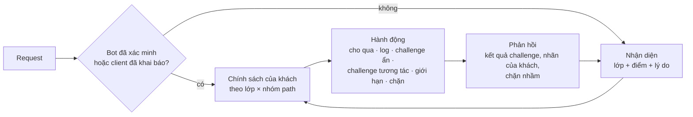

# 3.9 Bot management và challenge

> **Trạng thái: đang mở, chưa có quyết định nào (2026-11-07).** Theo chủ dự án, bot và challenge là một vùng
> nghiệp vụ lớn, cần phân tích riêng; API security tách sang [3.12](12-api-security.md). Thiết kế kỹ thuật ở kiến
> trúc 8.16. Lần phân tích tiếp (2026-11-07) thêm trục J–L, mô hình quyết định đề xuất ở [§4](#4-mô-hình-quyết-định-đề-xuất-chờ-duyệt)
> và phân tích các câu còn mở ở [§5](#5-phân-tích-các-câu-còn-mở-đề-xuất-của-claude-chờ-duyệt); tất cả là đề xuất, chưa phải quyết định.

## 1. Phạm vi

Phân biệt người thật với máy trên traffic của khách, cho máy tốt đi qua, chặn hoặc làm chậm máy xấu, và hỏi
lại (challenge) khi không chắc mà không làm hỏng trải nghiệm của người thật. Liên quan: F3.6, F3.8.1, F5.1.5 ở
[§1](../01-functional-decomposition.md).

Khác với WAF: WAF nhìn **nội dung** request (payload có độc không), bot management nhìn **ai gửi**. Một
request hoàn toàn sạch vẫn có thể là bot (đăng nhập bằng mật khẩu bị lộ, mua hết vé, lấy giá).

## 2. Kịch bản theo từng trục

### A. Khách muốn chống cái gì

| Mã | Kịch bản | Concern |
|---|---|---|
| KB9-A1 | Lấy dữ liệu (scraping): giá, nội dung, danh bạ | Phân biệt với đối tác lấy dữ liệu hợp lệ |
| KB9-A2 | Thử mật khẩu bị lộ (credential stuffing), dò mật khẩu | Lượng thấp, phân tán, request sạch |
| KB9-A3 | Tạo tài khoản ảo, spam form, spam bình luận | |
| KB9-A4 | Gom hàng, săn vé, flash sale (scalping) | Cần chặn trong vài giây đầu mở bán |
| KB9-A5 | Gửi OTP SMS hàng loạt (SMS pumping) làm khách mất tiền SMS | Phổ biến ở thị trường trong nước |
| KB9-A6 | Gian lận quảng cáo, click ảo, đánh giá ảo | |
| KB9-A7 | Bot gây quá tải (DDoS L7 bằng trình duyệt thật) | Giao với 3.3 |
| KB9-A8 | Giữ chỗ không mua (đặt phòng, đặt bàn, giỏ hàng) | |
| KB9-A9 | Dò lỗ hổng tự động (scanner) | Giao với WAF |

### B. Loại bot

| Mã | Kịch bản | Concern |
|---|---|---|
| KB9-B1 | Bot tốt đã xác minh: Google, Bing, Cốc Cốc, Apple | Danh sách bot trong nước có đủ không, ai duy trì |
| KB9-B2 | Bot xem trước link: Zalo, Facebook, Messenger, Slack, Telegram | Chặn thì link chia sẻ mất ảnh và tiêu đề |
| KB9-B3 | Công cụ giám sát uptime, SEO, đo hiệu năng | Khách dùng chính các công cụ này |
| KB9-B4 | Crawler AI (huấn luyện, trả lời câu hỏi) | Vùng xám; khách tự chọn |
| KB9-B5 | Đối tác lấy dữ liệu theo hợp đồng | Allowlist theo gì: IP, header ký, API key |
| KB9-B6 | Bot xấu đơn giản (script, thư viện HTTP) | Dễ nhận ra |
| KB9-B7 | Bot xấu tinh vi: trình duyệt headless, proxy dân cư, giải captcha thuê | Chạy đua với kẻ tấn công |
| KB9-B8 | Tool tự động hoá hợp lệ của chính khách (test, kiểm thử tải) | Khách tự chặn mình |

### C. Tín hiệu nhận diện

| Mã | Kịch bản | Concern |
|---|---|---|
| KB9-C1 | IP và ASN (trung tâm dữ liệu, proxy, VPN, Tor) | Proxy dân cư làm tín hiệu IP vô dụng; người dùng thật cũng dùng VPN |
| KB9-C2 | Dấu vân tay TLS, HTTP/2 | Thư viện mới, trình duyệt mới làm dấu vân tay đổi |
| KB9-C3 | Challenge JavaScript, kiểm môi trường trình duyệt | Không chạy được với client không phải trình duyệt |
| KB9-C4 | Hành vi: tốc độ, thứ tự trang, chuột, bàn phím | Thu thập hành vi là dữ liệu cá nhân |
| KB9-C5 | Tín hiệu theo tài khoản (một tài khoản đăng nhập từ nhiều nơi) | Edge không biết tài khoản trừ khi khách cho biết |
| KB9-C6 | Tín hiệu chéo tenant (IP này đang tấn công khách khác) | Dùng dữ liệu tenant này cho tenant khác (giống OQ-51) |

### D. Hành động

| Mã | Kịch bản | Concern |
|---|---|---|
| KB9-D1 | Cho qua, ghi log | |
| KB9-D2 | Challenge ẩn (JavaScript, proof of work) | Tốn pin, chậm trên máy yếu |
| KB9-D3 | Challenge tương tác (captcha) | Mất đơn, trợ năng |
| KB9-D4 | Chặn | |
| KB9-D5 | Giới hạn tốc độ theo phiên, làm chậm (tarpit) | |
| KB9-D6 | Trả dữ liệu giả cho bot lấy dữ liệu | Rủi ro pháp lý, khách có muốn không |
| KB9-D7 | Hành động theo path: chặt ở đăng nhập, thanh toán, OTP; lỏng ở trang tin | Cấu hình theo nhóm path |

### E. Trải nghiệm challenge

| Mã | Kịch bản | Concern |
|---|---|---|
| KB9-E1 | Request AJAX, fetch trong ứng dụng một trang (SPA) bị challenge | Trang challenge HTML trả về cho một request JSON làm ứng dụng hỏng |
| KB9-E2 | Trình duyệt trong app (Zalo, Facebook, TikTok) | Hay chặn cookie, JavaScript khác thường |
| KB9-E3 | Người dùng tắt cookie, trình duyệt riêng tư, chặn script | Challenge lặp vô hạn |
| KB9-E4 | Mạng di động chậm, máy cấu hình thấp | Challenge mất nhiều giây |
| KB9-E5 | Người khuyết tật, trình đọc màn hình | Captcha hình ảnh không dùng được |
| KB9-E6 | Ngôn ngữ, thương hiệu trên trang challenge | Theo gói |
| KB9-E7 | Trang đã được cache, trang nằm trong iframe | Challenge không hiện được |

### F. Clearance (giấy thông hành sau khi qua challenge)

| Mã | Kịch bản | Concern |
|---|---|---|
| KB9-F1 | Thời hạn clearance | Ngắn thì người dùng bị hỏi lại nhiều; dài thì bot dùng lại |
| KB9-F2 | Gắn clearance với IP hoặc dấu vân tay | Người dùng di động đổi IP liên tục |
| KB9-F3 | Dùng chung clearance giữa các subdomain của zone | |
| KB9-F4 | Clearance bị đánh cắp và bán lại (dịch vụ giải challenge) | |

### G. Client không phải trình duyệt

| Mã | Kịch bản | Concern |
|---|---|---|
| KB9-G1 | Ứng dụng mobile của khách | Cần SDK hoặc chứng thực thiết bị (attestation) |
| KB9-G2 | Smart TV, thiết bị IoT, máy POS | Không chạy được challenge |
| KB9-G3 | Gọi máy với máy (backend của đối tác, webhook) | Allowlist theo client đã xác định (BR-25) |

### H. Đo lường và tinh chỉnh

| Mã | Kịch bản | Concern |
|---|---|---|
| KB9-H1 | Khách muốn biết bao nhiêu % traffic là bot, loại nào | Dashboard bot |
| KB9-H2 | Tỉ lệ challenge, tỉ lệ vượt challenge, người thật bị hỏi lại | Mục tiêu QS-21 |
| KB9-H3 | Bật log-only trước khi chặn | Như WAF |
| KB9-H4 | Khách gắn nhãn "đây là người / đây là bot" | Học từ nhãn |

### I. Pháp lý, quyền riêng tư, thương mại

| Mã | Kịch bản | Concern |
|---|---|---|
| KB9-I1 | Dấu vân tay, dữ liệu hành vi là dữ liệu cá nhân | Nghị định 13/2023; thông báo cho người dùng cuối |
| KB9-I2 | Captcha của bên thứ ba gửi dữ liệu ra nước ngoài | |
| KB9-I3 | Request bị challenge có tính vào usage không | BR-7 nói traffic bị chặn hoặc challenge không tính; request vượt challenge thì tính |
| KB9-I4 | Mức bot theo gói (8.18): Free chặn bot rõ ràng, Pro theo lớp, Business có điểm, Enterprise có mô hình | Khách Pro gặp bot tinh vi |

### J. Kẻ tấn công thích nghi

| Mã | Kịch bản | Concern |
|---|---|---|
| KB9-J1 | Bot đổi dấu vân tay sau khi bị chặn vài giờ | Chặn theo dấu vân tay chỉ có tác dụng ngắn; cần vòng cập nhật nhanh |
| KB9-J2 | Dịch vụ giải challenge thuê (người thật giải hộ, hoặc AI giải captcha) | Captcha hình ảnh không còn là rào cản; chi phí của kẻ tấn công mới là thước đo |
| KB9-J3 | Botnet trên thiết bị thật, IP dân cư, trình duyệt thật | Mọi tín hiệu kỹ thuật trông như người; chỉ còn hành vi và tín hiệu theo tài khoản |
| KB9-J4 | Kẻ tấn công dò ngưỡng (gửi vừa dưới ngưỡng rate limit) | Ngưỡng cố định bị học; cần ngưỡng động, ngẫu nhiên hoá |
| KB9-J5 | Kẻ tấn công đọc trang challenge để biết mình bị phát hiện bằng gì | Không lộ lý do trong phản hồi |

### K. Playbook theo ngành ở thị trường trong nước

| Mã | Ngành | Bài toán bot điển hình | Concern |
|---|---|---|---|
| KB9-K1 | Thương mại điện tử | Flash sale, gom hàng, lấy giá, mã giảm giá bị dò | Chặn nhầm lúc mở bán là mất doanh thu lớn nhất trong năm |
| KB9-K2 | Ngân hàng, ví, fintech | Credential stuffing, OTP SMS hàng loạt, mở tài khoản ảo | App mobile là kênh chính; SDK, attestation |
| KB9-K3 | Vé, đặt chỗ (sự kiện, hàng không, tàu xe) | Giữ chỗ ảo, mua vé bằng bot | Hàng đợi ảo (waiting room) là sản phẩm liên quan |
| KB9-K4 | Báo chí, nội dung | Lấy nội dung, crawler AI | Muốn cho bot tìm kiếm, chặn bot sao chép |
| KB9-K5 | Game, cá cược hợp pháp, khuyến mãi | Tài khoản ảo săn thưởng | Tín hiệu theo tài khoản quan trọng hơn theo request |
| KB9-K6 | Cơ quan nhà nước, dịch vụ công | Dò dữ liệu, tra cứu hàng loạt | Trợ năng bắt buộc cao, không dùng captcha bên thứ ba ở nước ngoài |

### L. Tác tử AI (AI agent) truy cập thay người dùng

| Mã | Kịch bản | Concern |
|---|---|---|
| KB9-L1 | Trợ lý AI duyệt web, đặt hàng thay người dùng | Là bot nhưng có người thật đứng sau; chặn thì người dùng thật mất kênh |
| KB9-L2 | Tác tử tự xưng là của một hãng AI lớn | Kiểm chứng danh tính (chữ ký request của bot, dải IP công bố) |
| KB9-L3 | Khách muốn cho tác tử đọc nhưng không cho mua, hoặc tính phí truy cập | Chính sách theo hành động, không chỉ cho/chặn |

## 3. Câu hỏi cần chủ dự án quyết

| ID | Câu hỏi | Kịch bản | Ghi chú ban đầu |
|---|---|---|---|
| OQ-81 | Captcha tự làm, bên thứ ba, hay không có captcha (chỉ challenge ẩn)? | KB9-D3, KB9-E5, KB9-I2 | |
| OQ-82 | Crawler AI: mặc định cho, chặn, hay bắt khách chọn khi bật? | KB9-B4 | |
| OQ-83 | Nhận diện app mobile thật (SDK, attestation) có trong lộ trình không? | KB9-G1 | |
| OQ-85 | Bot trong nước (Cốc Cốc, bot xem trước link của Zalo) có nằm trong danh sách bot đã xác minh không, ai duy trì? | KB9-B1, KB9-B2 | |
| OQ-100 | Bài toán nào ưu tiên ở MVP: scraping, credential stuffing, flash sale, SMS pumping, spam form? | KB9-A1…KB9-A9 | SMS pumping và credential stuffing hay gặp nhất ở khách trong nước |
| OQ-101 | Request AJAX/JSON bị challenge: trả mã lỗi để ứng dụng tự xử lý, hay cấm challenge trên path API? | KB9-E1 | |
| OQ-102 | Có làm trả dữ liệu giả, làm chậm (tarpit) cho bot không? | KB9-D5, KB9-D6 | |
| OQ-103 | Clearance: thời hạn, gắn với IP hay không, dùng chung giữa subdomain? | KB9-F1…KB9-F4 | |
| OQ-104 | Có thu thập tín hiệu hành vi (chuột, bàn phím) không? Thông báo cho người dùng cuối thế nào? | KB9-C4, KB9-I1 | |
| OQ-105 | Tín hiệu bot chéo tenant có dùng không? | KB9-C6 | Gộp với OQ-51 |
| OQ-106 | Khách gói thấp bị bot tinh vi: có bán lẻ tính năng bot không, hay phải nâng gói? | KB9-I4 | Gắn với KB5-B4 |
| OQ-124 | Có playbook bot theo ngành (preset sẵn cho thương mại điện tử, ngân hàng, vé, báo chí) không? | KB9-K1…KB9-K6 | |
| OQ-125 | Tác tử AI: xếp vào lớp riêng, kiểm chữ ký bot, chính sách theo hành động (đọc, mua) có trong lộ trình không? | KB9-L1…KB9-L3 | |
| OQ-126 | Có làm hàng đợi ảo (waiting room) cho flash sale, mở bán vé không? | KB9-K1, KB9-K3 | Sản phẩm liên quan nhưng không phải WAF |

## 4. Mô hình quyết định (đề xuất, chờ duyệt)

Mô tả nghiệp vụ, không phải thiết kế kỹ thuật (kiến trúc 8.16 đã có lớp tín hiệu BS1–BS7). Điểm chính: tách
**nhận diện** (request này do ai gửi, chắc tới đâu) khỏi **chính sách** (khách muốn làm gì với loại đó ở path
đó), để khách chỉnh chính sách mà không phải hiểu tín hiệu.

| Thành phần | Đề xuất |
|---|---|
| Lớp | `verified` (bot đã xác minh), `declared` (client khách đã khai báo: app, đối tác), `agent` (tác tử AI, nếu OQ-125 có), `likely_human`, `likely_automated`, `automated` |
| Nhóm path | Khách gắn nhãn path theo mục đích: `login`, `otp`, `checkout`, `search`, `api`, `content`, `static`. Preset theo ngành (OQ-124) gắn sẵn |
| Ma trận chính sách | Ô = (lớp, nhóm path) → hành động. Mặc định chỉ chặt ở `login`, `otp`, `checkout`; `static` và `content` gần như không challenge |
| Bảo vệ người thật | Không bao giờ challenge tương tác trên request không phải trang HTML (AJAX, API, tài nguyên): trả mã lỗi có cấu trúc để ứng dụng tự xử lý (OQ-101) |
| Bảo vệ khỏi thích nghi | Không trả lý do trong phản hồi; ngưỡng có độ ngẫu nhiên nhỏ; dữ liệu bot cập nhật hằng ngày qua pipeline phát hành (KB9-J1, KB9-J4) |
| Đo | Mỗi ô của ma trận có số request, tỉ lệ challenge, tỉ lệ qua challenge, nhãn chặn nhầm; khách thấy ngay ô nào đang làm phiền người thật |

## 5. Phân tích các câu còn mở (đề xuất của Claude, chờ duyệt)

| Câu | Phương án | Đánh đổi | Đề xuất |
|---|---|---|---|
| OQ-81 | (a) Tự làm challenge; (b) captcha bên thứ ba; (c) chỉ challenge ẩn | (b) dữ liệu ra nước ngoài, không chạy on-prem; (c) không đủ với path nhạy cảm | (a) làm mặc định, như kiến trúc 8.16 đã chọn: challenge ẩn kiểu proof of work và kiểm môi trường, challenge tương tác đơn giản do edge phát, có phương án trợ năng. (b) là tuỳ chọn khách tự bật. Không coi captcha hình ảnh là rào cản chính (KB9-J2) |
| OQ-82 | (a) Mặc định cho; (b) mặc định chặn; (c) bắt chọn khi bật | (a) khách báo chí phản đối; (b) mất hiển thị trên trợ lý AI | (c): khi bật bot management, hỏi một câu "cho crawler AI không"; preset báo chí mặc định chặn crawler huấn luyện, cho crawler trả lời câu hỏi có trích nguồn |
| OQ-83 | SDK, attestation cho app mobile | Phải duy trì SDK trên iOS, Android | Lộ trình Nâng cao; trước đó app dùng danh tính consumer (API key, JWT) và rate limit như kiến trúc 8.17 |
| OQ-85 | Bot trong nước trong danh sách xác minh | Mỗi bot thêm là một nguồn phải kiểm định kỳ | Có: Cốc Cốc và bot xem trước link của Zalo, Facebook, Telegram, Slack vào danh sách từ MVP; threat research duy trì |
| OQ-100 | Bài toán ưu tiên ở MVP | | Credential stuffing và SMS pumping (mất tiền trực tiếp, hay gặp ở khách trong nước), rồi flash sale; scraping để Mở rộng vì khó phân biệt với đối tác |
| OQ-101 | Challenge request AJAX/JSON | Trang HTML trả cho JSON làm ứng dụng hỏng | Không challenge tương tác trên request không phải điều hướng trang; trả `403` hoặc `429` có mã lỗi JSON và header gợi ý; ứng dụng tự mở challenge khi cần |
| OQ-102 | Dữ liệu giả, tarpit | Dữ liệu giả có rủi ro pháp lý, gây nhầm cho đối tác | Tarpit (làm chậm) có ở Mở rộng; dữ liệu giả không làm. **Bảng hành động mặc định theo điểm và managed challenge đã quyết 2026-11-07 (BR-34). Tarpit đã quyết 2026-11-07** ở [3.13](13-configuration-surface.md#4-đã-quyết): có trần theo node, không dùng làm cách chính chống credential stuffing |
| OQ-103 | Clearance | | Thời hạn mặc định 30 phút, khách chỉnh 5 phút tới 24 giờ; không gắn cứng với IP (người dùng di động), gắn với dấu vân tay TLS và zone; dùng chung giữa các subdomain của zone |
| OQ-104 | Tín hiệu hành vi | Dữ liệu cá nhân | Mặc định tắt như kiến trúc 8.16; khách bật thì có văn bản mẫu để đưa vào chính sách quyền riêng tư của họ |
| OQ-105 | Tín hiệu chéo tenant | | Có, chỉ ở dạng reputation gộp (IP, ASN, dấu vân tay), không chia sẻ request; là lợi thế lớn nhất của một nền tảng nhiều khách (xem [§4.4](../04-product-direction/04-data-strategy.md)) |
| OQ-106 | Bán lẻ tính năng bot | Làm rối bảng giá | Có add-on "bảo vệ đăng nhập và OTP" cho Pro, vì đây là bài toán mất tiền trực tiếp; phần còn lại theo gói |
| OQ-124 | Playbook theo ngành | Phải duy trì nhiều preset | Có, 4 preset ở MVP: thương mại điện tử, ngân hàng/ví, vé/đặt chỗ, báo chí |
| OQ-125 | Tác tử AI | Chuẩn kiểm chứng còn đang hình thành | Xếp lớp `agent` riêng từ Mở rộng; kiểm dải IP công bố và chữ ký request khi hãng AI có; chính sách theo hành động (đọc, mua) ở Nâng cao |
| OQ-126 | Hàng đợi ảo | Là sản phẩm riêng | Không ở MVP; ghi vào lộ trình Mở rộng vì khách thương mại điện tử, vé sẽ hỏi ngay |

## 6. Phụ thuộc

FR-3-08, FR-5-03, BR-7, BR-25 ở [§2](../02-requirements.md); kiến trúc 8.16, ADR-0038; QS-20, QS-21.
