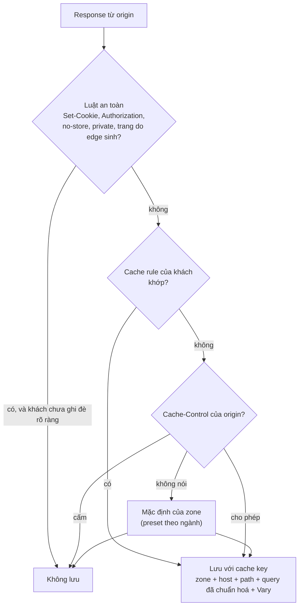

# 3.10 Cache, hiệu năng, nội dung

> **Trạng thái: đang mở, chưa có quyết định nào (2026-11-07).** Theo chủ dự án, cache là một vùng nghiệp vụ lớn,
> cần phân tích riêng. Chiến lược CDN ở kiến trúc ADR-0035. Lần phân tích tiếp thêm trục J–N, mô hình quyết định ở
> [§4](#4-mô-hình-quyết-định-cache-đề-xuất-chờ-duyệt) và phân tích các câu còn mở ở
> [§5](#5-phân-tích-các-câu-còn-mở-đề-xuất-của-claude-chờ-duyệt); tất cả là đề xuất, chưa phải quyết định.

## 1. Phạm vi

Khách dùng edge để phục vụ nội dung nhanh hơn và giảm tải origin: quyết định cái gì được lưu, lưu bao lâu, xoá
khi nào; tránh để cache làm lộ dữ liệu hoặc bị đầu độc; và chịu trách nhiệm về nội dung đi qua edge. Liên quan:
F4 ở [§1](../01-functional-decomposition.md#f4-hiệu-năng-và-phân-phối).

Cache là lý do nhiều khách dùng dịch vụ (ADR-0035), nhưng cũng là chỗ dễ gây sự cố nhất sau chặn nhầm: một
quyết định cache sai có thể đưa trang của người này cho người khác.

## 2. Kịch bản theo từng trục

### A. Loại nội dung

| Mã | Kịch bản | Concern |
|---|---|---|
| KB10-A1 | Tài nguyên tĩnh (ảnh, CSS, JS, font) | An toàn, lợi ích lớn |
| KB10-A2 | HTML công khai (trang tin, trang sản phẩm) | Cache được nếu không phụ thuộc người dùng |
| KB10-A3 | HTML theo người dùng (giỏ hàng, trang cá nhân, đã đăng nhập) | Không được cache, hoặc chỉ cache phần chung |
| KB10-A4 | API GET công khai (danh sách sản phẩm, tỉ giá) | TTL ngắn |
| KB10-A5 | File lớn tải xuống, tải theo đoạn (range) | Dung lượng cache theo gói, PoP |
| KB10-A6 | Video theo đoạn (HLS, DASH) | Lưu lượng lớn; đang ở mức Nâng cao |
| KB10-A7 | Trang lỗi (404, 500) | Cache trang lỗi làm lỗi kéo dài |

### B. Quyết định cache

| Mã | Kịch bản | Concern |
|---|---|---|
| KB10-B1 | Origin gửi `Cache-Control` đúng | Tôn trọng |
| KB10-B2 | Origin không gửi gì, hoặc gửi sai (WordPress mặc định, framework) | Mặc định cache gì |
| KB10-B3 | Response có `Set-Cookie`, request có `Authorization` hoặc cookie phiên | Không cache, kể cả khi khách cấu hình nhầm |
| KB10-B4 | Cache key: query string (bỏ `utm_*`, `fbclid`), cookie, ngôn ngữ, thiết bị, quốc gia | Mỗi biến thể nhân số bản lưu |
| KB10-B5 | `Vary` từ origin | `Vary: *`, `Vary: User-Agent` làm cache vô dụng |
| KB10-B6 | Khách ghi đè TTL bằng cache rule | Rule rộng quá cache cả trang riêng tư |

### C. An toàn của cache

| Mã | Kịch bản | Concern |
|---|---|---|
| KB10-C1 | Cache deception: `/account/profile.php/x.css` được cache như file tĩnh | Lộ trang riêng tư của người dùng |
| KB10-C2 | Cache poisoning: header không nằm trong cache key (`X-Forwarded-Host`) làm origin trả nội dung độc, bị lưu cho mọi người | |
| KB10-C3 | Một người dùng đã đăng nhập làm trang công khai bị lưu kèm dữ liệu của họ | Lỗi của origin, nhưng hậu quả do cache |
| KB10-C4 | Cache phần đã bị WAF chặn hoặc đang bị challenge | Không được lưu |

### D. Thời gian sống và làm mới

| Mã | Kịch bản | Concern |
|---|---|---|
| KB10-D1 | `stale-while-revalidate`, `stale-if-error` | Đã có `stale-if-error` ở MVP |
| KB10-D2 | Kiểm lại với origin (`ETag`, `304`) | Origin không hỗ trợ |
| KB10-D3 | Nội dung cần cập nhật ngay (giá, tồn kho) | TTL ngắn, hoặc xoá theo sự kiện |

### E. Xoá cache (purge)

| Mã | Kịch bản | Concern |
|---|---|---|
| KB10-E1 | Xoá theo URL, prefix, tag, toàn zone | Hạn mức theo gói (8.18) |
| KB10-E2 | Xoá sau mỗi lần deploy, gọi từ CI | Qua API |
| KB10-E3 | CMS tự xoá khi sửa bài (plugin WordPress) | Có làm plugin không |
| KB10-E4 | Xoá toàn zone lúc cao điểm | Mọi request dồn về origin cùng lúc |
| KB10-E5 | Nội dung bị gỡ ở origin vì pháp lý nhưng vẫn nằm trong cache | Phải xoá chắc chắn, có xác nhận |
| KB10-E6 | Purge có cần change request không | Purge là lệnh, không phải cấu hình (đề xuất ở OQ-33) |

### F. Bảo vệ origin

| Mã | Kịch bản | Concern |
|---|---|---|
| KB10-F1 | Nhiều request cùng lúc cho một object chưa có trong cache | Gộp thành một request về origin |
| KB10-F2 | Nhiều PoP cùng hỏi origin | Tầng cache trung gian (origin shield), Mở rộng |
| KB10-F3 | Cache lạnh sau khi mở PoP mới, sau khi xoá toàn zone | Origin chịu tải đột biến |

### G. Tối ưu khác

| Mã | Kịch bản | Concern |
|---|---|---|
| KB10-G1 | Nén gzip, brotli | Có làm ở edge không khi origin đã nén |
| KB10-G2 | HTTP/2, HTTP/3 tới người dùng | |
| KB10-G3 | Tối ưu ảnh, đổi định dạng (WebP, AVIF) | Mức Nâng cao |
| KB10-G4 | Người dùng ở nước ngoài truy cập website trong nước | PoP ở đâu |

### H. Thương mại và đo lường

| Mã | Kịch bản | Concern |
|---|---|---|
| KB10-H1 | Dung lượng cache theo gói, theo PoP | Gói thấp bị đẩy ra trước |
| KB10-H2 | Băng thông phục vụ từ cache có tính tiền không | Theo 8.18 thì tính là băng thông sạch |
| KB10-H3 | Khách muốn thấy tỉ lệ cache hit, băng thông origin tiết kiệm được | Chứng minh giá trị |
| KB10-H4 | Khách gỡ lỗi: vì sao trang này không được cache | Header trạng thái cache, công cụ xem cache key |

### I. Nội dung đi qua edge

| Mã | Kịch bản | Concern |
|---|---|---|
| KB10-I1 | Website lừa đảo, phishing, phát tán mã độc dùng edge để giấu origin | Nhận báo cáo abuse, xác minh, khoá; NCC có trách nhiệm gì |
| KB10-I2 | Yêu cầu gỡ nội dung vi phạm bản quyền | Quy trình |
| KB10-I3 | Nội dung bị cấm theo pháp luật Việt Nam, yêu cầu của cơ quan quản lý | Chặn theo quốc gia, khoá zone |
| KB10-I4 | Yêu cầu tiết lộ origin thật của một website (nạn nhân, cơ quan chức năng) | Quy trình, căn cứ |

### J. Cache và các lớp bảo vệ khác

Theo kiến trúc 5.8.1, thứ tự ở L7 là: lọc sớm, bot, rate limit, custom rule, WAF, rồi mới tới cache. WAF đứng
trước cache theo mặc định; zone có thể miễn WAF cho tài nguyên tĩnh.

| Mã | Kịch bản | Concern |
|---|---|---|
| KB10-J1 | Request có payload tấn công trong query tới một URL đã cache | WAF trước cache nên vẫn bị phát hiện; tốn CPU WAF cho cả cache hit |
| KB10-J2 | Khách bật "miễn WAF cho tài nguyên tĩnh" | Payload tấn công tới `/logo.png?id=1' OR 1=1` không bị ghi nhận; chấp nhận được với file tĩnh |
| KB10-J3 | Bị flood vào một URL đã cache | Cache hấp thụ; rate limit vẫn áp trước cache để không tốn băng thông vô ích |
| KB10-J4 | Under Attack mode bật, trang đã cache | Người dùng vẫn phải qua challenge trước khi nhận bản cache |
| KB10-J5 | Trang chặn, trang challenge, trang lỗi do edge sinh | Không bao giờ được cache |

### K. Theo ngành

| Mã | Ngành | Bài toán cache | Concern |
|---|---|---|---|
| KB10-K1 | Báo chí | Tin nóng cập nhật liên tục, trang chủ đổi mỗi phút | TTL ngắn, xoá theo tag bài viết; lượng truy cập đột biến khi có tin lớn |
| KB10-K2 | Thương mại điện tử | Trang sản phẩm công khai nhưng giá, tồn kho đổi | Cache phần khung, không cache giá và tồn kho; giỏ hàng không bao giờ cache |
| KB10-K3 | Game | Bản cập nhật vài GB tải cùng lúc | Băng thông lớn, tải theo đoạn, dung lượng cache |
| KB10-K4 | Giáo dục, video bài giảng | Video theo đoạn | Mức Nâng cao (KB10-A6) |
| KB10-K5 | Ngân hàng, dịch vụ công | Hầu như không cache HTML | Chỉ tài nguyên tĩnh; rủi ro lộ dữ liệu lớn nhất |
| KB10-K6 | API công khai (tỉ giá, thời tiết, giá vàng) | Cache vài giây giảm tải lớn | Cache API GET theo query |

### L. Cô lập giữa các khách

| Mã | Kịch bản | Concern |
|---|---|---|
| KB10-L1 | Hai zone có cùng path (`/index.html`) | Cache key luôn có zone và hostname |
| KB10-L2 | Kẻ tấn công trỏ hostname của mình vào cùng origin của nạn nhân để đọc cache | Cache key theo zone đã chặn; không chia sẻ object giữa zone dù cùng origin |
| KB10-L3 | Một zone lấp đầy cache của PoP | Hạn mức dung lượng theo gói (8.18) |

### M. Đứng sau CDN của khách, hoặc trước một CDN khác

| Mã | Kịch bản | Concern |
|---|---|---|
| KB10-M1 | Khách đã có CDN, đặt edge làm origin của CDN đó | Hai lớp cache; header cache của origin đi qua edge nguyên vẹn hay bị edge sửa |
| KB10-M2 | Khách muốn tắt hẳn cache của edge, chỉ dùng WAF | Cần một công tắc rõ ràng |
| KB10-M3 | Purge ở edge nhưng CDN của khách vẫn giữ bản cũ | Ngoài kiểm soát của NCC; hướng dẫn |

### N. Vận hành cache của NCC

| Mã | Kịch bản | Concern |
|---|---|---|
| KB10-N1 | Đĩa NVMe của PoP đầy | Đẩy ra theo gói (gói thấp trước), theo tần suất truy cập |
| KB10-N2 | PoP mới, cache trống | Làm ấm cache từ PoP khác hay để tự đầy |
| KB10-N3 | Lỗi phần mềm làm cache trả sai object | Sự cố nghiêm trọng nhất của CDN; cần cách xoá toàn bộ cache của fleet và kiểm tra tính toàn vẹn |
| KB10-N4 | Khách hỏi "vì sao cache hit thấp" | Công cụ chẩn đoán (KB10-H4) |

## 3. Câu hỏi cần chủ dự án quyết

| ID | Câu hỏi | Kịch bản | Ghi chú ban đầu |
|---|---|---|---|
| OQ-86 | Mặc định cache gì khi origin không nói gì? | KB10-A1…KB10-A3, KB10-B2 | Chỉ tài nguyên tĩnh theo đuôi file là an toàn |
| OQ-87 | Có làm plugin cho CMS phổ biến (WordPress) không? | KB10-E3 | |
| OQ-88 | Chính sách abuse: ai nhận báo cáo, thời gian xử lý, khi nào khoá zone, có tiết lộ origin không? | KB10-I1…KB10-I4 | Cần tư vấn pháp lý; dịch vụ che origin luôn bị dùng cho mục đích xấu |
| OQ-112 | Có luôn chặn cache response có `Set-Cookie` hoặc request có `Authorization`, kể cả khi khách cấu hình cache rule? | KB10-B3, KB10-B6 | Đây là chỗ chống rò rỉ |
| OQ-113 | Có chống cache deception (kiểm `Content-Type` khớp đuôi file) mặc định không? | KB10-C1 | |
| OQ-114 | Cache key mặc định: bỏ tham số marketing (`utm_*`, `fbclid`) không? | KB10-B4 | |
| OQ-115 | Xoá toàn zone: có giới hạn hoặc xác nhận thêm không, để tránh dội origin? | KB10-E4, KB10-F3 | |
| OQ-116 | Băng thông phục vụ từ cache có tính phí như băng thông sạch không? | KB10-H2 | Ảnh hưởng 8.18 |
| OQ-117 | Nén và HTTP/3 có ở MVP không? | KB10-G1, KB10-G2 | |
| OQ-143 | Giữ "WAF trước cache" làm mặc định, hay mặc định miễn WAF cho tài nguyên tĩnh? | KB10-J1, KB10-J2 | |
| OQ-144 | Có preset cache theo ngành (báo chí, thương mại điện tử, game, API công khai) không? | KB10-K1…KB10-K6 | Gắn với OQ-124 (preset bot theo ngành) |
| OQ-145 | Có công tắc "chỉ WAF, không cache" cho khách đã có CDN không? | KB10-M1, KB10-M2 | |
| OQ-146 | Có làm ấm cache cho PoP mới hoặc theo yêu cầu khách (trước một sự kiện lớn) không? | KB10-N2, KB10-K1 | |

## 4. Mô hình quyết định cache (đề xuất, chờ duyệt)

Mô tả nghiệp vụ, không phải thiết kế kỹ thuật. Điểm chính: **luật an toàn đứng trên mọi cấu hình**, kể cả cấu
hình của khách. Khách có thể nới lỏng an toàn nhưng phải làm rõ ràng, có cảnh báo, có audit.

| Bậc | Luật | Ai đặt | Ghi đè được không |
|---|---|---|---|
| 1 | **An toàn**: không lưu response có `Set-Cookie`; không lưu khi request có `Authorization` hoặc cookie phiên đã khai báo; tôn trọng `no-store`, `private`; không lưu trang do edge sinh; kiểm `Content-Type` khớp đuôi file (chống cache deception) | NCC | Khách ghi đè được từng luật cho từng path, phải xác nhận cảnh báo, có audit |
| 2 | **Cache rule của khách**: theo path, đuôi file, header; TTL, bỏ qua cache, cache key | Khách | |
| 3 | **Cache-Control của origin** | Origin | Bị bậc 2 ghi đè |
| 4 | **Mặc định của zone**: theo preset ngành; không có preset thì chỉ tài nguyên tĩnh theo đuôi file | NCC, khách chọn preset | |

Cache key mặc định: `(zone, host, path, query đã sắp xếp và bỏ tham số marketing, header theo Vary đã chuẩn
hoá)`. Không đưa cookie, thiết bị, quốc gia vào key trừ khi khách cấu hình.

## 5. Phân tích các câu còn mở (đề xuất của Claude, chờ duyệt)

| Câu | Phương án | Đánh đổi | Đề xuất |
|---|---|---|---|
| OQ-86 | Mặc định khi origin không nói gì | Cache HTML mặc định làm lộ trang riêng tư; không cache gì thì mất giá trị CDN | Chỉ tài nguyên tĩnh theo đuôi file (ảnh, CSS, JS, font, file tải xuống), TTL 4 giờ. HTML chỉ cache khi khách chọn preset hoặc viết cache rule |
| OQ-87 | Plugin cho CMS | Phải duy trì plugin | Có plugin WordPress ở Mở rộng (xoá cache khi sửa bài, gợi ý cache rule); trước đó có hướng dẫn gọi API |
| OQ-88 | Chính sách abuse | | Đầu mối abuse riêng, email và form công khai; xác minh trong 24 giờ; phishing và mã độc đã xác minh thì khoá zone ngay, báo khách; không tiết lộ origin trừ khi có văn bản của cơ quan có thẩm quyền; cần tư vấn pháp lý |
| OQ-112 | Luật an toàn có ghi đè được không | Không cho ghi đè thì một số site hợp lệ không cache được | Mặc định luôn áp; khách ghi đè được từng luật theo path, phải xác nhận cảnh báo và có audit (§4 bậc 1) |
| OQ-113 | Chống cache deception | Một số site trả `Content-Type` sai | Có, mặc định bật; khách tắt được theo path |
| OQ-114 | Bỏ tham số marketing khỏi cache key | Hiếm site dùng `utm_*` để đổi nội dung | Có, mặc định bỏ `utm_*`, `fbclid`, `gclid`, `zalo_*`; khách sửa danh sách |
| OQ-115 | Xoá toàn zone | | Cho phép, nhưng cần xác nhận lại và hiện ước lượng tải dồn về origin; gói thấp có giới hạn tần suất (8.18) |
| OQ-116 | Băng thông từ cache có tính phí không | Không tính thì khuyến khích cache nhưng mất doanh thu băng thông | Tính như băng thông sạch (như 8.18); lợi ích cho khách là origin nhẹ đi và rẻ hơn băng thông của hosting |
| OQ-117 | Nén, HTTP/3 ở MVP | | Nén gzip và brotli ở MVP (rẻ, lợi ích rõ); HTTP/3 ở MVP nếu nền L7 chọn ở ADR-0031 có sẵn, nếu không thì Mở rộng |
| OQ-143 | WAF trước hay sau cache | Trước: an toàn hơn, tốn CPU; sau: rẻ hơn | Giữ WAF trước cache làm mặc định như kiến trúc 5.8.1; preset báo chí, game, file tải xuống bật sẵn "miễn WAF cho tài nguyên tĩnh" |
| OQ-144 | Preset cache theo ngành | | Có, đi chung với preset bot (OQ-124): thương mại điện tử, báo chí, API công khai ở MVP; game ở Mở rộng |
| OQ-145 | Công tắc "chỉ WAF" | | Có, ở mọi gói |
| OQ-146 | Làm ấm cache | Tốn băng thông origin | Không làm ấm tự động cho PoP mới ở MVP; Enterprise yêu cầu làm ấm trước sự kiện lớn qua support |

## 6. Phụ thuộc

FR-4-01…FR-4-04 ở [§2](../02-requirements.md); kiến trúc ADR-0035, 8.18. Chính sách abuse và an toàn cache
chưa có requirement nào.
