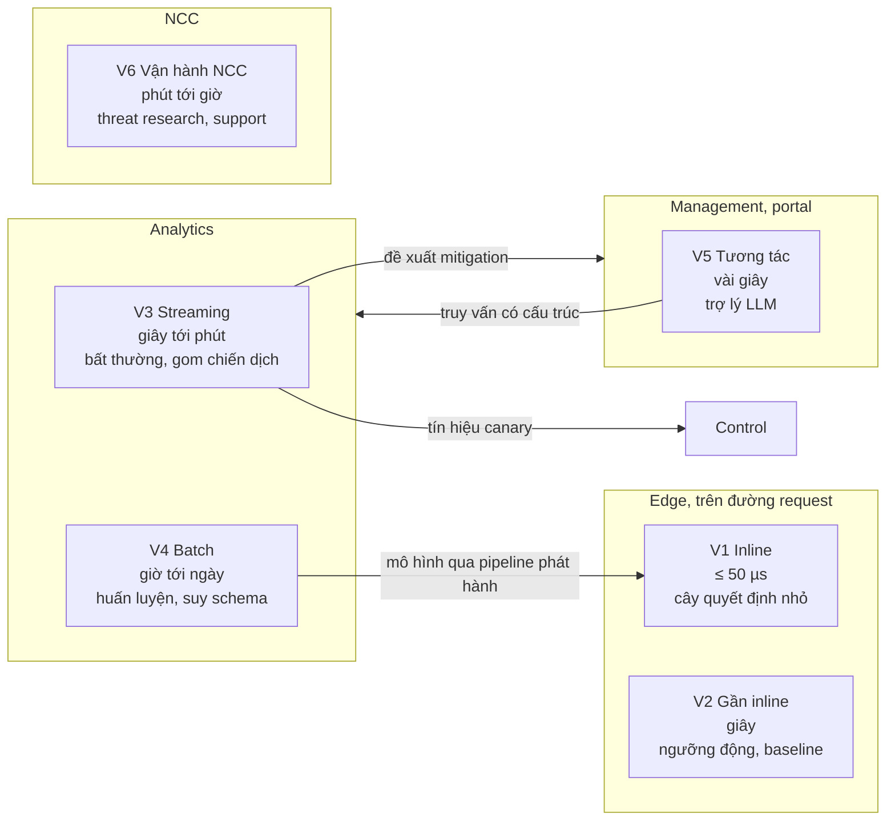

# 4.2 AI/ML tích hợp vào đâu

> **Trạng thái: đề xuất của Claude, chờ duyệt (2026-11-07).**

## Câu 1. Có những vị trí nào để đặt AI/ML?

Sáu vị trí, xếp theo độ trễ cho phép. Vị trí càng gần request thì mô hình càng phải nhỏ, càng phải xác định.

| Vị trí | Ở đâu | Ngân sách | Dùng cho | Loại mô hình |
|---|---|---|---|---|
| **V1 Inline** | L7, WAF | ≤ 50 µs mỗi request (QS-20) | Điểm bot, điểm bất thường của request, phân loại request cần gửi WAF hay không | Cây quyết định, gradient boosted trees đã biên dịch; không mạng nơ-ron lớn |
| **V2 Gần inline** | Edge agent, bộ đếm L7 | Giây | Ngưỡng DDoS động theo baseline của zone, ngưỡng rate limit thích nghi | Thống kê trượt (EWMA, phân vị), không phải mô hình huấn luyện |
| **V3 Streaming** | Detection ở Analytics | Giây tới phút | Phát hiện bất thường theo zone, gom cảnh báo thành chiến dịch, dự đoán chặn nhầm, đề xuất mitigation | Mô hình bất thường, phân cụm, mô hình phân loại chặn nhầm |
| **V4 Batch** | Analytics | Giờ tới ngày | Huấn luyện mô hình bot, reputation, suy schema API, phân loại endpoint, đánh giá rule | Huấn luyện và đánh giá; xuất mô hình cho V1 |
| **V5 Tương tác** | Portal | Vài giây | Trợ lý: hỏi bằng tiếng Việt ra truy vấn, giải thích một event, soạn nháp rule từ mô tả, tóm tắt sự cố, soạn báo cáo | LLM, gọi qua công cụ có cấu trúc |
| **V6 Vận hành NCC** | Nội bộ | Phút tới giờ | Soạn nháp rule khẩn từ CVE, phân loại báo cáo abuse, hỗ trợ support | LLM, người duyệt |

## Câu 2. Nguyên tắc nào để AI không làm hỏng sản phẩm?

| # | Nguyên tắc | Vì sao |
|---|---|---|
| AI1 | **ML đề xuất và chấm điểm, luật xác định quyết định.** Điểm của mô hình là một đầu vào của policy (ví dụ `bot.score < 30` ở path `login` thì challenge), không tự là hành động | Khách hiểu và chỉnh được; giải thích được với kiểm toán (Q4) |
| AI2 | **Mô hình là một artifact có version, đi cùng pipeline phát hành như ruleset**: đánh giá trên tập giữ lại, log-only song song, canary, rollback (kiến trúc 8.16 §6) | Mô hình lỗi không gây outage toàn fleet (Q2) |
| AI3 | **LLM không bao giờ nằm trên đường request** | Độ trễ, chi phí, và không xác định |
| AI4 | **Mỗi quyết định dựa trên ML có lý do**: tín hiệu nào đóng góp, ghi trong event | Xử lý chặn nhầm (3.4) cần biết vì sao |
| AI5 | **LLM chỉ thấy dữ liệu đã che** và chỉ thấy dữ liệu của tenant đang hỏi | Dữ liệu nhạy cảm, cô lập tenant (Q3) |
| AI6 | **LLM hành động qua công cụ có cấu trúc** (Query API, tạo change request nháp), không viết SQL tự do, không tự phát hành | Cùng quyền với người dùng đang hỏi; không vượt quyền |
| AI7 | **Có công tắc tắt** cho mọi tính năng ML theo zone và toàn fleet | Sự cố mô hình phải tắt được trong vài giây |
| AI8 | **Đo được giá trị**: mỗi mô hình có chỉ số so với luật thay thế; không tốt hơn thì không dùng (8.16 §3) | Tránh ML vì ML |

## Câu 3. Cụ thể từng bài toán dùng gì?

| Bài toán | Vị trí | Cách làm đề xuất | Mức |
|---|---|---|---|
| Điểm bot | V4 huấn luyện → V1 chấm | Cây quyết định trên đặc trưng BS3–BS6; nhãn từ kết quả challenge, bot đã xác minh, phản hồi của khách | MR (kéo lên từ NC, OQ-128) |
| Ngưỡng DDoS theo zone | V2 | Baseline theo giờ trong ngày, ngày trong tuần; ngưỡng = baseline × hệ số độ nhạy khách chọn | MVP |
| Phát hiện bất thường | V3 | Theo zone và path: lượng request, tỉ lệ lỗi, phân bố quốc gia, ASN, dấu vân tay mới | MR |
| Gom chiến dịch | V3 | Phân cụm event theo dấu vân tay, payload, nguồn, thời gian; một chiến dịch = một sự cố, không phải nghìn cảnh báo | MR |
| Dự đoán chặn nhầm | V3, V4 | Phân loại từng lần khớp rule là "có thể nhầm" dựa trên: người dùng đã đăng nhập, path quen, nhịp đều, nhãn cũ | MR |
| Đề xuất tinh chỉnh | V3 → Management | Từ dự đoán chặn nhầm sinh nháp tuning rule hoặc whitelist (BR-25), thành change request | MR |
| Suy schema API | V4 | Gom request theo mẫu path, suy kiểu trường; khách xác nhận (OQ-107) | MR |
| Đánh giá canary | V3 → Control | So chỉ số zone trước và sau thay đổi, phát hiện lệch có ý nghĩa thống kê | MVP (thống kê), MR (mô hình) |
| Trợ lý trên portal | V5 | LLM với công cụ: truy vấn event, giải thích rule, soạn nháp rule, tóm tắt | MR |
| Rule khẩn từ CVE | V6 | LLM đọc công bố CVE, soạn nháp rule và bộ request kiểm thử; threat research duyệt | MR |
| Bảo vệ ứng dụng LLM của khách | V1 (luật), V3 (phân loại) | Giới hạn kích thước và tần suất prompt, phát hiện mẫu prompt injection đã biết, quan sát token; phân loại nội dung sâu ở Analytics, không inline | MR (OQ-127) |

## Câu 4. Cần dữ liệu và hạ tầng gì?

| Cần | Có chưa | Ghi chú |
|---|---|---|
| Dữ liệu có nhãn | Một phần: kết quả challenge, bot xác minh, nhãn chặn nhầm (F7.5) | Nhãn chặn nhầm là dữ liệu quý nhất, cần khuyến khích khách gắn nhãn |
| Kho đặc trưng chéo tenant | Chưa | Tầng TD3 ở [4.4](04-data-strategy.md) |
| Môi trường huấn luyện tách khỏi sản xuất | Chưa | Đọc từ tầng đã khử nhận dạng |
| Pipeline phát hành mô hình | Có (8.16 §6, dùng chung với ruleset) | |
| LLM | Chưa chọn | Tự chạy mô hình mở (giữ dữ liệu trong nước, chạy được on-prem) hay gọi API bên ngoài (OQ-131) |

## Câu 5. Rủi ro riêng của AI

| Rủi ro | Giảm thiểu |
|---|---|
| Kẻ tấn công đầu độc dữ liệu huấn luyện (gửi traffic giả để mô hình học sai) | Huấn luyện có lọc nguồn, so với tập giữ lại cố định, không học trực tiếp từ traffic chưa có nhãn |
| Prompt injection vào trợ lý LLM qua dữ liệu event (payload tấn công chứa lệnh cho LLM) | Dữ liệu event đưa vào LLM luôn là dữ liệu, không phải chỉ dẫn; công cụ của LLM chỉ đọc và tạo nháp, không phát hành |
| Mô hình lệch theo thời gian | Theo dõi chỉ số theo tuần, huấn luyện lại định kỳ |
| Chi phí LLM | Giới hạn theo gói; trợ lý là tính năng của gói cao |

## Câu hỏi cần chủ dự án quyết

| ID | Câu hỏi | Đề xuất |
|---|---|---|
| OQ-131 | LLM tự chạy (mô hình mở, trong nước, chạy được on-prem) hay gọi API bên ngoài? | Tự chạy cho mọi thứ chạm dữ liệu khách; API bên ngoài chỉ cho V6 với dữ liệu công khai (CVE) |
| OQ-132 | Trợ lý trên portal có ở gói nào? | Business trở lên; Pro có bản giới hạn |
| OQ-133 | Có chấp nhận nguyên tắc AI1 (ML không tự quyết hành động) làm nguyên tắc sản phẩm không? | Có |
| OQ-134 | Có cần đội ML riêng từ MVP không, hay bắt đầu bằng thống kê và luật? | Bắt đầu bằng thống kê và luật (V2, đánh giá canary); một kỹ sư ML khi bắt đầu MR |
