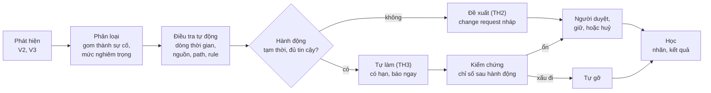

# 4.3 SOC tự hành

> **Trạng thái: đề xuất của Claude, chờ duyệt (2026-11-07).**

## Câu 1. "SOC tự hành" nghĩa là gì trong sản phẩm này?

Có hai SOC dùng sản phẩm:

- **SOC của khách**: người của khách xem event, xử lý chặn nhầm, phản ứng khi bị tấn công. Phần lớn khách nhỏ
  **không có** SOC; khách lớn có nhưng thiếu người.
- **SOC của NCC**: theo dõi toàn fleet, bật mitigation thay khách (đã quyết ở 3.3), phát hành rule khẩn.

Tự hành nghĩa là hệ thống tự làm phần lớn vòng **phát hiện → phân loại → điều tra → quyết định → hành động →
kiểm chứng → học**, để con người chỉ duyệt những việc có hậu quả lâu dài và xử lý ngoại lệ.

## Câu 2. Tự hành tới mức nào?

Đề xuất 5 mức, giống cách phân mức xe tự lái. Mỗi loại việc có mức riêng, không phải cả hệ thống một mức.

| Mức | Tên | Hệ thống làm | Con người làm |
|---|---|---|---|
| TH0 | Thủ công | Ghi log | Mọi việc |
| TH1 | Hỗ trợ | Cảnh báo, gom cảnh báo thành sự cố, gom bằng chứng | Điều tra, quyết định, hành động |
| TH2 | Đề xuất | Như TH1, cộng đề xuất hành động kèm lý do và mức tin cậy | Bấm chấp nhận hoặc từ chối |
| TH3 | Tự hành có giám sát | Tự làm hành động **tạm thời, có hạn**, báo ngay, tự gỡ khi có dấu hiệu sai | Xem lại, giữ hoặc huỷ; duyệt thay đổi lâu dài |
| TH4 | Tự hành hoàn toàn | Tự làm cả thay đổi lâu dài | Kiểm tra định kỳ |

| Loại việc | Mức đề xuất | Lý do |
|---|---|---|
| Giảm thiểu DDoS L7 | TH3 (đã có trong thiết kế) | Phải nhanh hơn con người |
| Bật Under Attack mode, rule tạm khi tấn công rõ ràng | TH3, hết hạn tối đa theo BR-6 | NCC đã được phép bật (3.3) |
| Cách ly zone sang cell riêng | TH3 | Bảo vệ khách khác |
| Gom cảnh báo thành sự cố, mở case | TH3 | Không có rủi ro cho traffic |
| Tinh chỉnh rule, whitelist vì chặn nhầm | **TH2** | Đã quyết: đi qua change request (3.4) |
| Nhận bản ruleset mới | TH3 theo đề xuất OQ-36 (log-only 7 ngày rồi tự chặn) | |
| Thay đổi policy lâu dài khác | TH2 | UI là nguồn sự thật, cần người duyệt (3.2) |
| TH4 | Không làm ở MVP và MR | Xem OQ-135 |

## Câu 3. Hàng rào an toàn cho mức TH3 là gì?

| # | Hàng rào | Ví dụ |
|---|---|---|
| HR1 | **Có hạn**: mọi hành động tự động có ngày hết hạn | Rule tạm tự gỡ sau 2 giờ trừ khi người giữ lại |
| HR2 | **Tự gỡ khi có dấu hiệu sai**: theo dõi chỉ số ngay sau hành động, xấu đi thì tự gỡ | Tỉ lệ người thật bị challenge tăng, đơn hàng ở origin giảm, lỗi 4xx của người đã đăng nhập tăng |
| HR3 | **Giới hạn phạm vi**: một hành động chỉ chạm một zone; hành động nhiều zone cần người | Không tự bật Under Attack cho cả org |
| HR4 | **Ngân sách**: số hành động tự động mỗi zone mỗi ngày có trần | Hệ thống không tự bật tắt liên tục |
| HR5 | **Giải thích**: mọi hành động có lý do, bằng chứng, mức tin cậy, hiện trên portal | |
| HR6 | **Công tắc**: khách tắt tự hành theo zone; NCC tắt theo fleet | |
| HR7 | **Audit**: hành động tự động ghi audit như một người dùng hệ thống riêng | Phân biệt được người làm và máy làm |
| HR8 | **Không vượt quyền**: tự hành chỉ dùng hành động mà gói và cấu hình của khách cho phép | |

## Câu 4. Một sự cố đi qua SOC tự hành thế nào?

Con người nhận được **một sự cố** đã có dòng thời gian, bằng chứng, hành động đã làm và đề xuất tiếp theo, thay
vì hàng trăm cảnh báo rời rạc.

## Câu 5. Đo SOC tự hành bằng gì?

| Chỉ số | Ý nghĩa | Mục tiêu đề xuất |
|---|---|---|
| Thời gian phát hiện (MTTD) | Từ lúc tấn công bắt đầu tới lúc có sự cố | ≤ 1 phút với DDoS, ≤ 10 phút với tấn công ứng dụng |
| Thời gian giảm thiểu (MTTM) | Tới lúc có hành động đầu tiên | ≤ 2 phút ở TH3 |
| Tỉ lệ sự cố xử lý không cần người | | Theo dõi, tăng dần |
| Tỉ lệ hành động tự động bị gỡ vì sai | | ≤ 5%; vượt thì hạ mức tự hành của loại việc đó |
| Số cảnh báo trên một sự cố | Đo khả năng gom | Càng cao càng tốt |
| Thời gian con người bỏ ra cho mỗi sự cố | | Giảm dần |

## Câu 6. Con người còn làm gì?

| Ai | Làm gì |
|---|---|
| Khách | Duyệt thay đổi lâu dài; gắn nhãn chặn nhầm; đặt mức tự hành cho zone của mình |
| SOC của NCC | Giám sát hành động tự động trên toàn fleet; xử lý sự cố mà hệ thống không đủ tin cậy; xử lý khách không có SOC |
| Threat research | Duyệt rule khẩn, mô hình mới; xem các chiến dịch mới hệ thống gom ra |

Với đội nhỏ chưa trực 24/7 (OQ-122), TH3 là cách để vẫn có phản ứng ngoài giờ mà không cần người thức.

## Câu hỏi cần chủ dự án quyết

| ID | Câu hỏi | Đề xuất |
|---|---|---|
| OQ-135 | Có cho khách bật TH4 (hệ thống tự đổi policy lâu dài) không? | Không ở MVP và MR; xem lại khi tỉ lệ hành động bị gỡ ổn định dưới 1% |
| OQ-136 | Mức tự hành mặc định cho khách không cấu hình gì | TH3 cho DDoS và tấn công rõ ràng, TH2 cho phần còn lại |
| OQ-137 | SOC tự hành có là tính năng bán riêng (dịch vụ SOC được quản lý) không? | Có, dịch vụ cho khách không có SOC, đi kèm SOC của NCC |
