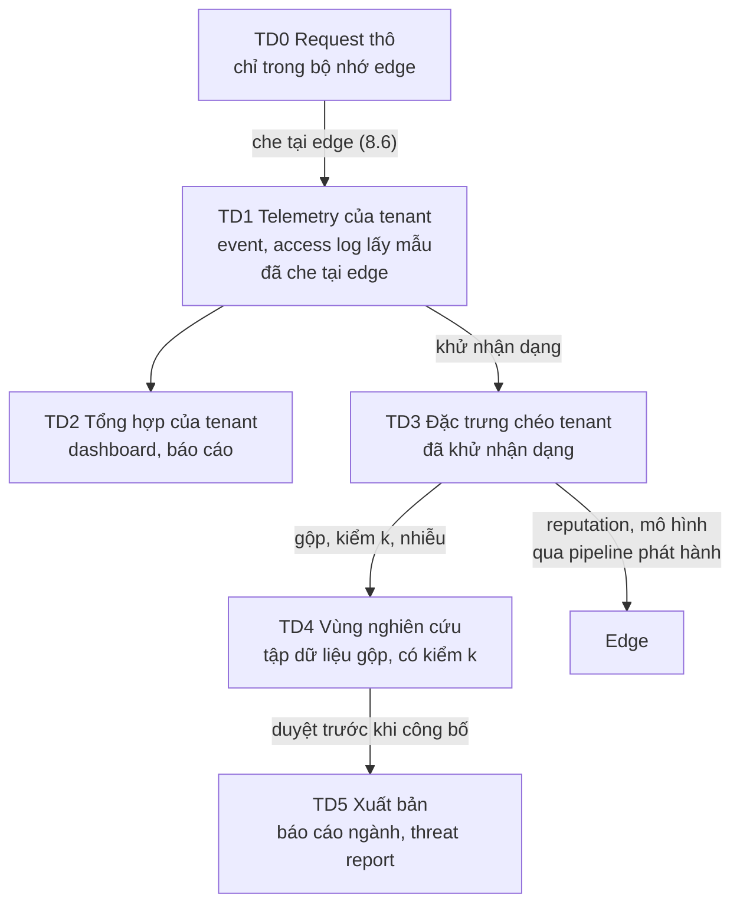

# 4.4 Chiến lược dữ liệu: luồng dữ liệu và dùng cho phân tích chuyên sâu

> **Trạng thái: đề xuất của Claude, chờ duyệt (2026-11-07).** Có nhiều điểm pháp lý; cần tư vấn luật về Nghị
> định 13/2023 về bảo vệ dữ liệu cá nhân trước khi chốt.

## Câu 1. Dữ liệu request của khách có giá trị gì ngoài log và cảnh báo?

Rất lớn, và là lợi thế mà chỉ một nền tảng nhiều khách mới có. Cùng một IP tấn công 50 khách thì nền tảng thấy
cả 50; từng khách chỉ thấy một.

| # | Mục đích | Ai được lợi | Mức nhạy |
|---|---|---|---|
| U1 | Bảo vệ chính khách đó (log, cảnh báo, điều tra) | Khách | Dữ liệu của khách, đúng mục đích |
| U2 | **Bảo vệ chung**: reputation IP, ASN, dấu vân tay, chữ ký tấn công mới từ toàn fleet | Mọi khách | Thấp nếu chỉ gộp đặc trưng tấn công |
| U3 | **Huấn luyện mô hình**: bot, bất thường, chặn nhầm ([4.2](02-ai-ml.md)) | Mọi khách | Trung bình |
| U4 | **Threat research**: chiến dịch mới, CVE đang bị khai thác, xu hướng tấn công theo ngành | NCC, mọi khách | Trung bình |
| U5 | **Báo cáo ngành**: so sánh khách với trung bình ngành (benchmark), báo cáo xu hướng công khai | Khách, marketing của NCC | Thấp nếu gộp đủ lớn |
| U6 | **Phân tích sản phẩm**: tính năng nào được dùng, rule nào hiệu quả, chi phí phục vụ theo gói | NCC | Thấp |
| U7 | **Dữ liệu kinh doanh của khách**: lượng truy cập, sản phẩm được xem nhiều, hành vi người dùng của một website cụ thể | Bên thứ ba | **Rất cao** |

**Đề xuất:** làm U1–U6. **Không làm U7**: không bán, không chia sẻ, không tự khai thác thông tin kinh doanh của một
khách cụ thể. Một nhà cung cấp bảo mật bị phát hiện dùng traffic của khách để làm việc khác là mất cả thị trường;
niềm tin có giá trị hơn mọi khoản thu từ dữ liệu.

## Câu 2. Dữ liệu đi qua những tầng nào?

Mỗi tầng có chủ, retention, người được truy cập riêng. Dữ liệu chỉ đi **lên** tầng trên qua một bước khử nhận
dạng, không bao giờ đi lên nguyên vẹn.

| Tầng | Chứa | Chủ, mục đích | Ai truy cập | Retention |
|---|---|---|---|---|
| **TD0** | Request đầy đủ | Edge, chỉ để xử lý | Không ai | Không lưu |
| **TD1** | Security event, access log lấy mẫu, mẫu request (gói cao) | Của khách (U1) | Khách; support khi được cấp quyền (BR-20) | Theo gói |
| **TD2** | Bảng tổng hợp theo zone | Của khách (U1) | Khách | Theo gói |
| **TD3** | Đặc trưng tấn công và hành vi đã khử nhận dạng: IP đã cắt hoặc băm khoá xoay, ASN, dấu vân tay đã băm, mẫu path đã bỏ ID, rule ID, kết quả, nhãn | NCC, cho U2, U3, U4 | Pipeline tự động; threat research, ML | 13 tháng |
| **TD4** | Tập dữ liệu gộp cho phân tích: số đếm theo ngành, quốc gia, loại tấn công, thời gian; nhóm nhỏ hơn ngưỡng k bị bỏ | NCC, cho U4, U5, U6 | Data analyst sau khi được duyệt | Theo dự án |
| **TD5** | Báo cáo đã duyệt | Công khai hoặc cho khách | Mọi người | Vĩnh viễn |

## Câu 3. Lọc dữ liệu nhạy cảm thế nào cho chắc?

Nhiều lớp, lớp sau không tin lớp trước:

| Lớp | Ở đâu | Làm gì |
|---|---|---|
| LC1 Che tại edge | Edge, trước khi log rời node (8.6) | Bỏ `Authorization`, cookie, trường mật khẩu, trường khách khai báo. Đã có trong thiết kế |
| LC2 Nhận diện theo mẫu | Edge hoặc enricher | Phát hiện và che: email, số điện thoại Việt Nam, số CCCD 12 số, số thẻ (kiểm Luhn), số tài khoản ngân hàng, JWT, khoá API theo tiền tố phổ biến |
| LC3 Phân loại trường | Schema telemetry | Mỗi trường có nhãn: `public`, `tenant_confidential`, `personal`, `secret`. Pipeline lên TD3 chỉ nhận trường được phép theo nhãn |
| LC4 Khử nhận dạng khi lên TD3 | Pipeline TD1 → TD3 | IP cắt về /24 (IPv4), /48 (IPv6), hoặc băm với khoá xoay hằng tháng; bỏ query string, chỉ giữ tên tham số; path về mẫu (`/users/{id}`); bỏ body, chỉ giữ đoạn khớp rule tấn công sau khi qua LC2; bỏ tenant ID, chỉ giữ ngành và quy mô |
| LC5 Gộp và kiểm k khi lên TD4 | Pipeline TD3 → TD4 | Mỗi ô số liệu phải có ít nhất k tenant khác nhau (đề xuất k = 10) và ít nhất n IP khác nhau; ô nhỏ hơn bị bỏ hoặc gộp; số công bố có thể thêm nhiễu (differential privacy) |
| LC6 Duyệt trước khi công bố | TD4 → TD5 | Người duyệt kiểm không có tenant nào nhận ra được qua báo cáo |
| LC7 Kiểm tra định kỳ | Toàn bộ | Quét TD3, TD4 tìm mẫu dữ liệu cá nhân lọt qua; có lọt thì dừng pipeline |

**Lưu ý:** IP của người dùng cuối là dữ liệu cá nhân theo cách hiểu phổ biến. Dùng IP tấn công cho reputation
(U2) có lý do rõ (bảo vệ an ninh mạng), nhưng vẫn phải ghi trong điều khoản và trong hồ sơ đánh giá tác động
xử lý dữ liệu cá nhân theo Nghị định 13.

## Câu 4. Cơ sở pháp lý và hợp đồng là gì?

| Việc | Đề xuất |
|---|---|
| Vai trò | Với dữ liệu ở TD1, TD2: khách là bên kiểm soát dữ liệu, NCC là bên xử lý. Với TD3 trở lên: NCC dùng cho mục đích riêng, phải ghi rõ trong điều khoản |
| Điều khoản dịch vụ | Liệt kê U2–U6, cam kết không làm U7, mô tả khử nhận dạng |
| Tuỳ chọn của khách | Enterprise được chọn không đóng góp dữ liệu vào TD3 (vẫn nhận reputation chung) |
| Hồ sơ đánh giá tác động | Lập theo Nghị định 13 trước khi chạy pipeline TD3 |
| Chuyển dữ liệu ra nước ngoài | TD3, TD4 giữ trong nước; nếu có nhu cầu ra nước ngoài thì làm hồ sơ riêng |
| Sổ mục đích | Mỗi tập dữ liệu ở TD4 có mục đích, người chịu trách nhiệm, thời hạn; hết mục đích thì xoá |

## Câu 5. Data analyst làm việc thế nào?

| Việc | Đề xuất |
|---|---|
| Nơi làm việc | Một vùng nghiên cứu tách khỏi hệ thống sản xuất: kho dữ liệu riêng (ClickHouse hoặc Parquet trên object storage) chỉ chứa TD3, TD4; không có đường vào TD1 |
| Xin dữ liệu | Analyst mô tả câu hỏi; tập dữ liệu TD4 được sinh theo yêu cầu, qua LC5, có người duyệt |
| Công cụ | Notebook, SQL trên vùng nghiên cứu; không tải dữ liệu về máy cá nhân |
| Kết quả | Mọi số liệu ra ngoài vùng nghiên cứu qua LC6 |
| Audit | Ghi ai truy vấn gì, khi nào |
| Ví dụ câu hỏi hợp lệ | Ngành nào bị credential stuffing nhiều nhất quý này; CVE nào bị khai thác ở Việt Nam sớm nhất sau khi công bố; tỉ lệ bot trên website thương mại điện tử theo giờ; rule nào chặn nhầm nhiều nhất ở WordPress |
| Ví dụ câu hỏi không hợp lệ | Website X có bao nhiêu người dùng; khách hàng của website X đến từ đâu; so sánh doanh thu ước tính giữa hai khách |

## Câu 6. Sản phẩm dữ liệu nào nên làm trước?

| Thứ tự | Sản phẩm | Dùng tầng | Lý do |
|---|---|---|---|
| 1 | Reputation chéo tenant cho edge (U2) | TD3 | Cải thiện bảo vệ ngay, ít rủi ro |
| 2 | Tập huấn luyện mô hình bot, chặn nhầm (U3) | TD3 | Điều kiện cho [4.2](02-ai-ml.md) |
| 3 | Benchmark cho khách trên portal: "zone của bạn bị tấn công nhiều hơn 80% website cùng ngành" (U5) | TD4 | Khách thấy giá trị, giúp bán gói cao |
| 4 | Báo cáo xu hướng tấn công hằng quý công khai (U4, U5) | TD5 | Marketing, uy tín |
| 5 | Chia sẻ chỉ dấu tấn công với CERT (U4) | TD3 | OQ-121 |

## Câu hỏi cần chủ dự án quyết

| ID | Câu hỏi | Đề xuất |
|---|---|---|
| OQ-138 | Dữ liệu chéo tenant dùng tới đâu: U2–U6? Có cam kết công khai không làm U7 không? | U2–U6; cam kết công khai không làm U7 |
| OQ-139 | Enterprise có được từ chối đóng góp vào TD3 không? | Có |
| OQ-140 | Ngưỡng k và cách khử nhận dạng IP (cắt hay băm khoá xoay) | k = 10; cắt /24, /48 cho TD4; băm khoá xoay cho TD3 |
| OQ-141 | Có làm vùng nghiên cứu và vị trí data analyst từ MVP không? | Từ MR; MVP chỉ làm U2 (reputation) |
| OQ-142 | Có xuất bản báo cáo xu hướng tấn công công khai không? | Có, hằng quý, từ khi đủ dữ liệu |
